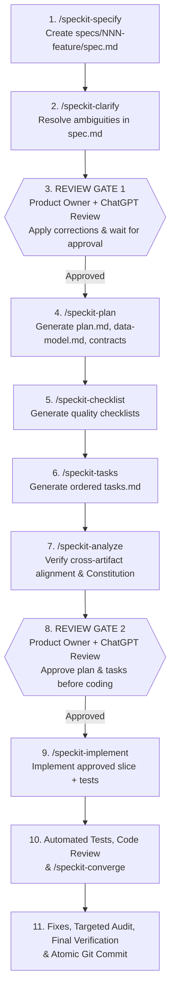

# WalimApp — AI-Assisted & Spec-Driven Development Workflow

- **Status:** Baseline v1.1 (Phase 0 Post-Audit Consolidated)
- **Last Updated:** 2026-10-29
- **Tooling Integration:** GitHub Spec Kit (`specify-cli` v1.2.5) integrated with Google Antigravity (`--integration agy`, PowerShell scripts).
- **Related Documents:** [Project Constitution](../.specify/memory/constitution.md), [AGENTS.md](../AGENTS.md), [Roadmap](./roadmap.md), [Decision Register](./decision-register.md).

---

## 1. Core Operating Philosophy

WalimApp is built by a **solo developer paired with AI coding agents** (Google Antigravity) and an **independent review loop** (Product Owner + ChatGPT review).

To prevent architectural drift, context overload, or untested code generation:
1. **Work Feature Slice by Feature Slice:** We never specify or implement an entire product phase in one giant prompt. Each candidate sprint or feature slice in [`docs/roadmap.md`](./roadmap.md) gets its own dedicated Spec Kit feature directory (`specs/<NNN-feature-name>/`).
2. **Slice-Scoped Decision Resolution:** Before starting `/speckit-specify` for a sprint slice, check [`docs/decision-register.md`](./decision-register.md) and ensure any `DEC-*` decision whose **Resolution Gate** applies to that slice has been settled by the Product Owner. Unresolved decisions for later slices do not block earlier foundation work.
3. **Two Mandatory Human Review Gates per Feature:** The AI agent **must stop** after specification/clarification (**Gate 1**) and again after planning/tasks/analysis (**Gate 2**) so the Product Owner can review the Markdown artifacts (optionally with ChatGPT), request corrections, and grant explicit approval before any code is written.
4. **Never Auto-Advance into Implementation:** Generating a Markdown artifact (`spec.md`, `plan.md`, `tasks.md`) is **never** permission to begin coding.

---

## 2. Installed Spec Kit Skills in Antigravity (`agy`)

Spec Kit (`v1.2.5`) is initialized in this repository under [`.specify/`](../.specify/) and exposes the following skills in [`.agents/skills/`](../.agents/skills/):

| Command / Skill | Antigravity Skill Path | Purpose |
| :--- | :--- | :--- |
| **`/speckit-constitution`** | [`.agents/skills/speckit-constitution/SKILL.md`](../.agents/skills/speckit-constitution/SKILL.md) | Create or amend the project governance principles in [`.specify/memory/constitution.md`](../.specify/memory/constitution.md). |
| **`/speckit-specify`** | [`.agents/skills/speckit-specify/SKILL.md`](../.agents/skills/speckit-specify/SKILL.md) | Create a structured feature specification (`specs/<NNN-slug>/spec.md`) focused on *what* and *why*. |
| **`/speckit-clarify`** | [`.agents/skills/speckit-clarify/SKILL.md`](../.agents/skills/speckit-clarify/SKILL.md) | Identify underspecified areas in `spec.md`, ask structured questions, and record answers directly in `spec.md`. |
| **`/speckit-plan`** | [`.agents/skills/speckit-plan/SKILL.md`](../.agents/skills/speckit-plan/SKILL.md) | Generate the technical implementation plan (`plan.md`, `data-model.md`, `contracts/`) aligned with [`docs/architecture.md`](./architecture.md) and the Constitution. |
| **`/speckit-checklist`** | [`.agents/skills/speckit-checklist/SKILL.md`](../.agents/skills/speckit-checklist/SKILL.md) | Generate domain-specific quality and requirement completeness checklists (`checklists/`). |
| **`/speckit-tasks`** | [`.agents/skills/speckit-tasks/SKILL.md`](../.agents/skills/speckit-tasks/SKILL.md) | Break `plan.md` into dependency-ordered, testable implementation tasks (`tasks.md`). |
| **`/speckit-analyze`** | [`.agents/skills/speckit-analyze/SKILL.md`](../.agents/skills/speckit-analyze/SKILL.md) | Non-destructive cross-artifact consistency and coverage audit across `spec.md`, `plan.md`, `tasks.md`, and `constitution.md`. |
| **`/speckit-implement`** | [`.agents/skills/speckit-implement/SKILL.md`](../.agents/skills/speckit-implement/SKILL.md) | Execute an approved slice of `tasks.md`, writing tests and implementation code. |
| **`/speckit-converge`** | [`.agents/skills/speckit-converge/SKILL.md`](../.agents/skills/speckit-converge/SKILL.md) | Audit the implemented codebase against `spec.md`, `plan.md`, and `tasks.md`, appending any remaining gap tasks. |
| **`/speckit-taskstoissues`** | [`.agents/skills/speckit-taskstoissues/SKILL.md`](../.agents/skills/speckit-taskstoissues/SKILL.md) | Optional utility to export approved `tasks.md` items to GitHub Issues. |

---

## 3. The 11-Step Feature Lifecycle

Every feature or sprint slice follows this exact 11-step sequence:

### Detailed Step Rules

1. **Step 1 — `/speckit-specify`:**
   - Check [`docs/decision-register.md`](./decision-register.md) to ensure any blocking decisions for the current sprint slice are settled (or confirm use of their recommended defaults).
   - Generate `specs/<NNN-feature>/spec.md` referencing the `REQ-*` IDs from [`docs/product-requirements.md`](./product-requirements.md).
2. **Step 2 — `/speckit-clarify`:**
   - Run `/speckit-clarify` to surface edge cases (e.g., overnight slots crossing midnight, RTL layout behavior, offline conflict states, Android vs. Windows adapter behavior).
3. **Step 3 — Product Owner Review Gate 1 (STOP):**
   - **Agent MUST STOP** and present `spec.md` to the Product Owner.
   - The Product Owner reviews `spec.md` (with ChatGPT if desired). The agent applies requested revisions and waits for explicit approval before running `/speckit-plan`.
4. **Step 4 — `/speckit-plan`:**
   - Produce `plan.md` adhering strictly to [`docs/architecture.md`](./architecture.md) and [`.specify/memory/constitution.md`](../.specify/memory/constitution.md).
   - Explicitly note shared Android/Windows components vs. any thin platform adapter touches.
5. **Step 5 — `/speckit-checklist`:**
   - Generate requirement verification checklists (e.g., data safety, RTL/LTR localization, offline behavior, security/tenant isolation).
6. **Step 6 — `/speckit-tasks`:**
   - Produce `tasks.md` broken into small, verifiable tasks with explicit file paths and test tasks.
7. **Step 7 — `/speckit-analyze`:**
   - Run `/speckit-analyze` to verify zero contradictions between `spec.md`, `plan.md`, `tasks.md`, and `constitution.md`. Fix any discrepancies immediately.
8. **Step 8 — Product Owner Review Gate 2 (STOP):**
   - **Agent MUST STOP** and present the completed planning artifacts (`plan.md`, `checklists/`, `tasks.md`, and analysis report).
   - Do **not** run `/speckit-implement` or create application code until the Product Owner explicitly approves.
9. **Step 9 — `/speckit-implement` (Scoped Execution):**
   - Execute only the approved feature or task slice.
   - Follow Test-First / TDD discipline for domain invariants (slot overlaps, unconditional `payments` immutability, sync idempotency, `outbox_seq` ordering, license verification).
10. **Step 10 — Automated Tests, Code Review & `/speckit-converge`:**
    - Run static analysis (`flutter analyze` / `dart analyze` for `apps/owner`; `phpstan` / `pint` for `backend`) and automated test suites (`flutter test`; `php artisan test`).
    - Run `/speckit-converge` to confirm every requirement in `spec.md` and task in `tasks.md` is actually implemented and tested.
11. **Step 11 — Fixes, Audit, Final Verification & Git Commit:**
    - If a security, financial-integrity, or sync-conflict audit is warranted, follow the **Pause-and-Audit Protocol** below.
    - Once all tests and checks pass, commit the completed slice to Git with a clear conventional commit message and push to the private `origin` repository.

---

## 4. Pause-and-Audit Protocol

Whenever the Product Owner requests an audit—or when the agent detects a contradiction, security flaw, or data-loss risk during implementation:

1. **Pause Workflow Immediately:** Stop feature implementation or task progression.
2. **Write Down Audit Findings:** Document the exact issue, affected files/requirements, root cause, and recommended options in a reviewable Markdown report (and update [`docs/decision-register.md`](./decision-register.md) if an architectural decision is affected).
3. **Wait for Review:** Present the findings to the Product Owner for review (with ChatGPT as needed).
4. **Apply Approved Corrections & Resume:** Only after the Product Owner approves the remediation plan does the agent apply the fix and resume the Spec Kit workflow.

---

## 5. Testing & Verification Standards

| Layer | Required Verification Commands | Mandatory Invariants Tested |
| :--- | :--- | :--- |
| **Flutter Client (`apps/owner`) & Issuer CLI (`tools/license-issuer`)** | `flutter analyze` & `flutter test` | Slot overlap detection (`[starts_at_local, ends_at_local)` including overnight), SQLite `payments` unconditional immutability trigger (rejecting updates on **all** columns), integer whole-Dinar `MoneyDzd` (`*_dzd BIGINT`), `sync_outbox` monotonic `outbox_seq` & dependency blocking, WAL-safe `VACUUM INTO` `.walimbak` integrity check & independent DEK encryption, Ed25519 `.walimlic` perpetual verification & CLI signing, `ar-DZ`/`fr-DZ` Western numerals (`0-9`), adaptive `<600dp` vs `>=600dp` widget tests, and `p95 < 100ms` benchmark. |
| **Laravel Backend (`backend` — Phase 2+)** | `./vendor/bin/pint --test`, `./vendor/bin/phpstan analyse`, `php artisan test` | PostgreSQL `btree_gist` double-booking exclusion under concurrency, `booking_requests` vs `reservations` separation, atomic request approval, `sync_processed_operations` idempotency, `venue_sync_state.last_seq` `FOR UPDATE` commit serialization, `permissions_hash` cursor reset on role change, `is_financial_masked` safety, staged migration dry-run (including `contract_templates` and `generated_documents` SHA-256 verification), 69-Wilaya seeding. |

---

## 6. Git, Branching & Security Hygiene

- **Repository Visibility:** The GitHub repository (`zBensadi/walimapp`) MUST remain **strictly private** at all times.
- **Branch Strategy:**
  - `main` holds reviewed, passing milestones and approved baseline documentation.
  - Each Spec Kit feature (`NNN-feature-name`) is developed on its feature branch (`NNN-feature-name`) or atomic commits reviewed at Gates 1, 2, and Step 11.
- **Commit Hygiene:**
  - Use Conventional Commits (`docs:`, `feat(local):`, `feat(connect):`, `feat(marketplace):`, `fix:`, `test:`, `chore:`).
  - Never commit `.env` files, Ed25519 private signing keys (`*.pem`, `*.key`), real customer SQLite databases (`*.db`, `*.sqlite`, `*.walimbak`), or API tokens.
  - Always check `git status` and `git diff --staged` before committing.
