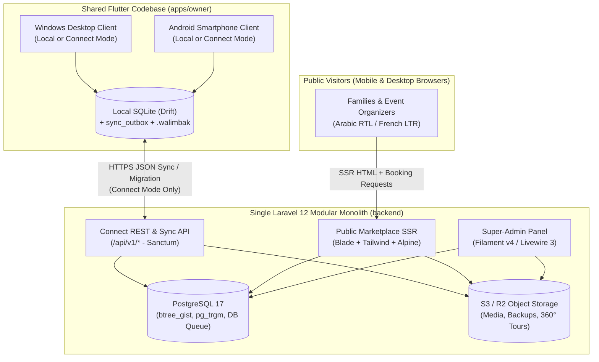
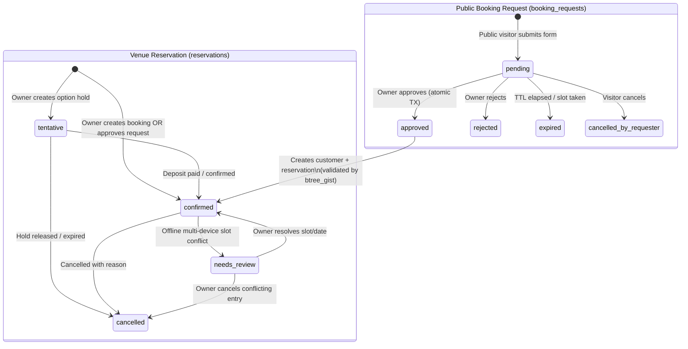

# WalimApp — Consolidated Architecture Baseline

- **Status:** Canonical Baseline v1.0 (Phase 0)
- **Last Updated:** 2026-10-29
- **Supersedes:** Historical drafts under `reference/architecture-drafts/`
- **Related Documents:** [Product Requirements](file:///c:/proj/walimapp/docs/product-requirements.md), [Architecture Review](file:///c:/proj/walimapp/docs/architecture-review.md), [Decision Register](file:///c:/proj/walimapp/docs/decision-register.md), [Project Constitution](file:///c:/proj/walimapp/.specify/memory/constitution.md).

---

## 1. System Context & Architectural Principles

WalimApp is designed as a **two-codebase system** maintainable by a solo developer:

1. **`apps/owner` (Shared Flutter Client):** A single offline-first Flutter application compiled for **Android smartphones (`API 24+`)** and **Windows desktops (`x64`)**, backed by local **Drift / SQLite**. It powers both **WalimApp Local** (100% offline perpetual license) and **WalimApp Connect** (multi-user, multi-device cloud synchronization).
2. **`backend` (Central Modular Monolith):** A single **Laravel 12** application backed by **PostgreSQL 17**, serving three surfaces from one deployment:
   - **Connect Sync & REST API (`/api/v1/*`):** Token-authenticated endpoints for multi-device synchronization, Local-to-Connect migration, licensing, and push notifications.
   - **Public Marketplace (`/` in `ar-DZ` and `fr-DZ`):** Server-side-rendered (SSR) **Laravel Blade + Tailwind CSS + Alpine.js** pages for SEO venue discovery across all **69 Algerian Wilayas**, availability viewing, and online booking requests.
   - **Super-Admin Back-Office (`/admin`):** **Filament v4** administrative panel for organizations, licenses, subscriptions, moderation, providers, advertising, and audit logs.



---

## 2. Validated Technology Stack

| Layer | Technology | Version Baseline | Rationale |
| :--- | :--- | :--- | :--- |
| **Owner Client UI & Logic** | Flutter + Dart | Flutter 3.27+ (stable), Dart 3.6+ | Single codebase for Android (`API 24+`) and Windows (`x64`) with native RTL/LTR support. |
| **Client State & Routing** | `flutter_riverpod`, `go_router` | Riverpod 2.6+, GoRouter 14+ | Compile-safe dependency injection and reactive stream binding to Drift SQLite queries. |
| **Client Local Database** | SQLite via `drift` + `sqlite3_flutter_libs` | Drift 2.22+, SQLite 3.46+ (WAL mode) | Type-safe SQL/Dart queries, migrations, and transactional outbox on both Android and Windows. |
| **Client PDF & Crypto** | `pdf`, `printing`, `cryptography` | Latest compatible | 100% offline Arabic/French PDF generation, Ed25519 license verification, and AES-256-GCM `.walimbak` backups. |
| **Central Backend** | PHP + Laravel | PHP 8.4, Laravel 12.x | Mature modular monolith with built-in authentication (`Sanctum`), queues, scheduler, and localization. |
| **Central Database** | PostgreSQL | PostgreSQL 17 (`btree_gist`, `pg_trgm`) | `btree_gist` enforces zero double-bookings at the engine level; `pg_trgm` handles bilingual search; native DB queues/locks avoid mandatory Redis. |
| **Super-Admin Panel** | Filament | Filament v4.x (Livewire 3.x) | Compatible with Laravel 12; provides rapid CRUD, actions, and audit widgets without maintaining a separate SPA. |
| **Public Marketplace** | Laravel Blade + Tailwind CSS + Alpine.js | Tailwind 3.4/4.x, Alpine 3.x | True server-side rendering (SSR) for Google indexing in Arabic/French without a separate Node.js runtime. |
| **Primary Keys** | Client/App-Generated UUIDv7 | RFC 9562 (`uuid` in Dart, `Ramsey\Uuid` in PHP) | Time-ordered UUIDs generated offline on devices without ID collisions or PostgreSQL 18 server-only dependency. |

---

## 3. Repository & Module Structure

```text
walimapp/
├── .agents/skills/              # Spec Kit Antigravity (agy) skills
├── .specify/                    # Spec Kit constitution, templates, and scripts
├── docs/                        # Canonical project documentation
├── reference/                   # Preserved historical architecture drafts (read-only)
├── apps/
│   └── owner/                   # Shared Flutter app (Android + Windows)
│       └── lib/
│           ├── core/            # Theme, l10n (ar-DZ/fr-DZ), MoneyDzd, UUIDv7, errors
│           ├── database/        # Drift tables, DAOs, migrations, SQLite WAL setup
│           ├── platform/        # Thin Android vs Windows adapter implementations
│           ├── features/
│           │   ├── calendar/    # Month/week/day/agenda views & slot availability
│           │   ├── reservations/# Reservation lifecycle, pricing, service items
│           │   ├── booking_requests/ # Connect online request inbox & approval UI
│           │   ├── customers/   # Customer directory & history
│           │   ├── finance/     # Append-only payments, installments, expenses, reports
│           │   ├── documents/   # Offline Arabic/French PDF contracts & receipts
│           │   ├── sync/        # Outbox worker, delta pull, conflict resolution UI
│           │   ├── migration/   # Staged Local-to-Connect migration wizard
│           │   ├── licensing/   # Ed25519 .walimlic verifier & Connect entitlement state
│           │   └── settings/    # Venue, halls, configurable slots, users, .walimbak backups
│           └── shared/          # Adaptive shell (NavigationBar vs NavigationRail), widgets
└── backend/                     # Laravel 12 Modular Monolith
    ├── app/Modules/
    │   ├── Identity/            # Users, Organizations, VenueMemberships, DeviceRegistrations
    │   ├── Reference/           # 69 Wilayas, Communes, Localization helpers
    │   ├── Venue/               # Venues, Halls, HallSlots, ServiceCatalogs
    │   ├── Booking/             # Reservations, BookingRequests, SlotOverlapValidator
    │   ├── Finance/             # Immutable Payments ledger, Expenses, Checksums
    │   ├── Sync/                # Outbox ingestion, SyncChangeLog, Conflict handlers
    │   ├── Migration/           # Staged upload chunks, validator, atomic promoter
    │   ├── Licensing/           # Ed25519 license signer, device transfers, Subscriptions
    │   ├── Marketplace/         # Public SSR controllers, SEO sitemaps, Providers, Ads
    │   └── Audit/               # Immutable AuditLog recorder
    ├── app/Filament/            # Super-Admin panel resources & actions
    └── resources/views/         # Bilingual SSR Blade templates (RTL/LTR)
```

---

## 4. Shared Android & Windows Client Architecture

### 4.1 What Is 100% Shared (~90% of `apps/owner`)
- All domain entities, value objects (`MoneyDzd`, `SlotWindow`, `WilayaCode`), and validation rules.
- All Drift/SQLite tables, indexes, DAOs, schema migrations, and local query streams.
- All application use cases (reservation creation, slot overlap check, payment recording, expense tracking, outbox queuing, delta sync, staged migration, and license verification).
- All localization files (`app_ar.arb`, `app_fr.arb`) and PDF contract/receipt templates.

### 4.2 Adaptive UI Layout Strategy
A single `AdaptiveShell` widget inspects `MediaQuery.sizeOf(context).width`:
- **Compact (`< 600dp` — Android Smartphones):**
  - Bottom `NavigationBar` (Calendar, Reservations, Requests/Customers, Finance, More).
  - Single-pane Agenda/Day/Month calendar with swipeable date navigation and bottom-sheet booking/payment forms.
  - Quick one-tap phone call (`tel:`) and WhatsApp (`https://wa.me/`) actions on customer and booking-request cards.
- **Medium / Expanded (`>= 600dp` / `>= 1024px` — Windows Desktop & Tablets):**
  - Left `NavigationRail` (collapsible to extended sidebar at `>= 1200px`).
  - Master-detail split views: multi-hall calendar grid on the left, selected reservation inspector and payment ledger drawer on the right.
  - Full keyboard navigation, shortcut bindings (`Ctrl+N` new reservation, `Ctrl+F` search, `Ctrl+P` print), and hover tooltips.

### 4.3 Platform-Specific Adapters (`lib/platform/`)

| Adapter Interface | Windows Implementation | Android Implementation |
| :--- | :--- | :--- |
| **`DeviceIdentityProvider`** | Reads Windows `MachineGuid` + CPU/Motherboard SMBIOS UUID + BIOS Serial via Win32/WMI and hashes with SHA-256. | Reads `Settings.Secure.ANDROID_ID` (app-signing-key scoped on Android 8+) combined with an Android Keystore hardware-backed keypair (`android_id + keystore_pubkey_sha256`). Does **not** request privileged IMEI/hardware serial permissions blocked on Android 10+. |
| **`SecureCredentialStore`** | Windows Credential Manager (`flutter_secure_storage`) storing SQLite backup key, license token, and Sanctum token. | Android Keystore (`EncryptedSharedPreferences`) + optional biometric/PIN unlock (`local_auth`). |
| **`BackupStorageAdapter`** | Native desktop file/folder picker (`file_picker`) supporting local folders and removable USB drives with rolling auto-backups. | Android Storage Access Framework (SAF) user-granted directory + native share sheet (`share_plus`) to export `.walimbak` archives to Google Drive/WhatsApp/local storage. |
| **`DocumentOutputAdapter`** | Direct OS print dialog (`printing`) and local file save. | Android Print Spooler (`printing`) and native share sheet to send PDF contracts/receipts directly to the customer's WhatsApp. |
| **`AppInstanceGuard`** | Named Windows mutex (`window_manager` / Win32 mutex) preventing multiple simultaneous desktop instances from opening the same SQLite file. | No-op (Android OS guarantees single process lifecycle per app task). |

---

## 5. Core Domain Model & Database Integrity

### 5.1 Algeria 69-Wilaya Reference Model
- **`wilayas`**: `code` (`VARCHAR(2)` primary/unique key `'01'`..`'69'`), `name_ar`, `name_fr`, `slug_ar`, `slug_fr`, `is_active`.
- **`communes`**: `id`, `wilaya_code` (FK -> `wilayas.code`), `code_ons`, `name_ar`, `name_fr`, `slug_ar`, `slug_fr`.
- Seeded from versioned JSON reference data covering all **69 official Algerian Wilayas** (including the 2019 and late-2025 administrative expansions). No application or database constraint restricts Wilaya codes to `<= 58`.

### 5.2 Tenant, Venue, Hall & Configurable Slot Hierarchy
- **`organizations`**: Top-level billing and ownership boundary (`id` UUIDv7, `name`, `plan_tier`, `subscription_status`, `subscription_expires_at`, `grace_ends_at`).
- **`venues`**: Physical wedding venue belonging to an `organization_id` (`id` UUIDv7, `organization_id`, `wilaya_code`, `commune_id`, `name_ar`, `name_fr`, `slug`, `phone`, `whatsapp`, `is_public_listed`, `migrated_from_local_at`).
- **`venue_memberships`**: Maps `user_id` to `organization_id` and `venue_id` (nullable = all venues in organization) with `role` (`owner`, `manager`, `receptionist`, `accountant`, `viewer`) and `is_active`.
- **`halls`**: Bookable space inside a venue (`id` UUIDv7, `venue_id`, `name_ar`, `name_fr`, `capacity_men`, `capacity_women`, `capacity_total`, `base_price_dzd`).
- **`hall_slots`**: Owner-configurable time windows per hall (`id` UUIDv7, `hall_id`, `code`, `label_ar`, `label_fr`, `start_time` `TIME`, `end_time` `TIME`, `spans_next_day` `BOOLEAN`, `default_price_dzd`).
  - *Overnight slot handling:* When `spans_next_day = false`, a booking on date `D` produces `starts_at_local = D + start_time` and `ends_at_local = D + end_time`. When `spans_next_day = true` (e.g., `19:00` to `02:00`), `ends_at_local = (D + 1 day) + end_time`.

### 5.3 Separation of `booking_requests` and `reservations`



1. **`booking_requests` (PostgreSQL + synced read/action projection in Connect):**
   - Stores public marketplace inquiries: `id` (UUIDv7), `organization_id`, `venue_id`, `hall_id`, `slot_id`, `event_date`, `starts_at_local`, `ends_at_local`, `requester_name`, `requester_phone`, `requester_whatsapp`, `guest_count`, `event_type`, `message`, `status` (`pending`, `approved`, `rejected`, `expired`, `cancelled_by_requester`), `resulting_reservation_id` (nullable FK), `privacy_consent_at`.
   - **Rule:** Rows in `booking_requests` **never** block a hall slot until approved.
2. **`reservations` (SQLite & PostgreSQL):**
   - Stores actual owner-managed bookings: `id` (UUIDv7), `organization_id`, `venue_id`, `hall_id`, `slot_id`, `customer_id`, `booking_reference`, `event_date`, `starts_at_local` (`TIMESTAMP`), `ends_at_local` (`TIMESTAMP`), `status` (`confirmed`, `tentative`, `cancelled`, `needs_review`), `base_price_dzd` (`BIGINT`), `services_total_dzd` (`BIGINT`), `discount_dzd` (`BIGINT`), `total_price_dzd` (`BIGINT`), `Cancellation fields`, `version` (`INT`), `created_by_user_id`, `created_by_device_id`, `deleted_at`.
   - **Client Sync Overlay (`has_pending_sync`):** The client does **not** overwrite `reservations.status` with `'pending_sync'`. Instead, SQLite views check `EXISTS (SELECT 1 FROM sync_outbox WHERE entity_type = 'reservation' AND entity_id = reservations.id AND status != 'acked')` to display a "Pending Sync" badge alongside the true domain status (`confirmed`, `tentative`, `cancelled`).
3. **PostgreSQL Double-Booking Exclusion Constraint:**
   ```sql
   CREATE EXTENSION IF NOT EXISTS btree_gist;

   ALTER TABLE reservations
   ADD CONSTRAINT reservations_no_overlapping_active_slots
   EXCLUDE USING gist (
       hall_id WITH =,
       tsrange(starts_at_local, ends_at_local, '[)') WITH &&
   )
   WHERE (status IN ('confirmed', 'tentative') AND deleted_at IS NULL);
   ```
   - In local SQLite (Drift), the equivalent overlap check `starts_at_local < :new_end AND ends_at_local > :new_start AND status IN ('confirmed', 'tentative') AND deleted_at IS NULL` is executed inside an `IMMEDIATE` SQLite transaction before insert/update.

### 5.4 Append-Only Financial Ledger (`payments` & `expenses`)
- **`payments`**: `id` (UUIDv7), `organization_id`, `venue_id`, `reservation_id`, `entry_type` (`deposit`, `installment`, `final_settlement`, `refund`, `adjustment`), `amount_dzd` (`BIGINT`, positive for inflows, negative for `refund` or negative `adjustment`), `payment_method` (`cash`, `ccp_baridimob`, `bank_transfer`, `check`, `cib_edahabia`), `paid_at`, `receipt_number`, `parent_payment_id` (nullable FK for refunds/adjustments), `reason` (mandatory when `entry_type IN ('refund', 'adjustment')`), `recorded_by_user_id`, `recorded_by_device_id`, `created_at`.
- **Database Enforcement:** A PostgreSQL `BEFORE UPDATE OR DELETE` trigger (and corresponding SQLite trigger) raises an exception if any code attempts to mutate `amount_dzd`, `reservation_id`, `entry_type`, or delete a row in `payments`.
- **Reservation Balance Calculation:** `amount_paid_dzd = COALESCE(SUM(payments.amount_dzd), 0)` for the reservation; `balance_due_dzd = total_price_dzd - amount_paid_dzd`.

---

## 6. Synchronization Architecture (WalimApp Connect)

### 6.1 Outbox Push (`POST /api/v1/sync/push`)
1. Every local create/update in Connect mode writes atomically to the local Drift domain table and inserts an ordered entry into `sync_outbox` (`operation_id` UUIDv7, `venue_id`, `entity_type`, `entity_id`, `op_type`, `base_version`, `payload_json`, `created_at`).
2. The background sync worker sends batches of up to 50 operations ordered by `created_at`.
3. For each operation, the server:
   - Checks `sync_processed_operations (operation_id, organization_id)`. If already present, returns the stored `result_json` immediately (100% idempotent on network retry).
   - Verifies the authenticated user's `venue_memberships` role for `venue_id` and `entity_type`.
   - Applies the mutation inside a savepoint and appends a monotonically increasing `seq` row to `sync_change_log`.
4. **Conflict Rules:**
   - **Reservation Slot Overlap (`SQLSTATE 23P01` on `reservations_no_overlapping_active_slots`):** If Device B pushes a booking for a slot already claimed by Device A, the server saves Device B's reservation with `status = 'needs_review'` (so the exclusion constraint is not violated and zero customer/payment data is lost), logs a `SLOT_CONFLICT` alert, and returns `outcome = 'flagged_needs_review'` to Device B.
   - **Non-Slot Field Edits (Customers, Notes, Venue Settings):** Optimistic concurrency check via `base_version`; field-level non-overlapping changes merge cleanly, while same-field collisions use server-timestamp LWW with the prior value recorded in `audit_logs`.
   - **Payments:** Strictly append-only (`op_type = 'insert'` only); union-merged by `id` and `operation_id`.

### 6.2 Cursor Delta Pull (`GET /api/v1/sync/pull?venue_id=...&after_seq=...`)
- Each client stores `last_pulled_seq` per `venue_id`.
- The server queries `sync_change_log WHERE venue_id = :venue_id AND seq > :after_seq ORDER BY seq ASC LIMIT 200`.
- **Role Filtering:** If the requesting user's role for that venue does not permit viewing financial records (e.g., `viewer`), `payment` and `expense` entities are omitted and price columns on `reservations` are masked before returning the delta payload.

---

## 7. Local-to-Connect Migration Pipeline

When a WalimApp Local owner upgrades to WalimApp Connect, migration executes in **4 non-destructive phases**:

1. **Phase M1 — Local Freeze & Pre-Migration Backup:**
   - The client generates a verified `.walimbak` snapshot on disk and enters a temporary read-only migration lock.
   - Local UUIDv7 primary keys are **preserved as-is** (never mutated in place).
2. **Phase M2 — Chunked Upload to Server Staging:**
   - Client initiates `POST /api/v1/migrations/sessions` with manifest counts and total financial checksums (`total_reservations_count`, `sum_total_price_dzd`, `sum_payments_amount_dzd`).
   - Client uploads entities in dependency order (`venue` -> `halls` -> `hall_slots` -> `customers` -> `reservations` -> `payments` -> `expenses`) in chunks of 100 records to `migration_staging_records`. Chunks are idempotent by `(migration_session_id, chunk_index)` and resumable after connection drop.
3. **Phase M3 — Server Dry-Run Validation & Atomic Promotion:**
   - `POST /api/v1/migrations/sessions/{id}/commit` validates inside a database transaction:
     1. Referential integrity across all staged entities.
     2. Financial checksum equality (`SUM(payments.amount_dzd)` matches client manifest).
     3. Any historical overlapping active reservations are flagged as `status = 'needs_review'` with a migration report item rather than aborting the entire venue's history.
   - All staged rows are inserted into the live PostgreSQL tables and initial `sync_change_log` entries are written in a single transaction, returning the initial `current_seq`.
4. **Phase M4 — Client Cutover:**
   - Only after receiving `200 OK` with `current_seq` does the client update its local venue mode to `connect` and set `last_pulled_seq = current_seq`. If anything fails before M4, the client unlocks Local mode with zero data modification.

---

## 8. Perpetual Licensing & Connect Subscription State Machine

### 8.1 WalimApp Local Perpetual License (`.walimlic`)
- A `.walimlic` file is a canonical JSON payload signed with WalimApp's offline **Ed25519 private key** (stored only in Super-Admin's secure KMS/signing Vault; the public key is compiled into the Flutter binary):
  ```json
  {
    "license_id": "01968000-0000-7000-8000-000000000001",
    "edition": "local_perpetual",
    "organization_name": "Salle El Bahia",
    "device_fingerprint_hash": "sha256:...",
    "platform": "windows|android",
    "issued_at": "2026-10-29T12:00:00Z",
    "updates_until": "2027-10-29T23:59:59Z",
    "max_venues": 1
  }
  ```
- **Maintenance Expiry Rule:** Each app binary embeds its `APP_BUILD_DATE`. As long as `APP_BUILD_DATE <= license.updates_until`, the build activates and runs **forever**. Even 10 years after `updates_until`, that installed version continues working with 100% functionality.
- **Hardware / Phone Change Grace:** If a Windows component changes or an owner replaces their Android phone, Super-Admin can issue a replacement `.walimlic` bound to the new device fingerprint (or approve a one-click online transfer).

### 8.2 WalimApp Connect Subscription Expiry
- Connect subscription states: `active` -> `past_due` (grace period, default 14 days `[OPEN -> DEC-09]`) -> `expired_local_fallback`.
- In `expired_local_fallback`:
  - Cloud sync push/pull and public marketplace `booking_requests` acceptance are paused.
  - All local SQLite data on the owner's Android and Windows devices remains **fully readable and writable offline**, including PDF printing and `.walimbak` backups.

---

## 9. Public Marketplace, Advertising & 360° Tours Readiness

- **SSR & SEO Architecture:** Public routes (`/ar/salles/{wilaya}/{slug}`, `/fr/salles/{wilaya}/{slug}`) are rendered by Laravel Blade with localized metadata, `hreflang`, and `EventVenue` JSON-LD.
- **Availability Cache:** Public availability calendars query a read-optimized projection of `(hall_id, slot_id, event_date, is_unavailable)` updated synchronously whenever a reservation status changes in PostgreSQL. Zero customer PII is ever exposed to the marketplace view layer.
- **Advertising Engine:** `ad_campaigns` and `ad_placements` tables support Wilaya-targeted and category-targeted featured slots (Phase 3 admin-managed; Phase 4 self-serve).
- **Phase 4 360° Virtual Tours Readiness:** The `venue_media` schema reserves `media_type = 'panorama_360'` pointing to static equirectangular/cubemap assets on S3/R2, rendered on the public page only when clicked via lazy-loaded `Pannellum` JS so initial page LCP stays `< 2.5s`.

---

## 10. Security, Algerian Privacy (Law 18-07 / 25-11) & Backups

1. **Authentication & Transport:** TLS 1.2/1.3 everywhere; Laravel Sanctum personal access tokens scoped per `device_id` with instant remote revocation from Super-Admin or owner settings when an employee leaves or a phone is lost.
2. **Algerian Law 18-07 & Law 25-11 Compliance:**
   - **Data Minimization:** Public `booking_requests` collect only name, phone/WhatsApp, event date/slot, guest count, and optional note. Customer national ID numbers (NIN/CNI) are optional fields used strictly for formal rental contracts inside the venue's private database.
   - **Explicit Consent:** Public booking request forms require an explicit Arabic/French consent checkbox recording `privacy_consent_at` and policy version.
   - **Data Subject Rights & Retention:** Built-in customer anonymization/export tools for owners and Super-Admin.
   - **Hosting & Cross-Border Assessment:** The architecture runs on any standard Linux VPS/VM with Docker or native PHP 8.4 + PostgreSQL 17, allowing deployment either on an Algerian cloud provider (Djezzy Cloud / Ooredoo / AT / local DC) or a European region after ANPDP evaluation `[OPEN -> DEC-10]`.
3. **Backup & Disaster Recovery:**
   - **Server:** Automated daily encrypted `pg_dump` + continuous WAL archiving to off-site object storage, with automated monthly restore drills to a disposable staging database (`RPO <= 24h`, `RTO <= 4h`).
   - **Client:** Rolling encrypted `.walimbak` archives on local disk/SAF with pre-restore `PRAGMA integrity_check`.
