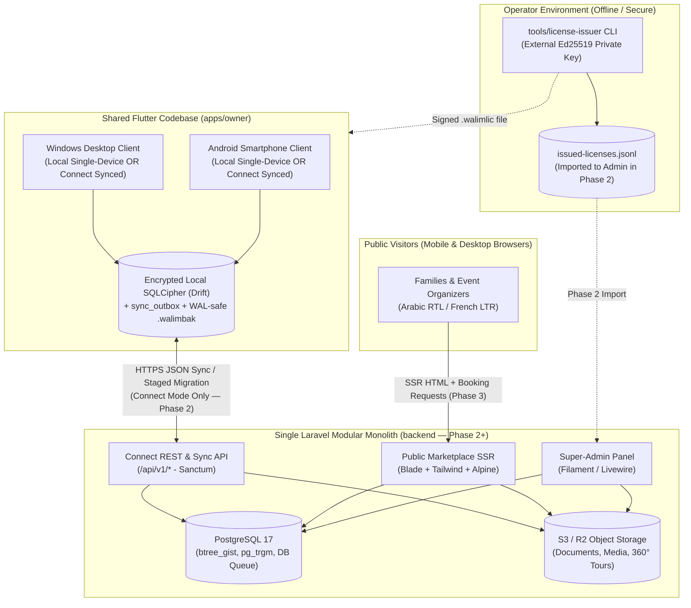
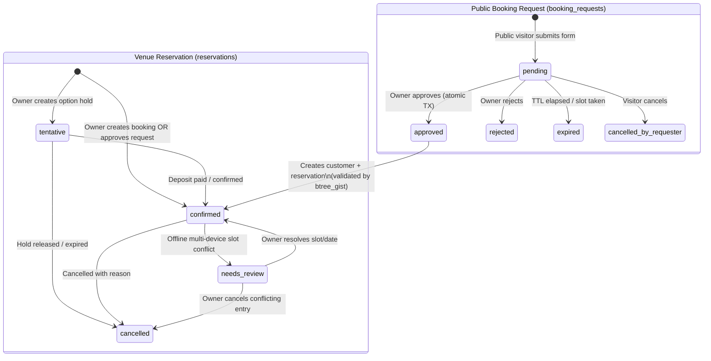

# WalimApp — Consolidated Architecture Baseline

- **Status:** Canonical Baseline v1.1 (Phase 0 Post-Audit Consolidated)
- **Last Updated:** 2026-10-29
- **Supersedes:** Historical drafts under [`reference/architecture-drafts/`](../reference/architecture-drafts/)
- **Related Documents:** [Product Requirements](./product-requirements.md), [Architecture Review](./architecture-review.md), [Decision Register](./decision-register.md), [Roadmap](./roadmap.md), [Project Constitution](../.specify/memory/constitution.md).

---

## 1. System Context & Architectural Principles

WalimApp is designed as a **two-codebase system** (plus a tiny offline operator CLI for Phase 1 license signing) maintainable by a solo developer:

1. **`apps/owner` (Shared Flutter Client):** A single offline-first Flutter application compiled for **Android smartphones (`API 24+`)** and **Windows desktops (`x64`)**, backed by local encrypted **SQLCipher / SQLite (via Drift)**. It powers:
   - **WalimApp Local (Phase 1):** A **single-device offline edition** (100% offline perpetual license; zero cross-device sharing).
   - **WalimApp Connect (Phase 2):** The **shared multi-user, multi-device edition** synchronizing calendars, reservations, and financial ledgers across multiple individually authenticated users on Android phones and Windows PCs.
2. **`backend` (Central Modular Monolith — Phase 2+):** A single **Laravel** application backed by **PostgreSQL 17**, serving three surfaces from one deployment:
   - **Connect Sync & REST API (`/api/v1/*`):** Token-authenticated endpoints for multi-device synchronization, Local-to-Connect migration, licensing, and push wake-up pokes.
   - **Public Marketplace (`/` in `ar-DZ` and `fr-DZ` — Phase 3+):** Server-side-rendered (SSR) **Laravel Blade + Tailwind CSS + Alpine.js** pages for SEO venue discovery across all **69 Algerian Wilayas**, availability viewing, and online booking requests.
   - **Super-Admin Back-Office (`/admin` — Phase 2+):** **Filament** administrative panel for organizations, licenses, subscriptions, moderation, providers, advertising, and audit logs.
3. **`tools/license-issuer` (Standalone Offline Operator CLI — Phase 1):** A small, air-gapped/operator-only Dart CLI script used by the Product Owner in Phase 1 to generate and sign `.walimlic` perpetual license files using an externalized Ed25519 private key before the Phase 2 Super-Admin panel is deployed.



---

## 2. Technology Stack & Evidence-Based Compatibility Matrix

### 2.1 Client & Database Baseline (Phase 1 Start)

| Layer | Technology | Version Baseline & Pinning Policy | Rationale & Verification Evidence |
| :--- | :--- | :--- | :--- |
| **Owner Client UI & Logic** | Flutter + Dart | Current Stable SDK (`Flutter 3.44.8` installed locally; `Flutter 3.47.8` / `Dart 3.13.7` latest upstream stable as of Oct 2026). Pinned in `pubspec.lock` at Sprint 1.1 start. | Single codebase for Android (`API 24+`) and Windows (`x64`) with native RTL/LTR support. |
| **Client State & Routing** | `flutter_riverpod`, `go_router` | Latest stable compatible with pinned Flutter SDK | Compile-safe dependency injection and reactive stream binding to Drift queries. |
| **Client Encrypted Local DB** | SQLCipher / SQLite via `drift` + `sqlcipher_flutter_libs` | Drift 2.22+, SQLCipher 4.x (SQLite 3.46+ WAL mode, `AES-256`) | Provides true encryption at rest (`NFR-04`) for local `.db` and `-wal` files on both Android and Windows (`x64`). |
| **Client PDF & Crypto** | `pdf`, `printing`, `cryptography` | Latest compatible | 100% offline Arabic/French PDF generation, Ed25519 `.walimlic` verification, and `AES-256-GCM` / `Argon2id` `.walimbak` backups. |
| **Central Database (Phase 2)** | PostgreSQL | PostgreSQL 17 (`btree_gist`, `pg_trgm`) | `btree_gist` enforces zero double-bookings at the engine level; `pg_trgm` handles bilingual search; native DB queues/locks avoid mandatory Redis. |
| **Primary Keys** | Client/App-Generated UUIDv7 | RFC 9562 (`uuid` in Dart, `Ramsey\Uuid` in PHP) | Time-ordered UUIDs generated offline on devices without ID collisions or PostgreSQL 18 server-only dependency. |

### 2.2 Backend Compatibility Matrix (Phase 2 Gate Verification)

Because backend implementation starts in **Phase 2**, we verified actual Composer package constraints on Packagist and executed `composer update --dry-run` (with `platform.php = 8.4.0`) against both active Laravel/Filament release tracks as of **2026-10-29**:

| Package / Lifecycle Metric | **Track 1 (Recommended Phase 2 Target — Current Active Upstream)** | **Track 2 (Conservative Fallback Track)** | Upstream Evidence (Packagist & Release Policy) |
| :--- | :--- | :--- | :--- |
| **PHP Runtime** | **PHP 8.4** | **PHP 8.4** | Laravel 13 requires `php: ^8.3`; Filament v4/v5 requires `php: ^8.2`. |
| **`laravel/framework`** | **`^13.0`** (resolved `v13.39.0`) | **`^12.0`** (resolved `v12.70.2`) | Laravel 13 released 2026-03-17 (**security fixes until 2028-03-17**). Laravel 12 security fixes end **2027-02-24**. |
| **`filament/filament`** | **`^5.0`** (resolved `v5.11.0`) | **`^4.0`** (resolved `v4.16.0`) | Both `filament/support` `v5.11.0` and `v4.16.0` declare `"illuminate/contracts": "^11.28\|^12.0\|^13.0"`. |
| **`livewire/livewire`** | **`^4.0`** (resolved `v4.4.8`) | **`^3.0`** (resolved `v3.8.11`) | `filament/support` `v5.11.0` requires `"livewire/livewire": "^4.4.8"`; `v4.16.0` requires `"^3.8.7"`. |
| **`laravel/sanctum`** | **`^4.3`** (resolved `v4.3.3`) | **`^4.3`** (resolved `v4.3.3`) | `laravel/sanctum` `v4.3.3` declares `"illuminate/*": "^11.0\|^12.0\|^13.0"`. |
| **Tailwind CSS** | **Tailwind CSS v4.1+** | **Tailwind CSS v3.4 / v4.x** | Required by Filament v5 / Blade SSR asset pipeline. |
| **Composer Solver Result** | `110 installs, 0 conflicts` | `110 installs, 0 conflicts` | Verified via `composer update --dry-run` on 2026-10-29. |

> **Version Selection Rule (`ADR-002`):** Because Laravel 12 reaches end-of-security-support on **February 24, 2027**, **Track 1 (`PHP 8.4 + Laravel 13.x + Filament v5.x + Livewire v4.x + Tailwind v4.1+`)** is the recommended baseline for Phase 2 so WalimApp launches with a multi-year security support window through March 2028. At the **Phase 2 Sprint 2.1 planning gate**, we will run a fresh `composer update --dry-run` including all chosen Filament plugins before locking `composer.lock`.

---

## 3. Repository & Module Structure

```text
walimapp/
├── .agents/skills/              # Spec Kit Antigravity (agy) skills
├── .specify/                    # Spec Kit constitution, templates, and scripts
├── docs/                        # Canonical project documentation
├── reference/                   # Preserved historical architecture drafts (read-only)
├── tools/
│   └── license-issuer/          # Phase 1 standalone offline Ed25519 .walimlic signer CLI
├── apps/
│   └── owner/                   # Shared Flutter app (Android + Windows; Local + Connect)
│       └── lib/
│           ├── core/            # Theme, l10n (ar-DZ/fr-DZ), MoneyDzd, UUIDv7, errors
│           ├── database/        # Drift SQLCipher tables, DAOs, migrations, WAL setup
│           ├── platform/        # Thin Android vs Windows adapter implementations
│           ├── features/
│           │   ├── calendar/    # Month/week/day/agenda views & slot availability
│           │   ├── reservations/# Reservation lifecycle, pricing, service items
│           │   ├── booking_requests/ # Connect online request inbox & approval UI (Phase 3)
│           │   ├── customers/   # Customer directory (optional NIN/CNI) & history
│           │   ├── finance/     # Unconditionally append-only payments, expenses, reports
│           │   ├── documents/   # Offline Arabic/French PDF contracts, receipts & hashes
│           │   ├── sync/        # Monotonic outbox worker, delta pull, conflict UI (Phase 2)
│           │   ├── migration/   # Staged Local-to-Connect migration wizard (Phase 2)
│           │   ├── licensing/   # Ed25519 .walimlic verifier & Connect entitlement state
│           │   └── settings/    # Venue, halls, configurable slots, users, .walimbak backups
│           └── shared/          # Adaptive shell (NavigationBar vs NavigationRail), widgets
└── backend/                     # Laravel Modular Monolith (Created in Phase 2)
    ├── app/Modules/
    │   ├── Identity/            # Users, Organizations, VenueMemberships, DeviceRegistrations
    │   ├── Reference/           # 69 Wilayas, Communes, Localization helpers
    │   ├── Venue/               # Venues, Halls, HallSlots, ServiceCatalogs
    │   ├── Booking/             # Reservations, BookingRequests, SlotOverlapValidator
    │   ├── Finance/             # Immutable Payments ledger, Expenses, Checksums
    │   ├── Sync/                # Outbox ingestion, VenueSyncState, SyncChangeLog
    │   ├── Migration/           # Staged upload chunks, binary verifier, atomic promoter
    │   ├── Licensing/           # Ed25519 license signer, ledger import, Subscriptions
    │   ├── Marketplace/         # Public SSR controllers, SEO sitemaps, Providers, Ads
    │   └── Audit/               # Immutable AuditLog recorder
    ├── app/Filament/            # Super-Admin panel resources & actions
    └── resources/views/         # Bilingual SSR Blade templates (RTL/LTR)
```

---

## 4. Shared Android & Windows Client Architecture

### 4.1 What Is 100% Shared (~90% of `apps/owner`)
- All domain entities, value objects (`MoneyDzd` integer whole DZD, `SlotWindow`, `WilayaCode`), and validation rules.
- All Drift/SQLCipher tables, indexes, DAOs, schema migrations, and local query streams.
- All application use cases (reservation creation, slot overlap check, payment recording, expense tracking, monotonic outbox queuing, delta sync, staged migration, and license verification).
- All localization files (`app_ar.arb`, `app_fr.arb`) and PDF contract/receipt templates.

### 4.2 Adaptive UI Layout Strategy
A single `AdaptiveShell` widget inspects `MediaQuery.sizeOf(context).width`:
- **Compact (`< 600dp` — Android Smartphones):**
  - Bottom `NavigationBar` (Calendar, Reservations, Requests/Customers, Finance, More).
  - Single-pane Agenda/Day/Month calendar with swipeable date navigation and bottom-sheet booking/payment forms.
  - Quick one-tap phone call (`tel:`) and WhatsApp (`https://wa.me/`) actions on customer and booking-request cards.
- **Medium / Expanded (`>= 600dp` / `>= 1024px` — Windows Desktop & Tablets):**
  - Left `NavigationRail` (collapsible to extended sidebar at `>= 1200px`).
  - Master-detail split views: multi-hall calendar grid on the left, selected reservation inspector and payment ledger drawer on the right.
  - Full keyboard navigation, shortcut bindings (`Ctrl+N` new reservation, `Ctrl+F` search, `Ctrl+P` print), and hover tooltips.

### 4.3 Platform-Specific Adapters (`lib/platform/`)

| Adapter Interface | Windows Implementation | Android Implementation |
| :--- | :--- | :--- |
| **`DeviceIdentityProvider`** | Generates a persistent random **Installation UUID** stored in Windows DPAPI Credential Manager combined with salted `SHA-256(MachineGuid)`. Avoids brittle multi-component BIOS/CPU hashes that break on minor driver updates. | Generates a persistent random **Installation UUID** stored in Android Keystore (`EncryptedSharedPreferences`, with automatic software-keystore fallback on low-cost devices lacking hardware TEE/StrongBox) combined with salted `SHA-256(Settings.Secure.ANDROID_ID)`. Never requests privileged IMEI/serial permissions blocked on Android 10+. |
| **`SecureCredentialStore`** | Windows DPAPI Credential Manager (`flutter_secure_storage`) storing the 256-bit SQLCipher database key, license token, and Connect Sanctum token. | Android Keystore (`EncryptedSharedPreferences`) storing the 256-bit SQLCipher database key, license token, and Connect Sanctum token + optional biometric/PIN unlock (`local_auth`). |
| **`BackupStorageAdapter`** | Creates a WAL-safe snapshot (`VACUUM INTO`) verified by `PRAGMA integrity_check`, encrypts to `.walimbak`, writes rolling foreground backups to local disk, and supports external folder/USB export via `file_picker`. | Creates a WAL-safe snapshot (`VACUUM INTO`) verified by `PRAGMA integrity_check`, writes deterministic foreground rolling backups to app-private storage, and prompts the user via a 7-day reminder banner to export off-device via Android Storage Access Framework (SAF) or native Share sheet (`share_plus` to Google Drive/WhatsApp). (`AppLifecycleState.paused` is treated strictly as best-effort, never the sole backup trigger.) |
| **`DocumentOutputAdapter`** | Direct OS print dialog (`printing`) and local file save. | Android Print Spooler (`printing`) and native share sheet to send PDF contracts/receipts directly to the customer's WhatsApp. |
| **`AppInstanceGuard`** | Named Windows mutex (`window_manager` / Win32 mutex) preventing multiple simultaneous desktop instances from opening the same SQLCipher file. | No-op (Android OS single-task activity lifecycle). |

---

## 5. Core Domain Model & Database Integrity

### 5.1 Algeria 69-Wilaya Reference Model
- **`wilayas`**: `code` (`VARCHAR(2)` primary/unique key `'01'`..`'69'`), `name_ar`, `name_fr`, `slug_ar`, `slug_fr`, `is_active`.
- **`communes`**: `id`, `wilaya_code` (FK -> `wilayas.code`), `code_ons`, `name_ar`, `name_fr`, `slug_ar`, `slug_fr`.
- Seeded from a versioned, checksummed JSON reference dataset (`data/algeria_69_wilayas_communes_v1.json`) verified against the official Algerian *Journal Officiel (JORADP)* / ONS administrative nomenclature (covering all **69 official Algerian Wilayas** and 1,541 communes). Automated tests assert the exact 69-Wilaya count and bilingual names. No application or database constraint restricts Wilaya codes to `<= 58`.

### 5.2 Tenant, Venue, Hall & Configurable Slot Hierarchy
- **Canonical Money Unit (`*_dzd BIGINT`):** Every monetary column across all tables in SQLCipher/SQLite and PostgreSQL is stored as an integer representing **whole Algerian Dinars (`BIGINT` `DZD`)**. Centimes (`amount_minor`) and floating-point types are never used.
- **`organizations`**: Top-level billing and ownership boundary (`id` UUIDv7, `name`, `plan_tier`, `subscription_status`, `subscription_expires_at`, `grace_ends_at`).
- **`venues`**: Physical wedding venue belonging to an `organization_id` (`id` UUIDv7, `organization_id`, `wilaya_code`, `commune_id`, `name_ar`, `name_fr`, `slug`, `phone`, `whatsapp`, `is_public_listed`, `migrated_from_local_at`).
- **`venue_memberships`**: Maps `user_id` to `organization_id` and `venue_id` (nullable = all venues in organization) with `role` (`owner`, `manager`, `receptionist`, `accountant`, `viewer`), `can_view_finance` (`BOOLEAN`), and `is_active`.
- **`halls`**: Bookable space inside a venue (`id` UUIDv7, `venue_id`, `name_ar`, `name_fr`, `capacity_men`, `capacity_women`, `capacity_total`, `base_price_dzd` `BIGINT`).
- **`hall_slots`**: Owner-configurable time windows per hall (`id` UUIDv7, `hall_id`, `code`, `label_ar`, `label_fr`, `start_time` `TIME`, `end_time` `TIME`, `spans_next_day` `BOOLEAN`, `default_price_dzd` `BIGINT`).
  - *Overnight slot handling:* When `spans_next_day = false`, a booking on date `D` produces `starts_at_local = D + start_time` and `ends_at_local = D + end_time`. When `spans_next_day = true` (e.g., `19:00` to `02:00`), `ends_at_local = (D + 1 day) + end_time`.

### 5.3 Separation of `booking_requests` and `reservations`



1. **`booking_requests` (PostgreSQL + synced read/action projection in Connect):**
   - Stores public marketplace inquiries: `id` (UUIDv7), `organization_id`, `venue_id`, `hall_id`, `slot_id`, `event_date`, `starts_at_local`, `ends_at_local`, `requester_name`, `requester_phone`, `requester_whatsapp`, `guest_count`, `event_type`, `message`, `status` (`pending`, `approved`, `rejected`, `expired`, `cancelled_by_requester`), `resulting_reservation_id` (nullable FK), `privacy_consent_at`.
   - **Rule:** Rows in `booking_requests` **never** block a hall slot until approved.
2. **`reservations` (SQLCipher/SQLite & PostgreSQL):**
   - Stores actual owner-managed bookings: `id` (UUIDv7), `organization_id`, `venue_id`, `hall_id`, `slot_id`, `customer_id`, `booking_reference`, `event_date`, `starts_at_local` (`TIMESTAMP`), `ends_at_local` (`TIMESTAMP`), `status` (`confirmed`, `tentative`, `cancelled`, `needs_review`), `base_price_dzd` (`BIGINT`), `services_total_dzd` (`BIGINT`), `discount_dzd` (`BIGINT`), `total_price_dzd` (`BIGINT`), `is_financial_masked` (`BOOLEAN DEFAULT FALSE`, local client column used when a non-financial role pulls masked prices), `cancellation_reason`, `cancelled_at`, `version` (`INT`), `created_by_user_id`, `created_by_device_id`, `deleted_at`.
   - **Client Sync Overlay (`has_pending_sync`):** The client does **not** overwrite `reservations.status` with `'pending_sync'`. Instead, SQLite views check `EXISTS (SELECT 1 FROM sync_outbox WHERE entity_type = 'reservation' AND entity_id = reservations.id AND status != 'acked')` to display a "Pending Sync" badge alongside the true domain status (`confirmed`, `tentative`, `cancelled`, `needs_review`).
3. **PostgreSQL Double-Booking Exclusion Constraint:**
   ```sql
   CREATE EXTENSION IF NOT EXISTS btree_gist;

   ALTER TABLE reservations
   ADD CONSTRAINT reservations_no_overlapping_active_slots
   EXCLUDE USING gist (
       hall_id WITH =,
       tsrange(starts_at_local, ends_at_local, '[)') WITH &&
   )
   WHERE (status IN ('confirmed', 'tentative') AND deleted_at IS NULL);
   ```
   - In local SQLCipher/SQLite (Drift), the equivalent overlap check `starts_at_local < :new_end AND ends_at_local > :new_start AND status IN ('confirmed', 'tentative') AND deleted_at IS NULL` is executed inside an `IMMEDIATE` SQLite transaction before insert/update.

### 5.4 Unconditionally Append-Only Financial Ledger (`payments` & `expenses`)
- **`payments`**: `id` (UUIDv7), `organization_id`, `venue_id`, `reservation_id`, `entry_type` (`deposit`, `installment`, `final_settlement`, `refund`, `adjustment`), `amount_dzd` (`BIGINT` whole DZD; positive for inflows, negative for `refund` or negative `adjustment`), `payment_method` (`cash`, `ccp_baridimob`, `bank_transfer`, `check`, `cib_edahabia`), `paid_at`, `receipt_number`, `parent_payment_id` (nullable FK for refunds/adjustments), `reason` (mandatory when `entry_type IN ('refund', 'adjustment')`), `recorded_by_user_id`, `recorded_by_device_id`, `created_at`.
- **Unconditional Immutability Enforcement:** Both PostgreSQL and local SQLCipher/SQLite enforce a `BEFORE UPDATE OR DELETE ON payments` trigger that **unconditionally raises an exception on any `UPDATE` (of any column) or `DELETE`**. No column on a recorded `payments` row can ever be modified after insertion; any correction to amount, payment method, date, or metadata must be recorded by inserting a new `refund` or `adjustment` row referencing `parent_payment_id` with a mandatory `reason`.
  ```sql
  -- PostgreSQL Enforcement
  CREATE OR REPLACE FUNCTION forbid_payments_mutation() RETURNS trigger AS $$
  BEGIN
      RAISE EXCEPTION 'payments table is strictly append-only; UPDATE and DELETE are forbidden. Insert a refund or adjustment row instead.';
  END;
  $$ LANGUAGE plpgsql;

  CREATE TRIGGER trg_payments_immutable
  BEFORE UPDATE OR DELETE ON payments
  FOR EACH ROW EXECUTE FUNCTION forbid_payments_mutation();
  ```
- **Reservation Balance Calculation:** `amount_paid_dzd = COALESCE(SUM(payments.amount_dzd), 0)` for the reservation; `balance_due_dzd = total_price_dzd - amount_paid_dzd`.

---

## 6. Synchronization Architecture (WalimApp Connect — Phase 2)

### 6.1 Monotonic Outbox Push & Dependency Blocking (`POST /api/v1/sync/push`)
1. **Transactionally Ordered Local Outbox (`outbox_seq`):**
   - Every local create/update in Connect mode writes atomically to the local Drift domain table and inserts an entry into `sync_outbox`:
     - `outbox_seq` (`INTEGER PRIMARY KEY AUTOINCREMENT` — strictly monotonic local sequence, immune to device wall-clock skew).
     - `operation_id` (`UUIDv7` — global idempotency key).
     - `venue_id`, `entity_type`, `entity_id`, `op_type`, `base_version`, `depends_on_outbox_seq` (nullable FK to parent operation in `sync_outbox`), `payload_json`, `status` (`pending`, `in_flight`, `acked`, `blocked_by_parent`, `failed_permanent`), `created_at` (diagnostic only).
2. **Causal Ordering & Parent-Child Dependency Blocking:**
   - The background sync worker selects operations with `status = 'pending'` ordered strictly by **`ORDER BY outbox_seq ASC`** (up to 50 operations per batch).
   - If a child operation (e.g., creating a `reservation` for a newly created offline `customer`, or recording a `payment` for a newly created `reservation`) references a parent operation via `depends_on_outbox_seq` that has failed with `failed_permanent`, the child operation automatically transitions to `status = 'blocked_by_parent'` and is held for user inspection rather than pushed out of order.
3. **Server Idempotency & Commit-Serialized Sequence Allocation:**
   - For each operation in the batch, the server:
     1. Checks `sync_processed_operations (operation_id, organization_id)`. If already present, returns the stored `result_json` immediately (100% idempotent on network retry).
     2. Verifies the authenticated user's `venue_memberships` role and financial permissions for `venue_id` and `entity_type` (rejecting any price/payment mutation from a non-financial role).
     3. Acquires a row-level lock on `venue_sync_state` (`SELECT last_seq FROM venue_sync_state WHERE venue_id = :venue_id FOR UPDATE`), increments `last_seq = last_seq + 1`, applies the domain mutation, and inserts the change record into `sync_change_log (venue_id, seq, entity_type, entity_id, op_type, payload_json, requires_finance_permission)`.
     4. Because `venue_sync_state` is locked with `FOR UPDATE` until transaction commit, `seq` allocation order is strictly identical to transaction commit visibility order—**preventing any out-of-order commit from slipping behind a client's already-advanced `last_pulled_seq` cursor**.
4. **Conflict Rules:**
   - **Reservation Slot Overlap (`SQLSTATE 23P01` on `reservations_no_overlapping_active_slots`):** If Device B pushes a booking for a slot already claimed by Device A, the server saves Device B's reservation with `status = 'needs_review'` (so the exclusion constraint is not violated, the reservation's primary key exists on the server for any dependent child `payments`, and zero customer/payment data is lost), logs a `SLOT_CONFLICT` alert, and returns `outcome = 'flagged_needs_review'` to Device B.
   - **Non-Slot Field Edits (Customers, Notes, Venue Settings):** Optimistic concurrency check via `base_version`; field-level non-overlapping changes merge cleanly, while same-field collisions use server-commit LWW with the prior value recorded in `audit_logs`.
   - **Payments:** Strictly append-only (`op_type = 'insert'` only); union-merged by `id` and `operation_id`.

### 6.2 Per-Venue Cursor Delta Pull & Permission-Hash Re-Sync (`GET /api/v1/sync/pull`)
- **Per-Venue Cursor Scope:** Each client stores `(venue_id, last_pulled_seq, last_permissions_hash)` in its local `local_venue_sync_state` table and calls `GET /api/v1/sync/pull?venue_id=...&after_seq=...&permissions_hash=...`.
- **Permission-Scope Hash & Automatic Re-Sync on Role Change:**
  - The server computes `current_permissions_hash = SHA256(venue_id || ':' || membership.role || ':' || membership.can_view_finance)`.
  - If the client's `permissions_hash` differs from `current_permissions_hash` (because an owner upgraded or downgraded the employee's role):
    - The server returns `status = 'CURSOR_RESET_REQUIRED'` with the new `current_permissions_hash`.
    - On **role downgrade** (e.g., `manager` -> `viewer`), the client immediately purges local `payments` and `expenses` rows for that venue, sets `reservations.base_price_dzd = 0, services_total_dzd = 0, discount_dzd = 0, total_price_dzd = 0, is_financial_masked = true`, and resets its cursor to pull a clean role-filtered snapshot.
    - On **role upgrade** (e.g., `receptionist` without finance -> `manager` with finance), the client resets `last_pulled_seq = 0` and pulls the full change log from `seq = 1`, backfilling all historical `payments`, `expenses`, and unmasked reservation prices (`is_financial_masked = false`).
- **Safe Application of Role-Filtered Rows:**
  - For users where `can_view_finance = false`, the server omits `sync_change_log` entries where `requires_finance_permission = true` (`payments`, `expenses`) and masks price fields on `reservations` payloads (`total_price_dzd = 0`, `is_financial_masked = true`).
  - The local client stores `is_financial_masked = true` on those reservations so the UI displays `"—"` instead of `0 DZD` and forbids pushing price edits from that device.

---

## 7. Local-to-Connect Migration Pipeline (Data, Templates & Documents)

When a WalimApp Local owner upgrades to WalimApp Connect in Phase 2, migration executes in **4 non-destructive phases** preserving 100% of relational records, contract templates, and generated PDF documents:

1. **Phase M1 — Local Freeze & Pre-Migration WAL-Safe Backup:**
   - The client creates a verified WAL-safe `.walimbak` snapshot (`VACUUM INTO` + `PRAGMA integrity_check`) on disk and enters a temporary read-only migration lock.
   - Local UUIDv7 primary keys are **preserved as-is** (never mutated in place before server commit).
2. **Phase M2 — Chunked Relational Upload & Binary Document Transfer to Staging:**
   - **M2a (Manifest Creation):** Client initiates `POST /api/v1/migrations/sessions` with exact manifest counts for every entity type, aggregate and per-reservation financial checksums (`sum_total_price_dzd`, `sum_payments_amount_dzd`, `sum_expenses_amount_dzd`), and the list of `generated_documents` (`id`, `document_type`, `reservation_id`, `payment_id`, `byte_size`, `sha256_checksum`).
   - **M2b (Relational Chunks):** Client uploads relational entities in strict dependency order:
     `venue -> halls -> hall_slots -> service_catalogs -> contract_templates -> customers -> reservations -> reservation_status_history -> payments -> expenses -> generated_documents (metadata)`
     in chunks of 100 records to `migration_staging_records`. Chunks are idempotent by `(migration_session_id, chunk_index)` and resumable after connection drop.
   - **M2c (Binary Document & Logo Upload):** Client uploads each local PDF contract/receipt file in `generated_documents` (and venue logo) to staging object storage (`PUT /api/v1/migrations/sessions/{id}/files/{doc_id}`), where the server verifies `byte_size` and `sha256_checksum` against the manifest before marking the file staged.
3. **Phase M3 — Server Dry-Run Validation & Atomic Promotion:**
   - `POST /api/v1/migrations/sessions/{id}/commit` validates inside a database transaction:
     1. **Entity Count & FK Integrity:** Staged counts for all 11 entity types (including `contract_templates` and `generated_documents`) match the manifest and all foreign keys resolve.
     2. **Financial Checksums:** `SUM(payments.amount_dzd)`, `SUM(reservations.total_price_dzd)`, and `SUM(expenses.amount_dzd)` match the client manifest 100%.
     3. **Document Binary Verification:** Every row in staged `generated_documents` has a verified binary object in storage with matching `sha256_checksum`.
     4. **Historical Slot Overlap Check:** Any historical overlapping active reservations are flagged as `status = 'needs_review'` with a migration report item rather than aborting the venue's history.
   - All staged rows are inserted into the live PostgreSQL tables, staged S3/R2 document keys are promoted to permanent tenant paths, and initial `sync_change_log` entries are written while holding `venue_sync_state` lock in a single transaction, returning the initial `current_seq`.
4. **Phase M4 — Client Cutover:**
   - Only after receiving `200 OK` with `current_seq` does the client update its local venue mode to `connect` and set `last_pulled_seq = current_seq`. If anything fails before M4, the client unlocks Local mode with zero local data modification.

---

## 8. Perpetual Licensing & Connect Subscription State Machine

### 8.1 WalimApp Local Perpetual License (`.walimlic`) & Phase 1 Offline Issuer
- **License Payload & Ed25519 Signature:** A `.walimlic` file is a canonical JSON payload signed with WalimApp's offline **Ed25519 private key** (only the 32-byte public key is embedded in `apps/owner`):
  ```json
  {
    "license_id": "01968000-0000-7000-8000-000000000001",
    "edition": "local_perpetual",
    "organization_name": "Salle El Bahia",
    "installation_fingerprint_hash": "sha256:...",
    "platform": "windows|android",
    "issued_at": "2026-10-29T12:00:00Z",
    "updates_until": "2027-10-29T23:59:59Z",
    "max_venues": 1,
    "max_halls": 5
  }
  ```
- **Phase 1 Offline Issuance Workflow (`tools/license-issuer`):**
  - Because the Filament Super-Admin backend is built in Phase 2, Phase 1 includes a standalone operator CLI (`tools/license-issuer`) run exclusively on the Product Owner's secure machine.
  - **Private Key Isolation:** The Ed25519 private key is stored outside the repository in the operator's hardware token / OS keystore / encrypted vault and passed at signing time.
  - **Activation, Ledger & Device Transfer:**
    1. The customer installs WalimApp Local on their Android phone or Windows PC; the app displays a short **Installation Request Code** encoding `platform` and `installation_fingerprint_hash`.
    2. The operator runs `dart run tools/license-issuer issue --org "..." --request-code "..."` to output the signed `.walimlic` file and append an audit record to the operator's encrypted `issued-licenses.jsonl` ledger (which is imported into Filament Super-Admin in Phase 2).
    3. If a customer replaces a broken/lost phone or reformats their PC, they provide their new Installation Request Code to support; the operator records a transfer entry in `issued-licenses.jsonl` superseding the old installation and issues a replacement `.walimlic` preserving the customer's original `updates_until` date.
- **Maintenance Expiry Rule:** Each app binary embeds its `APP_BUILD_DATE`. As long as `APP_BUILD_DATE <= license.updates_until` (checked *before* running any new version's SQLite schema migrations), the build activates and runs **forever**. Even 10 years after `updates_until`, that installed version continues working with 100% functionality.

### 8.2 WalimApp Connect Subscription Expiry & Renewal Reconciliation
- Connect subscription states: `active` -> `past_due` (grace period, default 14 days `[OPEN -> DEC-09]`) -> `expired_local_fallback`.
- **Behavior in `expired_local_fallback`:**
  - Cloud sync push/pull and public marketplace `booking_requests` acceptance are paused.
  - All local SQLCipher/SQLite data on the owner's device(s) remains **fully readable and writable offline**, including PDF printing and `.walimbak` backups.
- **Reconciliation Upon Renewal:**
  - While in `expired_local_fallback`, any local edits made on an authorized device continue appending to its local `sync_outbox` (`outbox_seq`).
  - When the subscription is renewed (`active`), each device pushes its queued `sync_outbox` batches through `/api/v1/sync/push` and pulls missed deltas via `/api/v1/sync/pull`. If two devices created overlapping reservations on the same hall while offline during expiry, the first device to push claims the slot as `confirmed` and the second device's overlapping reservation is automatically stored as `status = 'needs_review'` with a prominent conflict resolution prompt—guaranteeing zero silent data loss.

---

## 9. Public Marketplace, Advertising & 360° Tours Readiness (Phases 3–4)

- **SSR & SEO Architecture:** Public routes (`/ar/salles/{wilaya}/{slug}`, `/fr/salles/{wilaya}/{slug}`) are rendered by Laravel Blade with localized metadata, `hreflang`, and `EventVenue` JSON-LD.
- **Availability Cache:** Public availability calendars query a read-optimized projection of `(hall_id, slot_id, event_date, is_unavailable)` updated synchronously whenever a reservation status changes in PostgreSQL. Zero customer PII is ever exposed to the marketplace view layer.
- **Advertising Engine:** `ad_campaigns` and `ad_placements` tables support Wilaya-targeted and category-targeted featured slots (Phase 3 admin-managed; Phase 4 self-serve).
- **Phase 4 360° Virtual Tours Readiness:** The `venue_media` schema reserves `media_type = 'panorama_360'` pointing to static equirectangular assets on S3/R2, rendered on the public page only when clicked via lazy-loaded `Pannellum` JS so initial page LCP stays `< 2.5s`.

---

## 10. Security, Revocation Guarantees, Privacy (Law 18-07 / 25-11) & Backups

### 10.1 Authentication, Revocation Threat Model & Push Privacy
1. **Transport & Per-Device Tokens:** TLS 1.2/1.3 everywhere; Laravel Sanctum personal access tokens scoped per `device_id`.
2. **Realistic Membership & Device Revocation Guarantees:**
   - **Immediate Online Block:** Revoking a user's `venue_memberships` row or `device_registrations` token in Connect immediately blocks all `/api/v1/sync/*` and REST endpoints with `403 MEMBERSHIP_REVOKED` / `401 DEVICE_REVOKED`.
   - **Automatic Local Purge on Next Reconnection:** When a revoked device next contacts the server and receives `403 MEMBERSHIP_REVOKED` or `401 DEVICE_REVOKED`, the client immediately locks the venue workspace and deletes/purges the cached SQLCipher records for that venue.
   - **Bounded Offline Staff Lease (`OfflineAccessLease`):** Because no server can remotely wipe a device while it has no network connectivity, non-owner staff devices (`manager`, `receptionist`, `accountant`, `viewer`) hold a signed **Offline Access Lease** with a **72-hour TTL** refreshed on every successful sync. If a revoked staff member keeps their phone in airplane mode past 72 hours, the local app locks access to the Connect venue until online re-authentication succeeds.
3. **Zero PII in Push Notifications:** Firebase Cloud Messaging (FCM) notifications sent to Android devices contain only opaque sync wake-up payloads (`{"type": "SYNC_POKE", "venue_id": "<uuid>", "seq": 142}`). Customer names, phone numbers, and financial amounts are never transmitted through third-party push channels.

### 10.2 Encryption at Rest & Algerian Law 18-07 / Law 25-11 Technical Capabilities
1. **Local Database Encryption at Rest (`SQLCipher`):** The live client SQLite database (`.db`, `-wal`, `-shm`) is encrypted at rest using **SQLCipher (`AES-256-CBC` with HMAC-SHA512 page authentication)** via `sqlcipher_flutter_libs`. The random 256-bit database key is generated on initial setup and stored inside the OS hardware-backed keystore (`Android Keystore` / `Windows DPAPI`).
2. **Data Minimization & Optional NIN/CNI:**
   - Public `booking_requests` collect only name, phone/WhatsApp, event date/slot, guest count, and optional note.
   - Customer national ID (`national_id_number` / NIN / CNI) in `customers` is **strictly optional** (collapsed by default and used only if the venue prints formal legal ID numbers on rental contracts), excluded from search indexes and list views, encrypted inside SQLCipher and `.walimbak`, and erased when customer anonymization is triggered.
3. **Explicit Consent & Legal/ANPDP Review Gate (`DEC-10`):**
   - Public booking request forms require an explicit Arabic/French consent checkbox recording `privacy_consent_at` and policy version.
   - **Legal Gate:** While the architecture implements these technical privacy safeguards, formal legal compliance under Algerian **Law 18-07** and **Law 25-11** (including ANPDP declaration/authorization, final hosting jurisdiction selection between an Algerian datacenter vs. EU cloud region, consent text, and retention schedules) requires review and sign-off by qualified Algerian legal counsel before Phase 2/3 production launch (`DEC-10`).

### 10.3 `.walimbak` Backup Encryption & Key Separation (`DEC-06`)
- **Strict Separation from Licensing:** Backup encryption keys are **never** derived from `license_id` or license activation codes.
- **WAL-Safe Snapshot & Envelope Encryption:**
  1. Every `.walimbak` backup is generated from a consistent SQLite snapshot (`VACUUM INTO`) verified with `PRAGMA integrity_check` before encryption.
  2. The snapshot is encrypted with a fresh 256-bit random **Data Encryption Key (DEK)** using `AES-256-GCM`.
  3. The DEK is stored in the `.walimbak` unencrypted JSON header wrapped (encrypted) by the key-recovery mechanism chosen in `DEC-06`:
     - **Recommended Default (`DEC-06` Option A — User Passphrase + Printable 256-bit Recovery Key, Zero Vendor Escrow):** During backup setup, the app generates a random 256-bit **Recovery Key** (exported/printed as a physical *"Emergency Recovery Sheet"* for the owner's safe) and allows setting a user **Backup Passphrase** (stretched via `Argon2id`, `m=64 MiB, t=3, p=1`). The DEK is wrapped in two independent slots: Slot 1 wrapped by the `Argon2id` passphrase key, and Slot 2 wrapped by the 256-bit Recovery Key. Either credential can decrypt the `.walimbak` archive; WalimApp Support holds zero decryption keys, and losing both credentials makes off-device backups permanently unrecoverable.
     - **Alternative (`DEC-06` Option B — Opt-In Asymmetric Support Escrow):** Adds an optional third DEK wrapper slot encrypted with an offline vendor `X25519` Backup Escrow Public Key (distinct from the Ed25519 license key) *only* if the customer explicitly opts into vendor-assisted recovery.
- **Server Backups (Phase 2+):** Automated daily encrypted `pg_dump` + continuous WAL archiving to off-site object storage, with monthly restore drills to a disposable staging database (`RPO <= 24h`, `RTO <= 4h`).
