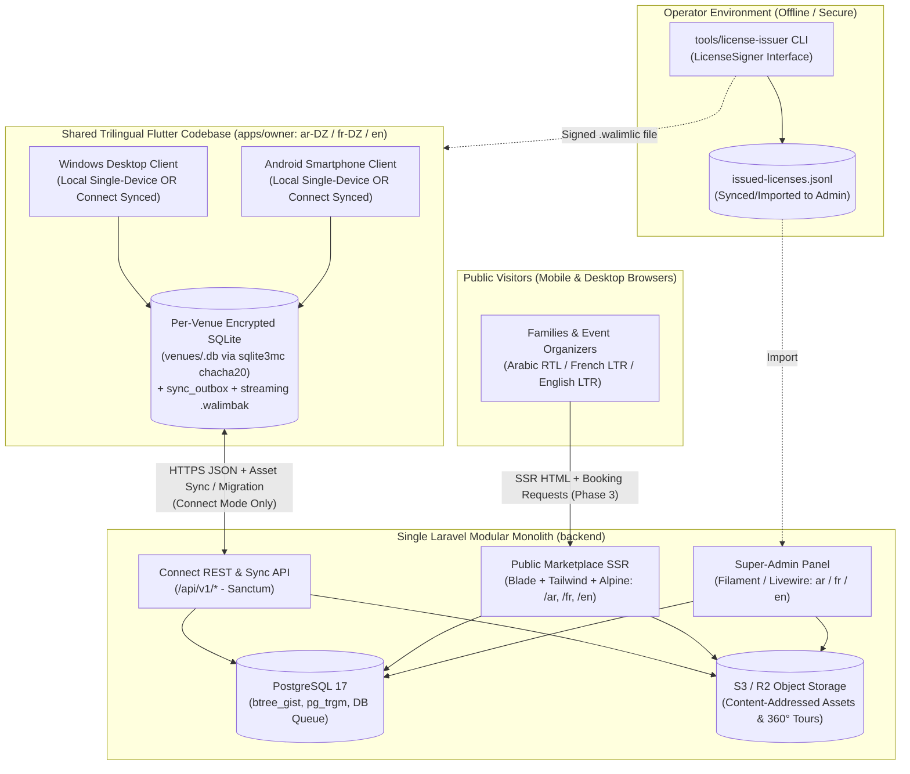
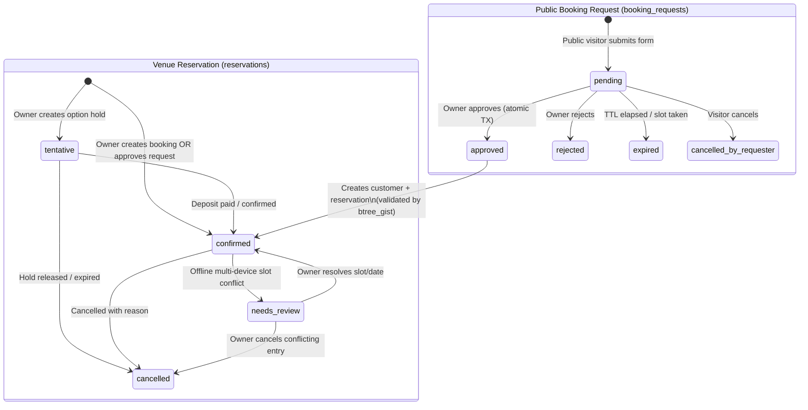

# WalimApp — Consolidated Architecture Baseline

- **Status:** Candidate Baseline v1.3.2-draft (Phase 0.3.2 — Pending Product Owner Approval)
- **Last Updated:** 2026-10-29
- **Supersedes:** Historical drafts under [`reference/architecture-drafts/`](../reference/architecture-drafts/)
- **Related Documents:** [Product Requirements](./product-requirements.md), [Architecture Review](./architecture-review.md), [Decision Register](./decision-register.md), [Roadmap](./roadmap.md), [Project Constitution](../.specify/memory/constitution.md).

---

## 1. System Context & Architectural Principles

WalimApp is designed as a **two-codebase system** (plus a small offline operator CLI for standalone license signing) maintainable by a solo developer, supporting **three languages (`ar-DZ` Arabic RTL, `fr-DZ` French LTR, and `en` English LTR)** across all user-facing surfaces:

1. **`apps/owner` (Shared Trilingual Flutter Client):** A single offline-first Flutter application compiled for **Android smartphones (`API 24+`)** and **Windows desktops (`x64`)**, backed by local encrypted **SQLite (`sqlite3mc` with explicit `chacha20` ChaCha20-Poly1305 256-bit AEAD via Drift)**. It powers:
   - **WalimApp Local:** A **single-device offline edition** (100% offline perpetual license; zero cross-device sharing).
   - **WalimApp Connect:** The **connected offline-first edition** with configurable active-device tiers (**Basic: `1` active device**; **Higher-Capacity: up to `5` active devices** at a higher price) synchronizing calendars, reservations, documents, and financial ledgers across individually authenticated users with mandatory venue-scoped role permissions.
2. **`backend` (Central Modular Monolith):** A single **Laravel** application backed by **PostgreSQL 17**, serving three surfaces from one deployment:
   - **Connect Sync & REST API (`/api/v1/*`):** Token-authenticated endpoints for multi-device synchronization, binary asset sync, Local-to-Connect staged migration, licensing, subscription device enforcement, and push wake-up pokes.
   - **Public Marketplace (`/` in `ar-DZ`, `fr-DZ`, and `en` — Phase 3+):** Server-side-rendered (SSR) **Laravel Blade + Tailwind CSS + Alpine.js** pages for SEO venue discovery across all **69 Algerian Wilayas**, optional per-language venue/provider content with deterministic fallback, availability viewing, and online booking requests.
   - **Super-Admin Back-Office (`/admin` in `ar`, `fr`, and `en`):** **Filament** administrative panel for organizations, licenses, configurable subscription plans & device limits, moderation, providers, advertising, and audit logs.
3. **`tools/license-issuer` (Standalone Offline Operator CLI):** A small, operator-only Dart CLI using a `LicenseSigner` abstraction (supporting non-exportable hardware/OS-keystore keys or an offline encrypted vault) to generate and sign `.walimlic` perpetual license files outside the client repository.



---

## 2. Technology Stack & Evidence-Based Compatibility Matrix

### 2.1 Client & Database Baseline (Sprint 1.1 Start)

| Layer | Technology | Version Baseline & Pinning Policy | Rationale & Upstream Verification Evidence |
| :--- | :--- | :--- | :--- |
| **Owner Client UI & Logic** | Flutter + Dart | Current Stable SDK (`Flutter 3.44.8` installed locally; `Flutter 3.47.8` / `Dart 3.13.7` latest upstream stable as of Oct 2026). Pinned in `pubspec.lock` at Sprint 1.1 start. | Single codebase for Android (`API 24+`) and Windows (`x64`) with native trilingual (`ar-DZ` RTL, `fr-DZ` LTR, `en` LTR) support. |
| **Client State & Routing** | `flutter_riverpod`, `go_router` | Latest stable compatible with pinned Flutter SDK | Compile-safe dependency injection and reactive stream binding to Drift queries. |
| **Client Encrypted Local DB** | `drift` + `sqlite3` with Native Assets Build Hook (`sqlite3mc`) | **`drift: ^2.35.0`** (latest `2.35.3`) + **`sqlite3: ^3.8.0`** configured in `pubspec.yaml` with `hooks.user_defines.sqlite3.source: sqlite3mc` (`SQLite3MultipleCiphers`), explicitly selecting **`chacha20` (`ChaCha20-Poly1305` 256-bit AEAD, `legacy = 0`)** *before* `PRAGMA key` and verifying the active cipher in `debug`, `profile`, and `release` builds. | Per upstream `sqlite3` 3.x (`UPGRADING_TO_V3.md`) and `SQLite3MultipleCiphers` docs, `sqlcipher_flutter_libs` (`0.7.0+eol`) is deprecated/EOL, and `sqlite3mc`'s documented default cipher is `chacha20` (`ChaCha20-Poly1305`), **not** AES-256. Explicitly configuring and verifying `chacha20` before key application guarantees authenticated 256-bit encryption and high performance on budget Android ARM CPUs and Windows `x64` (validated by a Sprint 1.1 pre-feature PoT). |
| **Client PDF & Crypto** | `pdf`, `printing`, `sodium` / `sodium_libs` (or `cryptography`) | Latest compatible (validated via Sprint 1.3 Arabic RTL shaping PoT and Sprint 1.4 `.walimbak` streaming encryption PoT) | 100% offline trilingual (`ar`, `fr`, `en`) PDF generation, Ed25519 `.walimlic` verification, and provisional streaming `.walimbak` backups (`libsodium` `crypto_secretstream_xchacha20poly1305` preferred; `§10.3`). |
| **Central Database** | PostgreSQL | **PostgreSQL 17 (`17.x` GA)** (`btree_gist`, `pg_trgm`) — deliberate baseline with a **Stage 2A (`Sprint 2.1`) version/hosting compatibility gate** (never a release candidate / beta). | **Deliberate Baseline Rationale (`ADR-003`):** PostgreSQL 17 (`17.x` GA) is the widely deployed, mature production baseline across Ubuntu 24.04 LTS repositories, managed cloud PostgreSQL providers, and Algerian/EU VPS hosts (`DEC-10`), providing `btree_gist` exclusion constraints, `pg_trgm` trilingual search, `SELECT ... FOR UPDATE` row locking, and native DB queues/locks without mandatory Redis. At the **Stage 2A (`Sprint 2.1`) gate**, we verify exact PostgreSQL version/extension availability on the chosen target host (retaining `17.x` GA by default or adopting a GA `18.x` point release *only* if universally supported by the target host and backup tooling; release candidates are never used). |
| **Primary Keys** | Client/App-Generated UUIDv7 | RFC 9562 (`uuid` in Dart, `Ramsey\Uuid` in PHP) | Because WalimApp is offline-first, primary keys must be generated on Android/Windows clients before any server contact (`ADR-004`), eliminating any need for server-generated UUIDv7 functions. |

### 2.2 Backend Compatibility Matrix (Sprint 2.1 Gate Verification)

We verified actual Composer package constraints on Packagist and executed `composer update --dry-run` (with `platform.php = 8.4.0`) against both active Laravel/Filament release tracks as of **2026-10-29**:

| Package / Lifecycle Metric | **Track 1 (Recommended Target — Current Active Upstream)** | **Track 2 (Conservative Fallback Track)** | Upstream Evidence (Packagist & Release Policy) |
| :--- | :--- | :--- | :--- |
| **PHP Runtime** | **PHP 8.4** | **PHP 8.4** | Laravel 13 requires `php: ^8.3`; Filament v4/v5 requires `php: ^8.2`. |
| **`laravel/framework`** | **`^13.0`** (resolved `v13.39.0`) | **`^12.0`** (resolved `v12.70.2`) | Laravel 13 released 2026-03-17 (**security fixes until 2028-03-17**). Laravel 12 security fixes end **2027-02-24**. |
| **`filament/filament`** | **`^5.0`** (resolved `v5.11.0`) | **`^4.0`** (resolved `v4.16.0`) | Both `filament/support` `v5.11.0` and `v4.16.0` declare `"illuminate/contracts": "^11.28\|^12.0\|^13.0"`. |
| **`livewire/livewire`** | **`^4.0`** (resolved `v4.4.8`) | **`^3.0`** (resolved `v3.8.11`) | `filament/support` `v5.11.0` requires `"livewire/livewire": "^4.4.8"`; `v4.16.0` requires `"^3.8.7"`. |
| **`laravel/sanctum`** | **`^4.3`** (resolved `v4.3.3`) | **`^4.3`** (resolved `v4.3.3`) | `laravel/sanctum` `v4.3.3` declares `"illuminate/*": "^11.0\|^12.0\|^13.0"`. |
| **Tailwind CSS** | **Tailwind CSS v4.1+** | **Tailwind CSS v3.4 / v4.x** | Required by Filament v5 / Blade SSR asset pipeline. |
| **Composer Solver Result** | `110 installs, 0 conflicts` | `110 installs, 0 conflicts` | Verified via `composer update --dry-run` on 2026-10-29. |

> **Version Selection Rule (`ADR-002`):** Because Laravel 12 reaches end-of-security-support on **February 24, 2027**, **Track 1 (`PHP 8.4 + Laravel 13.x + Filament v5.x + Livewire v4.x + Tailwind v4.1+`)** is the recommended baseline so WalimApp launches with security support through March 2028. At the **Sprint 2.1 planning gate**, we will run a fresh `composer update --dry-run` including all chosen Filament plugins before locking `composer.lock`.

---

## 3. Repository & Module Structure

```text
walimapp/
├── .agents/skills/              # Spec Kit Antigravity (agy) skills
├── .specify/                    # Spec Kit constitution, templates, and scripts
├── docs/                        # Canonical project documentation
├── reference/                   # Preserved historical architecture drafts (read-only)
├── tools/
│   └── license-issuer/          # Standalone offline Ed25519 .walimlic signer CLI (LicenseSigner)
├── apps/
│   └── owner/                   # Shared Flutter app (Android + Windows; Local + Connect)
│       └── lib/
│           ├── core/            # Theme, l10n (ar-DZ/fr-DZ/en), MoneyDzd, UUIDv7, errors
│           ├── database/        # Per-venue Drift encrypted DB (sqlite3mc chacha20), DAOs, migrations
│           ├── platform/        # Thin Android vs Windows adapter implementations
│           ├── features/
│           │   ├── calendar/    # Month/week/day/agenda views & slot availability
│           │   ├── reservations/# Reservation lifecycle, pricing, service items
│           │   ├── booking_requests/ # Connect online request inbox & approval UI (Phase 3)
│           │   ├── customers/   # Customer directory (optional NIN/CNI) & history
│           │   ├── finance/     # Unconditionally append-only payments, expenses, reports
│           │   ├── documents/   # Offline trilingual (ar/fr/en) PDF contracts, receipts & hashes
│           │   ├── sync/        # Monotonic outbox + asset uploader, delta pull, conflict UI
│           │   ├── migration/   # Staged Local-to-Connect migration wizard
│           │   ├── licensing/   # Ed25519 .walimlic verifier, Connect plan & device management
│           │   └── settings/    # Venue, halls, slots, local_actors, streaming .walimbak
│           └── shared/          # Adaptive shell (NavigationBar vs NavigationRail), widgets
└── backend/                     # Laravel Modular Monolith
    ├── app/Modules/
    │   ├── Identity/            # Users, Organizations, VenueMemberships, DeviceRegistrations
    │   ├── Reference/           # 69 Wilayas, Communes, Trilingual Fallback helpers
    │   ├── Venue/               # Venues, Halls, HallSlots, ServiceCatalogs
    │   ├── Booking/             # Reservations, BookingRequests, SlotOverlapValidator
    │   ├── Finance/             # Immutable Payments ledger, Expenses, Checksums
    │   ├── Sync/                # Outbox ingestion, AssetSyncController, VenueSyncState, SyncChangeLog
    │   ├── Migration/           # Staged relational chunks, content-addressed asset verifier, promoter
    │   ├── Licensing/           # Ed25519 license signer, ledger import, SubscriptionPlans, Subscriptions
    │   ├── Marketplace/         # Public SSR controllers (/ar, /fr, /en), SEO sitemaps, Providers, Ads
    │   └── Audit/               # Immutable AuditLog recorder
    ├── app/Filament/            # Trilingual Super-Admin panel resources & actions (ar / fr / en)
    └── resources/views/         # Trilingual SSR Blade templates (RTL/LTR)
```

---

## 4. Shared Android & Windows Client Architecture & Trilingual Localization

### 4.1 What Is 100% Shared (~90% of `apps/owner`)
- All domain entities, value objects (`MoneyDzd` integer whole DZD, `SlotWindow`, `WilayaCode`), and validation rules.
- All Drift/SQLite tables, indexes, DAOs, schema migrations, and local query streams, organized with **per-venue database file isolation (`venues/<venue_id>.db`)** so individual Connect venues can be cryptographically erased and rebuilt cleanly upon role downgrade or on the next online check after membership/device revocation without violating append-only table triggers.
- All application use cases (reservation creation, slot overlap check, payment recording, expense tracking, monotonic outbox queuing, binary asset sync, delta sync, staged migration, and license verification).
- All trilingual localization files (`app_ar.arb`, `app_fr.arb`, `app_en.arb`) and PDF contract/receipt templates.

### 4.2 Trilingual Architecture (`ar-DZ` RTL, `fr-DZ` LTR, `en` LTR), Language Preferences & Content Fallback
1. **Supported Locales & Directionality Across All Surfaces:**
   - **Arabic (`ar-DZ`):** Strict Right-to-Left (`TextDirection.rtl` in Flutter using `EdgeInsetsDirectional` / `AlignmentDirectional`; `dir="rtl"` in HTML/CSS using Tailwind logical properties `ms-*`, `me-*`, `ps-*`, `pe-*`, `text-start`, `text-end`).
   - **French (`fr-DZ`) & English (`en`):** Strict Left-to-Right (`TextDirection.ltr`; `dir="ltr"`).
   - **Western Arabic Numerals (`0-9`) Everywhere:** All numbers, dates (`'YYYY-MM-DDTHH:mm:ss'`), phone numbers, guest capacities, and integer whole-Dinar (`DZD` / `د.ج` / `DA`) amounts use Western digits (`0-9`) across Arabic, French, and English.
2. **Language Preference Hierarchy:**
   - **Flutter Owner & Staff App (`apps/owner`):**
     - **UI Language:** Stored per local actor (`local_actors.preferred_locale` in Local mode) and per authenticated user (`users.preferred_locale` in `'ar' | 'fr' | 'en'` in Connect mode, cached locally for login screen rendering). Switching UI language updates the app immediately without restart or data loss.
     - **Document Output Language:** Each venue defines a default document language (`venues.default_locale` in `'ar' | 'fr' | 'en'`, default `'fr'`). When generating any PDF contract or payment receipt, the staff member can accept `venues.default_locale` or explicitly pick `'ar'`, `'fr'`, or `'en'` (or bilingual header mode per `DEC-05`) for that customer document.
   - **Public Marketplace (`backend` Blade SSR):**
     - **URL-Prefixed Locale:** All public routes carry an explicit locale prefix (`/ar/...`, `/fr/...`, `/en/...`).
     - **Negotiation & Persistence:** Visiting `/` redirects (`302`) to `/ar`, `/fr`, or `/en` based on the visitor's `walimapp_locale` cookie (if previously chosen via the header language switcher), then the browser `Accept-Language` header, and defaults to `/fr` when neither matches.
   - **Super-Admin (`backend` Filament):**
     - Supports `'ar'` (RTL), `'fr'` (LTR), and `'en'` (LTR) via `users.preferred_locale` and an in-panel language switcher.
3. **Optional Per-Language Venue/Provider Content & Deterministic Fallback Chain:**
   - **System & Reference Data:** All UI chrome, navigation labels, status badges, amenity names, service categories, and the 69-Wilaya / 1,541-commune reference tables are 100% translated into Arabic (`_ar`), French (`_fr`), and English (`_en`).
   - **User-Authored Marketplace Content (`venues`, `halls`, `hall_slots`, `service_providers`):**
     - Supports optional per-language text columns (`name_ar`, `name_fr`, `name_en`, `description_ar`, `description_fr`, `description_en`).
     - **Single-Language Minimum:** Venue owners and providers are only required to populate **at least one language** (`ar`, `fr`, or `en`) to save or publish a listing; the remaining languages are optional.
     - **Deterministic Fallback Order:** When displaying a user-authored text field in requested locale `L` and the value for `L` is `NULL` or blank, the `LocalizedTextResolver` resolves the first non-empty value using:
       - Requested `en` -> **`en` -> `fr` -> `ar`**
       - Requested `fr` -> **`fr` -> `ar` -> `en`**
       - Requested `ar` -> **`ar` -> `fr` -> `en`**
     - **Bidirectional Container Isolation (`<bdi>` / `Directionality`):** Whenever the resolved fallback text belongs to a different directionality than the active page shell (e.g., an Arabic venue description displayed on an `/en/` or `/fr/` page, or a French description displayed on an `/ar/` page), the text block is rendered inside `<bdi dir="rtl|ltr" lang="...">` (web) or `Directionality(textDirection: ...)` (Flutter) so punctuation and layout never corrupt the surrounding page direction.

### 4.3 Adaptive UI Layout Strategy
A single `AdaptiveShell` widget inspects `MediaQuery.sizeOf(context).width`:
- **Compact (`< 600dp` — Android Smartphones):**
  - Bottom `NavigationBar` (Calendar, Reservations, Requests/Customers, Finance, More).
  - Single-pane Agenda/Day/Month calendar with swipeable date navigation and bottom-sheet booking/payment forms.
  - Quick one-tap phone call (`tel:`) and WhatsApp (`https://wa.me/`) actions on customer and booking-request cards.
- **Medium / Expanded (`>= 600dp` / `>= 1024px` — Windows Desktop & Tablets):**
  - Leading `NavigationRail` (automatically positioned on the right in `ar-DZ` RTL and on the left in `fr-DZ` / `en` LTR; collapsible to extended sidebar at `>= 1200px`).
  - Master-detail split views: multi-hall calendar grid on the start pane, selected reservation inspector and payment ledger drawer on the end pane.
  - Full keyboard navigation, shortcut bindings (`Ctrl+N` new reservation, `Ctrl+F` search, `Ctrl+P` print), and hover tooltips.

### 4.4 Platform-Specific Adapters (`lib/platform/`)

| Adapter Interface | Windows Implementation | Android Implementation |
| :--- | :--- | :--- |
| **`DeviceIdentityProvider`** | Generates a persistent random **Installation UUID** stored in Windows Credential Manager combined with salted `SHA-256(MachineGuid)` and reads the current OS boot session identifier (`boot_id`). Avoids brittle multi-component BIOS/CPU hashes that break on minor driver updates. | Generates a persistent random **Installation UUID** stored in `EncryptedSharedPreferences` combined with salted `SHA-256(Settings.Secure.ANDROID_ID)` and reads the OS boot session identifier (`Settings.Global.BOOT_COUNT` / `boot_id`). Never requests privileged IMEI/serial permissions blocked on Android 10+. |
| **`SecureCredentialStore`** | **Windows DPAPI (`CryptProtectData` via Credential Manager)** storing per-venue 256-bit SQLite encryption keys (`key_venue_<venue_id>`), license tokens, Sanctum tokens, signed `OfflineAccessLease` state (`lease_boot_id`, `lease_saved_elapsed_ms`, `last_verified_elapsed_ms`), and `highest_observed_utc`. *Security Note (`G-P2-2`):* Windows DPAPI is **OS user-profile-scoped encryption** (not a hardware TEE); if multiple staff members share the same Windows OS user login, a local Owner PIN (`DEC-04`) provides UI-level screen locking only. Venues sharing a Windows PC should use separate Windows OS user accounts for OS-level isolation. | **Android Keystore (`EncryptedSharedPreferences`)** storing per-venue 256-bit SQLite keys, tokens, signed `OfflineAccessLease` state (`lease_boot_id`, `lease_saved_elapsed_ms`, `last_verified_elapsed_ms`), and `highest_observed_utc` (hardware-backed TEE/StrongBox when confirmed by `KeyInfo.isInsideSecurityHardware()`, with automatic OS-isolated software keystore fallback on budget devices) + optional biometric/PIN unlock (`local_auth`). |
| **`BackupStorageAdapter`** | Creates a WAL-safe snapshot (`VACUUM INTO`) verified by `PRAGMA integrity_check`, encrypts via `64 KiB` chunked streaming AEAD (provisional pending the Sprint 1.4 PoT gate) to `.walimbak.tmp` with atomic rename to `.walimbak`, writes rolling foreground backups to local disk, and supports external folder/USB export via `file_picker`. | Creates a WAL-safe snapshot (`VACUUM INTO`) verified by `PRAGMA integrity_check`, encrypts via `64 KiB` chunked streaming AEAD (preventing OOM on 50MB+ DBs on low-RAM phones; provisional pending the Sprint 1.4 PoT gate) to `.walimbak.tmp` with atomic rename to `.walimbak`, writes deterministic foreground rolling backups to app-private storage, and prompts off-device export via a 7-day reminder banner (Android SAF / `share_plus`). (`AppLifecycleState.paused` is treated strictly as best-effort.) |
| **`DocumentOutputAdapter`** | Direct OS print dialog (`printing`) and local file save. | Android Print Spooler (`printing`) and native share sheet to send PDF contracts/receipts directly to the customer's WhatsApp. |
| **`AppInstanceGuard`** | Named Windows mutex (`window_manager` / Win32 mutex) preventing multiple simultaneous desktop instances from opening the same SQLite file. | No-op (Android OS single-task activity lifecycle). |

---

## 5. Core Domain Model & Database Integrity

### 5.1 Algeria 69-Wilaya Trilingual Reference Model
- **`wilayas`**: `code` (`VARCHAR(2)` primary/unique key `'01'`..`'69'`), `name_ar`, `name_fr`, `name_en`, `slug_ar`, `slug_fr`, `slug_en`, `is_active`.
- **`communes`**: `id`, `wilaya_code` (FK -> `wilayas.code`), `code_ons`, `name_ar`, `name_fr`, `name_en`, `slug_ar`, `slug_fr`, `slug_en`.
- Seeded in Sprint 1.1 after acquiring and verifying an authoritative, versioned JSON dataset (`data/algeria_69_wilayas_communes_v1.json`, recording official JORADP/ONS source version and SHA-256 checksum) covering all **69 official Algerian Wilayas** and **1,541 communes**. (For Algerian proper place names without a distinct English exonym, `name_en` / `slug_en` default to the official Latin/French orthography.) Automated tests assert the exact 69-Wilaya and 1,541-commune counts, parent-child linkage, and trilingual names. No constraint restricts Wilaya codes to `<= 58`.

### 5.2 Tenant, Venue, Hall, Configurable Slot & Local Actor Hierarchy
- **Canonical Money Unit (`*_dzd BIGINT`):** Every monetary column across all tables in SQLite and PostgreSQL is stored as an integer representing **whole Algerian Dinars (`BIGINT` `DZD`)**. Centimes (`amount_minor`) and floating-point types are never used.
- **`organizations`**: Top-level billing and ownership boundary (`id` UUIDv7, `name`, `active_subscription_id`).
- **`venues`**: Physical wedding venue belonging to an `organization_id` (`id` UUIDv7, `organization_id`, `wilaya_code`, `commune_id`, `name_ar`, `name_fr`, `name_en`, `description_ar`, `description_fr`, `description_en`, `default_locale` `'ar'|'fr'|'en'`, `slug`, `phone`, `whatsapp`, `logo_asset_sha256`, `is_public_listed`, `migrated_from_local_at`). At least one of `name_ar`, `name_fr`, or `name_en` must be non-empty (`CHECK (COALESCE( NULLIF(TRIM(name_ar), ''), NULLIF(TRIM(name_fr), ''), NULLIF(TRIM(name_en), '') ) IS NOT NULL)`).
- **`venue_memberships`** (Connect): Maps `user_id` to `organization_id` and `venue_id` (nullable = all venues in organization) with `role` (`owner`, `manager`, `receptionist`, `accountant`, `viewer`), `can_view_finance` (`BOOLEAN`), and `is_active` (`BOOLEAN NOT NULL DEFAULT TRUE`; set to `is_active = false` upon membership revocation).
- **`device_registrations`** (Connect): Tracks physical client installations registered to an organization (`id` UUIDv7, `organization_id`, `device_installation_uuid`, `platform` `'android'|'windows'`, `device_label`, `status` `'active'|'revoked'|'replaced'`, `last_authenticated_user_id`, `last_seen_at`, `revoked_at`, `revoked_by_user_id`, `replaced_by_device_id`), guarded by the canonical partial unique index `CREATE UNIQUE INDEX uq_active_device_installation_per_org ON device_registrations (organization_id, device_installation_uuid) WHERE status = 'active';`.
- **`local_actors`** (Local & Migrated Audit Identity — `P1-6`): Stores local device actor profiles (`id` UUIDv7, `venue_id`, `display_name` `TEXT NOT NULL`, `role_label` `'owner'` | `'staff'`, `preferred_locale` `'ar'|'fr'|'en'`, `mapped_connect_user_id` `UUID NULL`, `is_active` `BOOLEAN`). Seeded automatically on venue setup with a default `Local Owner` actor (`display_name = owner_name`). If the owner uses Local PIN/profiles (`DEC-04`), named local staff actors can be added so every payment, adjustment, or booking in single-device Local mode has an immutable actor identity that survives Local-to-Connect migration without fabricating fake server `user_id` values.
- **`halls`**: Bookable space inside a venue (`id` UUIDv7, `venue_id`, `name_ar`, `name_fr`, `name_en`, `capacity_men`, `capacity_women`, `capacity_total`, `base_price_dzd` `BIGINT`). The schema imposes no limit on the number of halls per venue (`P0-3`, `P2-3`, `DEC-02`).
- **`hall_slots`**: Owner-configurable time windows per hall (`id` UUIDv7, `hall_id`, `code`, `label_ar`, `label_fr`, `label_en`, `start_time` `TIME`, `end_time` `TIME`, `spans_next_day` `BOOLEAN`, `default_price_dzd` `BIGINT`).
  - *Overnight slot handling:* When `spans_next_day = false`, a booking on date `D` produces `starts_at_local = D + start_time` and `ends_at_local = D + end_time`. When `spans_next_day = true` (e.g., `19:00` to `02:00`), `ends_at_local = (D + 1 day) + end_time`.

### 5.3 Separation of `booking_requests` and `reservations`



1. **`booking_requests` (PostgreSQL + synced read/action projection in Connect):**
   - Stores public marketplace inquiries: `id` (UUIDv7), `organization_id`, `venue_id`, `hall_id`, `slot_id`, `event_date`, `starts_at_local`, `ends_at_local`, `requester_name`, `requester_phone`, `requester_whatsapp`, `requester_locale` (`'ar'|'fr'|'en'`), `guest_count`, `event_type`, `message`, `status` (`pending`, `approved`, `rejected`, `expired`, `cancelled_by_requester`), `resulting_reservation_id` (nullable FK), `privacy_consent_at`.
   - **Rule:** Rows in `booking_requests` **never** block a hall slot until approved.
2. **`reservations` (SQLite & PostgreSQL):**
   - Stores actual owner-managed bookings: `id` (UUIDv7), `organization_id`, `venue_id`, `hall_id`, `slot_id`, `customer_id`, `booking_reference`, `event_date`, `starts_at_local` (`TIMESTAMP` in PostgreSQL; canonical zero-padded ISO-8601 string `'YYYY-MM-DDTHH:mm:ss'` in SQLite for locale-independent `<` / `>` comparisons — `G-P3-2`), `ends_at_local`, `status` (`confirmed`, `tentative`, `cancelled`, `needs_review`), `base_price_dzd` (`BIGINT`), `services_total_dzd` (`BIGINT`), `discount_dzd` (`BIGINT`), `total_price_dzd` (`BIGINT`), `is_financial_masked` (`BOOLEAN DEFAULT FALSE`, local client column used when a non-financial role pulls masked prices), `cancellation_reason`, `cancelled_at`, `version` (`INT`), `recorded_by_actor_name` (`TEXT NOT NULL`), `recorded_by_local_actor_id` (`UUID NULL`), `created_by_user_id` (`UUID NULL`), `created_by_device_id`, `deleted_at`.
   - **Client Sync Overlay (`has_pending_sync`):** The client does **not** overwrite `reservations.status` with `'pending_sync'`. Instead, SQLite views check `EXISTS (SELECT 1 FROM sync_outbox WHERE entity_type = 'reservation' AND entity_id = reservations.id AND status != 'acked')` to display a "Pending Sync" badge alongside the true domain status (`confirmed`, `tentative`, `cancelled`, `needs_review`).
3. **PostgreSQL Double-Booking Exclusion Constraint:**
   ```sql
   CREATE EXTENSION IF NOT EXISTS btree_gist;

   ALTER TABLE reservations
   ADD CONSTRAINT reservations_no_overlapping_active_slots
   EXCLUDE USING gist (
       hall_id WITH =,
       tsrange(starts_at_local, ends_at_local, '[)') WITH &&
   )
   WHERE (status IN ('confirmed', 'tentative') AND deleted_at IS NULL);
   ```
   - In local SQLite (Drift), the equivalent overlap check `starts_at_local < :new_end AND ends_at_local > :new_start AND status IN ('confirmed', 'tentative') AND deleted_at IS NULL` (using canonical `'YYYY-MM-DDTHH:mm:ss'` strings) is executed inside an `IMMEDIATE` SQLite transaction before insert/update.

### 5.4 Unconditionally Append-Only Financial Ledger (`payments` & `expenses`) & Local Cache Purge Separation
- **`payments`**: `id` (UUIDv7), `organization_id`, `venue_id`, `reservation_id`, `entry_type` (`deposit`, `installment`, `final_settlement`, `refund`, `adjustment`), `amount_dzd` (`BIGINT` whole DZD; positive for inflows, negative for `refund` or negative `adjustment`), `payment_method` (`cash`, `ccp_baridimob`, `bank_transfer`, `check`, `cib_edahabia`), `paid_at`, `receipt_number`, `parent_payment_id` (nullable FK for refunds/adjustments), `reason` (mandatory when `entry_type IN ('refund', 'adjustment')`), `recorded_by_actor_name` (`TEXT NOT NULL` — e.g., `"Mohamed (Owner)"`), `recorded_by_local_actor_id` (`UUID NULL` FK -> `local_actors.id`), `recorded_by_user_id` (`UUID NULL` FK -> `users.id`, populated in Connect mode), `recorded_by_device_id`, `created_at`.
- **Unconditional Immutability Enforcement (`P0-6`):** Both PostgreSQL and local SQLite enforce a `BEFORE UPDATE OR DELETE ON payments` trigger that **unconditionally raises an exception on any `UPDATE` (of any column) or `DELETE`**. No column on a recorded `payments` row can ever be modified after insertion; any correction to amount, payment method, date, or metadata must be recorded by inserting a new `refund` or `adjustment` row referencing `parent_payment_id` with a mandatory `reason` and actor attribution.
  ```sql
  -- PostgreSQL Enforcement (Equivalent BEFORE UPDATE OR DELETE trigger in SQLite)
  CREATE OR REPLACE FUNCTION forbid_payments_mutation() RETURNS trigger AS $$
  BEGIN
      RAISE EXCEPTION 'payments table is strictly append-only; UPDATE and DELETE are forbidden. Insert a refund or adjustment row instead.';
  END;
  $$ LANGUAGE plpgsql;

  CREATE TRIGGER trg_payments_immutable
  BEFORE UPDATE OR DELETE ON payments
  FOR EACH ROW EXECUTE FUNCTION forbid_payments_mutation();
  ```
- **How Connect Role Downgrade & Next-Online Revocation Purge Cached Payments Without Weakening the Trigger (`P1-2`):**
   - Because `DELETE FROM payments` is unconditionally forbidden inside every database, `apps/owner` isolates each venue into its own encrypted SQLite file (`venues/<venue_id>.db`) encrypted with its own 256-bit key (`key_venue_<venue_id>` in `SecureCredentialStore`).
   - When a Connect employee's membership (`venue_memberships.is_active = false`) or device (`device_registrations.status = 'revoked'`) is revoked on the server, **server-side access is blocked immediately**, and **on the device's next successful online check** (when it receives `401 DEVICE_REVOKED` or `403 MEMBERSHIP_REVOKED`)—or when a user's role is downgraded from financial (`manager`) to non-financial (`viewer`, receiving `CURSOR_RESET_REQUIRED`)—the client **never issues `DELETE FROM payments`**. Instead, it closes `venues/<venue_id>.db`, deletes `key_venue_<venue_id>` from `SecureCredentialStore` (**cryptographic erasure**), unlinks the `venues/<venue_id>.db` file from disk, and (on role downgrade) initializes a fresh encrypted `venues/<venue_id>.db` re-hydrated from the role-filtered `/api/v1/sync/pull` stream (preserving any unpushed non-financial `sync_outbox` operations).
- **Reservation Balance Calculation:** `amount_paid_dzd = COALESCE(SUM(payments.amount_dzd), 0)` for the reservation; `balance_due_dzd = total_price_dzd - amount_paid_dzd`.

---

## 6. Synchronization Architecture (WalimApp Connect)

### 6.1 Monotonic Outbox Push, Binary Asset Sync & Auth-First Idempotency (`POST /api/v1/sync/push`)
1. **Transactionally Ordered Local Outbox (`outbox_seq` — `P1-1`):**
   - Every local create/update in Connect mode writes atomically to the local Drift domain table and inserts an entry into `sync_outbox`:
     - `outbox_seq` (`INTEGER PRIMARY KEY AUTOINCREMENT` — strictly monotonic local sequence, immune to device wall-clock skew).
     - `operation_id` (`UUIDv7` — global idempotency key).
     - `venue_id`, `entity_type`, `entity_id`, `op_type`, `base_version`, `depends_on_outbox_seq` (nullable FK to parent operation in `sync_outbox`), `required_asset_sha256` (nullable SHA-256 of an associated binary file), `payload_json`, `payload_sha256`, `status` (`pending`, `in_flight`, `acked`, `blocked_by_parent`, `failed_permanent`), `created_at` (diagnostic only).
2. **Causal Ordering, Parent-Child Blocking & Binary-Before-Metadata Upload (`G-P1-1`):**
   - The background sync worker selects operations with `status = 'pending'` ordered strictly by **`ORDER BY outbox_seq ASC`** (up to 50 operations per batch).
   - **Parent-Child Blocking:** If a child operation references a parent operation via `depends_on_outbox_seq` that has failed with `failed_permanent`, the child operation automatically transitions to `status = 'blocked_by_parent'` and is held for user inspection rather than pushed out of order.
   - **Connect Binary File Synchronization (`G-P1-1`):** When an outbox entry creates/updates a `generated_documents` row (PDF contract/receipt) or a `venues` logo (`required_asset_sha256 IS NOT NULL`), the sync worker **first** uploads the binary file to `PUT /api/v1/sync/assets/{sha256_checksum}` (where the server verifies `byte_size` and `sha256_checksum` and stores the immutable object at `tenants/{org_id}/venues/{venue_id}/assets/{sha256_checksum}`). Only after the binary upload returns `200 OK` does the client push the relational `sync_outbox` operation in `/api/v1/sync/push`. Other Connect devices pulling the `generated_documents` metadata row fetch the binary on demand via `GET /api/v1/sync/assets/{sha256_checksum}` and verify `sha256_checksum` locally.
3. **Auth-First Idempotency, Payload-Hash Binding & Commit-Serialized Sequence Allocation (`P1-4`, `G-P1-2`):**
   - For each operation in the batch, the server executes in strict order:
     1. **Step 1 — Current Authentication, Active Device & Venue Authorization Check FIRST (`P1-4`):** Verify that the caller's Sanctum token and `device_registrations` row have `status = 'active'` (`401 DEVICE_REVOKED` otherwise) and that the caller's current `venue_memberships` row for `op.venue_id` has `is_active = true` and is authorized for `(op.entity_type, op.op_type)`. If revoked (`is_active = false`) or unauthorized, return `403`/`401` immediately **before** checking `sync_processed_operations` (never leaking a previously stored `result_json` to a revoked or downgraded user).
     2. **Step 2 — Safe Partial Update Stripping for Non-Financial Roles (`G-P1-2`):** If `op.entity_type == 'reservation'` and the caller's `venue_memberships.can_view_finance == false`, the server **actively strips/ignores financial columns (`base_price_dzd`, `services_total_dzd`, `discount_dzd`, `total_price_dzd`)** from `op.payload_json` so that a receptionist editing `guest_count` or `notes` on a masked reservation (`is_financial_masked = true`) succeeds as a safe partial update without overwriting server prices or being rejected. (Attempts by a non-financial role to insert/mutate `payments` or `expenses` are rejected in Step 1 with `403 FORBIDDEN_FINANCIAL_OPERATION`.)
     3. **Step 3 — Idempotency Lookup & `payload_sha256` Verification (Inside Savepoint/Transaction — `P1-4`):** Compute `canonical_sha256 = SHA256(canonical_json(op.payload_json))` and query `sync_processed_operations WHERE operation_id = :op_id AND organization_id = :org_id FOR UPDATE`:
        - If found and `stored.payload_sha256 == canonical_sha256` and `stored.venue_id == op.venue_id`: return a role-filtered view of `stored.result_json` (`status = 'already_processed'`).
        - If found and `stored.payload_sha256 != canonical_sha256` (or `venue_id` differs): reject with `422 IDEMPOTENCY_PAYLOAD_MISMATCH` and record a security event in `audit_logs`.
     4. **Step 4 — Commit-Serialized Mutation & Change-Log Append (`P1-2`):** Acquire a row-level lock on `venue_sync_state` (`SELECT last_seq FROM venue_sync_state WHERE venue_id = :venue_id FOR UPDATE`), increment `last_seq = last_seq + 1`, apply the domain mutation, insert into `sync_change_log (venue_id, seq, entity_type, entity_id, op_type, payload_json, requires_finance_permission)`, and insert `(operation_id, organization_id, venue_id, user_id, payload_sha256, result_json)` into `sync_processed_operations` inside the **same** database transaction.
4. **Conflict Rules:**
   - **Reservation Slot Overlap (`SQLSTATE 23P01` on `reservations_no_overlapping_active_slots`):** If Device B pushes a booking for a slot already claimed by Device A, the server saves Device B's reservation with `status = 'needs_review'` (so the exclusion constraint is not violated, the reservation's primary key exists on the server for any dependent child `payments`, and zero customer/payment data is lost), logs a `SLOT_CONFLICT` alert, and returns `outcome = 'flagged_needs_review'` to Device B.
   - **Non-Slot Field Edits (Customers, Notes, Venue Settings):** Optimistic concurrency check via `base_version`; field-level non-overlapping changes merge cleanly, while same-field collisions use server-commit LWW with the prior value recorded in `audit_logs`.
   - **Payments:** Strictly append-only (`op_type = 'insert'` only); union-merged by `id` and `operation_id`.

### 6.2 Per-Venue Cursor Delta Pull, `scanned_through_seq` Contract & Role-Change Rebuild (`GET /api/v1/sync/pull` — `P1-2`, `P1-3`)
- **Per-Venue Cursor Scope:** Each client stores `(venue_id, last_pulled_seq, last_permissions_hash)` in its local sync state and calls `GET /api/v1/sync/pull?venue_id=:vid&after_seq=:cursor&permissions_hash=:phash&limit=200`.
- **Permission-Scope Hash & Per-Venue Crypto-Erasure Rebuild on Role Change (`P1-2`, `P1-3`):**
  - The server first verifies `device_registrations.status = 'active'` (`401 DEVICE_REVOKED` otherwise) and `venue_memberships.is_active = true` (`403 MEMBERSHIP_REVOKED` otherwise), then computes `current_permissions_hash = SHA256(venue_id || ':' || membership.role || ':' || membership.can_view_finance)`.
  - If the client's `permissions_hash` differs from `current_permissions_hash` (including if a role change occurs mid-pagination between page N and page N+1):
    - The server immediately returns `status = 'CURSOR_RESET_REQUIRED'` with `current_permissions_hash`.
    - **On Role Downgrade (`can_view_finance: true -> false`):** The client preserves any unpushed non-financial `sync_outbox` rows in memory, closes and **cryptographically erases** `venues/<venue_id>.db` (deleting `key_venue_<venue_id>` from `SecureCredentialStore` and unlinking the `.db` file so no SQL `DELETE FROM payments` is ever needed), creates a fresh encrypted `venues/<venue_id>.db` with a new key, and pulls from `after_seq = 0`.
    - **On Role Upgrade (`can_view_finance: false -> true`):** The client resets `last_pulled_seq = 0` and pulls from `after_seq = 0`, backfilling all historical `payments`, `expenses`, and unmasked reservation prices (`is_financial_masked = false`).
- **Precise Filtered-Delta Cursor Advancement Contract (`scanned_through_seq` — `P1-3`):**
  1. **Contiguous Window Scan:** When `permissions_hash` matches and `:cursor >= venue_sync_state.min_retained_seq`, the server selects the next contiguous window of up to `200` change-log rows:
     ```sql
     SELECT seq, entity_type, entity_id, op_type, payload_json, requires_finance_permission
     FROM sync_change_log
     WHERE venue_id = :venue_id AND seq > :after_seq
     ORDER BY seq ASC
     LIMIT 200;
     ```
  2. **High-Water-Mark Calculation (`scanned_through_seq`):**
     - If the scanned window contains `1..200` rows, `scanned_through_seq` is set to the **`MAX(seq)` of that scanned 200-row window** (even if some or all rows in that window have `requires_finance_permission = true` and are omitted from `items` for a non-financial caller).
     - `items` contains only the rows in that scanned window permitted for the caller's role (with reservation financial fields masked to `0` and `is_financial_masked = true` when `can_view_finance = false`).
     - `has_more` is `true` if 200 rows were scanned and rows with `seq > scanned_through_seq` exist in `sync_change_log`; otherwise `false`.
     - If the scanned window contains `0` rows, `items = []`, `scanned_through_seq = :after_seq`, and `has_more = false`.
  3. **Client Cursor Update:** After transactionally applying `items` (even when `items` is empty because all 200 scanned events were filtered financial events), the client sets `last_pulled_seq = scanned_through_seq` and, if `has_more == true`, requests the next page with `after_seq = scanned_through_seq`. This guarantees the cursor never stalls on runs of filtered events and never skips unscanned pages.
  4. **Change-Log Retention & Stale Cursor Fallback:** If a device reconnects with `:after_seq < venue_sync_state.min_retained_seq`, the server returns `status = 'SNAPSHOT_REBUILD_REQUIRED'`, and the client performs a clean per-venue DB rebuild from the server snapshot endpoint at `current_seq`.

---

## 7. Local-to-Connect Migration Pipeline (`P1-5`, `P1-6`, `P1-7`)

When a WalimApp Local owner upgrades to WalimApp Connect, migration executes in **4 non-destructive phases** preserving 100% of relational records, local actor attributions, contract templates, and binary assets (generated PDFs and venue logo):

1. **Phase M1 — Local Freeze & Pre-Migration WAL-Safe Backup:**
   - The client creates a verified WAL-safe `.walimbak` snapshot (`VACUUM INTO` + `PRAGMA integrity_check`) on disk and enters a read-only migration lock (`local_migration_state = 'uploading'`).
   - Local UUIDv7 primary keys and `local_actors` rows are **preserved as-is** (never mutated in place before server commit).
2. **Phase M2 — Chunked Relational Upload & Content-Addressed Binary Asset Transfer:**
   - **M2a (Session & Complete Asset Manifest — `P1-7`):** Client initiates `POST /api/v1/migrations/sessions` with:
     - Exact row counts for all **12 relational entity types** (`venue`, `local_actors`, `halls`, `hall_slots`, `service_catalogs`, `contract_templates`, `customers`, `reservations`, `reservation_status_history`, `payments`, `expenses`, `generated_documents`).
     - Aggregate and per-reservation financial checksums (`sum_total_price_dzd`, `sum_payments_amount_dzd`, `sum_expenses_amount_dzd`).
     - A complete **`migration_assets_manifest`** enumerating every binary asset that Local can store in Phase 1 (`generated_document_pdf` for every row in `generated_documents` and `venue_logo` if set on `venue`): `asset_id` (UUIDv7), `asset_kind` (`generated_document_pdf` | `venue_logo`), `owner_entity_type`, `owner_entity_id`, `mime_type`, `byte_size`, `sha256_checksum`, and `local_file_status` (`present_verified` | `missing_on_local_disk`).
   - **M2b (Relational Chunks):** Client uploads the 12 relational entity types in strict dependency order (`venue -> local_actors -> halls -> hall_slots -> service_catalogs -> contract_templates -> customers -> reservations -> reservation_status_history -> payments -> expenses -> generated_documents`) in chunks of 100 records to `migration_staging_records`. Chunks are idempotent by `(migration_session_id, chunk_index)` and resumable.
   - **M2c (Immutable Content-Addressed Binary Upload — `P1-5`, `P1-7`):**
     - For every asset in `migration_assets_manifest` with `local_file_status = 'present_verified'`, the client uploads the file to `PUT /api/v1/migrations/sessions/{id}/assets/{asset_id}`.
     - The server verifies `byte_size` and `sha256_checksum` against the manifest (rejecting corrupt transfers with `422 CHECKSUM_MISMATCH` for client retry) and writes the verified object directly to its **final immutable content-addressed key** `tenants/{org_id}/venues/{venue_id}/assets/{sha256_checksum}` (making duplicate uploads of identical SHA-256 hashes a safe no-op).
     - If an old historical PDF was manually deleted from the owner's disk prior to migration (`local_file_status = 'missing_on_local_disk'`), the relational `generated_documents` row is flagged `file_missing_at_migration = true` in the owner's pre-commit review report (with an option to regenerate the PDF from the immutable reservation/payment record) rather than failing the migration.
3. **Phase M3 — Pure PostgreSQL Validation & Atomic Promotion (`P1-5`):**
   - Before calling `POST /api/v1/migrations/sessions/{id}/commit`, the client persists `local_migration_state = 'commit_in_progress'` and `migration_session_id = :id` in local SQLite.
   - Because all binary assets were already written to their final content-addressed S3/R2 paths and verified in `Phase M2c`, **`POST /api/v1/migrations/sessions/{id}/commit` performs ZERO object-storage copy/move operations inside the database transaction**.
   - Inside a single PostgreSQL transaction (locking `migration_sessions FOR UPDATE` and `venue_sync_state FOR UPDATE`), the server:
     1. **Idempotent Retry Check (`P1-5`):** If `migration_sessions.status == 'committed'`, immediately returns `200 OK` with the stored `committed_receipt_json` (`initial_seq`, `committed_at`) without re-running promotion.
     2. **Validation:** Verifies all 12 entity counts, foreign keys, `local_actors` mappings (linking the default `Local Owner` actor to the authenticating Connect owner's `user_id` while preserving all `recorded_by_actor_name` and `recorded_by_local_actor_id` values — `P1-6`), 100% financial checksum equality, and 100% `verified` status on all `present_verified` manifest assets. Historical overlapping active reservations are flagged as `status = 'needs_review'` in the migration report.
     3. **Atomic Relational Promotion:** Inserts all staged rows into live PostgreSQL tables, writes initial `sync_change_log` entries, and updates `migration_sessions` to `status = 'committed'`, `initial_seq = :current_seq`, `committed_receipt_json = ...`.
4. **Phase M4 — Client Cutover & Lost-Response Recovery (`P1-5`):**
   - Upon receiving `200 OK` with `initial_seq`, the client sets local venue mode to `connect`, `last_pulled_seq = initial_seq`, and `local_migration_state = 'completed'`.
   - **Lost-Response Safety Rule:** If the HTTP call to `/commit` times out or drops connection while `local_migration_state == 'commit_in_progress'`, the client **MUST NOT unlock Local mode**. On retry or app restart, it queries `GET /api/v1/migrations/sessions/{id}` (or re-POSTs `/commit`): if the server reports `status == 'committed'`, the client completes `Phase M4` cutover using the returned `initial_seq`; only if the server confirms `status IN ('uploading', 'aborted')` may the client resume upload or explicitly abort the session before unlocking Local mode.

---

## 8. Perpetual Licensing & Connect Subscription / Device Management Architecture

### 8.1 WalimApp Local Perpetual License (`.walimlic`) & `LicenseSigner` Interface (`P0-3`, `P1-9`, `P2-3`)
- **License Payload & Ed25519 Signature:** A `.walimlic` file is a canonical JSON payload signed with WalimApp's **Ed25519** key (only the 32-byte public key is embedded in `apps/owner`). Per `P0-3` and `P2-3`, a Local license covers `1` physical venue with **unlimited halls by default (`"max_halls": null`)**; `max_halls` is an optional nullable entitlement enforced in domain policy only if a commercial tier sets a non-null integer:
  ```json
  {
    "license_id": "01968000-0000-7000-8000-000000000001",
    "edition": "local_perpetual",
    "organization_name": "Salle El Bahia",
    "installation_fingerprint_hash": "sha256:...",
    "platform": "windows|android",
    "issued_at": "2026-10-29T12:00:00Z",
    "updates_until": "2027-10-29T23:59:59Z",
    "max_venues": 1,
    "max_halls": null
  }
  ```
- **Offline Issuance CLI & Non-Exportable `LicenseSigner` Abstraction (`tools/license-issuer` — `P1-9`):**
  - `tools/license-issuer` interacts with signing keys strictly through a narrow `LicenseSigner` interface (`Future<Uint8List> sign(Uint8List canonicalPayloadBytes)` and `Future<Uint8List> getPublicKeyBytes()`).
  - This interface supports two concrete operator backends without ever requiring raw private-key export from hardware:
    1. **Hardware Token / OS Keystore Signer:** Delegates `sign(...)` directly to a non-exportable Ed25519 key held in a hardware security key (PKCS#11 / YubiKey / OS CNG) where private key bytes never leave the hardware boundary.
    2. **Offline Encrypted Vault Signer:** Unlocks an air-gapped Argon2id-encrypted keyfile in memory exclusively for the duration of the `sign(...)` call on the operator's offline machine.
  - Every issued or transferred `.walimlic` is appended to `issued-licenses.jsonl` (with `license_id`, `supersedes_license_id`, `installation_fingerprint_hash`, and signature) for import/sync with Filament Super-Admin.
- **Maintenance Expiry Rule:** Each app binary embeds its `APP_BUILD_DATE`. As long as `APP_BUILD_DATE <= license.updates_until` (checked *before* running any new version's SQLite schema migrations), the build activates and runs **forever**.

### 8.2 WalimApp Connect Subscription Plans, Atomic Active Device Tiers, Device Replacement & Expiry Lifecycle
1. **Super-Admin Configurable Plans (`subscription_plans`):**
   - `subscription_plans` (`id` UUIDv7, `code`, `name_ar`, `name_fr`, `name_en`, `price_dzd BIGINT NOT NULL`, `billing_interval` `'monthly'|'quarterly'|'semi_annual'|'annual'|'custom_days'`, `billing_interval_count INT`, `max_active_devices INT NOT NULL`, `max_venues INT NULL`, `max_users INT NULL`, `is_active BOOLEAN`).
   - Seeded with two standard commercial tiers (whose names, whole-DZD prices, billing intervals, device limits, and venue/user limits are fully configurable by the Super-Admin in Filament):
     - **Connect Basic:** **`max_active_devices = 1`** (`1` active registered device).
     - **Connect Higher-Capacity (Team/Pro):** **`max_active_devices = 5`** (up to `5` active registered devices at a higher price).
2. **Mandatory Individual Accounts & Separation of Device Limit from User Seats (`max_active_devices != max_users`):**
   - Individual user accounts (`users`) and venue-scoped role permissions (`venue_memberships`: `owner`, `manager`, `receptionist`, `accountant`, `viewer`, with `is_active = true`) are **always mandatory**, regardless of plan tier.
   - `max_active_devices` restricts the number of concurrently active physical installations (`SELECT COUNT(*) FROM device_registrations WHERE organization_id = :org_id AND status = 'active'`). It **does not** restrict how many staff accounts (`venue_memberships`) exist or sign in sequentially on an active registered device (unless an optional `max_users` limit is explicitly configured on a custom plan).
3. **Atomic Server-Side Device Registration, Idempotent Retries, Replacement & Revocation Workflow (`device_registrations`):**
   - **Database Uniqueness Invariant:** `device_registrations` enforces the canonical partial unique index `CREATE UNIQUE INDEX uq_active_device_installation_per_org ON device_registrations (organization_id, device_installation_uuid) WHERE status = 'active';` so the same physical installation can never be inserted concurrently as two active rows.
   - **Atomic Registration Transaction & Idempotent Retry Semantics (`POST /api/v1/auth/login` / `POST /api/v1/devices/register`):**
     - On login/registration, the client sends its `device_installation_uuid` (`DeviceIdentityProvider`), platform, `boot_id`, and user-friendly label.
     - To guarantee that concurrent requests for different devices can never exceed `effective_max_active_devices` (`1` on Basic, `5` on Higher-Capacity) while legitimate retries for the **same** device always succeed, the server executes inside a single PostgreSQL transaction that **first acquires a row-level `SELECT ... FOR UPDATE` lock on the organization's active `subscriptions` row**:
       ```sql
       SELECT s.id, s.snapshot_max_active_devices, s.override_max_active_devices
       FROM subscriptions s
       JOIN organizations o ON o.active_subscription_id = s.id
       WHERE o.id = :org_id
       FOR UPDATE OF s, o;
       ```
     - While holding that subscription-row lock (which serializes all concurrent registration, retry, and replacement requests for `:org_id`):
       1. **Step 1 — Check Existing Active Registration for the Same `device_installation_uuid` FIRST (Before Enforcing the Active-Device Limit):**
          - Query `SELECT id, status FROM device_registrations WHERE organization_id = :org_id AND device_installation_uuid = :uuid AND status = 'active' FOR UPDATE;`.
          - **Legitimate Retries & Lost-Response Recovery:** If an `active` registration row already exists for `(:org_id, :uuid)`—even when `active_device_count == effective_max_active_devices` (e.g., `1/1` on Basic or `5/5` on Higher-Capacity)—the server **does NOT enforce the new-device limit or return `409`**. Instead, it updates `last_authenticated_user_id`, `last_seen_at`, and `device_label` on the existing row, issues a fresh Sanctum token and signed `OfflineAccessLease` bound to the existing `device_registrations.id`, and returns **`200 OK` with the existing registration**.
          - **Concurrent Duplicate Requests from the Same Physical Device:** If a client sends two or more simultaneous registration requests with the same `(:org_id, :uuid)` (or retries after a lost HTTP response), the `SELECT ... FOR UPDATE` lock on `subscriptions` serializes them: the first transaction to acquire the lock inserts the `active` row (consuming `1` slot) and commits; the second transaction then acquires the subscription lock, finds the committed `active` row in Step 1, and returns the **existing registration (`200 OK`)** without consuming a second slot or triggering a unique-index violation on `uq_active_device_installation_per_org`.
       2. **Step 2 — Enforce `effective_max_active_devices` Only When `(:org_id, :uuid)` Has No Active Registration:**
          - Compute `effective_max_active_devices = COALESCE(override_max_active_devices, snapshot_max_active_devices)` and `SELECT COUNT(*) AS active_device_count FROM device_registrations WHERE organization_id = :org_id AND status = 'active';`.
          - If `active_device_count < effective_max_active_devices`: insert a new `device_registrations` row with `status = 'active'` (backed by `uq_active_device_installation_per_org`), issue the Sanctum token and signed `OfflineAccessLease`, and commit (`200 OK`).
          - If `active_device_count >= effective_max_active_devices`: perform no mutation and return `409 DEVICE_LIMIT_REACHED` with the list of currently active devices (`device_id`, `device_label`, `platform`, `last_seen_at`, `last_user_name`).
   - **Atomic Device Replacement, Lost-Response Idempotency & Revocation (`POST /api/v1/devices/{old_device_id}/replace`):**
     - An **Owner** (during the `409` replacement prompt or from Settings -> Devices) or a **Super-Admin** (in Filament) can revoke or replace an existing device.
     - Inside the **same `SELECT ... FOR UPDATE` lock on the organization's active `subscriptions` row**:
       - **Idempotent Replacement Retry (Lost Response):** If `:old_device_id` is already `status = 'revoked'` and its `replaced_by_device_id` already points to an `active` row for the caller's `device_installation_uuid`, the server idempotently returns `200 OK` with that existing replacement registration and fresh token/lease.
       - **First-Time Replacement:** Otherwise, the server verifies `:old_device_id` belongs to `:org_id` and has `status = 'active'`, marks `:old_device_id` as `status = 'revoked'` (`revoked_at = NOW()`, `replaced_by_device_id = :new_id`), deletes all Sanctum tokens bound to `:old_device_id`, verifies `active_device_count < effective_max_active_devices`, inserts `:new_id` as `status = 'active'`, writes an immutable entry to `audit_logs`, and commits.
   - **Immediate Server-Side Revocation vs. Next-Online Local Cryptographic Erasure:**
     - **Immediate Server-Side Effect:** The moment the transaction commits, the revoked device's Sanctum token is deleted, its `device_registrations` row is `revoked`, all online API/sync requests from the old device are immediately rejected with `401 DEVICE_REVOKED`, and the active-device slot is freed on the server.
     - **Deferred Local Enforcement on Next Online Check:** Because the server cannot remotely wipe an offline device while it is disconnected from the network, local enforcement and cryptographic erasure of `venues/<venue_id>.db` occur **on the revoked device's next successful online check** (when it receives `401 DEVICE_REVOKED`), while residual offline access on the disconnected device is bounded by the 72-hour `OfflineAccessLease` (`§10.1`).
   - **Mandatory Concurrency & Retry Tests (`Sprint 2.2`):** Automated parallel tests against PostgreSQL 17 must verify: (a) 10 simultaneous registration requests with **distinct** `device_installation_uuid` values at `effective_max_active_devices = 1` result in `1` `200 OK` and `9` `409 DEVICE_LIMIT_REACHED` (final active count `= 1`), (b) 15 simultaneous registration requests with **distinct** `device_installation_uuid` values at `effective_max_active_devices = 5` result in `5` `200 OK` and `10` `409 DEVICE_LIMIT_REACHED` (final active count `= 5`), (c) 10 simultaneous duplicate registration requests with the **same** `device_installation_uuid` at `effective_max_active_devices = 1` (and when already at `1/1` or `5/5` capacity) all return `200 OK` with the **same** `device_registrations.id` and consume only `1` active slot, and (d) retrying `/replace` after a simulated lost HTTP response returns `200 OK` with the existing replacement registration.
4. **Plan Changes & Grandfathered Price Snapshot Protection (`subscriptions`):**
   - Each row in `subscriptions` stores **immutable term snapshot columns**: `agreed_price_dzd BIGINT NOT NULL`, `agreed_billing_interval`, `snapshot_max_active_devices INT NOT NULL`, `snapshot_max_venues INT NULL`, `snapshot_max_users INT NULL` (plus optional Super-Admin per-tenant overrides `override_max_active_devices`, `override_max_venues`, `override_max_users`).
   - **No Silent Price Mutation:** Updating `subscription_plans.price_dzd` or limits in Filament modifies the template for *new* subscriptions or future negotiated renewals only; it **never** modifies `agreed_price_dzd` or reduces `snapshot_max_active_devices` on existing active subscriptions.
   - **Mid-Term Upgrades & Downgrades:**
     - **Upgrade (`1` -> `5` active devices):** Super-Admin (or owner upgrade confirmation) records the new `plan_id`, explicitly agreed `agreed_price_dzd`, and updates `snapshot_max_active_devices = 5` immediately (logged in `audit_logs`).
     - **Downgrade (`5` -> `1` active device):** Either scheduled for the end of the current paid billing cycle (`pending_plan_id`) so the current paid term is honored in full, or—if applied immediately by Super-Admin/Owner—requires selecting which `1` device remains `active` while marking the remaining devices `revoked` on the server (triggering local cryptographic erasure on each revoked device's next online check).
5. **Subscription Expiry & Renewal Reconciliation:**
   - Connect subscription states: `active` -> `past_due` (grace period, default 14 days `[OPEN -> DEC-09]`) -> `expired_local_fallback`.
   - **Behavior in `expired_local_fallback`:** Cloud sync push/pull and public marketplace `booking_requests` acceptance are paused, while local encrypted SQLite data on the owner's device(s) remains **fully readable and writable offline**, including PDF printing and `.walimbak` backups.
   - **Reconciliation Upon Renewal:** Local edits made during `expired_local_fallback` queue in `sync_outbox` (`outbox_seq`). Upon renewal (`active`), each device pushes its queued `sync_outbox` batches through `/api/v1/sync/push` and pulls missed deltas via `/api/v1/sync/pull` (transitioning any overlapping offline bookings to `status = 'needs_review'`).

---

## 9. Public Marketplace, Advertising & 360° Tours Readiness (Phases 3–4)

- **Trilingual SSR & SEO Architecture:** Public routes (`/ar/salles/{wilaya}/{slug}`, `/fr/salles/{wilaya}/{slug}`, `/en/venues/{wilaya}/{slug}`) are rendered by Laravel Blade with localized metadata, `hreflang="ar-DZ"`, `hreflang="fr-DZ"`, `hreflang="en"`, `hreflang="x-default"`, and `EventVenue` JSON-LD. Optional per-language venue/provider descriptions resolve via the deterministic fallback chain (`en -> fr -> ar`, `fr -> ar -> en`, `ar -> fr -> en`) inside `<bdi dir="rtl|ltr">` containers.
- **Availability Cache:** Public availability calendars query a read-optimized projection of `(hall_id, slot_id, event_date, is_unavailable)` updated synchronously whenever a reservation status changes in PostgreSQL. Zero customer PII is ever exposed to the marketplace view layer.
- **Advertising Engine:** `ad_campaigns` and `ad_placements` tables support Wilaya-targeted and category-targeted featured slots (Phase 3 admin-managed; Phase 4 self-serve).
- **Phase 4 360° Virtual Tours Readiness:** The `venue_media` schema reserves `media_type = 'panorama_360'` pointing to static equirectangular assets on S3/R2, rendered on the public page only when clicked via lazy-loaded `Pannellum` JS so initial page LCP stays `< 2.5s`.

---

## 10. Security, Revocation Guarantees, Privacy (Law 18-07 / 25-11) & Backups

### 10.1 Authentication, Immediate Server Revocation vs. Next-Online Local Erasure & Fail-Closed `OfflineAccessLease` (`P1-2`, `P1-3`, `G-P2-1`)
1. **Transport & Per-Device Tokens:** TLS 1.2/1.3 everywhere; Laravel Sanctum personal access tokens scoped per `device_id`.
2. **Distinguishing Server-Side Revocation from Next-Online Local Cryptographic Erasure & Residual Offline Risk:**
   - **Immediate Server-Side Revocation:** Revoking a user's membership (`venue_memberships.is_active = false`) or device (`device_registrations.status = 'revoked'`) in Connect takes effect **immediately on the server**, invalidating the device's Sanctum token, freeing the active-device slot, and rejecting all subsequent online `/api/v1/sync/*` and REST calls with `403 MEMBERSHIP_REVOKED` or `401 DEVICE_REVOKED`.
   - **Local Cryptographic Erasure on Next Successful Online Check (`P1-2`):** The server **cannot remotely wipe an offline device while it has no network connectivity**. Enforcement of local cryptographic erasure—closing `venues/<venue_id>.db`, deleting `key_venue_<venue_id>` from `SecureCredentialStore`, and unlinking `venues/<venue_id>.db` from disk—occurs **when the revoked device next contacts the server and receives `403 MEMBERSHIP_REVOKED` or `401 DEVICE_REVOKED`**.
   - **Residual Offline-Access Risk:** If a revoked employee keeps their device offline (e.g., in airplane mode), they could otherwise inspect cached local data on that physical device until reconnecting. To bound this residual offline-access window to **at most 72 hours within a single boot session** (and prevent extending it via system-clock rollback or offline reboots), every Connect client enforces the fail-closed **`OfflineAccessLease`** below. Any offline edits queued on a revoked device are permanently rejected (`401`/`403`) if the device later reconnects.
3. **Fail-Closed 72-Hour `OfflineAccessLease` State Machine (`G-P2-1` — Reconciled with Constitution Principle IV):**
   - **Lease Token & Persisted Anchor State:** On login, sync, or online lease refresh (`POST /api/v1/auth/lease/refresh`), the server verifies `device_registrations.status = 'active'` and `venue_memberships.is_active = true` and issues an Ed25519-signed `OfflineAccessLease` (`user_id`, `organization_id`, `venue_id`, `device_installation_uuid`, `permissions_hash`, `issued_at_server_utc`, `expires_at_server_utc = issued_at_server_utc + 72h`). Upon verifying the Ed25519 signature, the client stores in `SecureCredentialStore`:
     - `lease_payload` + `lease_signature`
     - `lease_boot_id` and `last_verified_boot_id` (set to the current OS `boot_id`)
     - `lease_saved_elapsed_ms` and `last_verified_elapsed_ms` (set to current OS monotonic uptime: `SystemClock.elapsedRealtime()` on Android; `GetTickCount64()` on Windows)
     - `highest_observed_utc = max(previous_highest_observed_utc, issued_at_server_utc, current_wall_clock_utc)`.
   - **Explicit Fail-Closed Behavior Across All 4 Operating Conditions:**
     1. **Same Boot Context (`current_boot_id == lease_boot_id` and `current_elapsed_ms >= last_verified_elapsed_ms`):**
        - OS monotonic time is used **exclusively within the same boot context (`current_boot_id == lease_boot_id`)**. Compute `elapsed_since_issue_ms = current_elapsed_ms - lease_saved_elapsed_ms` and `effective_utc = max(current_wall_clock_utc, issued_at_server_utc + elapsed_since_issue_ms)`.
        - If `elapsed_since_issue_ms > 72 hours` OR `effective_utc >= expires_at_server_utc`, the lease is **expired** -> **fail closed (`LEASE_EXPIRED`)**.
        - If `current_wall_clock_utc < highest_observed_utc - 5 minutes` (or `< issued_at_server_utc + elapsed_since_issue_ms - 5 minutes`), set `lease_state = 'locked_clock_tamper'` -> **fail closed (`LEASE_CLOCK_TAMPERED`)**.
        - Otherwise, advance `highest_observed_utc = max(highest_observed_utc, effective_utc)` and `last_verified_elapsed_ms = current_elapsed_ms`.
     2. **Across Device Reboots (`current_boot_id != lease_boot_id` or `current_elapsed_ms < last_verified_elapsed_ms`) — No Offline Re-Anchoring:**
        - Because `SystemClock.elapsedRealtime()` (Android) and `GetTickCount64()` (Windows) reset to `0` on reboot—and standard consumer Android/Windows devices do not expose a non-user-adjustable, tamper-proof persistent hardware clock across reboots—**the client MUST NEVER re-anchor a lease offline across a reboot using `current_wall_clock_utc` and `highest_observed_utc`** (doing so would allow an offline user to repeatedly reboot the device and hold `current_wall_clock_utc` at `highest_observed_utc` to stretch a 72-hour lease indefinitely).
        - Therefore, whenever a reboot or monotonic discontinuity is detected (`current_boot_id != lease_boot_id` or `current_elapsed_ms < last_verified_elapsed_ms`), **the client requires a successful online lease revalidation (`POST /api/v1/auth/lease/refresh`)** to confirm `device_registrations.status = 'active'` and `venue_memberships.is_active = true` and obtain a fresh server-signed lease anchored to `(current_boot_id, current_elapsed_ms)` (unless a genuinely trustworthy, platform-verified persistent time source is demonstrated and approved).
        - **If the server is unreachable or online revalidation cannot be completed after a reboot, the client MUST immediately fail closed (`LEASE_REBOOT_REVALIDATION_REQUIRED`)**, locking local Connect venue access until online revalidation succeeds.
     3. **System-Clock Rollback (`current_wall_clock_utc < highest_observed_utc - 5 minutes`):**
        - Immediately sets `lease_state = 'locked_clock_tamper'` in `SecureCredentialStore` and **fails closed (`LEASE_CLOCK_TAMPERED`)**. Advancing the local wall clock forward again does **not** unlock the app; only a successful online server revalidation (`POST /api/v1/auth/lease/refresh`) can clear `locked_clock_tamper`.
     4. **Expired Leases, Unverifiable State & Unavailable Servers:**
        - Whenever a lease is expired (`elapsed_since_issue_ms > 72h` or `effective_utc >= expires_at_server_utc`), crossed a reboot (`current_boot_id != lease_boot_id`), locked (`locked_clock_tamper`), missing, or fails signature/integrity checks, and the WalimApp server is **unavailable** (offline, DNS/TLS error, timeout, or `5xx`), the client **MUST fail closed**: local Connect venue data remains locked behind a *"Reconnection Required to Verify Venue Access"* screen until the server is reachable and issues a valid signed lease (or returns `401`/`403`, which triggers immediate local cryptographic erasure).
   - **Mandatory `OfflineAccessLease` Automated Test Suite (`Sprint 2.3`):** Must test: (a) same-boot 72h monotonic expiry even when the wall clock is frozen, (b) same-boot wall-clock rollback (`> 5m`) locking access (`locked_clock_tamper`), (c) single device reboot (`current_boot_id != lease_boot_id`) while offline immediately failing closed (`LEASE_REBOOT_REVALIDATION_REQUIRED`), (d) **repeated device reboots while offline with `current_wall_clock_utc` held at (or within `5m` of) the stored `highest_observed_utc` high-water mark**, verifying that the client **never** re-anchors the lease offline and remains failed-closed across every reboot until online revalidation succeeds, and (e) online revalidation after reboot restoring access for an active user or triggering local cryptographic erasure on `401`/`403`.
4. **Zero PII in Push Notifications (`P2-4`):** Firebase Cloud Messaging (FCM) notifications (gated on `DEC-10`/`DEC-11`) contain only opaque sync wake-up payloads (`{"type": "SYNC_POKE", "venue_id": "<uuid>", "seq": 142}`). Customer names, phone numbers, and financial amounts are never transmitted through push channels.

### 10.2 Explicit `sqlite3mc` Cipher Selection (`chacha20`), Pre-Key Configuration, Fail-Closed Verification & Law 18-07 / 25-11 Safeguards
1. **Why Selecting `sqlite3mc` Alone Does Not Establish AES-256 & Why We Explicitly Select `chacha20` (`ChaCha20-Poly1305` 256-bit AEAD):**
   - Bundling **SQLite3MultipleCiphers (`sqlite3mc`)** via the `package:sqlite3` (`^3.8.0`) Native Assets build hook (`hooks.user_defines.sqlite3.source: sqlite3mc`) supports multiple cipher schemes (`chacha20`, `sqlcipher`, `aes256cbc`, etc.), and its documented default cipher is **`chacha20` (`sqleet` IETF ChaCha20-Poly1305 AEAD)**—**not** AES-256.
   - Rather than relying on an implicit library default or assuming AES-256, WalimApp **explicitly selects and configures `chacha20` (`ChaCha20-Poly1305` 256-bit authenticated encryption, `legacy = 0`)** for all local `venues/<venue_id>.db` SQLite databases (while `.walimbak` backup archives use the provisional streaming AEAD specification in `§10.3`).
   - **Technical Justification for `chacha20` (`ChaCha20-Poly1305`):**
     1. **256-Bit Authenticated Encryption (AEAD):** Every 4,096-byte SQLite page is encrypted with a 256-bit key (`PBKDF2-HMAC-SHA256`), per-page nonce, and 128-bit `Poly1305` MAC (RFC 8439).
     2. **Consistent Performance on Budget Android Hardware (`NFR-03`):** On entry-level Android phones lacking ARMv8 Crypto Extensions, `ChaCha20-Poly1305` is 3x–4x faster in software than `AES-256-CBC + HMAC-SHA512` (`sqlcipher`), while performing equally fast on Windows `x64`.
     3. **Native `sqlite3mc` Mode (`legacy = 0`):** Avoids legacy SQLCipher page-header quirks during `VACUUM INTO` backup snapshots.
2. **Mandatory Pre-Key Configuration & Fail-Closed Runtime Verification (Debug, Profile, and Release Builds):**
   - In `NativeDatabase.createInBackground(dbFile, setup: (rawDb) { ... })`, the cipher scheme **MUST be explicitly configured BEFORE applying `PRAGMA key`**, and the active cipher **MUST be verified at runtime across `debug`, `profile`, and `release` builds** (never inside `assert(...)`, which is stripped in release builds):
     ```dart
     // 1. Explicitly select the cipher scheme BEFORE applying PRAGMA key
     rawDb.execute("PRAGMA cipher = 'chacha20';");
     rawDb.execute('PRAGMA legacy = 0;');

     // 2. Unconditional fail-closed verification (active in debug, profile, AND release builds):
     //    Verify both that sqlite3mc is linked AND that the active cipher is 'chacha20'
     final configRows = rawDb.select("SELECT sqlite3mc_config('cipher') AS active_cipher;");
     final pragmaRows = rawDb.select('PRAGMA cipher;');
     final activeCipher = (configRows.isNotEmpty
             ? configRows.first['active_cipher']
             : (pragmaRows.isNotEmpty ? pragmaRows.first.values.first : null))
         ?.toString()
         .toLowerCase();
     if (activeCipher != 'chacha20') {
       rawDb.dispose();
       throw StateError(
         'FATAL: Expected sqlite3mc cipher "chacha20", but got "$activeCipher". '
         'Failing closed to prevent unencrypted or mismatched database access.',
       );
     }

     // 3. Apply the per-venue 256-bit key and verify sqlite_master readability
     rawDb.execute("PRAGMA key = \"x'$hexKey256'\";");
     rawDb.select('SELECT count(*) FROM sqlite_master;');
     rawDb.execute('PRAGMA foreign_keys = ON;');
     rawDb.execute('PRAGMA journal_mode = WAL;');
     ```
   - **Mandatory Pre-Feature Android & Windows Proof-of-Technology (PoT) Gate (Sprint 1.1):** Before implementing any domain tables or feature screens in Sprint 1.1, a standalone PoT test must run on **both Android and Windows (`x64`) across `debug`, `profile`, and `release` builds**, verifying that `active_cipher == 'chacha20'`, that raw bytes `0..15` on disk are not `"SQLite format 3\x00"`, that opening without the key fails with `SQLiteException`, and that `VACUUM INTO` produces an encrypted snapshot passing `PRAGMA integrity_check`.
   - **Platform Key Storage & Recovery:** The per-venue 256-bit DB key is stored in OS-protected credential storage (`Android Keystore` on Android; `Windows DPAPI Credential Manager` on Windows). If the OS credential store is wiped (e.g., OS reinstall or device loss), local data is recovered on a Local device by restoring the latest `.walimbak` backup using the owner's `DEC-06` backup passphrase/Recovery Sheet, or on a Connect device by logging in and re-syncing from the server.
3. **Data Minimization & Optional NIN/CNI:**
   - Public `booking_requests` collect only name, phone/WhatsApp, event date/slot, guest count, and optional note.
   - Customer national ID (`national_id_number` / NIN / CNI) in `customers` is **strictly optional** (collapsed by default), excluded from search indexes and list views, encrypted inside `venues/<venue_id>.db` and `.walimbak`, and erased when customer anonymization is triggered.
4. **Explicit Consent & Legal/ANPDP Review Gate (`DEC-10`, `P2-4`):**
   - Public booking request forms require an explicit trilingual (`ar`/`fr`/`en`) consent checkbox recording `privacy_consent_at` and policy version.
   - **Legal Gate:** Formal legal compliance under Algerian **Law 18-07** and **Law 25-11** (including ANPDP declaration/authorization, final hosting jurisdiction selection between an Algerian datacenter vs. EU cloud region, third-party push/storage processors, consent text, and retention schedules) requires review and sign-off by qualified Algerian legal counsel before production cutover (`DEC-10`).

### 10.3 Provisional Streaming `.walimbak` Backup Encryption, Unambiguous Construction Alternatives & Key Separation (`DEC-06`, `G-P3-1`)
1. **Provisional Status & Mandatory Pre-Implementation PoT Gate (`Sprint 1.4`):**
   - The `.walimbak` backup encryption specification below is **provisional until its bounded-memory streaming, nonce/state safety, integrity verification, and staging restore properties pass a mandatory Proof-of-Technology (PoT) and negative test suite at the start of Sprint 1.4** (after `DEC-06` is decided by the Product Owner and before implementing the backup UI/service).
2. **Strict Key Separation from Licensing (`DEC-06` — Explicitly Open):**
   - Backup encryption keys are **never** derived from `license_id` or license activation codes.
   - Every `.walimbak` archive generates a fresh CSPRNG 256-bit **Data Encryption Key (`DEK`)** wrapped in the file header according to the recovery model chosen in `DEC-06`:
     - **Recommended Default (`DEC-06` Option A — Zero-Knowledge Owner Custody via Passphrase + Printable 256-bit Recovery Sheet):** `DEK` wrapped in Slot 1 (`Argon2id` passphrase KEK, `m=64 MiB, t=3, p=1`, random 16-byte salt) and Slot 2 (random 256-bit Recovery Key KEK printed on an *"Emergency Recovery Sheet"*). Either credential can unwrap `DEK`; WalimApp Support holds zero decryption keys, and losing both credentials makes off-device backups permanently unrecoverable.
     - **Alternative (`DEC-06` Option B — Opt-In Asymmetric Support Escrow):** Adds an optional third `DEK` wrapper slot encrypted with an offline vendor `X25519` Backup Escrow Public Key (distinct from the Ed25519 license key) *only* if the customer explicitly opts in.
3. **Unambiguous Separation of the Two Candidate Streaming Constructions (Never Mixed):**
   - **Candidate A (Preferred Primary Construction): `libsodium` `crypto_secretstream_xchacha20poly1305` (via `sodium` / `sodium_libs` FFI):**
     - **Why Preferred & Zero Manual Nonce Math:** `libsodium`'s `crypto_secretstream_xchacha20poly1305` is a purpose-built, audited streaming AEAD construction (`XChaCha20-Poly1305`). It initializes an internal 256-bit key and 96-bit nonce/counter state via `crypto_secretstream_xchacha20poly1305_init_push` / `init_pull`, automatically increments its internal message counter after each chunk, and supports internal key ratcheting (`rekey`). **Application code MUST NOT perform manual per-chunk nonce derivation or XOR operations when using `secretstream`.**
     - **File Header & Authenticated Metadata (`AAD`):**
       - The `.walimbak` file begins with a canonical header (`magic = "WALIMBAK\x01"`, `format_version = 1`, `stream_construction = "libsodium_secretstream_xchacha20poly1305"`, `backup_file_uuid` `16B`, `venue_id` `16B`, `created_at_utc`, `kdf_params`, `chunk_plaintext_size = 65536`, `expected_total_chunks`, `expected_plaintext_bytes`, `plaintext_sha256`, and the **`24-byte` (`CRYPTO_SECRETSTREAM_XCHACHA20POLY1305_HEADERBYTES`) `secretstream_header`** emitted by `init_push`).
       - Each key-wrapping slot (`Slot 1` passphrase KEK, `Slot 2` Recovery Key KEK) encrypts the 256-bit `DEK` using AEAD with **`header_sha256 = SHA256(canonical_header_including_24B_secretstream_header)` bound as Associated Authenticated Data (`AAD`)**. Supplying wrong credentials—or modifying any byte of the file header or `24-byte` `secretstream_header`—causes key-slot unwrap to fail immediately (`BackupInvalidCredentialsException` / `BackupCorruptedException`) before `init_pull` is ever called.
     - **Message Framing, Per-Chunk Authenticated Metadata & Required Final Tag (`TAG_FINAL`):**
       - The WAL-safe `VACUUM INTO` SQLite snapshot is read sequentially in `64 KiB` (`65,536-byte`) plaintext slices (`chunk_index = 0, 1, ..., expected_total_chunks - 1`; final slice `1..65,536` bytes).
       - Each slice is encrypted with `crypto_secretstream_xchacha20poly1305_push(state, slice_bytes, ad, tag)` where per-message authenticated metadata is `ad = backup_file_uuid (16B) || uint64_be(chunk_index)` (8B). Each call outputs a ciphertext frame of `len(slice_bytes) + 17 bytes` (`CRYPTO_SECRETSTREAM_XCHACHA20POLY1305_ABYTES = 17`, containing the encrypted 1-byte tag + 16-byte Poly1305 MAC), written to disk preceded by `uint32_be(frame_byte_length)` (`<= 65553`).
       - **Required Tags:** Every non-terminal chunk (`chunk_index < expected_total_chunks - 1`) MUST use `TAG_MESSAGE` (`0x00`). The final chunk (`chunk_index == expected_total_chunks - 1`) MUST use **`CRYPTO_SECRETSTREAM_XCHACHA20POLY1305_TAG_FINAL` (`0x03`)**.
   - **Candidate B (Fallback Only If `libsodium` FFI Fails the Sprint 1.4 PoT on a Target Platform): Explicit Fixed-Chunk RFC-8439 / NIST STREAM Construction (`package:cryptography`):**
     - Kept strictly separate from Candidate A: if evaluated in the PoT, it uses a fresh CSPRNG 256-bit `DEK`, a fresh CSPRNG `4-byte` `stream_nonce_prefix`, and standard STREAM 96-bit per-chunk nonces `nonce_i = stream_nonce_prefix (4B) || uint56_be(chunk_index) (7B) || uint8(is_final_chunk_flag: 0x00 | 0x01) (1B)` (with a hard abort if `expected_total_chunks >= 2^32 - 1`), binding `ad = header_sha256 || backup_file_uuid || uint64_be(chunk_index) || uint8(is_final_chunk_flag)` on each `64 KiB` AEAD chunk.
4. **Atomic Backup Write, Staging Restore & Mandatory Negative-Test Suite (`Sprint 1.4` Gate):**
   - **Atomic Backup Write:** Backup creation writes to `<archive>.walimbak.tmp`, `fsync`s after the `TAG_FINAL` frame is written, and atomically renames `.walimbak.tmp` -> `.walimbak`. Leftover `.walimbak.tmp` files from interrupted writes are never treated as valid backups.
   - **Staging Restore Protocol:** Restore never decrypts directly over `venues/<venue_id>.db`. It (1) unwraps `DEK` using `header_sha256` `AAD`, (2) initializes `init_pull(secretstream_header, DEK)`, (3) decrypts each frame sequentially (`chunk_index = 0 .. expected_total_chunks - 1`) into a staging file `restore_staging.db.tmp` while verifying `ad`, (4) verifies that `TAG_FINAL` (`0x03`) is returned **if and only if** `chunk_index == expected_total_chunks - 1` and exact EOF is reached immediately afterward (with zero trailing bytes), (5) verifies `decrypted_bytes == expected_plaintext_bytes` and `SHA256(restore_staging.db.tmp) == plaintext_sha256`, (6) opens `restore_staging.db.tmp` and verifies `PRAGMA integrity_check == 'ok'`, and (7) copies the current `venues/<venue_id>.db` to `venues/<venue_id>.db.pre_restore` before atomically replacing `venues/<venue_id>.db`. If any step fails, `restore_staging.db.tmp` is deleted and the live `venues/<venue_id>.db` remains untouched.
   - **Mandatory Sprint 1.4 PoT & Negative Tests:** Before implementing the backup feature, automated tests on Android and Windows must verify: (1) valid round-trip with `< 16 MiB` peak buffer memory, (2) **wrong credentials** (wrong passphrase or wrong Recovery Key rejected at key-slot unwrap before reading payload frames), (3) **tampering** (1-bit flip in header metadata, `24-byte` `secretstream_header`, frame length prefix, ciphertext, or 17-byte `ABYTES` MAC rejected), (4) **chunk reordering, duplication, deletion, or cross-file splicing** (rejected by `secretstream` chained state and `ad = backup_file_uuid || uint64_be(chunk_index)`), (5) **truncation & trailing-data injection** (EOF before `TAG_FINAL`, premature `TAG_FINAL`, or extra bytes appended after `TAG_FINAL` rejected with `BackupTruncatedException`), and (6) **interrupted `.walimbak.tmp` write & staging restore rollback** (confirming live `venues/<venue_id>.db` is 100% preserved on any restore failure).
- **Server Backups (Connect):** Automated daily encrypted `pg_dump` + continuous WAL archiving to off-site object storage, with monthly restore drills to a disposable staging database (`RPO <= 24h`, `RTO <= 4h`).
