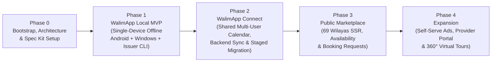

# WalimApp — Delivery Roadmap & Acceptance Gates

- **Status:** Baseline v1.1 (Phase 0 Post-Audit Consolidated)
- **Last Updated:** 2026-10-29
- **Execution Method:** Spec-Driven Development via GitHub Spec Kit (`/speckit-*` skills in Google Antigravity), slice by slice, with mandatory Product Owner review gates.
- **Related Documents:** [Product Requirements](./product-requirements.md), [Architecture Baseline](./architecture.md), [Decision Register](./decision-register.md), [AI Development Workflow](./ai-development-workflow.md), [Project Constitution](../.specify/memory/constitution.md).

---

## 1. Strategic Positioning: Single-Device Local Foundation (Phase 1) vs. Shared Multi-User Calendar (Phase 2)

In Algeria, wedding venue owners and staff work across both **Android smartphones** (taking customer calls on-site, checking dates, recording deposits, and sharing PDF receipts via WhatsApp) and **Windows desktop PCs** (at the venue reception/accounting desk).

### Clear Boundary Between Phase 1 (`Local`) and Phase 2 (`Connect`)

1. **Phase 1 (`WalimApp Local`) Is a Single-Device Offline Foundation & Pilot:**
   - **What it delivers:** A 100% offline, perpetual-licensed venue management application running from a single shared Flutter codebase (`apps/owner`) on **either** an Android smartphone **or** a Windows desktop PC.
   - **What it does NOT deliver:** Because `WalimApp Local` is strictly single-device with zero cloud/LAN sync, **Phase 1 (including the Sprint 1.3 Android APK pilot) does NOT synchronize a shared calendar across multiple family/staff phones or PCs**.
   - **Why we build it on the shared Android + Windows codebase from Sprint 1.1:** 100% of Drift/SQLCipher tables, slot-overlap logic, unconditionally append-only `payments` triggers, Arabic/French localization, PDF generators, WAL-safe `.walimbak` backups, and Ed25519 license verification are written and tested **once**, giving single-device phone-first owners an immediate offline tool while laying the exact client foundation required for Phase 2.
2. **Phase 2 (`WalimApp Connect`) Delivers the Shared Multi-User Team Calendar:**
   - **What it delivers:** The **first release that provides a shared, synchronized reservation calendar across multiple Android smartphones and Windows PCs** within the same venue/organization.
   - **Individual Accounts & Venue RBAC:** Every family member, manager, receptionist, or accountant authenticates with their own individual user account on their own device and sees data governed by their venue-scoped role (`owner`, `manager`, `receptionist`, `accountant`, `viewer`)—never by sharing a single owner password.
   - *Optional Sequencing Flexibility (`DEC-01`):* If the Product Owner decides that multi-phone shared team scheduling is needed before local-only polish, Phase 2 Sprints 2.1–2.3 can be pulled forward immediately after the Phase 1 core calendar/ledger foundation is approved.

---

## 2. Phase Overview & Slice-Scoped Decision Dependencies

> **Slice-Scoped Decision Rule (`P1-6`):** Unresolved decisions in [`docs/decision-register.md`](./decision-register.md) block **only the specific sprint slice that depends on them**, never unrelated earlier foundation work:

| Phase | Target Outcome | Slice-Scoped Decisions Required | Explicitly Deferred to Later Phases |
| :--- | :--- | :--- | :--- |
| **Phase 0** | Consolidated baseline docs, Spec Kit constitution, private GitHub repo. | Product Owner review & approval of revised Phase 0 docs and Constitution. | All application code, DB migrations, UI scaffolding. |
| **Phase 1** | **WalimApp Local MVP** (Single-device offline edition on Android & Windows + offline `tools/license-issuer` CLI). | • Before Sprint 1.1: `DEC-01`, `DEC-02` • Before Sprint 1.2: `DEC-03`, `DEC-04` • Before Sprint 1.3: `DEC-05` • Before Sprint 1.4: `DEC-06` | Multi-device/multi-user shared calendar sync, Laravel backend, public website, online booking requests. |
| **Phase 2** | **WalimApp Connect** (Shared multi-user calendar across phones/PCs, Laravel + PG 17 + Filament backend, sync, staged migration with documents). | • Before Sprint 2.1: Backend Composer lock check + `DEC-07` • Before Sprint 2.2: `DEC-08`, `DEC-09` • Before Sprint 2.3: `DEC-11` • Before Prod Launch: `DEC-10` (ANPDP/Legal review) | Public SEO marketplace pages, public booking requests, provider directory, ads. |
| **Phase 3** | **Public Marketplace & Online Booking Requests** (69-Wilaya SSR web, availability, `booking_requests` approval, curated providers). | • Before Sprint 3.1: `DEC-12`, `DEC-14` • Before Sprint 3.2: `DEC-13` | 360° virtual tours, provider self-registration portal, self-serve ad portal. |
| **Phase 4** | **Marketplace Expansion** (self-serve ads, provider self-service portal, 360° virtual tours). | • Before Sprint 4.1/4.2: `DEC-15` • Before Sprint 4.3: `DEC-16` | Out-of-scope enterprise ERP features. |

---

## 3. Detailed Phases, Candidate Sprints & Measurable Acceptance Gates

### Phase 0 — Project Bootstrap, Architecture Consolidation & Spec Kit Setup *(Current Phase)*

- **Deliverables:**
  - Preserve original drafts byte-for-byte in [`reference/architecture-drafts/`](../reference/architecture-drafts/).
  - Canonical docs: [`README.md`](../README.md), [`AGENTS.md`](../AGENTS.md), [`docs/product-requirements.md`](./product-requirements.md), [`docs/architecture.md`](./architecture.md), [`docs/architecture-review.md`](./architecture-review.md), [`docs/decision-register.md`](./decision-register.md), [`docs/roadmap.md`](./roadmap.md), [`docs/ai-development-workflow.md`](./ai-development-workflow.md), and [`.github/`](../.github/) templates.
  - Spec Kit initialized for Antigravity (`agy`) with [`.specify/memory/constitution.md`](../.specify/memory/constitution.md).
  - Git initialized and pushed to private GitHub repository `zBensadi/walimapp`.
- **Phase 0 Acceptance Gate:**
  - [x] All 3 original architecture drafts preserved byte-for-byte.
  - [x] P0 and P1 findings from [`docs/walimapp-phase0-audit.md`](./walimapp-phase0-audit.md) resolved across canonical documents and verified by automated link/terminology checks.
  - [x] Spec Kit skills verified in [`.agents/skills/`](../.agents/skills/).
  - [ ] **Human Gate (Required Before Phase 1):** Product Owner reviews the revised Phase 0 Markdown artifacts and [`.specify/memory/constitution.md`](../.specify/memory/constitution.md) (with ChatGPT) and explicitly approves moving to Phase 1.

---

### Phase 1 — WalimApp Local MVP (Single-Device Offline Foundation on Shared Android & Windows Codebase)

> **Goal:** Ship a rock-solid, 100% offline-capable **single-device** wedding venue management application on Android smartphones and Windows desktops with SQLCipher encryption at rest, WAL-safe encrypted backups, and offline Ed25519 perpetual licensing (`tools/license-issuer`).

#### Candidate Sprints / Feature Slices (Each Executed via Spec Kit Workflow)

- **Sprint 1.1 — Foundation, SQLCipher/Drift Schema, Authoritative 69-Wilaya Seed & Bilingual Shell *(Gate: `DEC-01`, `DEC-02`)*:**
  - Pin current stable Flutter SDK (`3.44+` / `3.47+`) in `apps/owner`, configure `ar-DZ` (RTL) and `fr-DZ` (LTR) localization with Western numerals (`0-9`), integer whole-Dinar `MoneyDzd` (`BIGINT` `DZD`), UUIDv7 generator, encrypted Drift database via `sqlcipher_flutter_libs` (WAL mode, key in `SecureCredentialStore`), verified 69-Wilaya/1,541-commune offline seed, and `AdaptiveShell` (`NavigationBar` `< 600dp` vs `NavigationRail` `>= 600dp`).
- **Sprint 1.2 — Venue, Halls, Configurable Slots, Local PIN & Reservation Calendar Engine *(Gate: `DEC-03`, `DEC-04`)*:**
  - Venue profile setup, multi-hall configuration (`halls`), configurable booking slots (`hall_slots` including overnight `spans_next_day`), customer directory (`customers` with optional collapsed `national_id_number`), optional local Owner PIN lock (`DEC-04`), and deterministic slot-overlap prevention (`[starts_at_local, ends_at_local)`).
  - Interactive Month, Week, Day, and Agenda calendar views meeting the measurable `p95 < 100ms` benchmark.
- **Sprint 1.3 — Unconditionally Append-Only Financial Ledger, Expenses, PDFs & Single-Device Android Pilot *(Gate: `DEC-05`)*:**
  - Immutable `payments` table (`deposit`, `installment`, `final_settlement`, `refund`, `adjustment` in whole `DZD`) with SQLite `BEFORE UPDATE OR DELETE` trigger rejecting **all** updates/deletes on every column, automatic `amount_paid_dzd` / `balance_due_dzd` calculation, `expenses` tracking, and financial summary reports.
  - Offline Arabic/French PDF contract and payment receipt generator (`pdf` + `printing`) recording metadata and SHA-256 hashes in `generated_documents`, with Android WhatsApp/share integration.
  - **Milestone:** Field-testable **single-device Android APK pilot** for phone-first venue owners.
- **Sprint 1.4 — Desktop Split-View, WAL-Safe `.walimbak` Backups, Ed25519 Verifier & Offline `tools/license-issuer` CLI *(Gate: `DEC-06`)*:**
  - Windows master-detail split panes, keyboard shortcuts, and single-instance mutex (`AppInstanceGuard`).
  - WAL-safe `.walimbak` backup creation (`VACUUM INTO` + `PRAGMA integrity_check` + `AES-256-GCM` with independent DEK wrapped per `DEC-06`), deterministic foreground rolling backups, 7-day off-device export reminder banner, and pre-restore verification with `.pre_restore` safety copy.
  - Offline Ed25519 `.walimlic` verification in `apps/owner` (`DeviceIdentityProvider` Installation UUID + OS ID) **plus** the standalone offline operator CLI (`tools/license-issuer`) for issuing, logging (`issued-licenses.jsonl`), and transferring `.walimlic` files outside the client repository.

#### Phase 1 Measurable Acceptance Gate
1. **Offline Single-Device Completeness:** Both the Android APK and Windows desktop build execute all venue, hall, slot, reservation, customer, payment, expense, PDF contract/receipt, and backup/restore workflows with airplane mode enabled / network adapter disabled.
2. **Measurable Offline Performance (`NFR-03`):** Automated benchmark tests against a warm SQLCipher database seeded with **2,000 reservations, 1,500 customers, and 5,000 payments across 5 halls** verify `p95 < 100ms` for month/week/day calendar queries, overlap validation, and customer search on the reference Android and Windows target classes.
3. **Zero Double-Booking:** Automated unit and integration tests verify that overlapping `confirmed` or `tentative` reservations (including Full-Day vs. Evening and overnight slots crossing midnight) are deterministically rejected.
4. **Unconditionally Immutable Ledger (`P0-6`):** Automated tests verify that attempting to `UPDATE` **any** column (amount, method, date, receipt number, or note) or `DELETE` a row on `payments` fails at the SQLite trigger level, and balance adjustments require an explicit `refund` or `adjustment` row with `parent_payment_id` and `reason`.
5. **Perpetual License & Offline Issuance Verification (`P0-2`):** Automated tests generate a `.walimlic` using `tools/license-issuer`, activate `apps/owner`, simulate system clocks set 5 years past `updates_until`, and verify that the activated build continues operating with zero locked features, while a simulated newer `APP_BUILD_DATE > updates_until` is blocked *before* running SQLite migrations.
6. **WAL-Safe Backup Round-Trip (`P0-1`, `P1-5`):** Creating a `.walimbak` archive while active WAL transactions exist (`VACUUM INTO`), corrupting a test copy (rejected by pre-restore check), and restoring a valid archive using the `DEC-06` recovery credential reproduces 100% identical reservation, document, and financial checksums.
7. **Bilingual & Whole-DZD Numeral Compliance:** All screens and generated PDF contracts/receipts render accurately in `ar-DZ` (RTL) and `fr-DZ` (LTR) using Western digits (`0-9`) and integer whole `DZD`.

---

### Phase 2 — WalimApp Connect (Shared Multi-User Calendar, Backend, Sync & Staged Migration)

> **Goal:** Deliver the **shared multi-user, multi-device reservation calendar** across Android phones and Windows PCs, venue-scoped employee permissions, Super-Admin governance, and non-destructive Local-to-Connect migration (including contract templates and generated PDFs).

#### Candidate Sprints / Feature Slices

- **Sprint 2.1 — Laravel Modular Monolith, PostgreSQL 17 Schema & Filament Super-Admin Core *(Gate: Composer Lock Check + `DEC-07`)*:**
  - Verify and lock the Phase 2 Composer dependency tree (Track 1 `PHP 8.4 + Laravel 13.x + Filament v5.x + Livewire v4.x + Tailwind v4.1+` recommended; see [`docs/architecture.md §2.2`](./architecture.md)).
  - Implement 69-Wilaya tables, `organizations`, `venues`, `venue_memberships`, `device_registrations`, `licenses` (importing Phase 1's `issued-licenses.jsonl` ledger + Ed25519 signer UI in Filament), `subscriptions`, and immutable `audit_logs`.
- **Sprint 2.2 — Central Booking Engine, Commit-Locked Venue Cursor & Role-Filtered Sync API *(Gate: `DEC-08`, `DEC-09`)*:**
  - PostgreSQL `reservations` table with `EXCLUDE USING gist (hall_id WITH =, tsrange(starts_at_local, ends_at_local, '[)') WITH &&)` and unconditional `BEFORE UPDATE OR DELETE ON payments` trigger.
  - Sync endpoints: `POST /api/v1/sync/push` with `sync_processed_operations` deduplication and `venue_sync_state.last_seq` locked with `SELECT ... FOR UPDATE` at commit; `GET /api/v1/sync/pull` with per-venue `seq` cursor, `permissions_hash` role-change detection (`CURSOR_RESET_REQUIRED`), and server-side RBAC financial filtering (`is_financial_masked = true`).
- **Sprint 2.3 — Client Monotonic Outbox Worker, Multi-User Shared Calendar & Revocation Lifecycle *(Gate: `DEC-11`)*:**
  - Integrate `sync_outbox` (`outbox_seq` ordering + `depends_on_outbox_seq` parent-child dependency blocking) and `pending_sync` badge overlay in `apps/owner` (Android & Windows).
  - Individual multi-user login, venue switcher, 72-hour staff `OfflineAccessLease`, local venue purge on `403 MEMBERSHIP_REVOKED` / `401 DEVICE_REVOKED`, zero-PII FCM push wake-up pokes, and `needs_review` conflict resolution UI.
- **Sprint 2.4 — Staged Local-to-Connect Migration (Data + Documents) & Subscription Expiry/Renewal Lifecycle *(Gate before Prod: `DEC-10`)*:**
  - Implement the 4-phase migration pipeline (`migration_sessions`, `migration_staging_records` for all 11 entity types including `contract_templates` and `generated_documents`, binary PDF/media transfer verified by `sha256_checksum`, server dry-run validator, atomic promotion, and client cutover).
  - Implement Connect subscription state transitions (`active` -> `past_due` -> `expired_local_fallback`) and renewal outbox reconciliation.

#### Phase 2 Measurable Acceptance Gate
1. **Multi-User, Multi-Device Shared Calendar Convergence (`P0-3`, `P1-1`, `P1-2`):** An owner on an Android phone, a manager on a second Android phone, and a receptionist on a Windows PC (authenticated as separate users in the same venue) create and update bookings offline (including skewed device clocks and parent-child customer+reservation+payment chains), reconnect, and converge to the exact same `venue_sync_state.last_seq`.
2. **Server-Side RBAC, Masked Row Safety & Role-Change Re-Sync (`P1-2`, `P1-3`):**
   - Integration tests verify that a `viewer` or non-financial `receptionist` cannot retrieve `payments` or `expenses`, receives `is_financial_masked = true` on `reservations` without overwriting server prices, and cannot push financial mutations.
   - Upgrading a user's role triggers `CURSOR_RESET_REQUIRED` (`permissions_hash` mismatch) and backfills historical financial records; downgrading or revoking a user purges restricted local data upon reconnection (and expires offline staff access after the 72h `OfflineAccessLease` TTL).
3. **Offline Double-Booking Conflict Safety:** When two offline devices book overlapping slots on the same hall, the first push succeeds as `confirmed` and the second push is stored as `needs_review` (preserving its primary key so any dependent child `payments` still attach cleanly).
4. **Idempotent Retry:** Replaying the exact same `POST /api/v1/sync/push` payload 5 times produces exactly 1 reservation and 1 payment entry in PostgreSQL.
5. **Non-Destructive Staged Migration of Data & Documents (`P0-7`):** A Local database containing 500+ historical reservations, installment payments, expenses, contract templates, and generated PDF contracts/receipts migrates to Connect with 100% matching entity counts, financial checksums, and PDF `sha256_checksum` verification; simulated network failure at 50% upload leaves the local SQLCipher database intact in Local mode and resumable.
6. **Connect Expiry & Renewal Reconciliation (`P2-3`):** Expiring a Connect subscription past `grace_ends_at` pauses cloud sync while offline read/write/print operations on Android and Windows continue working; renewing the subscription reconciles accumulated `sync_outbox` queues across devices without data loss.

---

### Phase 3 — Public Marketplace & Owner-Approved Online Booking Requests

> **Goal:** Launch the bilingual (`ar-DZ` / `fr-DZ`) SEO public marketplace across all 69 Wilayas, reliable slot availability display, curated wedding provider directory, and the end-to-end `booking_requests` -> owner approval workflow.

#### Candidate Sprints / Feature Slices

- **Sprint 3.1 — Bilingual SSR Venue Directory, 69-Wilaya Filters & SEO Infrastructure *(Gate: `DEC-12`, `DEC-14`)*:**
  - Server-side-rendered Laravel Blade + Tailwind CSS + Alpine.js pages for home, Wilaya/commune landing pages (all 69 Wilayas), search filters (capacity, price, amenities, date), venue profile pages, `hreflang`, JSON-LD `EventVenue`, and XML sitemaps.
- **Sprint 3.2 — Public Availability Projection & Online Booking Request Workflow (`booking_requests`) *(Gate: `DEC-13`)*:**
  - Privacy-safe public availability calendar (showing only slot availability when venue sync is fresh, zero customer PII).
  - Public `booking_requests` submission with Turnstile/rate-limiting and Law 18-07 consent recording.
  - Owner inbox in `apps/owner` (Android & Windows) + atomic approval transaction (`booking_requests` -> `customer` + `confirmed` `reservation` guarded by `btree_gist`) and competing-request flagging.
- **Sprint 3.3 — Curated Service Provider Directory, Admin Ad Placements & Moderation:**
  - Staff-curated wedding service provider directory (caterers, photographers, decorators, etc.) by Wilaya and category.
  - Super-Admin moderation queue for venue listings/photos and basic featured venue / banner placements.

#### Phase 3 Measurable Acceptance Gate
1. **Strict Separation of Requests and Reservations:** Submitting 10 public `booking_requests` for the same hall and date creates 0 rows in `reservations` and does not block the owner from booking that slot until the owner explicitly approves a request.
2. **Atomic Approval Under Race Conditions:** Concurrent attempts to approve two competing `booking_requests` (or an owner walk-in sync vs. request approval) result in exactly one `confirmed` reservation and one clean conflict message.
3. **Zero PII Leakage:** Automated security tests confirm public HTML and JSON endpoints never expose customer names, phone numbers, notes, or private ledger balances.
4. **SEO & Mobile Performance:** Public venue and Wilaya pages render complete indexable HTML without client JS, validate `ar-DZ` RTL and `fr-DZ` LTR `hreflang` markup, and achieve mobile LCP `< 2.5s`.

---

### Phase 4 — Advertising Expansion, Provider Self-Service & 360° Virtual Tours

> **Goal:** Expand marketplace monetization and rich media only after Phases 1–3 are stable in production.

#### Candidate Sprints / Feature Slices

- **Sprint 4.1 — Self-Serve Advertising Campaigns & Lead Attribution Analytics *(Gate: `DEC-15`)*:**
  - Venue/provider self-service campaign requests, impression/click/WhatsApp-click tracking, and billing workflows.
- **Sprint 4.2 — Wedding Service Provider Self-Service Portal *(Gate: `DEC-15`)*:**
  - Provider registration, profile/portfolio management, and Super-Admin verification workflow.
- **Sprint 4.3 — 360° Virtual Tours Integration *(Gate: `DEC-16`)*:**
  - S3/R2 panoramic asset storage (`media_type = 'panorama_360'`) and click-to-load `Pannellum` interactive 360° viewer on venue pages.

#### Phase 4 Measurable Acceptance Gate
1. **Zero Core Regression:** Enabling 360° tours and provider self-service introduces zero regressions to Connect sync latency or public page initial LCP (`< 2.5s` via click-to-load panorama lazy loading).
2. **Moderation Safety:** Unapproved self-registered providers or ad creatives never appear on public pages until approved in Filament Super-Admin.
