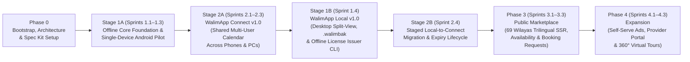

# WalimApp — Delivery Roadmap & Acceptance Gates

- **Status:** Candidate Baseline v1.3-draft (Phase 0.3 — Pending Product Owner Approval)
- **Last Updated:** 2026-10-29
- **Execution Method:** Spec-Driven Development via GitHub Spec Kit (`/speckit-*` skills in Google Antigravity), slice by slice, with mandatory Product Owner review gates.
- **Related Documents:** [Product Requirements](./product-requirements.md), [Architecture Baseline](./architecture.md), [Decision Register](./decision-register.md), [AI Development Workflow](./ai-development-workflow.md), [Project Constitution](../.specify/memory/constitution.md).

---

## 1. Strategic Sequencing: Value-First Interleaved Delivery (`DEC-01`)

In Algeria, wedding venue owners and family/staff teams operate across **multiple Android smartphones** (taking customer calls on the move, checking dates, recording deposits, and sharing PDF receipts via WhatsApp) and **Windows desktop PCs** (at the venue reception/accounting desk).

Because `WalimApp Local` is strictly a **single-device offline edition** (zero cloud/LAN sync), a local-only Android APK on one phone **cannot** provide a shared reservation calendar across multiple family members or staff phones. Conversely, `WalimApp Connect` requires the offline SQLite/Drift calendar, slot-overlap engine, and append-only ledger foundation built in `apps/owner`.

### Value-First Interleaved Roadmap (`DEC-01` Option B — Recommended Default)

To deliver the **shared multi-user, multi-device calendar (`WalimApp Connect v1.0`) as the first sellable commercial release** without throwing away or duplicating offline client work, the delivery schedule interleaves Phase 1 and Phase 2 into four clean stages:

1. **Stage 1A (`Sprints 1.1–1.3`) — Offline Core Foundation & Single-Device Android Pilot:**
   - Builds the shared trilingual (`ar-DZ` RTL, `fr-DZ` LTR, `en` LTR) `apps/owner` Flutter foundation: `sqlite3mc` encrypted SQLite (`drift` + `sqlite3` build hook with explicit `PRAGMA cipher = 'chacha20'; PRAGMA legacy = 0;` configured *before* `PRAGMA key` and verified across `debug`, `profile`, and `release` builds via a pre-feature Android + Windows PoT), authoritative 69-Wilaya/1,541-commune trilingual seed, multi-hall configuration (`max_venues = 1`, `max_halls = null` unlimited by default per `DEC-02`), configurable booking slots, `local_actors` attribution, deterministic overlap engine, unconditionally append-only `payments` ledger, and trilingual (`ar-DZ`, `fr-DZ`, `en`) PDF contracts/receipts.
   - **Explicit Pilot Scope (`P0-2`):** The Sprint 1.3 Android APK is an **internal / early-adopter single-device validation pilot** used to test calendar ergonomics, whole-DZD ledger rules, and Arabic RTL PDF shaping on physical phones. **It is NOT a multi-phone shared calendar or a paid commercial release.**
2. **Stage 2A (`Sprints 2.1–2.3` — Pulled Forward) — `WalimApp Connect v1.0` (Shared Multi-User Calendar Release):**
   - Immediately after Stage 1A (`Sprint 1.3`), builds the Laravel + PostgreSQL 17 (`btree_gist`) + trilingual Filament (`ar`/`fr`/`en`) backend, configurable Connect subscription plans (**Basic: `1` active device**; **Higher-Capacity: up to `5` active devices** at a higher price, with snapshotted `agreed_price_dzd`), mandatory individual user authentication & venue-scoped RBAC (`venue_memberships`, decoupled from device limits), device replacement/revocation (`device_registrations`), commit-serialized role-filtered sync (`scanned_through_seq`), binary PDF/logo sync, per-venue DB cryptographic erasure on revocation/downgrade, and monotonic `outbox_seq` client sync across Android phones and Windows PCs.
   - **First Commercial Release:** Ships **`WalimApp Connect v1.0`**, solving the core Algerian market need for a **shared, synchronized reservation calendar across multiple phones and Windows PCs**.
3. **Stage 1B (`Sprint 1.4`) — `WalimApp Local v1.0` Commercial Productization:**
   - Completes Windows desktop split-view polish, 64 KiB chunked streaming `.walimbak` encrypted backups (`DEC-06`), Ed25519 `.walimlic` offline license verification, and the standalone `tools/license-issuer` CLI (`LicenseSigner` interface).
   - **Second Commercial Release:** Ships the standalone perpetual single-device **`WalimApp Local v1.0`** edition for offline-only venues.
4. **Stage 2B (`Sprint 2.4`) — Local-to-Connect Staged Migration & Subscription Expiry/Renewal Lifecycle:**
   - Delivers the non-destructive 4-phase staged migration (all 12 relational entities + `migration_assets_manifest` content-addressed PDF/logo upload, pure-PostgreSQL promotion, and lost-response `/commit` recovery) so `WalimApp Local` venues can upgrade seamlessly to `WalimApp Connect`, plus Connect subscription expiry fallback and renewal reconciliation.

*(Note: If the Product Owner selects `DEC-01` Option A in [`docs/decision-register.md`](./decision-register.md), Stage 1B (`Sprint 1.4`) simply executes before Stage 2A (`Sprints 2.1–2.3`) with identical sprint contents and acceptance gates.)*

---

## 2. Stage Overview & Slice-Scoped Decision Dependencies

> **Slice-Scoped Decision Rule:** Unresolved decisions in [`docs/decision-register.md`](./decision-register.md) block **only the specific sprint slice that depends on them**, never unrelated earlier foundation work:

| Stage / Phase | Target Outcome | Slice-Scoped Decisions Required | Explicitly Deferred to Later Stages |
| :--- | :--- | :--- | :--- |
| **Phase 0** | Consolidated baseline docs (`v1.3-draft`), Spec Kit constitution (`v1.3.0-draft`), private GitHub repo. | Product Owner review & approval of revised Phase 0.3 docs and Constitution ratification. | All application code, DB migrations, UI scaffolding. |
| **Stage 1A** *(Sprints 1.1–1.3)* | **Offline Core Foundation & Single-Device Android Pilot** (`apps/owner` encrypted SQLite `chacha20` PoT, 69-Wilaya trilingual seed, multi-hall calendar, `local_actors`, append-only `payments`, trilingual `ar`/`fr`/`en` UI & PDFs). | • Before Sprint 1.1: `DEC-01`, `DEC-02` • Before Sprint 1.2: `DEC-03`, `DEC-04` • Before Sprint 1.3: `DEC-05` | Multi-device shared calendar sync, Laravel backend, `.walimlic` issuer CLI, `.walimbak` streaming backup UI. |
| **Stage 2A** *(Sprints 2.1–2.3)* | **`WalimApp Connect v1.0` (First Commercial Release):** Shared multi-user calendar across Android phones & Windows PCs, Laravel + PG 17 + trilingual Filament backend, configurable device plans (`1` vs. `5` active devices), role-filtered sync, binary asset sync, per-venue DB crypto-erasure. | • Before Sprint 2.1: Backend Composer lock check + `DEC-07` (initial plan prices) • Before Sprint 2.2: `DEC-08`, `DEC-09` • Before Sprint 2.3: `DEC-11` • Before Prod Launch: `DEC-10` (ANPDP/Legal review) | Local-to-Connect migration (`Sprint 2.4`), public SEO marketplace pages, public booking requests. |
| **Stage 1B** *(Sprint 1.4)* | **`WalimApp Local v1.0` Commercial Release:** Windows desktop split-view polish, 64 KiB streaming `.walimbak` backups, Ed25519 `.walimlic` verifier & `tools/license-issuer` CLI. | • Before Sprint 1.4: `DEC-06` | Local-to-Connect migration (`Sprint 2.4`), public marketplace. |
| **Stage 2B** *(Sprint 2.4)* | **Local-to-Connect Staged Migration & Subscription Expiry Lifecycle** (12 relational entities + `migration_assets_manifest` content-addressed binaries, pure-DB promotion, lost-response `/commit` recovery). | Uses settled `DEC-08`, `DEC-09`, `DEC-10`. | Public SEO marketplace pages, public booking requests, provider directory, ads. |
| **Phase 3** *(Sprints 3.1–3.3)* | **Public Marketplace & Online Booking Requests** (69-Wilaya trilingual `ar`/`fr`/`en` SSR web, optional per-language content & fallback, availability, `booking_requests` approval, curated providers). | • Before Sprint 3.1: `DEC-12`, `DEC-14` • Before Sprint 3.2: `DEC-13` | 360° virtual tours, provider self-registration portal, self-serve ad portal. |
| **Phase 4** *(Sprints 4.1–4.3)* | **Marketplace Expansion** (self-serve ads, provider self-service portal, 360° virtual tours). | • Before Sprint 4.1/4.2: `DEC-15` • Before Sprint 4.3: `DEC-16` | Out-of-scope enterprise ERP features. |

---

## 3. Detailed Stages, Candidate Sprints & Measurable Acceptance Gates

### Phase 0 — Project Bootstrap, Architecture Consolidation & Spec Kit Setup *(Current Phase)*

- **Deliverables:**
  - Preserve original drafts byte-for-byte in [`reference/architecture-drafts/`](../reference/architecture-drafts/).
  - Canonical docs (`v1.3-draft`): [`README.md`](../README.md), [`AGENTS.md`](../AGENTS.md), [`docs/product-requirements.md`](./product-requirements.md), [`docs/architecture.md`](./architecture.md), [`docs/architecture-review.md`](./architecture-review.md), [`docs/decision-register.md`](./decision-register.md), [`docs/roadmap.md`](./roadmap.md), [`docs/ai-development-workflow.md`](./ai-development-workflow.md), and [`.github/`](../.github/) templates.
  - Spec Kit initialized for Antigravity (`agy`) with candidate [`.specify/memory/constitution.md`](../.specify/memory/constitution.md) (`v1.3.0-draft`).
  - Git initialized and pushed to private GitHub repository `zBensadi/walimapp`.
- **Phase 0 Acceptance Gate:**
  - [x] All 3 original architecture drafts preserved byte-for-byte.
  - [x] Findings from [`docs/walimapp-phase0-audit.md`](./walimapp-phase0-audit.md), [`docs/walimapp-phase0-audit-round2.md`](./walimapp-phase0-audit-round2.md), the Gemini 3.1 Pro review, and Phase 0.3 Product Owner directives resolved across canonical documents and verified by automated link/terminology checks.
  - [x] Spec Kit skills verified in [`.agents/skills/`](../.agents/skills/).
  - [ ] **Human Ratification Gate (Required Before Stage 1A / Sprint 1.1):** Product Owner reviews the revised Phase 0.3 Markdown artifacts and [`.specify/memory/constitution.md`](../.specify/memory/constitution.md) (with ChatGPT) and explicitly approves ratification (`v1.3.0`) and progression to Sprint 1.1.

---

### Stage 1A — Offline Core Foundation & Single-Device Android Pilot (`Sprints 1.1–1.3`)

> **Goal:** Build the shared Android & Windows offline core (`apps/owner`) with `sqlite3mc` (`chacha20` ChaCha20-Poly1305 256-bit AEAD) encryption at rest, multi-hall slot-overlap prevention, `local_actors` attribution, unconditionally append-only whole-DZD financials, and trilingual (`ar-DZ`, `fr-DZ`, `en`) UI & PDF generation, culminating in an **internal / early-adopter single-device Android pilot**.

#### Candidate Sprints / Feature Slices (Each Executed via Spec Kit Workflow)

- **Sprint 1.1 — Foundation, Pre-Feature `sqlite3mc` (`chacha20`) PoT, Verified 69-Wilaya Trilingual Seed & Shell *(Gate: `DEC-01`, `DEC-02`)*:**
  - Pin current stable Flutter SDK (`3.44+` / `3.47+`) in `apps/owner`, configure **trilingual `ar-DZ` (RTL), `fr-DZ` (LTR), and `en` (LTR)** localization with Western numerals (`0-9`), integer whole-Dinar `MoneyDzd` (`BIGINT` `DZD`), canonical ISO-8601 (`'YYYY-MM-DDTHH:mm:ss'`) local timestamps, and UUIDv7 generator.
  - **Pre-Feature `sqlite3mc` Cipher Proof-of-Technology Gate (`P1-1`):** Configure `drift: ^2.35.0` + `sqlite3: ^3.8.0` with Dart Native Assets build hooks (`hooks.user_defines.sqlite3.source: sqlite3mc`), per-venue encrypted database files (`venues/<venue_id>.db`), keys in `SecureCredentialStore` (`Android Keystore` / `Windows DPAPI`), and explicit pre-key cipher selection (`PRAGMA cipher = 'chacha20'; PRAGMA legacy = 0;` executed **before** `PRAGMA key`) with fail-closed verification (`SELECT sqlite3mc_config('cipher');` / `PRAGMA cipher;` == `'chacha20'`). Execute and pass the standalone **Android + Windows `sqlite3mc` (`chacha20`) proof-of-technology test across `debug`, `profile`, and `release` builds** *before* building domain features on top of it.
  - Curate and verify the authoritative **69-Wilaya (`'01'`..`'69'`) and 1,541-commune** offline JSON/SQLite seed (`name_ar`, `name_fr`, `name_en`) against official Algerian *Journal Officiel (JORADP)* / ONS data (`P2-2`), and build `AdaptiveShell` (`NavigationBar` `< 600dp` vs `NavigationRail` `>= 600dp`).
- **Sprint 1.2 — Venue, Unlimited Multi-Hall Configuration, Configurable Slots, `local_actors`, Local PIN & Calendar Engine *(Gate: `DEC-03`, `DEC-04`)*:**
  - Venue profile setup (`max_venues = 1`, `default_locale` in `'ar'|'fr'|'en'`), multi-hall configuration (`halls` with `"max_halls": null` unlimited by default per `DEC-02`), configurable booking slots (`hall_slots` including overnight `spans_next_day`), customer directory (`customers` with optional collapsed `national_id_number`), `local_actors` operator selector (`P1-6`), optional local Owner PIN lock (`DEC-04`), and deterministic slot-overlap prevention (`[starts_at_local, ends_at_local)`).
  - Interactive Month, Week, Day, and Agenda calendar views meeting the measurable `p95 < 100ms` benchmark.
- **Sprint 1.3 — Unconditionally Append-Only Financial Ledger, Expenses, Trilingual PDFs & Single-Device Android Pilot *(Gate: `DEC-05`)*:**
  - Immutable `payments` table (`deposit`, `installment`, `final_settlement`, `refund`, `adjustment` in whole `DZD`, attributed via `recorded_by_actor_name` and `recorded_by_local_actor_id`) with SQLite `BEFORE UPDATE OR DELETE ON payments` trigger rejecting **all** updates/deletes on every column, automatic `amount_paid_dzd` / `balance_due_dzd` calculation, `expenses` tracking, and financial summary reports.
  - Execute an early **Arabic RTL PDF shaping proof-of-technology test** (`P2-1`) validating cursive ligatures, bidirectional tables (`ar-DZ` + `fr-DZ` + `en` + Western digits `0-9` + phone numbers), and thermal/A4 output before building the full trilingual contract/receipt templates (`generated_documents` + SHA-256 checksums + Android WhatsApp share sheet).
  - **Milestone:** Field-testable **single-device Android APK pilot** for internal and early-adopter single-phone validation.

#### Stage 1A Measurable Acceptance Gate
1. **Explicit `sqlite3mc` (`chacha20`) Fail-Closed Encryption Verification (`P1-1`):** Automated PoT tests on Android and Windows across **`debug`, `profile`, and `release` builds** verify that `PRAGMA cipher = 'chacha20'; PRAGMA legacy = 0;` is configured before `PRAGMA key`, `SELECT sqlite3mc_config('cipher');` / `PRAGMA cipher;` equals `'chacha20'`, raw `.db` files on disk have no plaintext SQLite header, and opening a database with a wrong key or mismatched cipher throws a fatal `StateError`.
2. **Measurable Offline Performance (`NFR-03`):** Automated benchmark tests against a warm `sqlite3mc` database seeded with **2,000 reservations, 1,500 customers, and 5,000 payments across 5 halls** verify `p95 < 100ms` for month/week/day calendar queries, overlap validation, and customer search on the reference Android and Windows target classes.
3. **Zero Double-Booking:** Automated unit and integration tests verify that overlapping `confirmed` or `tentative` reservations (including Full-Day vs. Evening and overnight slots crossing midnight) are deterministically rejected.
4. **Unconditionally Immutable Ledger & Actor Attribution (`P0-6`, `P1-6`):** Automated tests verify that attempting to `UPDATE` **any** column or `DELETE` a row on `payments` fails at the SQLite trigger level, balance adjustments require an explicit `refund` or `adjustment` row with `parent_payment_id` and `reason`, and every reservation/payment records `recorded_by_actor_name`.
5. **Trilingual RTL/LTR PDF Shaping & Whole-DZD Numeral Compliance (`P2-1`):** All screens and generated PDF contracts/receipts render connected Arabic script (`ar-DZ` RTL), French (`fr-DZ` LTR), and English (`en` LTR) accurately with Western digits (`0-9`) and integer whole `DZD`.

---

### Stage 2A — `WalimApp Connect v1.0`: Shared Multi-User Calendar, Tiered Device Plans & Sync Engine (`Sprints 2.1–2.3` — Pulled Forward)

> **Goal:** Ship **`WalimApp Connect v1.0`**—the first sellable commercial release delivering a **shared, synchronized multi-user reservation calendar across Android smartphones and Windows PCs**, configurable Connect device tiers (`1` active device Basic vs. `up to 5` active devices Higher-Capacity), mandatory individual accounts & venue-scoped RBAC, and trilingual Filament Super-Admin governance.

#### Candidate Sprints / Feature Slices

- **Sprint 2.1 — Laravel Modular Monolith, PostgreSQL 17 Schema, Configurable Connect Plans & Trilingual Filament Super-Admin *(Gate: Composer Lock Check + `DEC-07`)*:**
  - Verify and lock the Phase 2 Composer dependency tree (Track 1 `PHP 8.4 + Laravel 13.x + Filament v5.x + Livewire v4.x + Tailwind v4.1+` recommended; see [`docs/architecture.md §2.2`](./architecture.md)).
  - Implement 69-Wilaya trilingual tables, `organizations`, `venues`, `venue_memberships`, `device_registrations`, `licenses` (supporting Ed25519 `.walimlic` generation and `issued-licenses.jsonl` ledger import), **`subscription_plans` (seeded with Basic `max_active_devices = 1` and Higher-Capacity `max_active_devices = 5`, configurable in Filament)**, **`subscriptions` (with snapshotted `agreed_price_dzd` and device/venue/user limits)**, and immutable `audit_logs` in a trilingual (`ar`/`fr`/`en`) Filament Super-Admin panel.
- **Sprint 2.2 — Central Booking Engine, Auth-First Idempotency, Safe Masked Partial Updates & `scanned_through_seq` Sync API *(Gate: `DEC-08`, `DEC-09`)*:**
  - PostgreSQL `reservations` table with `EXCLUDE USING gist (hall_id WITH =, tsrange(starts_at_local, ends_at_local, '[)') WITH &&)`, `local_actors`, and unconditional `BEFORE UPDATE OR DELETE ON payments` trigger.
  - `POST /api/v1/sync/push`: Enforce authentication, active `device_registrations`, and active `venue_memberships` RBAC **before** checking `sync_processed_operations` (`P1-4`), verify `payload_sha256` (`422 IDEMPOTENCY_PAYLOAD_MISMATCH` on mismatch), strip/ignore financial fields from reservation updates submitted by non-financial roles (`G-P1-2`), and lock `venue_sync_state.last_seq` with `SELECT ... FOR UPDATE` at commit.
  - `GET /api/v1/sync/pull`: Scan contiguous 200-row windows of `sync_change_log`, returning role-filtered `items`, `scanned_through_seq = MAX(seq)` of the scanned window (`P1-3`), `has_more`, `current_permissions_hash` (`409 CURSOR_RESET_REQUIRED` on mismatch), and `409 SNAPSHOT_REBUILD_REQUIRED` if behind `min_retained_seq`.
  - Binary asset sync endpoints (`G-P1-1`): `PUT /api/v1/sync/assets/{sha256_checksum}` and `GET /api/v1/sync/assets/{sha256_checksum}` for `generated_documents` PDFs and `venues` logos.
- **Sprint 2.3 — Client Monotonic Outbox Worker, Device Limit/Replacement Flow, Per-Venue Crypto-Erasure & Shared Multi-User Calendar *(Gate: `DEC-11`)*:**
  - Integrate `sync_outbox` (`outbox_seq` ordering + `depends_on_outbox_seq` parent-child dependency blocking + `required_asset_sha256` pre-push binary upload) and `pending_sync` badge overlay in `apps/owner` (Android & Windows).
  - Individual multi-user login (`users.preferred_locale`), **active device limit enforcement (`409 DEVICE_LIMIT_REACHED`) and Owner/Super-Admin device replacement/revocation (`device_registrations`)**, venue switcher (`venues/<venue_id>.db`), **per-venue DB cryptographic erasure (`P1-2`)** on `403 MEMBERSHIP_REVOKED`, `401 DEVICE_REVOKED`, or financial role downgrade (`can_view_finance: true -> false`), **clock-rollback-resistant 72-hour staff `OfflineAccessLease` (`G-P2-1`)**, zero-PII FCM push wake-up pokes, and `needs_review` conflict resolution UI.

#### Stage 2A Measurable Acceptance Gate (`WalimApp Connect v1.0` Release Gate)
1. **Multi-User, Multi-Device Shared Calendar Convergence & Tiered Device Limits:**
   - On a **Higher-Capacity (`5` active devices)** subscription, an owner on an Android phone, a manager on a second Android phone, and a receptionist on a Windows PC (authenticated as separate users in the same venue) create and update bookings and PDF contracts offline, reconnect, and converge to the exact same `venue_sync_state.last_seq` with all generated PDF binaries downloadable on every permitted device (`G-P1-1`).
   - On a **Basic (`1` active device)** subscription, multiple staff accounts (`owner`, `receptionist`) can sign in on the single registered device with full per-user RBAC and audit attribution (`max_active_devices != max_users`), while attempting to register a 2nd concurrent device returns `409 DEVICE_LIMIT_REACHED` until the owner replaces the 1st device or upgrades the subscription.
   - Editing `subscription_plans.price_dzd` in Super-Admin leaves `subscriptions.agreed_price_dzd` on existing active subscriptions 100% unchanged.
2. **Server-Side RBAC, Masked Partial Update Safety & Filtered Cursor Progress (`P1-2`, `P1-3`, `G-P1-2`):**
   - Integration tests verify that a `viewer` or non-financial `receptionist` cannot retrieve `payments` or `expenses`, receives `is_financial_masked = true` on `reservations`, and can edit `guest_count` or `notes` on a masked reservation without overwriting server prices (`total_price_dzd`) or getting rejected.
   - When 500 consecutive `payment` changes occur, a non-financial `receptionist` pulling delta pages advances `last_pulled_seq = scanned_through_seq` cleanly to the head of the log with zero skipped booking events and zero infinite loops.
3. **Cryptographic Erasure on Revocation/Replacement/Downgrade & Clock-Rollback-Resistant Lease (`P1-2`, `G-P2-1`):**
   - Revoking/replacing a device or downgrading a user (`can_view_finance: true -> false`) deletes `key_venue_<venue_id>` from `SecureCredentialStore` and unlinks `venues/<venue_id>.db` without ever executing `DELETE FROM payments` (keeping the append-only trigger 100% unconditional), and re-hydrates a clean masked DB on downgrade while preserving unpushed non-financial `sync_outbox` edits.
   - Rolling the device system clock back 5 days while offline triggers an immediate `OfflineAccessLease` lock (`wall_clock_utc < highest_observed_utc - 300s`).
4. **Auth-First Idempotency & Payload Hash Verification (`P1-4`):** Replaying a valid `operation_id` 5 times produces 1 row; replaying an `operation_id` after membership/device revocation returns `403`/`401`; replaying an `operation_id` with a modified payload returns `422 IDEMPOTENCY_PAYLOAD_MISMATCH`.
5. **Offline Double-Booking Conflict Safety:** When two offline devices book overlapping slots on the same hall, the first push succeeds as `confirmed` and the second push is stored as `needs_review` (preserving its UUIDv7 primary key so dependent child `payments` attach cleanly).

---

### Stage 1B — `WalimApp Local v1.0`: Desktop Split-View, Streaming `.walimbak` Backups & Offline Licensing (`Sprint 1.4`)

> **Goal:** Complete the commercial single-device **`WalimApp Local v1.0`** perpetual edition with Windows desktop split-view ergonomics, 64 KiB chunked streaming `.walimbak` backups (`DEC-06`), and offline Ed25519 `.walimlic` licensing (`tools/license-issuer`).

#### Candidate Sprint / Feature Slice

- **Sprint 1.4 — Desktop Split-View, 64 KiB Streaming `.walimbak` Backups, Ed25519 Verifier & `tools/license-issuer` CLI *(Gate: `DEC-06`)*:**
  - Windows master-detail split panes, keyboard shortcuts, and single-instance mutex (`AppInstanceGuard`).
  - WAL-safe `.walimbak` backup creation (`VACUUM INTO` + `PRAGMA integrity_check` + **64 KiB chunked streaming `AES-256-GCM` encryption** with independent random 256-bit DEK wrapped per `DEC-06` and `G-P3-1`), deterministic foreground rolling backups, 7-day off-device export reminder banner, and pre-restore verification with `.pre_restore` safety copy.
  - Offline Ed25519 `.walimlic` verification in `apps/owner` (including `"max_venues": 1` and optional `"max_halls": null` check) **plus** the standalone offline operator CLI (`tools/license-issuer`) built around the `LicenseSigner` interface (`P1-9`), appending to `issued-licenses.jsonl`.

#### Stage 1B Measurable Acceptance Gate (`WalimApp Local v1.0` Release Gate)
1. **Perpetual License & Offline Issuance Verification (`P0-2`, `P1-9`, `DEC-02`):** Automated tests generate a `.walimlic` using `tools/license-issuer`, activate `apps/owner`, verify unlimited halls when `"max_halls": null` (and cap enforcement when `"max_halls": 2`), simulate system clocks set 5 years past `updates_until` (zero locked features), and verify that a simulated newer `APP_BUILD_DATE > updates_until` is blocked *before* running SQLite migrations.
2. **Streaming WAL-Safe Backup Round-Trip (`P0-1`, `G-P3-1`):** Creating a `.walimbak` archive while active WAL transactions exist (`VACUUM INTO`), verifying bounded memory usage via 64 KiB chunked streaming `AES-256-GCM`, corrupting a test chunk (rejected by pre-restore GCM tag check), and restoring a valid archive using the `DEC-06` recovery credential reproduces 100% identical reservation, document, and financial checksums.

---

### Stage 2B — Staged Local-to-Connect Migration & Subscription Expiry Lifecycle (`Sprint 2.4`)

> **Goal:** Enable any `WalimApp Local` venue to migrate 100% of its historical data, actor attributions, contract templates, and generated PDF documents to `WalimApp Connect` without data loss, and enforce safe Connect subscription expiry/renewal behavior.

#### Candidate Sprint / Feature Slice

- **Sprint 2.4 — Staged Local-to-Connect Migration (12 Entities + Content-Addressed Assets + Lost-Response Recovery) & Subscription Expiry Lifecycle *(Gate before Prod: `DEC-10`)*:**
  - Implement the 4-phase migration pipeline (`migration_sessions`, `migration_staging_records` for all 12 relational entity types including `local_actors`, `contract_templates`, and `generated_documents`, plus `migration_assets_manifest` `P1-7`).
  - Upload binary PDFs and venue logos directly to content-addressed paths (`tenants/{org_id}/venues/{venue_id}/assets/{sha256_checksum}`) verified by SHA-256 and byte size *before* `Phase M3` so promotion is a **pure PostgreSQL transaction** with zero S3 move operations (`P1-5`).
  - Implement `local_migration_state = 'commit_in_progress'` and idempotent `/commit` receipt recovery (`committed_receipt_json`) so a lost HTTP response after server commit never causes dual-mode divergence (`P1-5`).
  - Implement Connect subscription state transitions (`active` -> `past_due` -> `expired_local_fallback`) and renewal `sync_outbox` reconciliation.

#### Stage 2B Measurable Acceptance Gate
1. **Non-Destructive Staged Migration of Data, Actors & Documents (`P0-7`, `P1-5`, `P1-6`, `P1-7`):** A Local database containing 500+ historical reservations, `local_actors`, installment payments, expenses, contract templates, venue logo, and generated PDF contracts/receipts migrates to Connect with 100% matching entity counts, financial checksums, and asset `sha256_checksum` verification.
2. **Network Failure & Lost-Response `/commit` Recovery (`P1-5`):**
   - Simulated network failure at 50% staging upload leaves the local SQLite database intact in Local mode and resumable.
   - Simulated connection drop *after* PostgreSQL commits `Phase M3` but *before* the client receives the HTTP 200 response keeps the client locked in `commit_in_progress` and recovers `initial_seq` idempotently from `committed_receipt_json` upon retry.
3. **Connect Expiry & Renewal Reconciliation:** Expiring a Connect subscription past `grace_ends_at` pauses cloud sync while offline read/write/print operations on Android and Windows continue working; renewing the subscription reconciles accumulated `sync_outbox` queues across devices without data loss.

---

### Phase 3 — Public Marketplace & Owner-Approved Online Booking Requests (`Sprints 3.1–3.3`)

> **Goal:** Launch the **trilingual (`ar-DZ` RTL / `fr-DZ` LTR / `en` LTR)** SEO public marketplace across all 69 Wilayas, optional per-language venue/provider content with deterministic fallback, reliable slot availability display, curated wedding provider directory, and the end-to-end `booking_requests` -> owner approval workflow.

#### Candidate Sprints / Feature Slices

- **Sprint 3.1 — Trilingual SSR Venue Directory (`/ar`, `/fr`, `/en`), Per-Language Content Fallback, 69-Wilaya Filters & SEO Infrastructure *(Gate: `DEC-12`, `DEC-14`)*:**
  - Server-side-rendered Laravel Blade + Tailwind CSS + Alpine.js pages for home, Wilaya/commune landing pages (all 69 Wilayas in Arabic, French, and English), search filters (capacity, price, amenities, date), venue profile pages with deterministic per-language content fallback (`en -> fr -> ar`, `fr -> ar -> en`, `ar -> fr -> en` inside `<bdi>` containers), `hreflang="ar-DZ"`, `hreflang="fr-DZ"`, `hreflang="en"`, `hreflang="x-default"`, JSON-LD `EventVenue`, and XML sitemaps.
- **Sprint 3.2 — Public Availability Projection & Online Booking Request Workflow (`booking_requests`) *(Gate: `DEC-13`)*:**
  - Privacy-safe public availability calendar (showing only slot availability when venue sync is fresh, zero customer PII).
  - Public `booking_requests` submission with Turnstile/rate-limiting and Law 18-07 consent recording.
  - Owner inbox in `apps/owner` (Android & Windows) + atomic approval transaction (`booking_requests` -> `customer` + `confirmed` `reservation` guarded by `btree_gist`) and competing-request flagging.
- **Sprint 3.3 — Curated Service Provider Directory, Admin Ad Placements & Moderation:**
  - Staff-curated trilingual wedding service provider directory (caterers, photographers, decorators, etc.) by Wilaya and category.
  - Super-Admin moderation queue for venue listings/photos and basic featured venue / banner placements.

#### Phase 3 Measurable Acceptance Gate
1. **Strict Separation of Requests and Reservations:** Submitting 10 public `booking_requests` for the same hall and date creates 0 rows in `reservations` and does not block the owner from booking that slot until the owner explicitly approves a request.
2. **Atomic Approval Under Race Conditions:** Concurrent attempts to approve two competing `booking_requests` (or an owner walk-in sync vs. request approval) result in exactly one `confirmed` reservation and one clean conflict message.
3. **Zero PII Leakage:** Automated security tests confirm public HTML and JSON endpoints never expose customer names, phone numbers, notes, or private ledger balances.
4. **Trilingual SEO, Fallback & Mobile Performance:** Public venue and Wilaya pages render complete indexable HTML without client JS across `/ar`, `/fr`, and `/en`, validate `ar-DZ` RTL, `fr-DZ` LTR, and `en` LTR `hreflang` markup, verify single-language listing fallback inside `<bdi>` containers, and achieve mobile LCP `< 2.5s`.

---

### Phase 4 — Advertising Expansion, Provider Self-Service & 360° Virtual Tours (`Sprints 4.1–4.3`)

> **Goal:** Expand marketplace monetization and rich media only after Phases 1–3 are stable in production.

#### Candidate Sprints / Feature Slices

- **Sprint 4.1 — Self-Serve Advertising Campaigns & Lead Attribution Analytics *(Gate: `DEC-15`)*:**
  - Venue/provider self-service campaign requests, impression/click/WhatsApp-click tracking, and billing workflows.
- **Sprint 4.2 — Wedding Service Provider Self-Service Portal *(Gate: `DEC-15`)*:**
  - Provider registration, profile/portfolio management, and Super-Admin verification workflow.
- **Sprint 4.3 — 360° Virtual Tours Integration *(Gate: `DEC-16`)*:**
  - S3/R2 panoramic asset storage (`media_type = 'panorama_360'`) and click-to-load `Pannellum` interactive 360° viewer on venue pages.

#### Phase 4 Measurable Acceptance Gate
1. **Zero Core Regression:** Enabling 360° tours and provider self-service introduces zero regressions to Connect sync latency or public page initial LCP (`< 2.5s` via click-to-load panorama lazy loading).
2. **Moderation Safety:** Unapproved self-registered providers or ad creatives never appear on public pages until approved in Filament Super-Admin.
