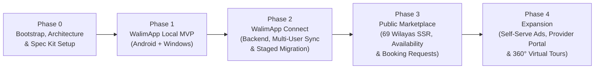

# WalimApp — Delivery Roadmap & Acceptance Gates

- **Status:** Baseline v1.0 (Phase 0)
- **Last Updated:** 2026-10-29
- **Execution Method:** Spec-Driven Development via GitHub Spec Kit (`/speckit-*` skills in Google Antigravity), slice by slice, with mandatory Product Owner review gates.
- **Related Documents:** [Product Requirements](file:///c:/proj/walimapp/docs/product-requirements.md), [Architecture Baseline](file:///c:/proj/walimapp/docs/architecture.md), [Decision Register](file:///c:/proj/walimapp/docs/decision-register.md), [AI Development Workflow](file:///c:/proj/walimapp/docs/ai-development-workflow.md).

---

## 1. Strategic Recommendation: Phone-First Android + Windows Shared Release in Phase 1

In Algeria, many wedding venue owners and managers run daily operations from an **Android smartphone** on-site (taking customer calls, checking calendar availability, recording cash deposits, and sending PDF receipts over WhatsApp), while receptionists or accountants often use a **Windows desktop PC** at the venue office.

### Recommended Phase 1 Delivery Strategy
1. **Single Shared Flutter Project (`apps/owner`) from Sprint 1.1:** Initialize the Flutter app with both `android` and `windows` targets enabled from Day 1. Never fork the codebase.
2. **Phone-First Touch Ergonomics First, Adaptive Desktop Shell Alongside:**
   - Design every screen with the `< 600dp` compact mobile layout (bottom navigation, swipeable calendar, bottom-sheet booking/payment entry, WhatsApp receipt share) as the baseline so **phone-first venue owners can use a field-ready Android APK as early as Sprint 1.3**.
   - Wrap the same feature widgets in the `>= 600dp` / `>= 1024px` desktop `NavigationRail` and master-detail split pane in Sprint 1.4, adding Windows direct printing, USB folder backups, and keyboard shortcuts.
3. **Why This Works Best for a Solo Developer:**
   - 100% of Drift/SQLite tables, slot-overlap logic, append-only payment rules, Arabic/French localization, PDF templates, `.walimbak` encryption, and Ed25519 license verification are written and tested **once**.
   - Delivering the Android build early allows real-world pilot testing with phone-first venue owners while completing the desktop refinements within the same Phase 1 milestone.

---

## 2. Phase Overview & Dependencies

| Phase | Target Outcome | Required Before Starting | Explicitly Deferred to Later Phases |
| :--- | :--- | :--- | :--- |
| **Phase 0** | Consolidated baseline docs, Spec Kit constitution, private GitHub repo. | Initial drafts & product context. | All application code, DB migrations, UI scaffolding. |
| **Phase 1** | **WalimApp Local MVP** (Android + Windows offline-first app, perpetual license). | Phase 0 PO approval + `DEC-01`..`DEC-06` settled. | Cloud sync, Laravel backend, public website, online booking requests. |
| **Phase 2** | **WalimApp Connect** (Laravel 12 + PG 17 + Filament v4, multi-user/device sync, Local-to-Connect migration). | Phase 1 Gate passed + `DEC-07`..`DEC-11` settled. | Public SEO marketplace pages, public booking requests, provider directory, ads. |
| **Phase 3** | **Public Marketplace & Online Booking Requests** (69-Wilaya SSR web, availability, `booking_requests` approval, curated providers). | Phase 2 Gate passed + `DEC-12`..`DEC-14` settled. | 360° virtual tours, provider self-registration portal, self-serve ad portal. |
| **Phase 4** | **Marketplace Expansion** (self-serve ads, provider self-service portal, 360° virtual tours). | Phase 3 live + `DEC-15`..`DEC-16` settled. | Out-of-scope enterprise ERP features. |

---

## 3. Detailed Phases, Candidate Sprints & Acceptance Gates

### Phase 0 — Project Bootstrap, Architecture Consolidation & Spec Kit Setup *(Current Phase)*

- **Deliverables:**
  - Preserve original drafts in `reference/architecture-drafts/`.
  - Canonical docs: `README.md`, `AGENTS.md`, `docs/product-requirements.md`, `docs/architecture.md`, `docs/architecture-review.md`, `docs/decision-register.md`, `docs/roadmap.md`, `docs/ai-development-workflow.md`, `.github/` templates.
  - Spec Kit initialized for Antigravity (`agy`) with `.specify/memory/constitution.md`.
  - Git initialized and pushed to private GitHub repository `walimapp`.
- **Phase 0 Acceptance Gate:**
  - [x] All 3 original architecture drafts preserved byte-for-byte.
  - [x] Zero contradictions across canonical documents (69 Wilayas, Android+Windows shared codebase, `booking_requests` vs `reservations`, Laravel 12 + Filament v4).
  - [x] Spec Kit skills verified in `.agents/skills/speckit-*/SKILL.md`.
  - [x] Product Owner reviews Phase 0 Markdown artifacts (with ChatGPT) and explicitly approves moving to Phase 1.

---

### Phase 1 — WalimApp Local MVP (Shared Android & Windows Client)

> **Goal:** Ship a rock-solid, 100% offline-capable wedding venue management application on Android smartphones and Windows desktops with perpetual licensing and encrypted local backups.

#### Candidate Sprints / Feature Slices (Each Executed via Spec Kit Workflow)

- **Sprint 1.1 — Foundation, Drift SQLite Schema, 69-Wilaya Seed & Bilingual Shell:**
  - Initialize `apps/owner` (Flutter Android + Windows), `ar-DZ` (RTL) and `fr-DZ` (LTR) localization with Western numerals (`0-9`), `MoneyDzd` integer value object, UUIDv7 generator, Drift SQLite database (WAL mode), 69-Wilaya/commune offline seed, and `AdaptiveShell` (`NavigationBar` `< 600dp` vs `NavigationRail` `>= 600dp`).
- **Sprint 1.2 — Venue, Halls, Configurable Slots & Reservation Calendar Engine:**
  - Venue profile setup, multi-hall configuration (`halls`), configurable booking slots (`hall_slots` including overnight `spans_next_day`), customer directory (`customers`), and deterministic slot-overlap prevention (`[starts_at_local, ends_at_local)`).
  - Interactive Month, Week, Day, and Agenda calendar views with `< 100ms` local query performance.
- **Sprint 1.3 — Append-Only Financial Ledger, Expenses & Phone-First Android Field Build:**
  - Immutable `payments` table (`deposit`, `installment`, `final_settlement`, `refund`, `adjustment`) with SQLite immutability trigger, automatic `amount_paid` / `balance_due` calculation, `expenses` tracking, and financial summary reports.
  - Offline Arabic/French PDF contract and payment receipt generator (`pdf` + `printing`) with Android WhatsApp/share integration.
  - **Milestone:** Field-testable **Android APK** for phone-first venue owners.
- **Sprint 1.4 — Desktop Split-View Refinement, `.walimbak` Backups & Ed25519 Perpetual Licensing:**
  - Windows master-detail split panes, keyboard shortcuts, and single-instance mutex (`AppInstanceGuard`).
  - Encrypted `.walimbak` backup creation and pre-restore `PRAGMA integrity_check` verification (Windows file/USB picker + Android SAF).
  - Offline Ed25519 `.walimlic` verification (`DeviceIdentityProvider` for Windows and Android) enforcing perpetual execution regardless of `updates_until` expiry, plus local Owner PIN lock.

#### Phase 1 Measurable Acceptance Gate
1. **Offline Completeness:** Both the Android APK and Windows desktop build execute all venue, hall, slot, reservation, customer, payment, expense, PDF contract/receipt, and backup/restore workflows with airplane mode enabled / network adapter disabled.
2. **Zero Double-Booking:** Automated unit and integration tests verify that overlapping `confirmed` or `tentative` reservations (including Full-Day vs. Evening and overnight slots crossing midnight) are deterministically rejected.
3. **Immutable Ledger:** Automated tests verify that `UPDATE` or `DELETE` on recorded `payments` fails at the SQLite trigger level, and balance adjustments require an explicit `refund` or `adjustment` row with `parent_payment_id` and `reason`.
4. **Perpetual License Verification:** Automated tests simulate system clocks set 5 years past `updates_until` and verify that an activated build continues operating with zero locked features or data restrictions.
5. **Backup Round-Trip:** Creating a `.walimbak` archive, corrupting a test copy (rejected by pre-restore check), and restoring a valid archive reproduces 100% identical reservation and financial checksums.
6. **Bilingual & Numeral Compliance:** All screens and generated PDF contracts/receipts render accurately in `ar-DZ` (RTL) and `fr-DZ` (LTR) using Western digits (`0-9`).

---

### Phase 2 — WalimApp Connect (Backend, Multi-User Sync & Staged Migration)

> **Goal:** Enable multi-user, multi-device cloud synchronization across Android phones and Windows PCs, venue-scoped employee permissions, Super-Admin governance, and safe Local-to-Connect migration.

#### Candidate Sprints / Feature Slices

- **Sprint 2.1 — Laravel 12 Modular Monolith, PostgreSQL 17 Schema & Filament v4 Super-Admin Core:**
  - Initialize `backend` (Laravel 12, PHP 8.4, PostgreSQL 17 with `btree_gist` and `pg_trgm`, Filament v4).
  - Implement 69-Wilaya tables, `organizations`, `venues`, `venue_memberships`, `device_registrations`, `licenses` (Ed25519 signer UI in Filament), `subscriptions`, and immutable `audit_logs`.
- **Sprint 2.2 — Central Booking Engine & Idempotent Outbox Sync Protocol:**
  - PostgreSQL `reservations` table with `EXCLUDE USING gist (hall_id WITH =, tsrange(starts_at_local, ends_at_local, '[)') WITH &&)` and append-only `payments` trigger.
  - Sync endpoints (`POST /api/v1/sync/push` with `sync_processed_operations` deduplication; `GET /api/v1/sync/pull` using `sync_change_log.seq` cursor) and server-side RBAC filtering of financial data.
- **Sprint 2.3 — Client Sync Worker, Multi-User Auth & Conflict Resolution UI:**
  - Integrate `sync_outbox` background worker and `pending_sync` badge overlay in `apps/owner` (Android & Windows).
  - Multi-user login, venue switcher, employee role enforcement, and `needs_review` conflict resolution workflow when two offline devices book the same slot.
- **Sprint 2.4 — Staged Local-to-Connect Migration & Subscription Expiry Lifecycle:**
  - Implement the 4-phase migration pipeline (`migration_sessions`, `migration_staging_records`, server dry-run checksum/FK/overlap validator, atomic promotion, and client cutover).
  - Implement Connect subscription state transitions (`active` -> `past_due` -> `expired_local_fallback`) ensuring offline local access never breaks on subscription expiry.

#### Phase 2 Measurable Acceptance Gate
1. **Multi-Device Convergence:** An owner on an Android phone and a receptionist on a Windows PC (authenticated as separate users in the same venue) create and update bookings offline, reconnect, and converge to the exact same calendar state (`seq`).
2. **Server-Side RBAC Enforcement:** Integration tests verify that a user with the `viewer` or non-financial `receptionist` role cannot retrieve `payments`, `expenses`, or contract totals via `/api/v1/sync/pull` or REST endpoints, nor push unauthorized mutations.
3. **Offline Double-Booking Conflict Safety:** When two offline devices book overlapping slots on the same hall, the first push succeeds as `confirmed` and the second push is stored as `needs_review` without losing customer or payment records.
4. **Idempotent Retry:** Replaying the exact same `POST /api/v1/sync/push` payload 5 times produces exactly 1 reservation and 1 payment entry in PostgreSQL.
5. **Non-Destructive Staged Migration:** A Local database containing 500+ historical reservations, installment payments, and expenses migrates to Connect with 100% matching financial checksums; simulated network failure at 50% upload leaves the local SQLite database intact and resumable.
6. **Connect Expiry Graceful Fallback:** Expiring a Connect subscription past `grace_ends_at` pauses cloud sync while verified offline read/write/print operations on Android and Windows continue working without error.

---

### Phase 3 — Public Marketplace & Owner-Approved Online Booking Requests

> **Goal:** Launch the bilingual (`ar-DZ` / `fr-DZ`) SEO public marketplace across all 69 Wilayas, reliable slot availability display, curated wedding provider directory, and the end-to-end `booking_requests` -> owner approval workflow.

#### Candidate Sprints / Feature Slices

- **Sprint 3.1 — Bilingual SSR Venue Directory, 69-Wilaya Filters & SEO Infrastructure:**
  - Server-side-rendered Laravel Blade + Tailwind + Alpine.js pages for home, Wilaya/commune landing pages (all 69 Wilayas), search filters (capacity, price, amenities, date), venue profile pages, `hreflang`, JSON-LD `EventVenue`, and XML sitemaps.
- **Sprint 3.2 — Public Availability Projection & Online Booking Request Workflow (`booking_requests`):**
  - Privacy-safe public availability calendar (showing only slot availability, zero customer PII).
  - Public `booking_requests` submission with Turnstile/rate-limiting and Law 18-07 consent.
  - Owner inbox in `apps/owner` (Android & Windows) + atomic approval transaction (`booking_requests` -> `customer` + `confirmed` `reservation` guarded by `btree_gist`) and competing-request flagging.
- **Sprint 3.3 — Curated Service Provider Directory, Admin Ad Placements & Moderation:**
  - Staff-curated wedding service provider directory (caterers, photographers, decorators, etc.) by Wilaya and category.
  - Super-Admin moderation queue for venue listings/photos and basic featured venue / banner placements.

#### Phase 3 Measurable Acceptance Gate
1. **Strict Separation of Requests and Reservations:** Submitting 10 public `booking_requests` for the same hall and date creates 0 rows in `reservations` and does not block the owner from booking that slot until the owner explicitly approves a request.
2. **Atomic Approval Under Race Conditions:** Concurrent attempts to approve two competing `booking_requests` (or an owner walk-in sync vs. request approval) result in exactly one `confirmed` reservation and one clean conflict message.
3. **Zero PII Leakage:** Automated security tests confirm public HTML and JSON endpoints never expose customer names, phone numbers, notes, or private ledger balances.
4. **SEO & Mobile Performance:** Public venue and Wilaya pages render complete indexable HTML without client JS, validate `ar-DZ` RTL and `fr-DZ` LTR `hreflang` markup, and achieve mobile LCP `< 2.5s`.

---

### Phase 4 — Advertising Expansion, Provider Self-Service & 360° Virtual Tours

> **Goal:** Expand marketplace monetization and rich media only after Phases 1–3 are stable in production.

#### Candidate Sprints / Feature Slices

- **Sprint 4.1 — Self-Serve Advertising Campaigns & Lead Attribution Analytics:**
  - Venue/provider self-service campaign requests, impression/click/WhatsApp-click tracking, and billing workflows.
- **Sprint 4.2 — Wedding Service Provider Self-Service Portal:**
  - Provider registration, profile/portfolio management, and Super-Admin verification workflow.
- **Sprint 4.3 — 360° Virtual Tours Integration:**
  - S3/R2 panoramic asset storage (`media_type = 'panorama_360'`) and click-to-load `Pannellum` interactive 360° viewer on venue pages.

#### Phase 4 Measurable Acceptance Gate
1. **Zero Core Regression:** Enabling 360° tours and provider self-service introduces zero regressions to Connect sync latency or public page initial LCP (`< 2.5s` via click-to-load panorama lazy loading).
2. **Moderation Safety:** Unapproved self-registered providers or ad creatives never appear on public pages until approved in Filament Super-Admin.
