# WalimApp — Initial Technical Architecture Document

**Document Version:** 1.0.0-draft  
**Status:** Proposed for Architecture Review & Product-Owner Sign-Off  
**Target Market:** Algeria (`DZ`)  
**Primary Source of Requirements:** `product-requirements.md`  
**Delivery Model:** Solo Developer + AI Coding Agents, Clean-Slate Incremental Implementation

---

## 1. Executive summary

**WalimApp** is a hybrid wedding venue management and discovery platform tailored for the Algerian wedding market (*salles des fêtes* and wedding service providers). It bridges two distinct operational realities:
1. Venue owners require rock-solid desktop management software that works **100% offline** regardless of internet availability, ISP instability, or cloud subscription status.
2. Engaged couples and families increasingly search online for venues and wedding providers by Wilaya, capacity, budget, and date availability, while owners who opt into online visibility need a controlled workflow to receive and approve booking requests without risking double-bookings.

### Architectural Thesis

To allow a **solo developer working with AI coding agents** to build, operate, and evolve four distinct product surfaces without drowning in distributed-systems complexity, this architecture consolidates the platform into **two runtime deployables** built on a shared domain contract:

1. **The WalimApp Owner Desktop Client (Flutter + SQLite/Drift):** A single Windows desktop codebase that powers both **WalimApp Local** (standalone, perpetual-licensed, offline-only) and **WalimApp Connect** (offline-first with background cloud synchronization, online listing management, and booking-request handling). Local and Connect are **capability modes** within one application rather than forked codebases.
2. **The WalimApp Central Platform (Laravel Modular Monolith + PostgreSQL):** A single, well-modularized Laravel application that serves:
   - The **REST API** for Connect synchronization, authentication, licensing, and media orchestration.
   - The **Public Marketplace** via SEO-optimized Server-Side Rendered (SSR) pages (Laravel Blade + Livewire + Alpine.js).
   - The **Super-Admin Platform** via an isolated, permission-hardened **Filament** administration panel.

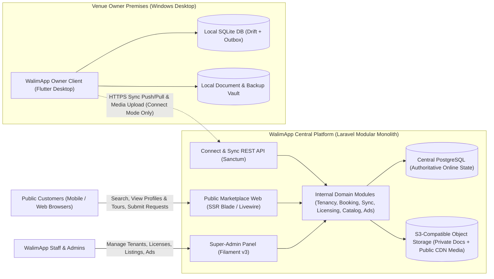

### Key Architectural Commitments

- **Local Independence First:** WalimApp Local runs indefinitely with zero cloud dependency. Every record produced in Local mode uses client-generated **UUIDv7** identifiers and sync-ready metadata columns from Day 1 so that upgrading to Connect later is a deterministic data upload rather than a destructive schema rewrite.
- **Explicit Command/Outbox Sync over Blind Last-Write-Wins:** Offline mutations in Connect mode are recorded atomically into a local `sync_outbox` table alongside local SQLite state changes. The central server processes mutations idempotently and returns deltas using a monotonic per-organization sequence cursor (`server_seq`).
- **Server-Authoritative Booking Confirmation:** While owners can record reservations offline at any time, transitioning a booking to globally `confirmed` in Connect mode is arbitrated by central PostgreSQL using row-level locking and database exclusion/unique constraints. A confirmed booking is **never** silently overwritten by synchronization.
- **Defense-in-Depth Multi-Tenancy:** Every tenant-owned record carries an immutable `organization_id`. Isolation is enforced at three levels: application middleware/policies, composite tenant foreign keys (`(organization_id, id)`), and PostgreSQL Row-Level Security (RLS) as a backstop.
- **Zero Premature Infrastructure:** The initial backend runs on a single Linux host (or managed VM) with PostgreSQL handling relational storage, full-text search, transactional locks, job queues (`database` driver), and application caching. Kubernetes, microservices, and mandatory Redis clusters are explicitly excluded until measured throughput justifies them.

---

## 2. Product requirements and architectural principles

### 2.1 Requirements Traceability Matrix

| Requirement Area | PRD Ref | Core Product Requirement | Architectural Response & Primary Sections |
| :--- | :--- | :--- | :--- |
| **Four-Component Topology** | §1 | Support WalimApp Local, WalimApp Connect, Public Marketplace, and Super-Admin Platform. | Two deployables (Flutter Desktop + Laravel Modular Monolith) with strict internal module boundaries (§4, §6, §7). |
| **Local Autonomy** | §3, §9 | Works 100% offline on Windows; single-device SQLite; perpetual license; no forced cloud dependency; never disabled when optional maintenance expires. | Local-first repository architecture over SQLite (`drift`); asymmetric Ed25519 offline license files; local backup/restore vault (§5, §11, §14). |
| **Connect & Offline Sync** | §4 | Offline-first owner UX + central shared authority; queued offline ops; idempotent retry; explicit conflict handling; multi-venue & scoped employee access. | Transactional outbox + idempotent `sync_mutation_log` + monotonic `server_seq` delta pull + entity-specific conflict resolution (§10, §11). |
| **Booking Integrity** | §4, §5 | Online requests start as `pending_owner_approval`; offline ops track `pending_sync`; server prevents conflicting `confirmed` bookings; never overwrite confirmed reservations. | Formal reservation state machine; PostgreSQL partial unique index / `btree_gist` exclusion constraint; explicit `sync_conflict` state and owner resolution UI (§9, §12). |
| **Local-to-Connect Upgrade** | §3, §4 | Preserve customers, reservations, financial history, and documents when upgrading from Local to Connect. | Shared UUIDv7 identity scheme from Milestone 1; resumable, chunked migration pipeline with checksum verification (§13). |
| **Public Marketplace & Ads** | §6 | Venue search by Wilaya/date/price/capacity/services; availability display; booking requests; WhatsApp contact; curated provider directory; sponsored placements without empty ad blocks. | Laravel SSR (Blade + Livewire + Alpine.js); bilingual SEO routing (`ar`/`fr`); PostgreSQL search indexes; server-side ad slot resolver with graceful collapse (§15). |
| **Virtual Tours** | §7 | 360° panoramic scene graphs with hotspots; owner upload/preview/submission; admin moderation; non-blocking for initial marketplace launch. | Decoupled `VirtualTours` module; equirectangular image validation & multi-resolution processing; lazy-loaded WebGL viewer (Pannellum) (§16). |
| **Super-Admin Governance** | §8 | Manage tenants, listings, providers, bookings, roles, ad campaigns, licenses, and subscriptions with granular RBAC and audit logging. | Filament v3 panel under dedicated `admin` auth guard; granular staff roles; immutable `audit_logs` table (§10, §17). |
| **Security, Privacy & Localization** | §11 | Strict server-side tenant/venue authorization; protect PII/finance/documents; Arabic (RTL) & French (LTR); evaluate Algerian data-protection law. | Defense-in-depth tenancy; private object storage with presigned URLs; RTL/LTR typography & PDF engine; Law 18-07 (ANPDP) compliance analysis (§17). |
| **Phased Delivery** | §12 | Milestone 1 (Local MVP) → Milestone 2 (Connect Foundation) → Milestone 3 (Marketplace) → Milestone 4 (Expansion). | Phased roadmap isolating Milestone 1 from backend completion while embedding sync-compatible schemas early (§22). |

### 2.2 Core Architectural Principles

> [!IMPORTANT]
> Every design decision in this document is governed by the following seven architectural principles. Any future feature or code generation prompt must adhere to these constraints.

1. **Principle 1 — Local-First Execution, Server-Authoritative Coordination:**
   The owner desktop application always reads from and writes to its local SQLite database first so UI interactions complete in milliseconds regardless of network state. When Connect is active, the central PostgreSQL database is the sole arbiter of cross-device state, public marketplace projections, and globally confirmed reservations.
2. **Principle 2 — Single Owner Codebase, Entitlement-Driven Capabilities:**
   WalimApp Local and WalimApp Connect are **not** two separate Flutter apps. They are a single codebase where Connect capabilities (Sync Engine, Online Booking Inbox, Listing Publisher, Multi-User Sync) are activated by a verified Connect subscription entitlement. This eliminates dual-maintenance overhead for a solo developer.
3. **Principle 3 — No Silent Data Loss or Blind Overwrites:**
   Last-Write-Wins (LWW) is forbidden for reservations and financial records. Reservations use an explicit state machine with conflict detection, and financial records use an append-only ledger model.
4. **Principle 4 — Database-Level Invariants Back Up Application Logic:**
   Application code can have bugs, especially when rapidly iterating with AI coding agents. Critical invariants—such as preventing two `confirmed` reservations for the same hall, date, and slot, or preventing cross-tenant foreign-key references—must be enforced by PostgreSQL constraints (`UNIQUE WHERE`, `EXCLUDE`, composite `FOREIGN KEY`, `CHECK`).
5. **Principle 5 — Server-Enforced Multi-Tenancy:**
   Client-side visibility hides UI elements for usability, never for security. Every API request and web action resolves the actor's authenticated `organization_id` and scoped `venue_id` permissions on the server before reading or mutating data.
6. **Principle 6 — Radical Operational Simplicity:**
   Every additional daemon, cluster, or runtime multiplies operational risk for a solo founder. Use one backend language (PHP/Laravel), one primary server database (PostgreSQL), one client framework (Flutter), and one local database (SQLite).
7. **Principle 7 — AI-Agent-Friendly Bounded Contexts:**
   Code is organized into small, domain-aligned modules with explicit Data Transfer Objects (DTOs), strict type signatures, and deterministic automated tests so AI coding agents can implement or modify one module without corrupting unrelated features.

---

## 3. Assumptions, constraints, and unresolved decisions

To avoid conflating mandatory product requirements with architectural recommendations or unconfirmed business rules, this document uses four explicit categories:

### 3.1 Confirmed Product Requirements (`REQ`)

- **REQ-01:** WalimApp Local must operate on Windows desktop using local SQLite storage with zero dependency on cloud servers or local-network sync.
- **REQ-02:** WalimApp Local is sold under a perpetual license; expiration of optional maintenance or updates must never disable the purchased version or destroy user data.
- **REQ-03:** WalimApp Connect preserves offline-first operation via SQLite while synchronizing with a central authoritative backend and enabling online listings and booking requests.
- **REQ-04:** Online booking requests from customers enter `pending_owner_approval` and never auto-confirm a date; confirmed bookings must never be silently overwritten by synchronization.
- **REQ-05:** Upgrading from Local to Connect must preserve existing customers, reservations, financial records, expenses, and documents.
- **REQ-06:** Expiration of a Connect subscription must degrade gracefully, preserving full access to local data and providing data export capabilities.
- **REQ-07:** Both Arabic (RTL) and French (LTR) must be supported across user-facing interfaces.
- **REQ-08:** Administrative access in Super-Admin must be role-scoped and auditable.
- **REQ-09:** Virtual tours (360° panoramas) and provider self-registration must not block Milestone 1 (Local), Milestone 2 (Connect), or Milestone 3 (Initial Marketplace).

### 3.2 Technical & Operational Constraints (`CON`)

- **CON-01 (Solo Developer + AI Agents):** The architecture must minimize DevOps toil, avoid polyglot backend services, and maintain high static typing and testability.
- **CON-02 (Algerian Connectivity Reality):** Venue offices frequently experience intermittent ADSL/4G connectivity, high latency, or complete offline operation (e.g., basement offices or rural/peri-urban halls). All network operations must use small payloads, resumable uploads, and idempotent retries.
- **CON-03 (Algerian Hardware Reality):** Venue office PCs in Algeria often run older Windows 10/11 machines (4–8 GB RAM, HDD or entry-level SSD, occasionally inaccurate system clocks). The Flutter desktop app must keep memory usage low and must not rely purely on local wall-clock timestamps for sync correctness.
- **CON-04 (Unselected Hosting Provider):** No VPS or cloud provider has been purchased yet. The deployment design must remain portable across standard Linux VPS/cloud providers (including Algerian local hosts and European cloud providers) using standard PostgreSQL and S3-compatible storage interfaces.

### 3.3 Architectural Assumptions & Provisional Defaults (`ASM`)

Where the PRD leaves operational details open, the architecture adopts safe provisional defaults designed so they do not restrict business flexibility:

- **ASM-01 (Reservation Slot Granularity):** In Algeria, wedding venues commonly rent halls either for a **full day** or by **time shift/period** (e.g., *Après-midi / العصر*, *Soirée / السهرة*, *Journée complète / يوم كامل*).
  - *Provisional Default:* Every reservation targets a specific `hall_id`, `event_date` (`DATE`), and `slot_type` (`full_day`, `afternoon`, `evening`, or `custom_time_range`). A `full_day` confirmed reservation conflicts with any other slot on that date for that hall, while `afternoon` and `evening` can coexist if the venue enables split-shift booking.
- **ASM-02 (Currency & Monetary Precision):** All monetary amounts are denominated in Algerian Dinars (`DZD`).
  - *Provisional Default:* Amounts are stored as signed 64-bit integers representing centimes (`amount_centimes BIGINT`, where `100 centimes = 1 DZD`) or whole Dinars in UI display, avoiding floating-point rounding errors across SQLite and PostgreSQL.
- **ASM-03 (Employee Multi-User Access in Local vs. Connect):**
  - *Provisional Default:* Since Local runs on a single Windows PC (`PRD §3: runs on one device; local-network synchronization is not required`), multiple employees in Local mode switch profiles on the same Windows workstation using local PIN/password credentials. In Connect mode, employees may log in either on the main venue PC or on additional authorized devices synchronized through the central backend.
- **ASM-04 (Customer Accounts on Public Marketplace):**
  - *Provisional Default:* For Milestone 3, customers submitting an online booking request do **not** need to register a full persistent password account; they submit their name, phone number (validated for Algerian mobile format `05/06/07`), optional email, event date/slot, guest count, and notes, with anti-spam rate limiting and optional SMS/WhatsApp verification later. This maximizes conversion and defers customer-portal complexity until the future customer mobile app.

### 3.4 Unresolved Business Decisions (`DEC`)

The following business rules cannot be finalized purely from engineering principles and are cataloged with concrete options and provisional defaults in **Section 12** and **Section 23**:
- **DEC-01:** Do `pending_owner_approval` booking requests temporarily hold/lock the date on the public calendar, or can multiple customers submit competing requests for the same date until the owner confirms one? *(Provisional default: Competing requests are allowed while `pending_owner_approval`; confirming one automatically flags or prompts rejection of overlapping pending requests).*
- **DEC-02:** Do `pending_owner_approval` requests automatically expire after N hours/days if the owner does not respond? *(Provisional default: Configurable per-platform expiry timer, e.g., 72 hours, defaulting to soft-expiry warning rather than silent deletion).*
- **DEC-03:** When an owner approves an online booking request, is it immediately marked `confirmed`, or is there an intermediate `awaiting_deposit` state before the date is locked? *(Provisional default: Support an optional `option_hold` / `awaiting_deposit` sub-state with an expiration date, or direct confirmation at the owner's choice).*
- **DEC-04:** Under Algerian Law 18-07, must production PostgreSQL and private document storage be physically hosted inside Algeria, or is hosting in an EU region permissible following ANPDP declaration/authorization? *(Must be confirmed before purchasing production infrastructure).*

---

## 4. System context and component boundaries

### 4.1 The Four Product Components

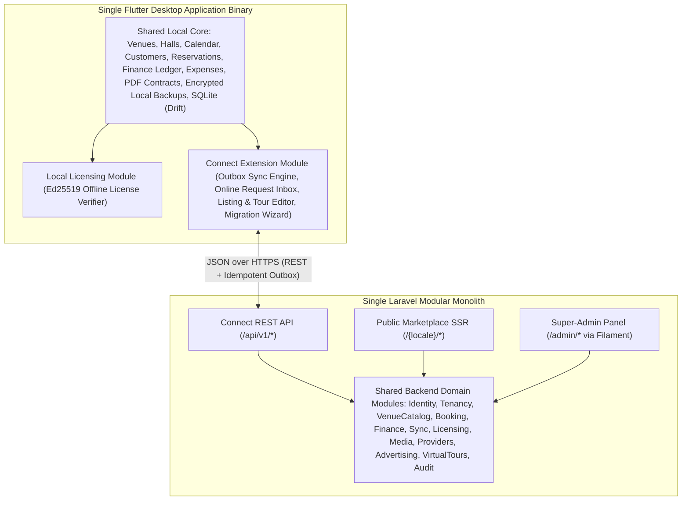

#### Component 1: WalimApp Local (Standalone Owner Application)
- **Responsibility:** Complete day-to-day operational management of one or more venues/halls on a single Windows desktop computer without internet access.
- **Included Capabilities:** Venue & hall setup, shift/pricing templates, customer directory, interactive calendar, reservation lifecycle (walk-in/phone bookings), deposit & installment ledger, expense tracking, financial summary reports, bilingual PDF contract & receipt generation, local employee role switching, local encrypted backup/restore, and offline perpetual license verification.
- **Strict Boundary Rule:** WalimApp Local **never** requires an account on the central server, **never** transmits venue or customer data over the internet during normal operation, and **never** exposes public listings or accepts online booking requests.

#### Component 2: WalimApp Connect (Connected Owner Application)
- **Responsibility:** Extends the Local owner experience with cloud synchronization, multi-device/employee coordination, public marketplace listing management, and online booking request processing.
- **Included Capabilities:** Everything in WalimApp Local, plus:
  - Local-to-Connect migration wizard.
  - Background & manual bidirectional synchronization (`SyncEngine`) with conflict detection and resolution UI.
  - Online booking request inbox (`pending_owner_approval` → Approve / Reject / Contact via WhatsApp or Phone).
  - Public venue profile editor (descriptions, amenities, pricing display rules, gallery photo uploads, 360° virtual tour scene builder).
  - Multi-device sync for organization owners and venue-scoped employees.
- **Strict Boundary Rule:** Even in Connect mode, all local UI reads and writes target the local SQLite database first. A temporary loss of internet connectivity never blocks the owner from viewing the calendar, recording a walk-in reservation, recording a payment, or printing a contract.

#### Component 3: Public Marketplace (Customer-Facing Web Platform)
- **Responsibility:** High-performance, SEO-indexed bilingual (`ar-DZ` / `fr-DZ`) website enabling prospective customers to discover wedding venues and service providers, inspect availability, view photos/virtual tours, and submit booking requests.
- **Included Capabilities:**
  - Wilaya, Commune, date, capacity, budget, and service filters.
  - Public venue profile pages with photo galleries, interactive 360° virtual tour embeds (when published), availability calendar, WhatsApp click-to-chat, and online booking request form.
  - Curated (and later self-service) wedding service-provider directory (caterers, decorators, photographers, florists, musicians, car rentals).
  - Sponsored listings and banner placements controlled by active ad campaigns.
- **Strict Boundary Rule:** The Public Marketplace reads exclusively from **published projection tables/views** (`venue_listings`, `provider_listings`, `advertising_campaigns`, and sanitized availability projections). It **never** exposes internal owner notes, customer PII from existing reservations, financial ledgers, expense records, or private contract documents.

#### Component 4: Super-Admin Platform (Internal Operations & Governance)
- **Responsibility:** Internal back-office application for authorized WalimApp staff to operate the business, manage tenants, issue licenses, moderate content, and oversee support.
- **Included Capabilities:**
  - Organization, owner, employee, and venue lifecycle management.
  - Local perpetual license generation/revocation and Connect subscription management.
  - Moderation and approval queue for public venue listings, media, and 360° virtual tours.
  - Service-provider directory curation and category management.
  - Advertising campaign creation, scheduling, placement assignment, and performance reporting.
  - Booking conflict / support oversight and immutable security audit log inspection.
- **Strict Boundary Rule:** Isolated under a dedicated authentication guard (`admin`), separate from tenant `users`, protected by mandatory Multi-Factor Authentication (MFA) and granular staff RBAC policies, with every state-changing action recorded in `audit_logs`.

### 4.2 Shared vs. Separate Artifacts Across Boundaries

Because the owner client is written in **Dart (Flutter)** and the central platform is written in **PHP (Laravel)**, source code is not shared at the language compilation level. Sharing is achieved through **canonical specifications and structural symmetry**:

| Artifact / Concern | Shared Across Components? | How It Is Structured |
| :--- | :--- | :--- |
| **Entity Identifiers (UUIDv7)** | **Shared Specification** | Both Flutter (SQLite) and Laravel (PostgreSQL) generate and store RFC 9562 UUIDv7 strings/UUIDs for all syncable domain entities. |
| **Domain Status Enums & State Transitions** | **Shared Specification** | Reservation states (`pending_owner_approval`, `pending_sync`, `confirmed`, `rejected`, `cancelled`, `sync_conflict`), payment types, and slot types are defined in `/contracts/enums.json` and mirrored in Dart and PHP enums. |
| **Core Table Structures** | **Mirrored Core + Context Extensions** | Core business tables (`venues`, `halls`, `customers`, `reservations`, `financial_transactions`, `expenses`, `documents`) have identical business columns in SQLite and PostgreSQL. PostgreSQL adds multi-tenant RLS/indexing; SQLite adds local outbox tracking. |
| **API & Sync Payloads** | **Shared OpenAPI 3.1 / JSON Schema** | Defined in `/contracts/openapi.yaml` so AI agents can generate/validate both Laravel `FormRequest`/`Resource` classes and Dart DTOs deterministically. |
| **Contract & Receipt PDF Rendering** | **Separate (Client-Primary)** | Implemented in Dart (`pdf` package) inside the Flutter app so owners can generate and print contracts 100% offline. Generated PDFs can be synced as binary attachments to Connect. |
| **Public Marketplace Queries & SEO** | **Server-Only (Laravel)** | Lives strictly in the Laravel `Marketplace` module; never bloated into the desktop SQLite database. |
| **License Private Key Signing** | **Server-Only (Super-Admin)** | Ed25519 private key lives exclusively in the central backend secrets; the Flutter app embeds only the Ed25519 **public** key for offline verification. |

---

## 5. Recommended technology stack and rationale

The technology preferences proposed in `product-requirements.md` (§10) are technically sound and well-aligned with the product constraints. Below is the architectural evaluation of each layer, including concrete package choices, alternatives considered, solo-developer operational impact, and risks.

### 5.1 Technology Evaluation Summary

| Layer | Recommended Choice | Key Supporting Packages / Tools | Verdict |
| :--- | :--- | :--- | :--- |
| **Central Backend & API** | **Laravel 11/12 (PHP 8.3/8.4)** | Laravel Sanctum, Spatie Permission / Custom Policies, Database Queue | **Confirmed & Recommended** |
| **Central Database** | **PostgreSQL 16/17** | `btree_gist`, native `uuid`, `jsonb`, `pg_trgm`, Row-Level Security (RLS) | **Confirmed & Recommended** |
| **Super-Admin Panel** | **Filament v3** | Filament Tables, Forms, Actions, MFA plugin | **Confirmed & Recommended** |
| **Public Marketplace Web** | **Laravel SSR (Blade + Livewire 3 + Alpine.js + Tailwind CSS)** | `mcamara/laravel-localization` or custom locale route prefix, Schema.org JSON-LD | **Recommended SEO Stack** |
| **Owner Desktop App** | **Flutter (Windows Desktop)** | Riverpod (`flutter_riverpod`), `go_router`, `freezed` / `json_serializable`, `pdf` | **Confirmed & Recommended** |
| **Local Owner Database** | **SQLite 3 via Drift** | `drift`, `sqlite3_flutter_libs` (or `sqlcipher_flutter_libs`), `uuid` | **Confirmed & Recommended** |
| **Media & 360° Tours** | **S3-Compatible Object Storage + Pannellum WebGL** | Laravel `Storage` (Flysystem S3), `libvips` / `intervention/image`, Pannellum | **Recommended** |

### 5.2 Detailed Rationale and Trade-Off Analysis

#### A. Central Backend: Laravel (Modular Monolith)
- **Recommendation:** Use **Laravel 11/12** structured as a **Modular Monolith** (`app/Modules/*`), serving the REST API, Public Marketplace, and Filament Super-Admin from a single codebase and deployment pipeline.
- **Why it fits:**
  - First-class batteries-included support for authentication (Sanctum), background queues, scheduled tasks, filesystem abstraction (Flysystem), rate limiting, validation, database migrations, and automated testing (Pest/PHPUnit).
  - Exceptionally strong training corpus for AI coding agents—AI agents produce reliable, idiomatic Laravel code with minimal hallucination when guided by clear module conventions.
- **Alternatives considered:**
  - *NestJS (TypeScript) or Go:* Higher raw concurrency ceiling, but loses Filament (requiring months of custom admin UI work) and splits the ecosystem.
  - *Microservices (separate Auth, Booking, Marketplace, and Admin services):* Rejected per PRD §10. Introduces distributed transaction hazards, network serialization overhead, and deployment multiplication with zero benefit at WalimApp's scale.
- **Solo-developer implications:** One codebase to upgrade, one test suite to run, one deployment script, and unified domain models shared across API, Admin, and Marketplace.
- **Risks & mitigations:**
  - *Risk:* Monoliths can degrade into "spaghetti code" where controllers query arbitrary Eloquent models across domains.
  - *Mitigation:* Enforce strict module boundaries (`app/Modules/{Module}`) where cross-module writes must go through explicit Action/Service classes or Domain Events (detailed in §7).

#### B. Central Database: PostgreSQL 16/17
- **Recommendation:** Use a single **PostgreSQL 16 or 17** instance as the primary relational store, search engine, queue backing store, lock manager, and cache store for initial milestones.
- **Why it fits:**
  - **Booking Integrity:** Supports partial unique indexes (`UNIQUE ... WHERE status = 'confirmed'`) and GiST exclusion constraints (`EXCLUDE USING gist`) that make double-booking mathematically impossible at the storage engine level.
  - **Multi-Tenancy Defense:** Supports declarative Row-Level Security (`CREATE POLICY`) as a second line of defense behind application scoping.
  - **Marketplace Search:** Built-in Full-Text Search (`tsvector`), trigram matching (`pg_trgm`), and `JSONB` indexing handle Wilaya/capacity/price/amenity search for thousands of venues in <10 ms without needing Elasticsearch or Meilisearch.
  - **Infrastructure Consolidation:** Replaces Redis in Milestones 2–3 by powering Laravel's `database` queue driver (which uses `SELECT ... FOR UPDATE SKIP LOCKED`), `database` cache driver, and advisory locks.
- **Alternatives considered:**
  - *MySQL / MariaDB:* Lacks partial unique indexes (`WHERE` clause on unique index), GiST exclusion constraints, and native Row-Level Security.
- **Solo-developer implications:** Only one stateful database service to back up, monitor, and tune.
- **Risks & mitigations:**
  - *Risk:* High-frequency queue polling on PostgreSQL can add light CPU load at very high scale.
  - *Mitigation:* Configure sensible worker polling intervals (`sleep=3`, `backoff=5,15,60`). If WalimApp scales to hundreds of concurrent active sync clients, switching `QUEUE_CONNECTION` and `CACHE_STORE` to Redis later requires only a `.env` change.

#### C. Internal Administration: Filament v3
- **Recommendation:** Use **Filament v3** mounted at a configurable admin path/subdomain with a dedicated `admin` auth guard.
- **Why it fits:**
  - Cuts Super-Admin development time by 70–80%. CRUD interfaces, approval action modals, filterable tables, audit log viewers, license generation actions, and dashboard widgets can be built declaratively in PHP.
  - Native RTL support for Arabic and built-in French translations.
- **Alternatives considered:**
  - *Laravel Nova:* Paid license per site; less flexible for custom workflows than Filament v3.
  - *Custom React/Vue SPA Admin:* Massive front-end maintenance burden for an internal tool used only by WalimApp staff.
- **Risks & mitigations:**
  - *Risk:* Accidentally exposing tenant data or destructive actions to junior support staff in Filament resources.
  - *Mitigation:* Every Filament Resource must bind to a Laravel Policy (`AdminVenuePolicy`, `LicensePolicy`, etc.) and log mutations to `audit_logs` (§10.4, §17.6).

#### D. Owner Application: Flutter (Windows Desktop) + SQLite (Drift)
- **Recommendation:** Use **Flutter (stable channel)** targeting Windows x64 Desktop, paired with **Drift** (`drift` + `sqlite3_flutter_libs` / `sqlcipher_flutter_libs`) for local persistence, **Riverpod** for reactive state management, and the Dart **`pdf` / `printing`** packages for offline document generation.
- **Why it fits:**
  - Compiles to native Windows machine code (`AOT`) with predictable desktop performance, native file system access, and rich custom calendar/dashboard rendering.
  - Built-in directional layout engine (`Directionality`, `EdgeInsetsDirectional`) makes seamless switching between **Arabic (RTL)** and **French (LTR)** reliable.
  - Reuses Dart domain knowledge, models, and UI patterns when building the future customer or owner mobile app (Android/iOS).
  - **Why Drift over raw `sqflite` or Isar/Hive:** Drift provides compile-time verified SQL, type-safe Dart query builders, reactive `Stream` queries (so the calendar UI automatically updates when a background sync inserts a booking request), explicit transaction blocks, and deterministic schema migration tooling.
- **Alternatives considered:**
  - *Electron / Tauri (React/Vue + SQLite):* Viable for desktop, but does not align with the team's preference for Flutter and cannot share UI/client architecture seamlessly with a future Flutter mobile app.
  - *Isar / Hive (NoSQL local DBs):* Poor fit for relational financial ledgers, foreign keys, and complex calendar overlap queries; Isar has also faced maintenance stagnation compared to SQLite + Drift.
- **Solo-developer implications:** Strong static typing and code generation (`build_runner`) catch schema mismatches at compile time rather than at a customer's venue.
- **Risks & mitigations:**
  - *Risk:* Windows native plugin compatibility or antivirus false positives on unsigned `.exe` binaries.
  - *Mitigation:* Minimize exotic native C++ plugins (stick to well-maintained essentials: `sqlite3_flutter_libs`, `flutter_secure_storage_windows`, `file_selector`, `path_provider`, `printing`) and package releases with a standard signed Inno Setup or MSIX installer (§18.7).

#### E. Public Marketplace: Laravel SSR (Blade + Livewire 3 + Alpine.js + Tailwind CSS)
- **Recommendation:** Build the public marketplace inside the Laravel monolith using **Server-Side Rendered Blade templates**, enhanced with **Livewire 3** for interactive search/filtering and **Alpine.js** for lightweight client-side UI (photo lightboxes, date pickers, lazy-loaded 360° tour modals).
- **Why it fits:**
  - **SEO Excellence:** Search engines (Google, Bing) and social media crawlers (WhatsApp, Facebook, Instagram link previews—critical for Algerian wedding sharing) receive complete, pre-rendered HTML with localized metadata, canonical URLs, `hreflang` tags, and Schema.org JSON-LD on the first HTTP response.
  - **Mobile Performance in Algeria:** Sends minimal JavaScript over the wire compared to heavy SPA bundles, yielding fast First Contentful Paint (FCP) on budget Android devices over 3G/4G networks.
  - **Zero Dual-Deployment Overhead:** No separate Node.js SSR server to deploy, secure, or keep in sync with the Laravel API.
- **Alternatives considered:**
  - *Flutter Web:* **Strongly rejected for the public marketplace.** Flutter Web renders onto an HTML5 Canvas/WebAssembly surface, which suffers from poor search-engine indexability, large initial download sizes (2–5 MB+), and non-standard text selection/accessibility on mobile browsers.
  - *Next.js / Nuxt (Decoupled Frontend):* Great SEO, but forces a solo developer to maintain two separate applications (PHP backend + TypeScript Node.js SSR frontend), duplicate validation/routing logic, and manage CORS/deployment synchronization.
  - *Laravel + Inertia.js (Vue/React) with SSR:* Requires running a persistent Node.js SSR daemon alongside PHP-FPM. Blade + Livewire 3 achieves the same interactive filter UX natively in PHP.

---

## 6. High-level architecture and data flows

### 6.1 Internal Layered Architecture

Both the Flutter Owner Application and the Laravel Central Backend follow a clean layered architecture to keep business rules decoupled from UI widgets and HTTP transport.

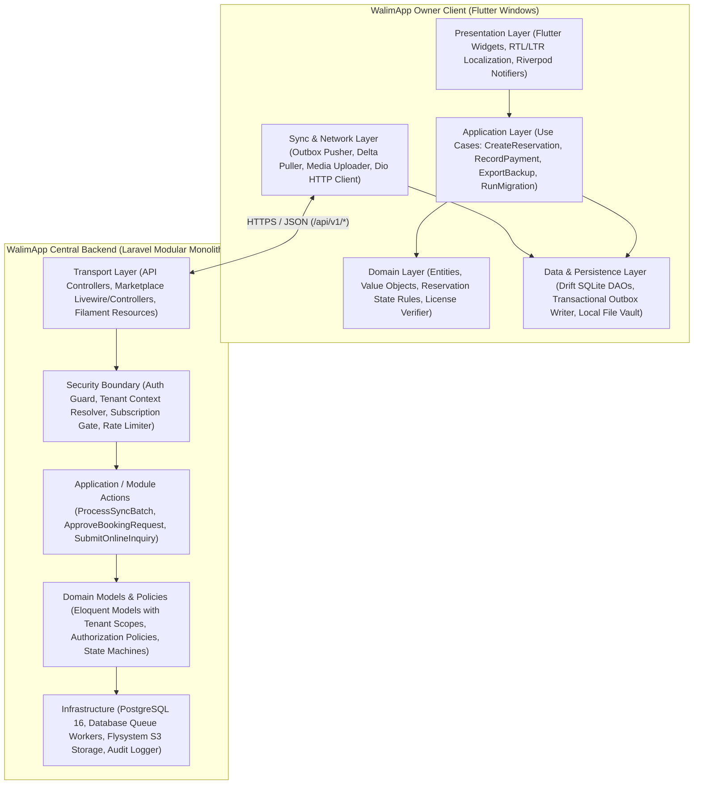

### 6.2 Core End-to-End Data Flows

#### Flow A: Offline Operation in WalimApp Local (or Disconnected Connect)
1. The venue owner or receptionist selects a hall and date on the calendar and creates a reservation with an initial deposit (`versement / عربون`).
2. The Flutter `CreateReservationUseCase` validates the input and opens a **single local SQLite transaction** via Drift:
   - Verifies no conflicting `confirmed` reservation exists locally for that `(hall_id, event_date, slot_type)`.
   - Inserts the `customers` record (if new) with a client-generated `UUIDv7`.
   - Inserts the `reservations` record with `UUIDv7`:
     - In **Local mode**, `status = 'confirmed'`, `sync_status = 'local_only'`.
     - In **Connect mode**, `status = 'pending_sync'` (displayed in the local UI as *"Confirmed Locally — Pending Online Sync"*), `sync_status = 'pending_push'`.
   - Inserts the deposit record into `financial_transactions` (`UUIDv7`).
   - If Connect mode is active, appends ordered mutation records (`customer.upsert`, `reservation.create`, `financial_transaction.create`) to the local `sync_outbox` table inside the **same SQLite transaction**.
3. The owner clicks "Generate Contract"; the Dart `pdf` engine renders the Arabic or French PDF contract locally from the SQLite data, saves it to the local document vault, computes its `SHA-256` hash, and records the `documents` row.

#### Flow B: Online Booking Request & Owner Approval (WalimApp Connect)

```mermaid
sequenceDiagram
    autonumber
    actor Customer as Public Customer (Browser)
    participant Web as Marketplace Module (Laravel)
    participant PG as Central PostgreSQL
    participant API as Connect Sync API (Laravel)
    participant App as Owner Desktop App (Flutter)
    participant SQLite as Local SQLite (Drift)

    Customer->>Web: Submit Booking Request (Venue, Hall, Date, Slot, Phone)
    Web->>PG: Validate anti-spam & check hall/date not already 'confirmed'
    PG-->>Web: OK (Insert reservation with status = 'pending_owner_approval', server_seq++)
    Web-->>Customer: Show confirmation & optional WhatsApp link to owner

    Note over App,API: Owner App polls or receives notification & runs Delta Pull
    App->>API: GET /api/v1/sync/pull?after_seq=1042
    API->>PG: Fetch changes for organization_id where server_seq > 1042
    PG-->>API: Return new reservation (status = 'pending_owner_approval', server_seq = 1043)
    API-->>App: Delta payload (server_seq = 1043)
    App->>SQLite: Upsert reservation & update last_pulled_server_seq = 1043
    App->>App: Display badge in "Booking Requests Inbox"

    Note over App,SQLite: Owner reviews request, calls customer, and clicks "Approve"
    App->>SQLite: Transaction: Mark local sync_status='pending_push' & enqueue 'reservation.approve' in sync_outbox
    App->>API: POST /api/v1/sync/push (mutation_id, reservation.approve, base_version)
    API->>PG: BEGIN; SELECT hall FOR UPDATE; Verify no 'confirmed' conflict; UPDATE status='confirmed', version++, server_seq++; COMMIT
    PG-->>API: Commit succeeded (new version = 2, server_seq = 1044)
    API-->>App: Ack mutation_id (status = 'applied', version = 2, server_seq = 1044)
    App->>SQLite: Transaction: Update reservation status='confirmed', sync_status='synced', delete from sync_outbox
```

---

## 7. Module and repository structure

### 7.1 Repository Strategy: Single Polyglot Monorepo

**Recommendation:** Use a **single Git monorepo** (`walimapp/`) containing both the Flutter desktop application, the Laravel backend monolith, and the shared API/schema contracts.

**Why a monorepo is optimal for a solo developer with AI coding agents:**
- An AI coding agent working in the workspace (`c:\proj\walimapp`) can simultaneously read the OpenAPI contract, inspect the Laravel `SyncController` and PostgreSQL migration, and update the corresponding Flutter `Drift` table and DTO in a single turn without switching repositories or suffering version drift.
- Atomic commits across API contract changes (`feat(booking): add afternoon/evening slot_type to reservation sync payload`).

```text
walimapp/
├── product-requirements.md
├── architecture.md
├── contracts/                          # Shared language-agnostic specifications
│   ├── openapi.yaml                    # OpenAPI 3.1 specification for /api/v1/*
│   ├── enums.json                      # Canonical status codes, roles, slot types, wilayas
│   └── license-payload.schema.json     # JSON Schema for Ed25519 signed license files
├── apps/
│   ├── owner_client/                   # Flutter Windows Desktop App (Local + Connect)
│   └── platform_backend/               # Laravel 11/12 Modular Monolith (API + Marketplace + Admin)
└── infra/
    ├── docker/                         # Local dev docker-compose (PostgreSQL 16 + MinIO + Mailpit)
    └── scripts/                        # Backup verification, key generation, release packaging scripts
```

### 7.2 Flutter Owner Application Structure (`apps/owner_client`)

The Flutter application uses a **feature-first + core-infrastructure** modular structure. Every feature depends on local Drift repositories through interfaces; features never call HTTP endpoints directly.

```text
apps/owner_client/
├── pubspec.yaml
├── assets/
│   ├── fonts/                          # Cairo / NotoSansArabic (RTL) & Inter (LTR) for UI + offline PDF
│   ├── i18n/                           # ARB translation files (app_ar.arb, app_fr.arb)
│   └── keys/                           # Embedded Ed25519 public key for license verification
└── lib/
    ├── main.dart
    ├── bootstrap.dart                  # Crash handler, SQLite initialization, file vault setup
    ├── core/
    │   ├── config/                     # App constants, edition capability resolver (Local vs Connect)
    │   ├── crypto/                     # Ed25519 signature verifier, AES-256 backup encryption, SHA-256
    │   ├── ids/                        # UUIDv7 generator
    │   ├── l10n/                       # Generated Arabic/French localization delegates & RTL helpers
    │   ├── security/                   # Windows Credential Manager wrapper, local PIN/Argon2id lock
    │   └── theme/                      # Bilingual typography & responsive desktop layout system
    ├── database/
    │   ├── app_database.dart           # Main Drift database class & deterministic schema migrations
    │   ├── tables/                     # Drift table definitions (.drift / .dart)
    │   └── daos/                       # Data Access Objects (Transactional write + outbox atomicity)
    ├── sync/                           # Dormant in Local mode; active in Connect mode
    │   ├── sync_engine.dart            # Orchestrates Outbox Push -> Delta Pull -> Media Sync
    │   ├── outbox_processor.dart       # Reads sync_outbox in dependency order, handles retries
    │   ├── delta_applier.dart          # Applies server_seq deltas & detects conflicts
    │   └── conflict_resolver.dart      # Domain conflict handlers (especially reservation collisions)
    └── features/
        ├── auth_local/                 # Local workstation login, employee switching, permissions
        ├── licensing/                  # Offline license activation (.walimlic), Connect status & grace UI
        ├── venues/                     # Venue & Hall management, shift/slot configuration, services
        ├── calendar/                   # Multi-hall availability calendar (Gregorian + optional Hijri display)
        ├── customers/                  # Customer directory, contact history, search
        ├── reservations/               # Reservation CRUD, state machine, online booking request inbox
        ├── finance/                    # Immutable payment ledger (deposits/balances), expenses, reports
        ├── documents/                  # Offline Arabic/French PDF contract & receipt generator + vault
        ├── backup_restore/             # Encrypted .walimbak export, automated rolling backups, restore wizard
        ├── connect_migration/          # Step-by-step Local-to-Connect upgrade & verification wizard
        └── marketplace_publisher/      # Connect-only: Public profile editor, photo uploader, 360° tour builder
```

### 7.3 Laravel Backend Modular Monolith Structure (`apps/platform_backend`)

The Laravel application is partitioned into explicit domain modules under `app/Modules/`.

```text
apps/platform_backend/
├── composer.json
├── app/
│   ├── Modules/
│   │   ├── Identity/                   # Tenant Users, Platform Admins, Sanctum Device Tokens, 2FA
│   │   ├── Tenancy/                    # Organizations, Memberships, Venue Assignments, TenantContext
│   │   ├── Licensing/                  # Ed25519 Local License Issuer, Connect Subscriptions, Entitlements
│   │   ├── VenueCatalog/               # Venues, Halls, Services, Public Venue Listings, Wilaya Reference
│   │   ├── Booking/                    # Reservations, Online Booking Requests, Availability Engine, Conflicts
│   │   ├── Finance/                    # Synced Financial Ledger & Expense Records (Tenant-Private)
│   │   ├── Sync/                       # Push Mutation Processor, Idempotency Log, Delta Pull, Migration API
│   │   ├── Media/                      # Private/Public S3 Storage, Image Optimization, Presigned URLs
│   │   ├── VirtualTours/               # 360° Tours, Scenes, Hotspots, Moderation Workflow
│   │   ├── ProviderDirectory/          # Service Providers, Categories, Curated & Self-Service Listings
│   │   ├── Advertising/                # Ad Campaigns, Placements, Slot Resolver, Sponsored Badges
│   │   ├── Marketplace/                # Public SSR Controllers, Livewire Search/Filter Components, SEO/Sitemaps
│   │   └── Audit/                      # Immutable Security & Admin Audit Logger
│   ├── Filament/                       # Super-Admin Panel (Resources, Pages, Widgets, Actions)
│   │   ├── Resources/
│   │   └── Pages/
│   └── Http/
│       └── Middleware/                 # EnsureTenantContext, VerifyConnectSubscription, SetLocale
├── database/
│   ├── migrations/                     # Sequential PostgreSQL migrations (including RLS & GiST constraints)
│   └── seeders/                        # 58 Algerian Wilayas, Communes, Provider Categories, Roles
└── resources/
    ├── views/
    │   └── marketplace/                # Bilingual SSR Blade + Livewire + Alpine.js templates
    └── lang/
        ├── ar/                         # Arabic translations
        └── fr/                         # French translations
```

### 7.4 Module Boundary Rules

1. **No Cross-Module Direct Table Writes:** Only the `Booking` module may `INSERT` or `UPDATE` rows in `reservations`. When the `Sync` module receives a `reservation.create` mutation, it delegates execution to `Booking\Actions\ApplySyncedReservationAction`.
2. **Strict Read Projections for Marketplace:** The `Marketplace` module may only query published read models (`venue_listings`, `provider_listings`, `virtual_tours` where `status = 'published'`, and a read-only availability service `Booking\Services\PublicAvailabilityQuery`). It is forbidden from querying `customers`, `financial_transactions`, `expenses`, or `documents`.
3. **Explicit Tenant Context Injection:** Every module action operating on tenant data requires an explicit, authenticated `TenantContext` value object (`organizationId`, `userId`, `role`, `allowedVenueIds`) rather than reading global request state ad hoc.

---

## 8. Domain model and entity relationships

### 8.1 Core Tenancy, Venues, Customers, and Reservations ER Diagram

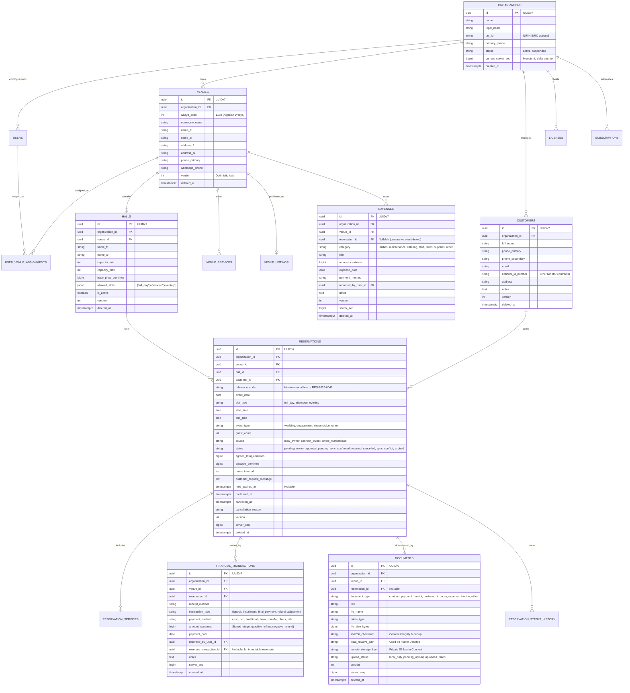

### 8.2 Marketplace, Providers, Advertising, and Virtual Tours ER Diagram

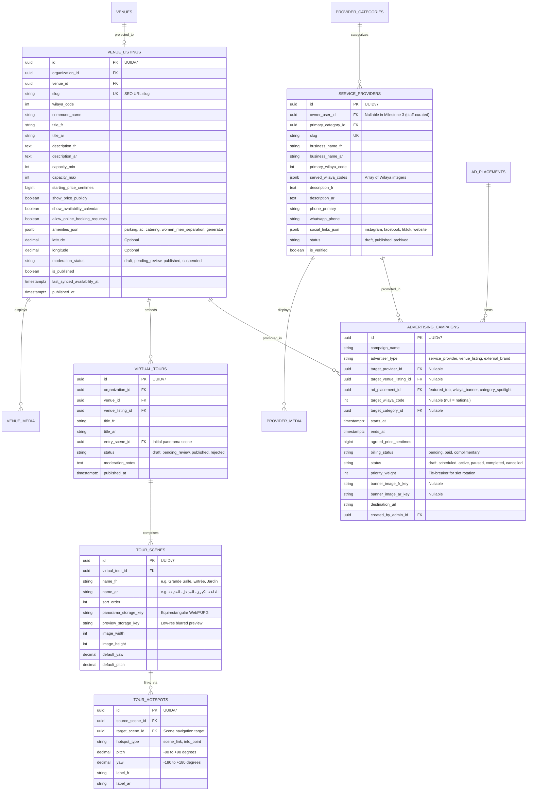

### 8.3 Distinguishing Business Data, Sync Metadata, and Audit History

To prevent domain pollution and keep synchronization deterministic, every syncable table in both SQLite and PostgreSQL separates its columns into three distinct groups:

1. **Business Domain Attributes:** The actual wedding-venue business fields (`event_date`, `slot_type`, `agreed_total_centimes`, `full_name`, etc.).
2. **Synchronization Metadata Attributes:**
   - `id` (`UUID` — RFC 9562 UUIDv7 generated at creation time on either client or server).
   - `organization_id` (`UUID` — immutable tenant owner).
   - `version` (`INTEGER NOT NULL DEFAULT 1` — incremented by the authoritative server on every accepted update; used for optimistic concurrency control).
   - `server_seq` (`BIGINT NULL` in SQLite, `BIGINT NOT NULL` in PostgreSQL — assigned from `organizations.current_server_seq` whenever a row is inserted/updated/soft-deleted on the server; drives cursor-based delta pull).
   - `client_updated_at` (`TIMESTAMPTZ` — client wall-clock timestamp for informational display only).
   - `last_modified_by_device_id` (`UUID NULL` — identifies which registered sync device originated the change).
   - `sync_status` (**SQLite client-only column**: `'local_only' | 'pending_push' | 'synced' | 'conflict' | 'error'`).
   - `deleted_at` (`TIMESTAMPTZ NULL` — soft-delete tombstone so deletions propagate cleanly during delta pull).
3. **Immutable Audit & Status History Tables:**
   - `reservation_status_history`: Tracks every state transition (`from_status`, `to_status`, `actor_type`, `actor_id`, `reason`, `occurred_at`).
   - `audit_logs`: Server-side security and administrative log recording sensitive tenant and Super-Admin operations (`actor_guard`, `actor_id`, `organization_id`, `action`, `auditable_type`, `auditable_id`, `old_values_json`, `new_values_json`, `ip_address`, `user_agent`, `created_at`).

---

## 9. Database design principles and critical constraints

### 9.1 Primary Keys: Client-Generated UUIDv7

Auto-incrementing integers (`SERIAL` / `BIGSERIAL` / SQLite `AUTOINCREMENT`) are fundamentally incompatible with offline-first creation and Local-to-Connect migration because two offline clients (or a Local installation upgrading to Connect) will inevitably generate colliding integer IDs (`1, 2, 3...`), forcing complex foreign-key remapping across reservations, payments, and documents.

**Design Rule:** Every syncable entity uses a **128-bit RFC 9562 UUIDv7** generated at record creation time:
- Stored as native `UUID` in PostgreSQL (16 bytes) and `TEXT` (36-char canonical lowercase hyphenated string) in SQLite.
- Unlike random UUIDv4—which causes severe B-tree page splitting and index fragmentation in PostgreSQL—UUIDv7 embeds a 48-bit Unix epoch millisecond timestamp prefix followed by 74 bits of cryptographic randomness, preserving monotonic insertion locality.

### 9.2 Monetary Integrity & Immutable Financial Ledger

1. **Integer Centimes (`amount_centimes BIGINT`):** Floating-point types (`FLOAT`, `REAL`, `DOUBLE`) are strictly forbidden for money. All monetary columns are stored as 64-bit integers in Algerian Dinar centimes (`1 DZD = 100 centimes`).
2. **Append-Only Financial Transactions:** Rows in `financial_transactions` are **immutable once committed**. Neither owners nor employees can silently edit the `amount_centimes` of a historical deposit receipt. If an entry was recorded in error:
   - The application creates a compensating transaction (`transaction_type = 'adjustment'` or `'refund'`) with a negative `amount_centimes` and sets `reverses_transaction_id` pointing to the original entry.
   - Reservation balance is always computed deterministically:
     $$\text{Outstanding Balance} = \text{agreed\_total\_centimes} - \text{discount\_centimes} - \sum \text{financial\_transactions.amount\_centimes}$$
   - This eliminates sync conflicts on payment history and provides tamper-evident bookkeeping for venue owners.

### 9.3 Critical PostgreSQL DDL Constraints

Application-level validation is mandatory for user-friendly error messages, but **database-level constraints** are the ultimate guardian of data integrity.

```sql
-- Required PostgreSQL extension for exclusion constraints
CREATE EXTENSION IF NOT EXISTS btree_gist;
CREATE EXTENSION IF NOT EXISTS pg_trgm;

-- 1. Composite Unique Constraint on Tenant Entities (Enables Composite Tenant Foreign Keys)
ALTER TABLE venues
    ADD CONSTRAINT uq_venues_org_id UNIQUE (organization_id, id);

ALTER TABLE halls
    ADD CONSTRAINT uq_halls_org_venue_id UNIQUE (organization_id, venue_id, id);

ALTER TABLE customers
    ADD CONSTRAINT uq_customers_org_id UNIQUE (organization_id, id);

-- 2. Composite Tenant Foreign Keys on Reservations
-- Guarantees that a reservation in Organization A can NEVER reference a Hall or Customer in Organization B
ALTER TABLE reservations
    ADD CONSTRAINT fk_reservations_hall_tenant
    FOREIGN KEY (organization_id, venue_id, hall_id)
    REFERENCES halls (organization_id, venue_id, id)
    ON DELETE RESTRICT,
    ADD CONSTRAINT fk_reservations_customer_tenant
    FOREIGN KEY (organization_id, customer_id)
    REFERENCES customers (organization_id, id)
    ON DELETE RESTRICT;

-- 3. Double-Booking Prevention Constraint (Confirmed Reservations)
-- Rule A: Exact same slot_type ('full_day', 'afternoon', 'evening') cannot be confirmed twice on the same hall & date
CREATE UNIQUE INDEX uq_reservations_confirmed_exact_slot
    ON reservations (hall_id, event_date, slot_type)
    WHERE status = 'confirmed' AND deleted_at IS NULL;

-- Rule B: If a 'full_day' booking is confirmed, NO 'afternoon' or 'evening' booking can be confirmed on that hall & date,
-- and vice versa. Enforced via a normalized time-range exclusion constraint:
-- (In DDL, a generated tsrange column 'effective_time_range' maps:
--   'afternoon' -> [event_date 12:00, event_date 18:00)
--   'evening'   -> [event_date 18:00, event_date+1 02:00)
--   'full_day'  -> [event_date 08:00, event_date+1 04:00) )
ALTER TABLE reservations
    ADD CONSTRAINT ex_reservations_no_confirmed_overlap
    EXCLUDE USING gist (
        hall_id WITH =,
        effective_time_range WITH &&
    )
    WHERE (status = 'confirmed' AND deleted_at IS NULL);

-- 4. Monetary Sanity Constraints
ALTER TABLE reservations
    ADD CONSTRAINT chk_reservations_positive_amounts
    CHECK (agreed_total_centimes >= 0 AND discount_centimes >= 0 AND discount_centimes <= agreed_total_centimes);
```

### 9.4 Indexing Strategy

| Table | Index Definition | Purpose |
| :--- | :--- | :--- |
| `reservations` | `(organization_id, venue_id, event_date)` | Fast owner calendar view & monthly availability queries. |
| `reservations` | `(organization_id, server_seq)` | Cursor-based delta sync pull (`WHERE organization_id = ? AND server_seq > ?`). |
| `reservations` | `(organization_id, status, event_date) WHERE deleted_at IS NULL` | Fast lookup of `pending_owner_approval` inbox and `sync_conflict` alerts. |
| `customers` | `(organization_id, phone_primary)` | Duplicate detection during customer entry & Local-to-Connect migration. |
| `venue_listings` | `(wilaya_code, capacity_max, starting_price_centimes) WHERE is_published = true AND moderation_status = 'published'` | Primary public marketplace filter index. |
| `venue_listings` | `GIN (amenities_json jsonb_path_ops)` | Fast filtering by venue services/facilities (e.g., parking, catering, generator). |
| `sync_mutation_log` | `UNIQUE (organization_id, mutation_id)` | Idempotency enforcement for client sync push retries. |

### 9.5 Transaction Boundaries

- **Local Client (SQLite):** Every user command (`CreateReservation`, `RecordPayment`, `UpdateCustomer`, `CancelReservation`) executes inside a single `db.transaction(() async { ... })` block that atomically updates the domain table(s), inserts into `reservation_status_history` (if applicable), and inserts the corresponding `sync_outbox` entry.
- **Central Server (PostgreSQL):**
  - During `/api/v1/sync/push`, each mutation in a batch executes inside a **PostgreSQL savepoint (`DB::transaction`)** coupled with the `sync_mutation_log` insert. If mutation #3 of a 10-mutation batch fails with a business conflict (e.g., reservation date collision), mutations #1 and #2 still commit cleanly, and mutation #3 returns a structured conflict response so the client does not get stuck in a head-of-line blocking loop.
  - External side effects (sending email/WhatsApp notifications, optimizing uploaded images, regenerating sitemaps) are **dispatched after transaction commit** (`DB::afterCommit()`) via queued jobs.

### 9.6 Data Retention and Soft-Delete Policies

- **Syncable Operational Records (`venues`, `halls`, `customers`, `reservations`, `expenses`, `documents`):** Use soft deletes (`deleted_at TIMESTAMPTZ`) so deletions propagate to all connected devices as tombstones via `server_seq`.
- **Financial Transactions & Audit Logs (`financial_transactions`, `audit_logs`, `reservation_status_history`):** Never soft-deleted or hard-deleted during normal operations. Retain for a minimum of **10 years** (standard commercial/accounting retention period in Algeria under the Commercial Code).
- **Idempotency Log (`sync_mutation_log`):** Retain for **90 days**, pruned weekly by a scheduled command (`walimapp:prune-sync-log`), since no offline client retry loop spans beyond 90 days for a single HTTP request.

---

## 10. API, authentication, and authorization

### 10.1 REST API Design Principles

- **Base Path & Versioning:** All programmatic endpoints live under `/api/v1/`. Breaking schema changes require `/api/v2/`, though additive optional fields are permitted in `v1`.
- **Content Format & Error Standard:** All requests and responses use `application/json` (UTF-8), except binary file uploads which use presigned S3 PUT URLs or `multipart/form-data`. Errors conform to **RFC 9457 Problem Details for HTTP APIs**:
  ```json
  {
    "type": "https://walimapp.dz/errors/booking-date-conflict",
    "title": "Booking Date Conflict",
    "status": 409,
    "detail": "Hall 'Grande Salle El Bahia' already has a confirmed reservation on 2027-06-18 (evening).",
    "instance": "/api/v1/sync/push",
    "conflict_meta": {
      "conflicting_reservation_id": "01967f8a-2b30-7120-9a11-445566778899",
      "hall_id": "01967f10-0000-7000-8000-000000000001",
      "event_date": "2027-06-18",
      "slot_type": "evening"
    }
  }
  ```

### 10.2 Core API Endpoint Catalog (`/api/v1`)

| Domain | Method & Path | Auth / Scope | Purpose |
| :--- | :--- | :--- | :--- |
| **Auth & Device** | `POST /api/v1/auth/login` | Public (Rate-limited) | Authenticates owner/employee, registers `sync_device`, returns Sanctum token + signed Connect entitlement lease. |
| **Auth & Device** | `POST /api/v1/auth/logout` | `auth:sanctum` | Revokes current device token. |
| **Licensing** | `POST /api/v1/licenses/activate` | Public (Rate-limited) | Optional online activation of a Local license key; returns signed `.walimlic` payload. |
| **Licensing** | `GET /api/v1/entitlements/current` | `auth:sanctum` | Refreshes signed Connect subscription lease token & organization feature flags. |
| **Sync** | `POST /api/v1/sync/push` | `auth:sanctum`, `connect.active` | Pushes ordered batch of offline outbox mutations with idempotency keys (`mutation_id`). |
| **Sync** | `GET /api/v1/sync/pull` | `auth:sanctum`, `connect.grace_allowed` | Pulls delta changes for `organization_id` where `server_seq > after_seq`. Allowed even during subscription grace/expiry for data recovery. |
| **Migration** | `POST /api/v1/migration/sessions` | `auth:sanctum`, `role:owner` | Initializes or resumes a Local-to-Connect migration session. |
| **Migration** | `POST /api/v1/migration/sessions/{id}/chunks` | `auth:sanctum`, `role:owner` | Uploads idempotent batch chunk (venues, customers, reservations, payments, expenses). |
| **Migration** | `POST /api/v1/migration/sessions/{id}/finalize` | `auth:sanctum`, `role:owner` | Verifies row counts and financial checksums, then activates live Connect sync. |
| **Bookings** | `POST /api/v1/reservations/{id}/approve` | `auth:sanctum`, `perm:reservations.approve` | Direct online approval of a `pending_owner_approval` request (can also be sent via `/sync/push`). |
| **Bookings** | `POST /api/v1/reservations/{id}/reject` | `auth:sanctum`, `perm:reservations.approve` | Rejects a `pending_owner_approval` request with reason. |
| **Media** | `POST /api/v1/media/presign-upload` | `auth:sanctum` | Validates MIME/size quota and returns presigned PUT URL (or local upload token) for documents, venue photos, or 360° panoramas. |
| **Catalog** | `PUT /api/v1/venues/{id}/listing` | `auth:sanctum`, `role:owner\|manager` | Updates public marketplace profile draft and submits for moderation/publication. |
| **Tours** | `PUT /api/v1/venues/{id}/virtual-tour` | `auth:sanctum`, `role:owner\|manager` | Saves 360° tour scene graph and hotspots; submits tour for admin review. |

### 10.3 Authentication Architecture Across Surfaces

1. **Owner & Employee Desktop App (Connect Mode):**
   - Uses **Laravel Sanctum** personal access tokens scoped to a specific registered `sync_device` row (`device_id`, `device_name`, `os_version`, `last_ip`, `last_active_at`).
   - On Windows, the Sanctum bearer token and the signed Connect lease token are stored in the **Windows Credential Manager (DPAPI-encrypted)** via `flutter_secure_storage`, never in plaintext JSON or unencrypted SQLite settings.
2. **Owner & Employee Desktop App (Local Workstation Switching):**
   - Whether in Local or Connect mode, the Windows desktop app supports a local workstation lock screen and fast employee profile switching using a locally stored **Argon2id** password/PIN hash so an owner can leave the PC at the reception desk without giving the receptionist owner-level access to financial reports or expense ledgers.
3. **Super-Admin Platform (Filament):**
   - Uses a completely separate authentication guard (`Auth::guard('admin')`) backed by a dedicated `platform_admins` table—**never** sharing the tenant `users` table.
   - Enforces mandatory **TOTP Two-Factor Authentication (2FA)**, strict password complexity, and idle session timeout (30 minutes).
4. **Public Marketplace Customers:**
   - Milestone 3 requires **no customer login** to browse or submit a booking request. Requests are protected by CSRF tokens, IP/phone rate limiting, hidden honeypot fields, and Cloudflare Turnstile (or lightweight server-side challenge).

### 10.4 Multi-Tenancy & Authorization Matrix

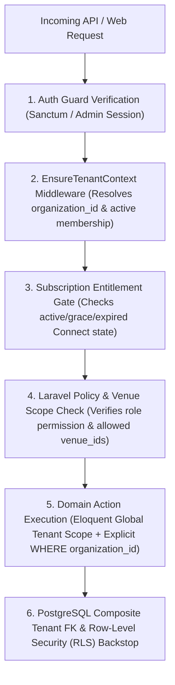

#### Tenant Role & Permission Matrix

| Capability | Organization Owner | Venue Manager | Venue Receptionist | Venue Accountant |
| :--- | :---: | :---: | :---: | :---: |
| Scope of Access | All Organization Venues | Assigned Venue(s) Only | Assigned Venue(s) Only | Assigned Venue(s) Only |
| View Calendar & Reservations | Yes | Yes | Yes | Read-Only |
| Create / Edit Reservations | Yes | Yes | Yes | No |
| Approve / Reject Online Requests | Yes | Yes | Configurable (Default: Yes) | No |
| Cancel Confirmed Reservation | Yes | Yes | No (Requires Manager/Owner) | No |
| Record Customer Deposit / Payment | Yes | Yes | Yes | Yes |
| View Full Revenue & Profit Reports | Yes | Configurable | **No** (Sees only individual booking balance) | Yes |
| Manage Venue Expenses | Yes | Yes | Record Petty Cash Only | Yes |
| Edit Public Listing & Virtual Tours | Yes | Yes | No | No |
| Manage Employees & Permissions | Yes | No | No | No |
| Manage Subscription & Local-to-Connect Migration | Yes | No | No | No |

#### Super-Admin Staff Role Matrix (`platform_admins`)

Per PRD §8 (*"Broad administrative access must not mean that every staff member automatically has unrestricted access"*), WalimApp staff are assigned one of four distinct roles:
1. **`super_admin`:** Full system configuration, staff role assignment, signing key rotation, emergency overrides.
2. **`licensing_billing_admin`:** Can issue/revoke Local licenses, manage Connect subscriptions, and manage paid advertising billing status.
3. **`catalog_moderator`:** Can review and publish/reject venue listings, provider directory entries, and 360° virtual tours; can manage ad campaign creatives. Cannot issue licenses or modify tenant financial data.
4. **`support_specialist`:** Read-only oversight of tenant organizations, sync health, and booking conflict cases; can trigger device token resets or license transfer codes with mandatory ticket reason logged in `audit_logs`.

---

## 11. Offline storage and synchronization architecture

### 11.1 Unified Local-First Persistence Pattern

Both **WalimApp Local** and **WalimApp Connect** execute against the exact same local SQLite schema managed by **Drift**.

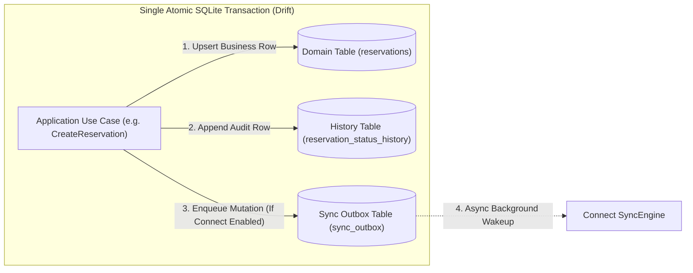

- **In WalimApp Local mode:** Step 3 is skipped (or `organization.mode == 'local'`). `sync_status` is set to `'local_only'`. No background network worker runs.
- **In WalimApp Connect mode:** Every local mutation writes both the business state change and a serialized command row into `sync_outbox` inside the same SQLite transaction. If the PC loses power 1 millisecond later, either both the reservation and its outbox command exist on disk, or neither does.

### 11.2 Local `sync_outbox` Schema (SQLite)

```sql
CREATE TABLE sync_outbox (
    outbox_seq INTEGER PRIMARY KEY AUTOINCREMENT,
    mutation_id TEXT NOT NULL UNIQUE,          -- UUIDv7 idempotency key
    organization_id TEXT NOT NULL,
    entity_type TEXT NOT NULL,                 -- 'venue','hall','customer','reservation','financial_transaction','expense','document'
    entity_id TEXT NOT NULL,                   -- Target record UUIDv7
    operation TEXT NOT NULL,                   -- 'create','update','delete','approve','reject','cancel'
    base_version INTEGER NOT NULL DEFAULT 0,   -- Version of record known to client before mutation
    payload_json TEXT NOT NULL,                -- Deterministic JSON snapshot/delta of the mutation
    depends_on_entity_id TEXT NULL,            -- Ensures parent (e.g. customer) pushes before child (reservation)
    status TEXT NOT NULL DEFAULT 'pending',    -- 'pending','in_flight','failed_retryable','conflict','failed_permanent'
    attempt_count INTEGER NOT NULL DEFAULT 0,
    next_retry_at TEXT NULL,
    last_error_code TEXT NULL,
    last_error_detail TEXT NULL,
    client_occurred_at TEXT NOT NULL
);

CREATE INDEX idx_sync_outbox_pending ON sync_outbox (status, next_retry_at, outbox_seq);
```

### 11.3 Timestamps, Versioning, and Monotonic Cursors

> [!WARNING]
> **Never rely on client wall-clock timestamps (`client_updated_at`) to order updates or calculate sync deltas.** Desktop PCs in wedding halls frequently have drifted clocks (wrong timezone, dead CMOS battery resetting to 2020, or manual clock edits).

Instead, WalimApp uses a **three-part logical ordering model**:
1. **`version` (Entity-Level Optimistic Concurrency Integer):** Every mutable record starts at `version = 1`. When a client updates a record, it sends `base_version = N`. The server checks if the authoritative row's current `version == N`. If it matches (or changes are non-overlapping field merges), the server increments `version = N + 1`.
2. **`server_seq` (Organization-Level Monotonic Watermark):** Each organization row in PostgreSQL holds `current_server_seq BIGINT NOT NULL DEFAULT 0`. Whenever *any* syncable record belonging to that organization is created, updated, or soft-deleted on the server (whether via a client sync push, another employee's device, an online customer booking request, or an admin action), a database function atomically increments `organizations.current_server_seq` and stamps the new integer onto the modified row's `server_seq` column.
3. **`client_occurred_at` (Informational Only):** Preserved for human audit logs (*"Receptionist created booking at 14:32 device time"*), never used to discard newer server states or filter delta pulls.

### 11.4 Synchronization Protocol (Push, Pull, Resume, Retry)

When the Flutter app detects connectivity (or on a periodic 30-second timer / manual "Sync Now" click / websocket wakeup hint), `SyncEngine` executes a strict four-phase cycle protected by an in-memory mutex:

#### Phase 1: Outbox Push (`POST /api/v1/sync/push`)
1. Reads up to `50` pending mutations from `sync_outbox` ordered by `outbox_seq ASC` (which naturally respects parent-before-child creation order: `venue` → `hall` → `customer` → `reservation` → `financial_transaction`).
2. Sends the batch to `/api/v1/sync/push`.
3. For each item in the batch, the server checks `sync_mutation_log (organization_id, mutation_id)`:
   - **Already present?** Immediately returns the cached outcome (`status: 'already_applied'`, `version`, `server_seq`). This makes network retries **100% idempotent**.
   - **New mutation?** Executes the domain action inside a savepoint, logs the result in `sync_mutation_log`, and returns per-mutation status (`applied`, `conflict`, or `validation_error`).
4. On receiving the response, the client removes `applied` and `already_applied` rows from `sync_outbox` and marks `conflict` rows for owner attention.

#### Phase 2: Delta Pull (`GET /api/v1/sync/pull?after_seq={last_pulled_server_seq}&limit=200`)
1. The server queries all syncable tables for the authenticated `organization_id` (and allowed `venue_id`s if scoped) where `server_seq > after_seq`, ordered by `server_seq ASC`.
2. The client applies the incoming records in a single SQLite transaction:
   - **Crucial Guard:** Before overwriting a local row with an incoming server row, the client checks if `sync_outbox` still holds an unpushed `pending` or `conflict` mutation for that `entity_id`. If not, the server state is applied cleanly and `sync_status` is set to `'synced'`.
   - Updates `local_sync_state.last_pulled_server_seq` to the highest `server_seq` in the batch.
   - Loops until `has_more == false`.

#### Phase 3: Binary Document & Media Queue
- Binary files (`documents` PDFs/scans and `venue_media` photos) are **never** Base64-embedded inside `/sync/push` JSON payloads, which would choke slow ADSL connections.
- Metadata syncs first in Phase 1 (`upload_status = 'pending_upload'`).
- Phase 3 iterates over local `documents` where `upload_status = 'pending_upload'`, requests a presigned URL (`POST /api/v1/media/presign-upload` with `sha256_checksum`), uploads the binary file over HTTP PUT, and confirms completion.

#### Phase 4: Exponential Backoff & Offline Recovery
- If the network drops mid-request, `in_flight` outbox entries revert to `pending` and retry using exponential backoff with full jitter:
  $$t_{\text{retry}} = \min\left(300\text{s},\; 2^{\text{attempt}} \times 2\text{s}\right) + \text{random}(0, 2\text{s})$$

### 11.5 Entity-Specific Conflict Detection & Resolution Matrix

Last-Write-Wins (LWW) is **not** safe across all entities. Each entity class uses a tailored conflict strategy:

| Entity | Conflict Scenario | Resolution Strategy |
| :--- | :--- | :--- |
| **`reservations`** | Client attempts to create or approve a booking for `(hall_id, event_date, slot_type)` that already has a `confirmed` reservation on the server (or `base_version` mismatch on status/date/slot). | **Strict Server Rejection (`409 Conflict`):** Server never overwrites the existing confirmed reservation. The colliding client reservation is transitioned to `status = 'sync_conflict'`. The owner UI displays a prominent **Conflict Resolution Banner** allowing the owner to: (a) Move their offline booking to another hall/date/slot, or (b) Cancel the conflicting entry and contact the customer. |
| **`financial_transactions`** | Two devices record payments for the same reservation while offline. | **Zero-Conflict Append-Only Set Union:** Because each payment is an immutable ledger entry with its own `UUIDv7`, both payments are valid additive entries and commit cleanly without conflict. |
| **`customers`** | Two devices edit different fields of the same customer (e.g., Device 1 updates `phone_secondary`, Device 2 updates `notes`) with the same `base_version`. | **Field-Level Merge with Audit Log:** Server compares changed fields against current state; non-overlapping field changes merge automatically. If the exact same field (`phone_primary`) changed to two different values, the newer mutation applies while preserving the overwritten value in `audit_logs` and surfacing a non-blocking review notice. |
| **`venues` / `halls`** | Concurrent edits to hall capacity or pricing. | **Optimistic Concurrency (`base_version`):** Only owners/managers can edit hall definitions. Field-level merge for distinct fields; explicit version conflict prompt if the same field was modified concurrently. |
| **`documents`** | Two devices attach contract PDFs to the same reservation. | **Additive Attachment by Checksum:** Both documents are retained in `documents` linked to `reservation_id` (deduplicated if `sha256_checksum` is identical). |

### 11.6 SQLite Schema Migrations and Local Crash Recovery

1. **Pre-Migration Automatic Safety Snapshot:** Before the Flutter app runs any Drift schema migration (`onUpgrade(Migrator m, int from, int to)`), `bootstrap.dart` compares `PRAGMA user_version` with the binary's `schemaVersion`. If `from < to`, the app first copies the SQLite database file (using `VACUUM INTO` or file copy while closed) to `backups/auto_pre_migration_v{from}_to_v{to}_{timestamp}.db`.
2. **Forward-Only Additive Local Migrations:** SQLite migrations must be strictly additive or use safe table-rebuild patterns tested against realistic fixtures in CI.
3. **WAL Mode & Integrity Check:** Local SQLite runs with `PRAGMA journal_mode = WAL; PRAGMA synchronous = NORMAL; PRAGMA foreign_keys = ON;`. On startup, if an unclean shutdown is detected, the app runs `PRAGMA quick_check` and offers 1-click restoration from the latest rolling backup if filesystem corruption is ever detected.

---

## 12. Reservation lifecycle and concurrency control

### 12.1 Complete Reservation State Machine

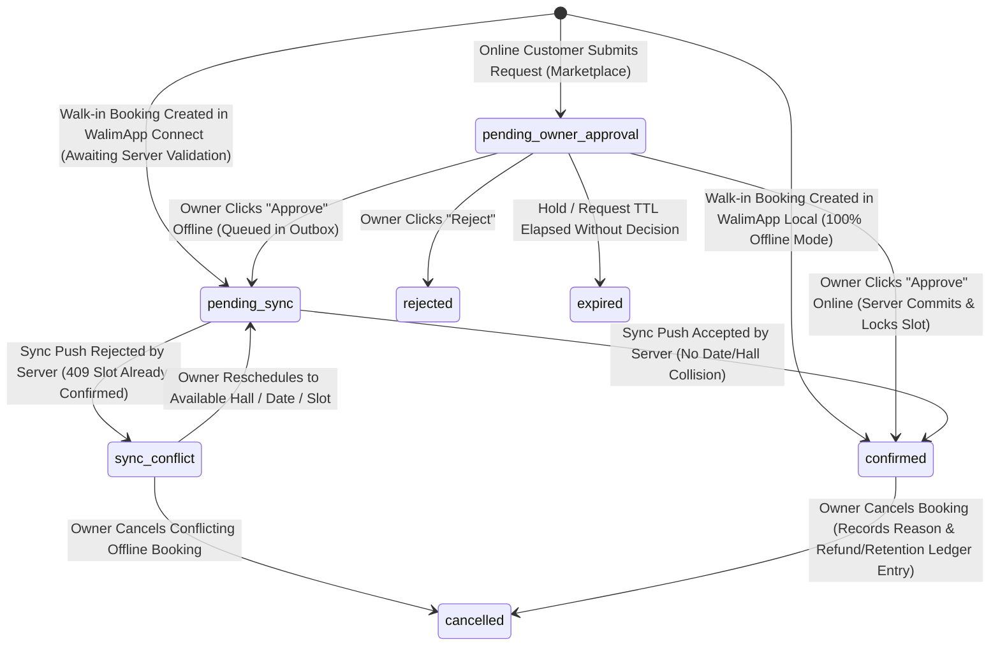

### 12.2 State Definitions & Authoritative Source of Truth

| State | Meaning | Blocks Public Availability? | Blocks Local Owner Calendar? |
| :--- | :--- | :--- | :--- |
| **`pending_owner_approval`** | Submitted by a customer on the Public Marketplace; awaiting owner review. | **Configurable** (See §12.4: Provisional default = Shows as *"Available / High Demand"* without hard-locking date). | Shown on owner calendar in **Amber (Pending Inquiry)** lane; does not block owner until approved. |
| **`pending_sync`** | Created or approved by the owner/employee in Connect mode while offline (or in-flight to server). | Once synced, immediately promotes to `confirmed` (or `sync_conflict`). | **Yes** — Displayed on owner calendar as *"Confirmed Locally (Pending Sync)"* so receptionist cannot double-book locally. |
| **`confirmed`** | Authoritatively committed (in Local SQLite for Local edition; in Central PostgreSQL for Connect edition). | **Yes (Hard Lock)** — Date/slot shows as **Unavailable** on public calendar and rejects competing confirmations. | **Yes (Hard Lock)**. |
| **`sync_conflict`** | An offline owner booking/approval collided with an already-`confirmed` booking on the central server during sync. | No (the existing server `confirmed` booking already holds the slot). | Highlighted in **Red Alert** on owner calendar and Conflict Center until resolved. |
| **`rejected`** | Online customer request declined by the owner. | No. | Hidden from main calendar; retained in request history. |
| **`cancelled`** | Previously confirmed (or conflicted) reservation cancelled by owner/customer. | No (frees the hall/date/slot immediately upon sync). | Hidden from active calendar slot; retained in customer & financial history. |
| **`expired`** | Online request that passed its response TTL without owner action. | No. | Archived in request history. |

### 12.3 Handling Critical Concurrency & Collision Scenarios

#### Scenario 1: Two Customers Submit Online Requests for the Same Hall & Date Simultaneously
- **Behavior:** Because selecting an available date on the public website only creates a `pending_owner_approval` request (PRD §5: *"Selecting an available date does not automatically confirm a reservation"*), **both requests succeed** and are stored in `reservations` with `status = 'pending_owner_approval'`.
- **Owner UX:** Both inquiries appear in the owner's Booking Requests Inbox grouped under that `(hall_id, event_date, slot_type)` with an explicit badge: *"2 competing requests for this date"*. When the owner approves Customer A's request, the system atomically confirms Customer A and prompts the owner (or automatically transitions) Customer B's competing request to `rejected` with reason `"Date booked by another client"`.

#### Scenario 2: Customer Submits Online Request While Owner Records an Offline Walk-In Reservation
- **Timeline:**
  - `10:00`: Customer A submits an online request for June 18 (`status = 'pending_owner_approval'` on server).
  - `10:15`: Owner (currently offline at the venue) takes a cash deposit from Walk-in Customer B for June 18 and records a reservation locally (`status = 'pending_sync'`).
  - `11:00`: Owner's internet reconnects; `SyncEngine` runs.
- **Outcome:**
  - Because Customer A's online request is only `pending_owner_approval` (not `confirmed`), the owner's walk-in reservation (`reservation.create`) **succeeds** on the server and becomes `confirmed`!
  - During the subsequent Delta Pull, Customer A's `pending_owner_approval` request arrives on the owner's app automatically flagged with *"Slot now occupied by confirmed Reservation #RES-2026-0089"*, allowing the owner to reject Customer A or offer an alternative date/hall via WhatsApp.
  - This matches real-world Algerian venue operations: a customer physically standing in the venue office paying a cash deposit (`عربون`) always takes precedence over an unapproved web inquiry.

#### Scenario 3: Two Offline Devices Under the Same Connect Organization Confirm the Same Slot
- **Timeline:** Owner on Laptop 1 (offline) and Manager on Office PC 2 (offline) both create a walk-in reservation for Hall 1 on July 10 (`evening`).
- **Outcome:**
  - Laptop 1 reconnects first at `12:00`. Server verifies no confirmed booking exists for `(Hall 1, July 10, evening)`, commits Laptop 1's reservation as `confirmed`, and increments `server_seq`.
  - Office PC 2 reconnects at `12:05` and pushes its `reservation.create` mutation.
  - Server runs `ApplySyncedReservationAction`, detects the existing `confirmed` booking on `(Hall 1, July 10, evening)`, and **does not overwrite Laptop 1's booking**. Instead:
    - Server persists Office PC 2's record with `status = 'sync_conflict'` (so neither the customer details nor any attached deposit transaction from PC 2 is lost!) and returns a `409 Conflict` outcome in the sync response.
    - Both PC 2 and Laptop 1 now see the conflict alert and can move the second reservation to Hall 2, another date, or refund the deposit.

### 12.4 Unresolved Booking Business Rules & Architectural Accommodations

Per PRD §5, the following business rules require Product-Owner confirmation. The schema is designed so that **any** choice below works via configuration without schema changes:

| Rule ID | Business Question | Recommended Provisional Default | How Schema Supports Alternatives |
| :--- | :--- | :--- | :--- |
| **BR-01: Pending Request Date Hold** | Does a `pending_owner_approval` request temporarily block other customers from submitting requests for that date? | **No Hard Hold (Competing Inquiries Allowed):** Allowing only one unverified web visitor to lock a prime Friday in summer would enable competitors or bots to DoS a venue's calendar for free. Multiple inquiries are allowed until the owner confirms one. | `reservations.hold_expires_at` (`TIMESTAMPTZ NULL`) is already included on the table. If an owner wants a 24h/48h "Option Hold" after speaking with a client, setting `hold_expires_at` soft-holds the date until expiry. |
| **BR-02: Request Expiration** | Do `pending_owner_approval` requests expire automatically? | **Soft Expiry After 72 Hours:** If unactioned after 72 hours, status transitions to `expired` via a scheduled job, freeing inbox clutter while allowing the owner to still view the customer's phone number and reopen if desired. | TTL duration (`booking_request_ttl_hours`) is stored in `organizations` / `venue_listings` settings. |
| **BR-03: Slot Model** | Are bookings strictly full-day or split by shifts (Afternoon / Evening)? | **Per-Hall Configurable Slots:** Each `hall` defines `allowed_slots` (`['full_day']` or `['full_day', 'afternoon', 'evening']`). | The PostgreSQL `effective_time_range` GiST exclusion constraint handles both full-day and shift-based overlap detection automatically. |

### 12.5 Server-Side Concurrency Implementation (Laravel + PostgreSQL)

```php
// Conceptual transaction pattern inside Booking\Actions\ConfirmReservationAction
return DB::transaction(function () use ($tenantContext, $reservationId, $expectedVersion) {
    // 1. Lock the parent Hall row to serialize concurrent confirmation attempts for this hall
    $hall = Hall::where('organization_id', $tenantContext->organizationId)
        ->where('id', $targetHallId)
        ->lockForUpdate()
        ->firstOrFail();

    // 2. Check for any overlapping confirmed reservation on this hall & date/time-range
    $conflict = Reservation::where('organization_id', $tenantContext->organizationId)
        ->where('hall_id', $hall->id)
        ->where('event_date', $eventDate)
        ->where('status', 'confirmed')
        ->whereNull('deleted_at')
        ->whereIn('slot_type', $this->conflictingSlotTypes($slotType))
        ->first();

    if ($conflict !== null && $conflict->id !== $reservationId) {
        throw new BookingSlotConflictException($conflict);
    }

    // 3. Allocate next monotonic organization server_seq & commit state transition
    $nextSeq = $this->sequenceGenerator->nextForOrganization($tenantContext->organizationId);

    $reservation->update([
        'status'       => 'confirmed',
        'confirmed_at' => now(),
        'version'      => $reservation->version + 1,
        'server_seq'   => $nextSeq,
    ]);

    // 4. PostgreSQL unique index & GiST exclusion constraint act as final atomic safety net
    return $reservation;
});
```

---

## 13. Local-to-Connect migration

When a venue owner who has used **WalimApp Local** for months or years purchases a **WalimApp Connect** subscription, all historical data must migrate to the central platform reliably without duplicates or data loss.

### 13.1 Why Identity Mapping Is Seamless

Because WalimApp Local is architected from **Milestone 1** to generate **UUIDv7** primary keys for all entities (`venues`, `halls`, `customers`, `reservations`, `financial_transactions`, `expenses`, `documents`), **no primary-key or foreign-key rewriting is required** during migration.
- Only one identifier changes: in Local-only mode, records use a locally generated `organization_id`. When the owner logs into their newly provisioned Connect account for the first time, the Migration Wizard binds their local dataset to the authoritative server `organization_id` (or the server adopts the client's `organization_id` if the organization was just created for this upgrade).
- *Recommendation:* Have the central server **adopt the Local installation's `organization_id`** when creating a brand-new Connect organization during upgrade, or run a single local SQLite transaction (`UPDATE ... SET organization_id = :serverOrgId`) before uploading if merging into a pre-created admin organization.

### 13.2 Local-to-Connect Migration Workflow & State Machine

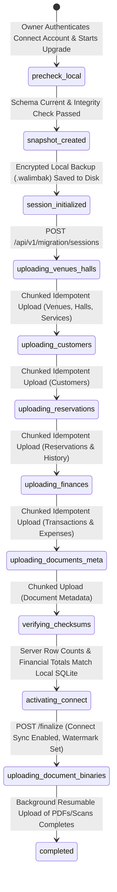

### 13.3 Duplicate Detection, Validation, and Partial Failure Recovery

1. **Mandatory Pre-Migration Safety Backup:** Step 2 of the wizard forces the creation of a local encrypted backup (`backups/pre_connect_upgrade_{timestamp}.walimbak`) before a single byte is sent over the network.
2. **Idempotent Chunked Uploads (`POST /api/v1/migration/sessions/{id}/chunks`):**
   - Data is uploaded in deterministic entity waves (100 records per HTTP chunk):
     `Wave 1: Venues & Halls` → `Wave 2: Services` → `Wave 3: Customers` → `Wave 4: Reservations` → `Wave 5: Financial Transactions & Expenses` → `Wave 6: Document Metadata`.
   - Every chunk uses `INSERT ... ON CONFLICT (organization_id, id) DO UPDATE` on PostgreSQL, keyed by the entity's `UUIDv7`.
   - **What if the internet drops at 65% during Wave 4?** The local wizard persists `migration_session_id` and the last acknowledged chunk index in SQLite. When internet returns, clicking "Resume Upgrade" resumes from Wave 4 Chunk 7. Re-sending an already processed chunk is a safe idempotent no-op.
3. **Handling Pre-Existing Server Venues (Duplicate Detection):**
   - If a WalimApp administrator manually created a placeholder venue for the owner in Super-Admin before the owner ran the migration wizard, the `/migration/sessions` initialization endpoint returns any existing server `venues` for that `organization_id`.
   - If a placeholder exists, the wizard prompts the owner: *"Link your local venue 'Salle El Bahia' to the existing online profile, or create as a separate venue?"* If linked, the local SQLite transaction remaps `venue_id` (and `hall_id` if applicable) inside SQLite before Wave 1 begins.
4. **End-to-End Reconciliation Gate (`/finalize`):**
   - Before marking the migration complete, the client sends a `manifest` containing exact entity counts and the sum of `financial_transactions.amount_centimes` and `expenses.amount_centimes`.
   - The server verifies that PostgreSQL's counts and financial sums for `organization_id` match 100%.
   - Upon verification, the server returns the organization's `current_server_seq`, the client sets `last_pulled_server_seq = current_server_seq`, marks all migrated local rows as `sync_status = 'synced'`, and transitions the app into live **WalimApp Connect** mode.
   - Binary PDF contracts and ID scans upload asynchronously in the background via Phase 3 of `SyncEngine` so a venue with 2 GB of historical PDFs can start using Connect immediately without waiting hours for file uploads.

---

## 14. Licensing and subscriptions

### 14.1 Cryptographic Offline Licensing for WalimApp Local

Because WalimApp Local must activate and run on computers that may **never** connect to the internet, licensing uses **Ed25519 asymmetric digital signatures**.

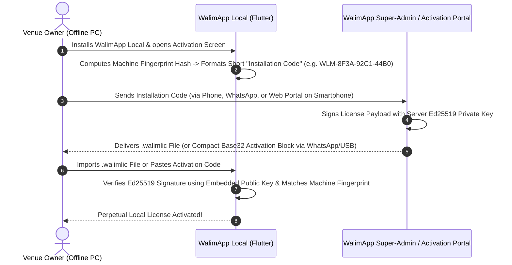

#### Signed License Payload Structure (`.walimlic`)

```json
{
  "schema_version": 1,
  "license_id": "01967f00-1122-7333-8444-556677889900",
  "edition": "local_perpetual",
  "organization_id": "01967f00-aaaa-7bbb-8ccc-ddddeeeeffff",
  "licensee_name": "SARL Palais des Roses - Oran",
  "machine_fingerprint": "sha256:9f86d081884c7d659a2feaa0c55ad015...",
  "max_venues": 1,
  "max_halls": 5,
  "issued_at": "2026-11-01T10:00:00Z",
  "license_expires_at": null,
  "maintenance_updates_until": "2027-11-01T23:59:59Z",
  "min_allowed_app_version": "1.0.0",
  "max_allowed_release_date": "2027-11-01"
}
```
*(Accompanied by `signature`: 64-byte Ed25519 signature over canonical RFC 8785 JCS JSON).*

#### Crucial Rules for Local Perpetual Licenses (PRD §3 & §9)

1. **`license_expires_at` is `null` for purchased perpetual licenses:** The installed application will **never** stop working or lock out the user as time passes.
2. **How Optional Maintenance Expiry (`maintenance_updates_until`) Works:**
   - Every compiled Flutter release embeds its build release date (`kAppReleaseDate = '2026-11-15'`).
   - As long as `kAppReleaseDate <= license.max_allowed_release_date` (or if it is a critical security/bugfix patch on the same minor version branch), the license is valid forever on that version.
   - If the owner's optional maintenance expired in `2027-11-01` and they attempt to install a major feature upgrade released in `2028-05-01`, the installer/updater checks the license before replacing the binary and informs the owner: *"Your perpetual license covers versions released up to Nov 1, 2027. Renew maintenance to install the 2028 release, or continue using your current version."*
3. **Tolerant Machine Fingerprinting:**
   - Computed from stable Windows identifiers: `HKEY_LOCAL_MACHINE\SOFTWARE\Microsoft\Cryptography\MachineGuid` + Motherboard UUID (`wmic csproduct get uuid` / SMBIOS) + CPU family identifier.
   - Does **not** include volatile components like MAC addresses, external USB drives, or RAM size so routine hardware upgrades do not break activation.

### 14.2 WalimApp Connect Subscriptions & Graceful Expiry

Connect is sold as a recurring subscription (`monthly` or `annual`) managed in the `subscriptions` table on the central server.

#### Subscription Lifecycle & Entitlement Lease Token
- Whenever a Connect client syncs (`POST /api/v1/sync/push` or `GET /api/v1/entitlements/current`), the server returns an Ed25519-signed `connect_lease_token` containing:
  - `subscription_status`: `'trialing' | 'active' | 'past_due_grace' | 'expired' | 'suspended'`
  - `subscription_period_ends_at`: Date the paid billing cycle ends.
  - `grace_period_ends_at`: `subscription_period_ends_at + 14 days` (gives Algerian owners time to pay via CCP, BaridiMob, bank transfer, or cash deposit without sudden service disruption).
  - `offline_lease_valid_until`: `now() + 30 days` (allows a paid Connect client to work completely offline for up to 30 days before needing to refresh its lease token).

#### Graceful Degradation Matrix on Connect Expiry

Per PRD §9 (*"Expiration must be handled gracefully. Appropriate data preservation and export access must be provided. Existing Local data must remain available if Connect access expires"*):

| Capability | `active` / `trialing` | `past_due_grace` (Days 1–14 post-expiry) | `expired` (After Grace Period) |
| :--- | :--- | :--- | :--- |
| **View & Search All Local Data (Customers, Reservations, Finances, Documents)** | Full Access | Full Access + Renewal Reminder Banner | **Full Access Forever** |
| **Create / Edit Walk-in Reservations, Payments, Expenses & Contracts Locally** | Full Access | Full Access | **Full Access (Reverts to Local Mode)** |
| **Data Export (Encrypted Backup, CSV/Excel Reports, PDF Archive)** | Full Access | Full Access | **Full Access (Unrestricted)** |
| **Final Delta Pull from Server (To ensure local PC has latest online state)** | Active | Active | **Allowed** (`GET /api/v1/sync/pull` remains open for 90 days post-expiry so owner never loses an online record) |
| **Push Local Changes / Multi-Device Cloud Sync** | Active | Active | **Paused** until subscription renewal |
| **Public Marketplace Venue Listing** | Published | Published (Warning sent to owner) | **Unpublished** (Or switched to static directory listing without online booking, per admin setting) |
| **New Online Booking Requests** | Enabled | Enabled | **Disabled** on public page |

### 14.3 Device Replacement and License Recovery

If a venue owner's Windows PC suffers a hardware failure, is stolen, or is replaced:
1. **In WalimApp Local:**
   - The owner installs WalimApp Local on the new Windows PC, imports their latest `.walimbak` backup file from their USB drive or external disk, and sends the new PC's `Installation Code` to WalimApp Support (or enters their License Recovery Key online).
   - A `licensing_billing_admin` or `support_specialist` clicks **"Reissue License for Hardware Replacement"** in Filament (which records the old machine fingerprint as superseded in `license_activations`, logs the action in `audit_logs`, and generates a new `.walimlic` file for the new PC).
2. **In WalimApp Connect:**
   - The owner installs WalimApp on the new PC, logs in with their Connect credentials, and selects **"Restore Organization Data from Cloud"**.
   - The app runs a full initial pull (`after_seq = 0`) to reconstruct the entire SQLite database and downloads on-demand PDF contracts from private S3 storage. The stolen/broken device token is revoked in Super-Admin or the owner's device settings.

---

## 15. Public marketplace and SEO

### 15.1 SSR Web Architecture (Blade + Livewire 3 + Alpine.js)

The Public Marketplace is served directly by the Laravel application under localized routes (`/fr/...` and `/ar/...`) using server-side rendered Blade views and Livewire 3 components.

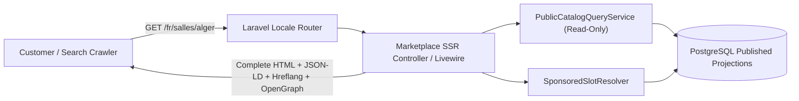

### 15.2 Bilingual URL Structure & Technical SEO

1. **Localized Semantic URLs:**
   - French (`fr-DZ`):
     - `/fr/salles` (All wedding venues)
     - `/fr/salles/{wilaya_slug}` (e.g., `/fr/salles/16-alger`, `/fr/salles/31-oran`, `/fr/salles/25-constantine`)
     - `/fr/salles/{wilaya_slug}/{venue_slug}` (Venue profile page)
     - `/fr/prestataires/{category_slug}/{wilaya_slug}` (Service providers, e.g., `/fr/prestataires/traiteurs/16-alger`)
   - Arabic (`ar-DZ`):
     - `/ar/salles/{wilaya_slug}/{venue_slug}` (With full `<html lang="ar" dir="rtl">` layout and Arabic metadata).
2. **Search Engine & Social Discovery Metadata:**
   - Every indexable page emits `<link rel="canonical">`, bidirectional `<link rel="alternate" hreflang="fr-DZ">` and `<link rel="alternate" hreflang="ar-DZ">`, and OpenGraph / WhatsApp meta tags (`og:title`, `og:description`, `og:image` pointing to a 1200×630 optimized WebP/JPEG venue cover card).
   - Dynamic XML sitemaps (`/sitemap.xml`, `/sitemap-venues-fr.xml`, `/sitemap-venues-ar.xml`, `/sitemap-providers.xml`) regenerated automatically when listings are published.
3. **Structured Data (Schema.org JSON-LD):**
   - Venue profile pages embed `EventVenue` and `LocalBusiness` JSON-LD schemas (name, address, Wilaya, `maximumAttendeeCapacity`, price range if public, photos, and breadcrumb list).

### 15.3 Venue Search, Filtering, and Availability Projection

Customers can filter venues by:
1. **Wilaya & Commune:** Indexed integer `wilaya_code` (1 to 58) and `commune_name`.
2. **Event Date & Shift (`event_date`, `slot_type`):**
   - Executed via a fast indexed `NOT EXISTS` subquery against `reservations`:
     ```sql
     SELECT vl.*
     FROM venue_listings vl
     WHERE vl.is_published = true
       AND vl.moderation_status = 'published'
       AND vl.wilaya_code = :wilayaCode
       AND vl.capacity_max >= :guestCount
       AND (
         -- Venue has at least one active hall without a confirmed conflicting booking on :targetDate
         EXISTS (
           SELECT 1 FROM halls h
           WHERE h.venue_id = vl.venue_id
             AND h.is_active = true
             AND h.deleted_at IS NULL
             AND NOT EXISTS (
               SELECT 1 FROM reservations r
               WHERE r.hall_id = h.id
                 AND r.event_date = :targetDate
                 AND r.status = 'confirmed'
                 AND r.deleted_at IS NULL
                 AND r.slot_type IN ('full_day', :requestedSlot)
             )
         )
       )
     ORDER BY vl.is_featured_current DESC, vl.published_at DESC
     LIMIT 24;
     ```
3. **Reliability of Public Availability Display (PRD §6):**
   - Because a Connect owner's desktop PC may be temporarily offline, the public venue profile displays availability with an honest freshness indicator based on `venue_listings.last_synced_availability_at`:
     - Synced within last 48 hours: Shows interactive calendar with green (*Available for Request*) and grey (*Booked*) dates, plus disclaimer: *"Dates are subject to owner confirmation."*
     - Offline for >7 days (or if owner sets `show_availability_calendar = false`): Hides the green/grey calendar badges and displays *"Contact venue or submit a request to verify availability for your date."*

### 15.4 Customer Contact & Online Booking Request Intake

On a public venue profile, prospective customers have two clear call-to-action paths:
1. **Submit Online Booking Request:**
   - Captures: Customer Name, Phone (`05/06/07XXXXXXXX`), Optional Secondary Phone/Email, Preferred Hall (or "Any Suitable Hall"), Event Date, Shift (`Journée complète`, `Après-midi`, `Soirée`), Estimated Guest Count, Event Type, and Optional Message.
   - Protected by Laravel rate limiting (`RateLimiter::for('booking-request', fn (Request $r) => [Limit::perMinute(3)->by($r->ip()), Limit::perDay(5)->by($r->input('phone_primary'))])`), honeypot field, and Turnstile challenge.
   - Creates a `reservations` record with `status = 'pending_owner_approval'` and `source = 'online_marketplace'`, increments `organizations.current_server_seq`, and triggers owner notifications (Connect desktop sync + email/WhatsApp notification hook).
2. **Direct WhatsApp Contact (PRD §6):**
   - If the venue has enabled WhatsApp inquiries (`whatsapp_phone`), renders a deep link (`https://wa.me/213XXXXXXXXX?text=...`) pre-filled in Arabic or French with the venue name and the customer's selected date, while logging an anonymous click counter so the venue owner can see how many leads WalimApp generated.

### 15.5 Sponsored Listings and Advertising Engine

To satisfy PRD §6 (*"Featured listings and reserved banner placements... clear identification of sponsored content... without displaying unattractive empty advertising blocks"*):

1. **Named Placement Slots (`ad_placements`):**
   - `marketplace_home_hero_featured` (Up to 4 featured cards on home page).
   - `venue_search_sponsored_top` (Up to 2 sponsored listings pinned above organic search results matching the filtered Wilaya).
   - `provider_directory_spotlight` (Sponsored provider cards at the top of a service category).
   - `venue_profile_related_providers` (Promoted caterers/photographers/decorators serving that venue's Wilaya).
2. **Deterministic Server-Side Resolution & Graceful Collapse:**
   - `SponsoredSlotResolver` queries `advertising_campaigns` where `status = 'active'`, `starts_at <= NOW()`, `ends_at >= NOW()`, and `target_wilaya_code` matches the current filter (or is `NULL` for national campaigns).
   - **Zero Empty Ad Blocks Rule:** Blade templates wrap every ad slot in `@if($sponsoredItems->isNotEmpty()) ... @endif`. If no paid campaign is active for a given Wilaya or category, the container is **not rendered at all** in the DOM—no "Advertise Here" placeholder boxes or broken whitespace ever appear.
   - **Mandatory Disclosure Badge:** Every rendered campaign item displays a non-removable localized pill badge: `Sponsorisé` (FR) / `مُموَّل` (AR).

---

## 16. Media storage and virtual tours

### 16.1 Media Storage Segregation (Private vs. Public Buckets)

All uploaded binary assets are managed through Laravel's Flysystem abstraction (`Storage` facade) backed by S3-compatible object storage in production (and local disk / MinIO in development). Storage is strictly split into **two isolated buckets/disks**:

| Storage Disk | Bucket Visibility | Stored Asset Types | Access Mechanism |
| :--- | :--- | :--- | :--- |
| **`walimapp-private`** | **Strictly Private** (No public read ACLs) | Customer contracts (`.pdf`), payment receipts, customer ID scans, expense invoices, and unapproved media drafts. | Accessed **only** via short-lived Presigned GET URLs (`TTL = 5 minutes`) issued by an authenticated Laravel controller after verifying `organization_id` and role permissions. |
| **`walimapp-public`** | **Public Read via CDN** (Write restricted to backend IAM credentials) | Approved venue gallery photos (`WebP`/`AVIF` derivatives), provider portfolio photos, ad banners, and published 360° virtual tour panoramas. | Served via custom CDN domain (`media.walimapp.dz`) with immutable `Cache-Control: public, max-age=31536000, immutable` headers. |

### 16.2 Upload Validation, Security, and Optimization Pipeline

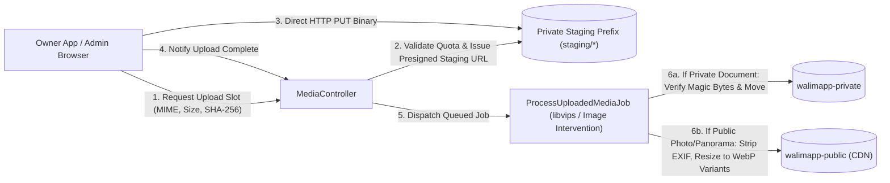

1. **Strict Server-Side Validation:**
   - **Documents:** Allowed MIME types restricted to `application/pdf`, `image/jpeg`, `image/png`, `image/webp` verified by inspecting file **magic bytes** (`finfo_file`), never trusting the client-supplied file extension. Maximum size: `15 MB` per document.
   - **Gallery Photographs:** Maximum raw upload `12 MB`. `ProcessUploadedMediaJob` strips all EXIF metadata (protecting owner/customer GPS privacy unless venue coordinates were explicitly set) and generates three optimized `WebP` derivatives:
     - `thumb` (`400x300`, ~25 KB — search cards)
     - `medium` (`1024x768`, ~90 KB — desktop/mobile gallery)
     - `hero` (`1920x1080`, ~180 KB — full-screen lightbox)

### 16.3 360-Degree Panoramic Virtual Tours Architecture

Per PRD §7, virtual tours use **360-degree equirectangular panoramas** connected via interactive scene hotspots, without requiring complex 3D mesh/digital-twin capture hardware, and **without blocking Milestone 3**.

#### 1. Capture & Authoring Workflow (Owner App / Connect Portal)
- Venue owners capture 360° photos using any standard consumer 360° camera (e.g., Insta360, Ricoh Theta) or smartphone Google Street View / panorama stitching mode, exporting standard **2:1 equirectangular JPEG/WebP images** (typically `4096×2048` or `6080×3040`, up to `25 MB` per scene).
- In the **Virtual Tour Editor** (available in Connect mode and Super-Admin):
  1. Owner creates a tour and uploads scenes (*Main Hall / القاعة الكبرى*, *Bride Stage / المنصة*, *Garden / الحديقة*, *Parking / الموقف*).
  2. Server validates that each image has an aspect ratio of `2:1` (±2%) and minimum resolution of `2048×1024`.
  3. Background job (`ProcessPanoramaSceneJob`) generates:
     - `preview.webp` (`1024×512` low-weight initial load image, ~40 KB, so the viewer opens instantaneously on mobile).
     - `full_hd.webp` (`4096×2048` optimized high-resolution equirectangular projection, ~600–900 KB) or multi-resolution cubemap tiles for `8K` inputs.
  4. Owner visually clicks inside the preview viewer to place **navigation hotspots** (`pitch`, `yaw`, `target_scene_id`, `label_fr`, `label_ar`).
  5. Owner previews the tour and clicks **"Submit for Publication"** (`status = 'pending_review'`).

#### 2. Moderation & Public Rendering
- A `catalog_moderator` in Filament previews the submitted tour to ensure image quality and absence of inappropriate content, then clicks **Publish** (`status = 'published'`).
- On the public venue profile page (`/fr/salles/{wilaya}/{slug}`):
  - **Zero Initial Page Weight:** The 360° WebGL viewer (**Pannellum**, a lightweight ~21 KB gzipped standalone WebGL panorama viewer with zero heavy dependencies) is **not** loaded during initial page render.
  - Instead, the page renders a lightweight static preview card with a *"Visite Virtuelle 360° / جولة افتراضية 360°"* play button.
  - When the customer taps the button, Alpine.js dynamically loads `pannellum.js` and feeds it the JSON scene graph generated from `virtual_tours`, `tour_scenes`, and `tour_hotspots`, starting with the 40 KB `preview.webp` and progressively upgrading to `full_hd.webp`.

---

## 17. Security and privacy

### 17.1 Server-Side Multi-Tenancy Isolation

> [!CAUTION]
> **Never trust `organization_id` or `venue_id` passed in a client request body or query parameter without verifying ownership against the authenticated user's server-side membership.**

Multi-tenancy isolation is enforced through **four concentric defense layers**:

1. **Layer 1 — Authentication Context (`EnsureTenantContext` Middleware):**
   - Resolves the authenticated `User` from the Sanctum token, loads their active `organization_memberships` record, and binds an immutable `TenantContext` singleton into the Laravel service container for the request lifecycle.
2. **Layer 2 — Venue Scope & RBAC Policy (`VenueScopePolicy`):**
   - If the actor is an employee (`VenueManager`, `VenueReceptionist`, `VenueAccountant`) rather than the `OrganizationOwner`, every query and mutation verifies that `target_venue_id` is in `TenantContext::$allowedVenueIds`.
3. **Layer 3 — Eloquent Global Scope + Composite Tenant Foreign Keys:**
   - All tenant models apply a mandatory `BelongsToOrganizationScope` (`WHERE organization_id = :ctxOrgId`).
   - Database composite foreign keys (`FOREIGN KEY (organization_id, venue_id, hall_id) REFERENCES halls (organization_id, venue_id, id)`) guarantee that even a raw SQL query cannot link a reservation in Organization A to a hall or customer in Organization B.
4. **Layer 4 — PostgreSQL Row-Level Security (RLS) Backstop:**
   - Every connection leased by the API middleware executes `SET LOCAL app.current_organization_id = '<uuid>';`.
   - Tenant tables enable RLS (`ALTER TABLE reservations ENABLE ROW LEVEL SECURITY; CREATE POLICY tenant_isolation_policy ON reservations USING (organization_id = current_setting('app.current_organization_id', true)::uuid);`).

### 17.2 Credential, License, and Local Data Protection

- **Password Hashing:** `Argon2id` (`memory: 65536, time: 4, threads: 1`) on both the Laravel backend and the Flutter desktop local employee lock screen.
- **API Tokens:** Sanctum stores only `SHA-256` hashes of personal access tokens in PostgreSQL. On Windows Desktop, tokens are stored in the OS **Windows Credential Locker (DPAPI)** via `flutter_secure_storage`.
- **Local Backup Encryption:** All `.walimbak` backup archives exported by the owner app are encrypted using **AES-256-GCM** with a key derived via `PBKDF2-HMAC-SHA256` / `Argon2id` from the owner's backup passphrase (or recovery key).
- **Optional Local SQLite At-Rest Encryption:** By using Drift's `sqlite3` FFI binding, the owner app can optionally swap `sqlite3_flutter_libs` for `sqlcipher_flutter_libs` with a machine-bound DPAPI key if full local disk database encryption is desired.

### 17.3 API Rate Limiting and Abuse Prevention

| Limiter Name | Target Endpoints | Policy |
| :--- | :--- | :--- |
| `auth-login` | `POST /api/v1/auth/login`, `/admin/login` | `5 attempts / minute` per IP + email/username lock after 5 failures |
| `license-activation` | `POST /api/v1/licenses/activate` | `10 attempts / hour` per IP |
| `public-booking-inquiry` | `POST /{locale}/salles/{slug}/booking-request` | `3 requests / minute` per IP and `5 requests / day` per normalized phone number |
| `sync-api` | `POST /api/v1/sync/push`, `GET /api/v1/sync/pull` | `60 requests / minute` per authenticated `device_id` |
| `media-upload` | `POST /api/v1/media/presign-upload` | `30 uploads / 10 minutes` per `organization_id` |

### 17.4 Administrative Governance and Immutable Audit Logging

- Every state-changing action in the Filament Super-Admin panel (issuing or revoking a license, extending a Connect subscription, suspending an organization, approving/rejecting a listing, modifying staff permissions, or viewing private tenant support diagnostics) invokes `AuditLogger::record()`.
- The `audit_logs` table has **no Eloquent `delete()` or `update()` methods** and its PostgreSQL database user does not have `DELETE` or `UPDATE` privileges on `audit_logs` (append-only `INSERT` privilege).

### 17.5 Localization Engineering: Arabic (`ar-DZ` RTL) and French (`fr-DZ` LTR)

1. **Bi-Directional Layout Discipline:**
   - In Flutter: All padding, margins, and alignments must use directional primitives (`EdgeInsetsDirectional.only(start: 16)`, `AlignmentDirectional.centerStart`) rather than hardcoded `left`/`right`.
   - In Marketplace Web: Tailwind CSS logical properties (`ms-4`, `me-4`, `ps-4`, `pe-4`, `text-start`, `text-end`) are used throughout so `<html dir="rtl" lang="ar">` and `<html dir="ltr" lang="fr">` mirror automatically without separate stylesheets.
2. **Algerian Numeral & Date Conventions:**
   - In Algeria, **Western Arabic numerals (`0, 1, 2, 3, 4, 5, 6, 7, 8, 9`)** are standard in both French and Arabic commercial/financial contexts (rather than Eastern Mashriqi numerals `٠١٢٣٤٥٦٧٨٩`). Both locales must format numbers, dates (`DD/MM/YYYY`), phone numbers (`0550 12 34 56`), and `DZD` amounts (`150 000,00 DA` / `150,000 د.ج`) using Western numerals by default.
   - Phone numbers and reference codes (`RES-2026-0042`) inside RTL Arabic layouts must be wrapped in `<bdi>` / `Directionality(textDirection: TextDirection.ltr)` so plus signs and hyphens do not invert visually.
3. **Offline Arabic PDF Shaping:**
   - The Dart `pdf` package requires explicit TTF font embedding (`Cairo-Regular.ttf`, `Cairo-Bold.ttf`) and Arabic text shaping/BiDi reordering so printed Arabic contracts render connected cursive glyphs properly offline.

### 17.6 Algerian Personal-Data Protection & Regulatory Considerations (Law No. 18-07)

> [!IMPORTANT]
> **Legal Disclaimer:** The following analysis highlights technical and architectural implications of Algerian data-protection law to guide engineering and hosting decisions. It does **not** constitute formal legal advice and must be verified with qualified Algerian legal counsel before launching WalimApp Connect or the Public Marketplace.

In Algeria, the processing of personal data of natural persons (venue owners, employees, customers submitting booking requests, and wedding guests/contract signatories) is governed by **Law No. 18-07 of 10 June 2018** relating to the protection of individuals in the processing of personal data, enforced by the **ANPDP** (*Autorité Nationale de Protection des Données à Caractère Personnel*, active since 2022–2023).

#### Key Architectural & Hosting Implications to Confirm:
1. **Cross-Border Data Transfer Restrictions (Article 44 of Law 18-07):**
   - Law 18-07 strictly regulates transferring personal data of Algerian residents to a foreign country, generally requiring adequacy Conditions and prior authorization from the ANPDP, and prohibiting transfers that could affect public security or national interests.
   - **Impact on Milestone 1 (WalimApp Local):** Because WalimApp Local stores all data strictly on the venue owner's local Windows PC inside Algeria with zero cloud transmission, cross-border hosting rules are not triggered by the software vendor.
   - **Impact on Milestones 2–4 (WalimApp Connect & Marketplace):** Central PostgreSQL and `walimapp-private` object storage hold customer names, phone numbers, national ID numbers (`CIN`/`NIN` on contracts), and financial receipts.
   - **Architectural Action:** Keep the deployment stack 100% cloud-agnostic (Docker Compose / standard Linux + PostgreSQL + S3-compatible storage) so WalimApp can be deployed onto an **Algerian-hosted infrastructure provider** (e.g., Algérie Télécom / DzairCloud, Issal, Icosnet, Tedj Cloud) to keep all PII and private documents physically inside Algerian borders, OR on a compliant host following formal ANPDP declaration/authorization.
2. **ANPDP Prior Declaration & Consent (Articles 7 & 12 of Law 18-07):**
   - Online booking request forms and Connect owner registration flows must include an explicit, un-prechecked consent checkbox in Arabic and French explaining the purpose of data collection, retention period, and the user's rights of access, rectification, and deletion under Law 18-07.
   - The data model includes soft-delete and PII anonymization support (`CustomerAnonymizerAction`) to fulfill verified data-subject erasure requests while preserving anonymized financial ledger totals required by tax/accounting rules.

---

## 18. Deployment and operational architecture

### 18.1 Environment Strategy

| Environment | Purpose | Infrastructure Topology |
| :--- | :--- | :--- |
| **`local` (Developer Machine)** | Daily feature development & AI-agent execution (`c:\proj\walimapp`). | Flutter Windows desktop running natively; Laravel backend via `docker compose` (PHP 8.3, PostgreSQL 16, MinIO S3, Mailpit). |
| **`ci` (GitHub Actions / GitLab CI)** | Automated test gates on every commit/PR. | Ephemeral containers running PHPUnit/Pest against PostgreSQL 16 and `flutter test` against SQLite. |
| **`staging`** | Pre-production integration testing (Connect sync, migration wizard, marketplace SEO preview). | Single small Linux VPS (2 vCPU, 4 GB RAM) mirroring production OS/stack, protected by HTTP Basic Auth / IP allowlist, using test keys. |
| **`production`** | Live platform (Milestones 2–4). | Single hardened Linux server (initial sizing: 4 vCPU, 8–16 GB RAM, NVMe SSD) + Automated Off-Site Encrypted Backup Storage. |

### 18.2 Production Single-Host Topology (Managing Complexity for a Solo Developer)

Until WalimApp exceeds ~500 active Connect venues or >100 requests/second on the marketplace, a **single vertically scalable Linux server** running the modular monolith is vastly more reliable, cheaper, and easier to debug than a multi-node cluster.

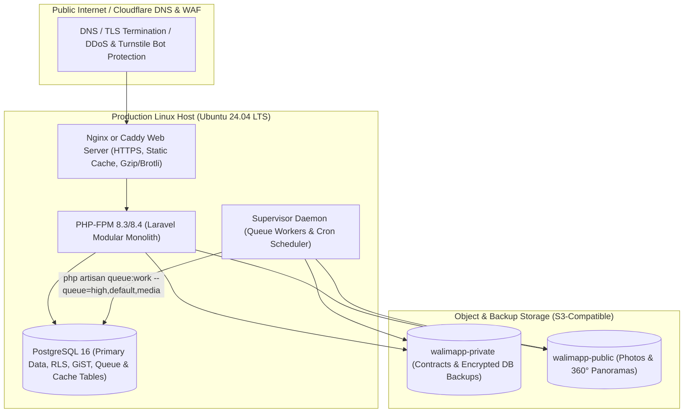

### 18.3 Secrets and Configuration Management

- All environment-specific configuration is injected via `.env` (restricted to `chmod 0600`, owned by the deploy user, never committed to Git).
- **Critical Secret — Ed25519 License Signing Key (`WALIMAPP_LICENSE_PRIVATE_KEY`):**
  - Generated offline once; stored encrypted in the founder's password manager/hardware key and injected only into the production server's protected environment.
  - Support key rotation by embedding an array of trusted `public_keys` keyed by `key_id` (`kid: "key-2026-v1"`) inside the Flutter app.

### 18.4 Zero-Downtime Database Migrations & API Backward Compatibility

Because desktop Connect clients update on the venue owner's schedule rather than simultaneously with the backend:
1. **Expand-and-Contract Database Migrations:** Never rename or drop a PostgreSQL column referenced by `/api/v1/*` in a single release. Add new nullable/defaulted columns first (*Expand*), support both old and new fields in the Sync API, and only remove deprecated columns after `min_allowed_connect_app_version` has advanced (*Contract*).
2. **Minimum Supported Connect Client Header:** Every Connect API request sends `X-WalimApp-Client-Version: 1.2.0`. If a critical sync protocol update ever requires a client update, the server can return `426 Upgrade Required` with a localized prompt to update the desktop app while leaving offline Local mode untouched.

### 18.5 Backup, Restoration, and Disaster Recovery

#### A. WalimApp Local (Desktop Backup & Restore)
1. **Automated Rolling Local Backups:** Whenever the owner closes the application (or once every 24 hours of active use), the app executes `VACUUM INTO` to write a consistent, compacted SQLite snapshot into `%LocalAppData%\WalimApp\Backups\Rolling\`, keeping the last 14 daily snapshots.
2. **One-Click External/USB Backup (`.walimbak`):**
   - The UI prominently encourages owners to plug in a USB flash drive weekly (or after major bookings) and click **"Sauvegarder sur clé USB / نسخ احتياطي إلى قرص خارجي"**.
   - Produces a single AES-256-GCM encrypted `.walimbak` archive containing:
     - `database.sqlite` (consistent snapshot via `VACUUM INTO`)
     - `documents/` (all local PDF contracts and receipts)
     - `manifest.json` (app version, schema version, record counts, and per-file `SHA-256` checksums)
3. **Safe Restoration Wizard:**
   - Before restoring any `.walimbak` archive, the wizard verifies all `SHA-256` checksums in a temporary staging directory, automatically backs up the *current* local database to `Backups\PreRestore\`, and only swaps the active database after integrity verification succeeds.

#### B. Central Platform (PostgreSQL & Object Storage DR)
- **RPO (Recovery Point Objective):** `< 6 hours` initially (upgradeable to `< 5 minutes` with continuous WAL archiving via `pgBackRest` / `wal-g` once revenue grows).
- **RTO (Recovery Time Objective):** `< 2 hours` (provision fresh VPS via Ansible/provision script + restore latest PostgreSQL dump + point DNS).
- **Automated Schedule (`spatie/laravel-backup` + cron):**
  - Every **6 hours**: `pg_dump --format=custom` compressed, encrypted with AES-256, and uploaded to an off-site S3 bucket in a separate account/credentials from the primary server (so a compromised server cannot delete historical backups).
  - Daily: Verify backup file size and integrity; retain 14 daily, 8 weekly, and 12 monthly snapshots.

### 18.6 Logging, Monitoring, and Background Jobs

- **Queue Isolation:** Supervisor runs `php artisan queue:work database --queue=high,default,media --tries=3 --timeout=120`.
  - `high`: Booking notifications, password resets, license emails.
  - `default`: Sitemap generation, audit log exports.
  - `media`: CPU-intensive image resizing and 360° panorama processing (`ProcessUploadedMediaJob`).
- **Monitoring & Alerting:**
  - **Exception Tracking:** Self-hosted GlitchTip or Sentry free tier (with PII scrubbing enabled so customer phone numbers/names are stripped from stack traces).
  - **Health Check Endpoint (`/healthz`):** Verifies PostgreSQL connectivity, disk free space (`>15%`), and queue backlog age (`<5 minutes`), polled every 60 seconds by an external uptime monitor (e.g., UptimeRobot / BetterStack) alerting the founder via Telegram/Email.
  - **Sync Conflict Telemetry:** Super-Admin dashboard widget showing any organization with `sync_conflict` reservations or repeated `/sync/push` errors so support can proactively assist the venue owner.

### 18.7 Windows Desktop Packaging & Update Delivery

- Packaged using **Inno Setup** (producing a clean, standard `WalimApp-Setup-x64.exe` installer that bundles the Visual C++ Redistributable if missing and creates desktop shortcuts).
- **Code Signing:** Sign the Windows `.exe` installer and binary with an OV/EV Code Signing Certificate (or Azure Trusted Signing) before commercial release to prevent Windows SmartScreen warnings.
- **Update Mechanism:** In-app "Check for Updates" (or USB offline update installer `.exe` for offline venues) checks the signed `maintenance_updates_until` date in the local `.walimlic` before applying major feature updates.

---

## 19. Testing and quality gates

Because WalimApp is built by a solo developer using AI coding agents, **automated tests are the primary safeguard against regressions**. AI agents must never mark a feature complete without passing its corresponding automated test suite.

### 19.1 Comprehensive Testing Strategy

| Test Category | Tooling | What Must Be Verified |
| :--- | :--- | :--- |
| **1. Domain Unit Tests** | Flutter `test`, Laravel `Pest` | Reservation state machine transitions, monetary balance calculations (`agreed_total - discount - sum(payments)`), Ed25519 license signature & maintenance date evaluation, slot overlap rules (`full_day` vs `afternoon`/`evening`). |
| **2. Database Constraint Tests** | `Pest` (Real PostgreSQL 16 in CI—**never SQLite** for backend tests!) | Verify PostgreSQL `uq_reservations_confirmed_exact_slot`, GiST exclusion constraint `ex_reservations_no_confirmed_overlap`, composite tenant FKs, and RLS policies reject invalid writes even when bypassing application validation. |
| **3. Multi-Tenancy & Authorization Matrix** | `Pest` HTTP Feature Tests | Automated cross-tenant intrusion suite: User of Organization A attempts to read, update, delete, sync, approve, or download documents belonging to Organization B across every API and web route (`403`/`404` required). Verify `VenueReceptionist` cannot access unassigned venues or full profit reports. |
| **4. Booking Concurrency & Race Tests** | `Pest` Parallel / Lock Harness | Simulate simultaneous approval of two overlapping `pending_owner_approval` requests and simultaneous `/sync/push` + `/approve` for the same `(hall_id, event_date, slot_type)`. Assert **exactly one** succeeds (`200`) and the second receives `409 Conflict`. |
| **5. Offline & Synchronization Tests** | Flutter `drift` in-memory DB + Mock/Local Server | Verify atomic creation of domain record + `sync_outbox` row; idempotent replay of duplicate `mutation_id`s; out-of-order batch failure recovery; `server_seq` delta pull; and transition of colliding offline bookings to `sync_conflict` without data loss. |
| **6. Local-to-Connect Migration Tests** | Full-stack integration test | Seed a Local SQLite DB with 500 customers, 300 reservations, 800 payments, and 50 PDF contracts; run the Migration Wizard against the backend; simulate network failure at 50%; resume; assert 100% row count and financial sum parity. |
| **7. Backup & Restore Round-Trip Tests** | Flutter integration test | Export an encrypted `.walimbak` archive, tamper with 1 byte to verify checksum rejection, then restore the valid archive into a clean SQLite instance and assert byte-for-byte record equality. |
| **8. End-to-End (E2E) Workflows** | Flutter `integration_test` + Playwright / Laravel Dusk | Critical user journeys from venue creation to contract PDF output and online booking inquiry to owner confirmation. |

### 19.2 Mandatory Milestone Quality Gates

No milestone may be considered complete until all quality gates in its column pass in CI:

- **Gate 1 (Before Releasing Milestone 1 — WalimApp Local MVP):**
  - [ ] 100% pass rate on Local reservation overlap rules (`full_day`, `afternoon`, `evening`) in SQLite.
  - [ ] Financial ledger immutability and balance calculation tests pass (deposits, installments, refunds, discounts).
  - [ ] Offline Ed25519 `.walimlic` activation, tampered-signature rejection, and expired-maintenance continued-usability tests pass.
  - [ ] Bilingual (`ar-DZ` RTL and `fr-DZ` LTR) PDF contract and receipt generation produces valid, readable PDFs with zero internet access.
  - [ ] Encrypted `.walimbak` backup export, corruption detection, and full restoration round-trip test passes.
  - [ ] Pre-migration SQLite automatic backup snapshot test passes across simulated schema upgrade `v1 -> v2`.

- **Gate 2 (Before Releasing Milestone 2 — Connect Foundations & Sync):**
  - [ ] Cross-tenant authorization intrusion suite passes 100% across all `/api/v1/*` and `/admin/*` endpoints.
  - [ ] Idempotency test: sending the exact same `/api/v1/sync/push` payload 5 times in a row produces exactly 1 database mutation and 1 financial ledger entry.
  - [ ] Offline booking conflict test: offline-created reservation colliding with a server-confirmed booking transitions cleanly to `sync_conflict` without overwriting the confirmed booking.
  - [ ] Local-to-Connect migration test passes with mid-migration network drop and resume, verifying zero lost customers, reservations, payments, or documents.
  - [ ] Connect subscription expiry test: expiring a subscription disables cloud push while leaving 100% of local data readable, editable locally, and exportable.

- **Gate 3 (Before Releasing Milestone 3 — Public Marketplace & Online Bookings):**
  - [ ] Parallel concurrency test: concurrent approvals for the same `(hall_id, event_date, slot_type)` never produce two `confirmed` rows in PostgreSQL.
  - [ ] Public marketplace leakage audit: automated test verifying public HTML and JSON-LD responses contain zero internal notes, customer PII, or private document URLs.
  - [ ] SEO & Localization verification: `/fr/...` and `/ar/...` pages return HTTP 200 SSR HTML with valid `hreflang`, canonical tags, and Schema.org `EventVenue` JSON-LD.
  - [ ] Sponsored slot collapse test: pages with zero active `advertising_campaigns` render zero empty ad containers.

- **Gate 4 (Before Releasing Milestone 4 — Providers, Ads & 360° Virtual Tours):**
  - [ ] Panorama validation test: non-2:1 images, oversized files, and disguised executables are rejected at upload.
  - [ ] Lighthouse mobile performance gate: adding a published 360° virtual tour to a venue page does not degrade initial Largest Contentful Paint (LCP) because the WebGL viewer is lazy-loaded on interaction.

---

## 20. Architectural decision records

### ADR-001: Modular Monolith in Laravel over Microservices
- **Status:** Accepted
- **Context:** WalimApp spans four functional areas (Connect Sync API, Public Marketplace, Super-Admin, and Background Media/Notification Workers) built and maintained by a single developer using AI coding agents.
- **Decision:** Build the entire central platform as a single Laravel 11/12 Modular Monolith (`app/Modules/*`) backed by a single PostgreSQL 16 database.
- **Alternatives Considered:** Separate microservices for Sync API, Booking Engine, Public Marketplace (Next.js), and Admin Panel.
- **Consequences:** Eliminates distributed transactions, network latency between internal services, and multi-repo deployment synchronization. Requires strict adherence to internal module boundaries (§7.4) so domain logic remains decoupled.

### ADR-002: Single Flutter Codebase with Capability Entitlements for Local and Connect
- **Status:** Accepted
- **Context:** WalimApp offers two desktop owner tiers: a standalone perpetual-licensed Local edition and a subscription-based Connect edition.
- **Decision:** Maintain a single Flutter desktop codebase and SQLite schema where Local and Connect are controlled by signed cryptographic entitlement tokens (`local_perpetual` vs `connect_subscription`).
- **Alternatives Considered:** Forking two separate Flutter repositories (`walimapp-local` and `walimapp-connect`).
- **Consequences:** Fixes and UI improvements to calendar, contracts, and finances immediately benefit both editions. Upgrading from Local to Connect happens in-place without uninstalling the software.

### ADR-003: Transactional Outbox + Monotonic `server_seq` Delta Sync over CRDTs / Last-Write-Wins
- **Status:** Accepted
- **Context:** Connect must work offline for days, queue mutations reliably, and synchronize without ever silently overwriting confirmed reservations or corrupting financial ledgers.
- **Decision:** Record local mutations atomically in `sync_outbox` alongside SQLite domain updates; push ordered command batches with `mutation_id` idempotency keys; pull deltas using a per-organization server-assigned monotonic sequence integer (`server_seq`); and apply entity-specific conflict resolution.
- **Alternatives Considered:** Generic Last-Write-Wins (LWW) by timestamp, or state-based CRDT replication (e.g., PowerSync / ElectricSQL).
- **Consequences:** Immune to client clock skew; guarantees server-side business rules and booking availability locks run on every mutation; prevents silent double-bookings.

### ADR-004: Central PostgreSQL as Authoritative Arbitrator for Confirmed Connect Bookings
- **Status:** Accepted
- **Context:** In Connect mode, reservations can originate from online customer requests, the main venue desktop PC (online or offline), or a manager's secondary device.
- **Decision:** Central PostgreSQL is the sole authority for transitioning a Connect reservation to `status = 'confirmed'`, enforced via `SELECT ... FOR UPDATE` on the hall and a PostgreSQL GiST exclusion constraint / partial unique index. Offline-created Connect bookings start as `status = 'pending_sync'` until validated by the server.
- **Alternatives Considered:** Allowing offline clients to force-overwrite server state upon reconnection.
- **Consequences:** Guarantees zero double-confirmed slots in the central database. If an offline walk-in booking collides with a booking confirmed while the PC was offline, it is preserved as `sync_conflict` for explicit human resolution rather than lost or silently overwriting the existing booking.

### ADR-005: Client-Generated UUIDv7 Primary Keys Across SQLite and PostgreSQL
- **Status:** Accepted
- **Context:** Records are created offline in Local and Connect modes and later migrated or synced to PostgreSQL.
- **Decision:** Use RFC 9562 UUIDv7 for all primary keys of syncable entities from Milestone 1.
- **Alternatives Considered:** Auto-incrementing integers with a separate `remote_id` mapping column; random UUIDv4.
- **Consequences:** Zero foreign-key rewriting during Sync or Local-to-Connect migration; time-sorted B-tree index locality in both SQLite and PostgreSQL.

### ADR-006: Server-Side Rendered (SSR) Laravel Blade + Livewire 3 for the Public Marketplace
- **Status:** Accepted
- **Context:** The public marketplace requires strong Arabic/French SEO, instant WhatsApp/Facebook link previews, fast loading on Algerian mobile networks, and low maintenance overhead.
- **Decision:** Render the public marketplace directly from Laravel using SSR Blade templates, Livewire 3 for interactive search filters, and Alpine.js for client-side micro-interactions.
- **Alternatives Considered:** Flutter Web (rejected due to poor SEO and heavy WASM/Canvas bundle); decoupled Next.js/Nuxt frontend (rejected due to dual-stack deployment and API duplication overhead).
- **Consequences:** First-class SEO and Core Web Vitals out of the box within the single Laravel deployment.

### ADR-007: Asymmetric Ed25519 Offline License Files for Local and Signed Lease Tokens for Connect
- **Status:** Accepted
- **Context:** WalimApp Local must activate on offline PCs and continue working indefinitely after optional maintenance expires; Connect must tolerate temporary internet outages without locking out paying subscribers.
- **Decision:** Sign `.walimlic` files and Connect lease tokens on the Super-Admin server using an Ed25519 private key and verify them offline in the Flutter app using an embedded Ed25519 public key. Separate `license_expires_at` (`null` for Local) from `maintenance_updates_until`.
- **Alternatives Considered:** Mandatory periodic online license check-ins; symmetric HMAC keys embedded in the client binary (vulnerable to extraction and keygen forgery).
- **Consequences:** Even if a user decompiles the Flutter Windows binary, they can only see the Ed25519 **public** key and cannot forge valid licenses.

### ADR-008: Immutable Append-Only Ledger for Financial Transactions
- **Status:** Accepted
- **Context:** Venue owners and receptionists record deposits, installments, and refunds offline and online. Concurrent or retroactive edits to payment rows risk accounting discrepancies and sync conflicts.
- **Decision:** Store all payments in `financial_transactions` as immutable append-only entries (`amount_centimes BIGINT`). Corrections are recorded as explicit reversal/adjustment rows referencing `reverses_transaction_id`.
- **Alternatives Considered:** Mutable `paid_amount` column on `reservations` or editable payment rows.
- **Consequences:** Eliminates lost-update sync bugs on financial data and provides a complete, auditable cash trail for venue owners.

---

## 21. Risks and mitigations

| Risk ID | Category | Risk Description | Likelihood | Impact | Mitigation Strategy |
| :--- | :--- | :--- | :---: | :---: | :--- |
| **RSK-01** | **Concurrency / Sync** | Venue owner takes a cash deposit offline while a manager on a second device confirms the same hall/date online, resulting in a physical double-booking dispute. | Medium | High | 1. Offline Connect bookings clearly display *"Confirmed Locally — Pending Sync"*.<br>2. Server rejects the second confirmation with `409 Conflict` and transitions it to `sync_conflict` with prominent visual/audio alert.<br>3. Recommend single primary reception PC per venue for walk-in cash intake. |
| **RSK-02** | **Hardware / Data Loss** | Venue PC in Local mode suffers hard-drive failure and owner never configured cloud Connect. | Medium | Critical | 1. Automated daily rolling backups on local disk.<br>2. Persistent UI reminder badge whenever >7 days have elapsed since the last external USB `.walimbak` export.<br>3. Simple 1-click USB backup button on the main toolbar. |
| **RSK-03** | **Client Clock Skew** | Venue PC CMOS battery dies or clock is set to the wrong year, corrupting date comparisons or sync watermarks. | High | Medium | 1. Sync delta pulls use server-assigned monotonic `server_seq`, never client timestamps.<br>2. On Connect sync, server returns `server_time_utc`; if local PC clock differs by >15 minutes, app displays a non-blocking warning to fix the Windows system clock. |
| **RSK-04** | **Solo Developer Bus Factor** | Overly complex infrastructure or tangled code slows development and causes burnout during production incidents. | Medium | High | 1. Strict modular monolith with zero Redis/Kubernetes/microservice dependencies.<br>2. Automated CI test gates and 6-hour automated off-site database backups. |
| **RSK-05** | **Abuse / Spam Inquiries** | Competitors or bots flood a venue with fake online booking requests on the public marketplace. | High | Medium | 1. Multi-tier rate limiting (by IP and phone number) + honeypot + Cloudflare Turnstile.<br>2. Online requests default to `pending_owner_approval` and **do not hard-lock** the public calendar date against real customers. |
| **RSK-06** | **Desktop Piracy** | Unauthorized copying of the WalimApp Local installer across multiple venues. | Medium | Medium | 1. Ed25519 asymmetric cryptographic `.walimlic` tied to tolerant hardware fingerprint.<br>2. Printed PDF contracts embed the licensed venue's registered name/header from the signed license payload (making another venue's cracked license useless for printing contracts under a different venue name!). |
| **RSK-07** | **Regulatory / Law 18-07** | Hosting Algerian customer PII outside Algeria without ANPDP compliance triggers regulatory enforcement. | Medium | High | Keep stack 100% portable (standard Docker/Linux + PostgreSQL) and confirm Algerian local hosting vs. ANPDP cross-border authorization before Milestone 2 launch (§17.6). |

---

## 22. Phased implementation roadmap

### 22.1 Early Foundations vs. Safely Deferred Features

To ensure **Milestone 1 (WalimApp Local MVP)** ships rapidly without requiring a destructive rewrite when **Milestone 2 (Connect)** begins, the architecture strictly separates what must be built in Milestone 1 from what must be deferred:

| Must Be Established in Milestone 1 (Zero Rework Later) | Safely Deferred Until Milestones 2, 3, and 4 |
| :--- | :--- |
| **UUIDv7 primary keys** across all SQLite tables (`venues`, `halls`, `customers`, `reservations`, `financial_transactions`, `expenses`, `documents`). | The Laravel central backend, PostgreSQL database, and Filament Super-Admin (except a minimal CLI/script or micro-tool to sign `.walimlic` files for early Local customers). |
| **Sync metadata columns** present in SQLite tables (`organization_id`, `version`, `server_seq`, `sync_status`, `deleted_at`) and the `sync_outbox` table created (even though the background network sync worker is disabled in Local mode). | Background network `SyncEngine` (`OutboxProcessor`, `DeltaApplier`, conflict resolution dialogs) -> **Milestone 2**. |
| **Reservation state enum & slot model** (`full_day`, `afternoon`, `evening`; states including `confirmed`, `cancelled`, `pending_owner_approval`, `pending_sync`, `sync_conflict`). | Local-to-Connect Migration Wizard UI and server endpoints -> **Milestone 2**. |
| **Immutable `financial_transactions` ledger** storing integer `amount_centimes`. | Public Marketplace SSR pages, SEO sitemaps, and online booking inquiry form -> **Milestone 3**. |
| **Ed25519 offline license verifier** (`.walimlic`) + **Bilingual (`ar-DZ` RTL / `fr-DZ` LTR)** foundation + **Encrypted `.walimbak` backup/restore**. | Service-provider self-registration, Advertising Campaign slots, and 360° Panoramic Virtual Tours -> **Milestone 4**. |

### 22.2 Milestone Breakdown

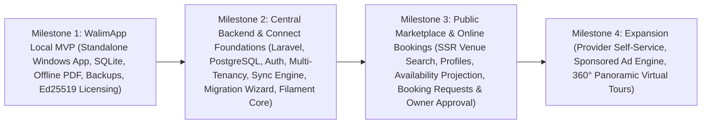

#### Milestone 1: WalimApp Local MVP
- **Goal:** Ship a commercially sellable, rock-solid offline Windows desktop application for Algerian wedding venue owners.
- **Deliverables:**
  1. Monorepo skeleton (`apps/owner_client`, `/contracts`) and standalone CLI/admin script for signing `.walimlic` Ed25519 license files.
  2. Drift SQLite database with full sync-ready schema, automatic pre-migration snapshots, and WAL integrity checks.
  3. Venue & Hall management (multi-hall support, `full_day` / `afternoon` / `evening` slot configurations, services).
  4. Interactive Calendar (month/week/day views, hall filtering, Arabic & French localization).
  5. Customer CRM and Walk-in Reservation workflow with local slot-conflict prevention.
  6. Immutable Financial Ledger (deposits, installments, refunds, outstanding balance calculator) + Expense tracker & financial summary reports.
  7. Offline bilingual (`ar-DZ` / `fr-DZ`) PDF contract and payment receipt generator + local document vault.
  8. Local employee profile switching (PIN/password with role restrictions) + Encrypted `.walimbak` backup & restore wizard.
  9. Windows installer (`Inno Setup`) and Milestone 1 automated test suite.

#### Milestone 2: Central Backend and Connect Foundations
- **Goal:** Launch the central Laravel + PostgreSQL platform, internal Super-Admin governance, bidirectional offline-first synchronization, and seamless upgrade from Local to Connect.
- **Deliverables:**
  1. Laravel 11/12 modular monolith setup (`Identity`, `Tenancy`, `Licensing`, `VenueCatalog`, `Booking`, `Finance`, `Sync`, `Media`, `Audit`).
  2. PostgreSQL 16 schema with composite tenant foreign keys, `btree_gist` booking exclusion constraints, and Row-Level Security (RLS).
  3. Filament v3 Super-Admin panel (`admin` guard + 2FA) for managing organizations, users, Local licenses, Connect subscriptions, and viewing `audit_logs`.
  4. Sanctum device authentication + signed Connect subscription lease tokens with graceful expiry fallback to Local mode.
  5. Transactional `/api/v1/sync/push` (idempotent via `sync_mutation_log`), `/api/v1/sync/pull` (cursor-based via `server_seq`), and private S3 document synchronization.
  6. Flutter `SyncEngine`, Conflict Resolution Center UI (for `sync_conflict` reservations), and the **Local-to-Connect Migration Wizard**.
  7. Milestone 2 multi-tenant authorization, sync chaos, and migration test suites.

#### Milestone 3: Public Venue Listings and Owner-Approved Online Booking Requests
- **Goal:** Launch the SEO-friendly Public Marketplace for venue discovery and connect online customer inquiries directly to the owner's Connect application.
- **Deliverables:**
  1. Connect Owner App: Public Venue Listing Editor (bilingual descriptions, amenities, pricing visibility toggle, gallery photo upload) and Online Booking Requests Inbox (`pending_owner_approval` → Approve / Reject / WhatsApp contact).
  2. Filament Super-Admin: Venue listing & photo moderation queue, plus initial staff-curated Service Provider Directory CRUD.
  3. Public Marketplace SSR (`Marketplace` module with Blade + Livewire 3 + Alpine.js):
     - Bilingual routes (`/fr/...`, `/ar/...`), Schema.org JSON-LD, dynamic sitemaps, OpenGraph cards.
     - Venue search & filter by Wilaya, Commune, date/shift availability, guest capacity, price, and services.
     - Public venue profiles with photo galleries, freshness-aware availability calendar, WhatsApp click-to-chat, and rate-limited Online Booking Request submission form.
     - Initial curated Service Provider Directory pages.
  4. Milestone 3 concurrency race tests and SEO/public-leakage verification gates.

#### Milestone 4: Provider Expansion, Advertising, and 360° Virtual Tours
- **Goal:** Unlock marketplace monetization (sponsored placements), high-engagement 360° panoramic venue tours, and provider self-service.
- **Deliverables:**
  1. `Advertising` module: Campaign management in Filament, `SponsoredSlotResolver`, featured search placements, Wilaya/category banners, mandatory `Sponsorisé / مُموَّل` badges, and zero-empty-block rendering.
  2. `VirtualTours` module: Owner 360° equirectangular panorama uploader, scene & hotspot graph editor, background WebP optimization (`ProcessPanoramaSceneJob`), admin moderation queue, and lazy-loaded Pannellum WebGL viewer on public venue profiles.
  3. Service Provider self-registration portal and profile management workflow.
  4. Foundation readiness for a future Flutter Customer Mobile Application consuming `/api/v1/public/*` endpoints.

---

## 23. Questions requiring product-owner decisions

The following decisions require business confirmation from the Product Owner. For each item, this architecture defines a **safe provisional default** so engineering work on Milestone 1 is not blocked.

| ID | Phase Needed | Question for Product Owner | Architectural Impact | Provisional Default Assumed in This Document |
| :--- | :--- | :--- | :--- | :--- |
| **Q-01** | **Before Milestone 1** | **Booking Slot Model:** In addition to full-day bookings, what standard shift divisions should be supported out-of-the-box for Algerian wedding halls (e.g., *Après-midi 13h–18h* + *Soirée 19h–02h*, or custom start/end hours)? | Determines the default `slot_type` options and overlap rules in SQLite and PostgreSQL. | Support configurable per-hall slots: `full_day`, `afternoon`, and `evening`, where `full_day` overlaps with both shifts. |
| **Q-02** | **Before Milestone 1** | **Local Multi-Venue Limit:** Does a standard WalimApp Local perpetual license allow managing 1 venue (with multiple halls) or multiple distinct venue locations on the same PC? | Controls `max_venues` enforcement in the `.walimlic` payload. | Schema supports multiple venues; `.walimlic` includes configurable `max_venues` (default `1`) and `max_halls` (default `5`). |
| **Q-03** | **Before Milestone 1** | **Contract Template Customization:** Do venue owners need a fixed standard bilingual contract template with customizable clause text, or a full rich-text template editor? | Impacts complexity of the offline Dart `pdf` document generator in Milestone 1. | Provide a structured, professional Arabic/French contract template where owners configure their logo, legal header, standard clauses/conditions text, and automatic reservation/payment table injection. |
| **Q-04** | **Before Milestone 2** | **Algerian Hosting & Law 18-07:** Will the central backend and private document storage be hosted on an Algerian local cloud/VPS provider (for strict domestic data residency) or an European provider (subject to ANPDP cross-border rules)? | Dictates production provider selection and whether an external S3 CDN or local object storage is provisioned. | Stack is 100% container/Linux portable; legal confirmation required before purchasing production hosting. |
| **Q-05** | **Before Milestone 2** | **Connect Expired Listing Behavior:** When a venue's Connect subscription expires (after the 14-day grace period), should its public marketplace page be completely unpublished (404/redirect), or remain visible as a basic static directory entry with online booking disabled? | Affects SEO link retention vs. subscription renewal incentive. | Keep URL alive for SEO with a *"Contact unavailable online"* state for 60 days (disabling booking requests and hiding phone/WhatsApp), then unpublish if unrenewed; configurable in Super-Admin. |
| **Q-06** | **Before Milestone 3** | **Pending Request Date Holding:** Should a customer's `pending_owner_approval` request ever temporarily block the date on the public calendar, or should multiple customers be able to submit competing requests until the owner confirms one? | Prevents calendar DoS attacks vs. exclusive hold expectations. | **Do not hard-block** on unverified customer requests; allow competing requests until the owner confirms one (with an optional owner-triggered temporary "Option Hold" with expiry). |
| **Q-07** | **Before Milestone 3** | **Pending Request Auto-Expiry:** After how many hours/days of owner inactivity should an unactioned `pending_owner_approval` request transition to `expired`? | Controls scheduled expiration job timing and owner notification cadence. | **72 hours** (with reminder notifications at 24h and 48h), configurable per platform/venue. |
| **Q-08** | **Before Milestone 3** | **Customer Notification Channel:** When an owner approves or rejects an online booking request, how should the customer be notified initially (Email, automated SMS/WhatsApp API, or owner-initiated 1-click WhatsApp message)? | Determines whether third-party Algerian SMS/WhatsApp gateway integration is required in Milestone 3. | **Email + 1-click pre-filled WhatsApp message launched from the owner's app/phone** in Milestone 3 (zero per-message SMS gateway cost initially), with pluggable SMS/WhatsApp API notification interface ready for expansion. |
