# WalimApp — Initial Technical Architecture

| | |
|---|---|
| **Status** | Proposed — awaiting product-owner and technical review. Nothing in this document is approved yet. |
| **Source of requirements** | [`product-requirements.md`](./product-requirements.md) (referred to as **PRD**; section numbers such as "PRD §4" refer to it) |
| **Audience** | Product owner, solo developer, AI coding agents working on the implementation |
| **Date** | 2026-10-28 |

### How to read this document

Each statement in this document falls into one of four categories. Where it matters, the category is marked explicitly:

| Marker | Meaning |
|---|---|
| **[REQ]** | Confirmed product requirement taken from the PRD. |
| **[ASSUMPTION]** | Something this design assumes because the PRD is silent. Each one must be confirmed or corrected. |
| **[RECOMMENDATION]** | An architectural choice proposed here. It can be changed through review. |
| **[OPEN]** | A decision that cannot be made correctly without business input. A provisional default is given so that work can continue, but the default is **not** approved. All open items are collected in §23. |

Identifiers used throughout: `A-xx` assumptions (§3), `Q-xx` product-owner questions (§23), `ADR-xxx` decisions (§20), `R-xx` risks (§21).

---

## 1. Executive summary

WalimApp has two very different halves:

1. An **offline-first desktop management application** for wedding-venue owners. It must work for years without the internet, survive hardware changes and licence expiry, and never lose financial or reservation data.
2. An **online platform**: a synchronization backend, a public SEO-indexed marketplace, and an internal administration panel. Its main correctness problem is preventing double bookings when several actors (offline devices, employees, online customers) compete for the same hall and date.

The architecture keeps these halves loosely coupled. The desktop app is complete on its own. The platform adds capabilities to it, but the app never depends on the platform to function.

**Key recommendations**

| # | Recommendation | Section |
|---|---|---|
| 1 | **A single Flutter owner application** (Windows first) with two operating modes, *Local* and *Connect*, chosen by licence and account linkage. Not two separate codebases. | §4, §11 |
| 2 | **Connect-ready local schema from day one:** client-generated UUIDv7 identifiers, organization/venue scoping columns, integer money, row versions, soft deletes, and an append-only local change journal, even in Local. This makes the later upgrade to Connect a data copy rather than a data transformation. | §9, §13 |
| 3 | **One Laravel modular monolith** serving the owner REST API, the server-rendered public marketplace (Blade + Livewire), and the Filament admin panel, backed by **one PostgreSQL database**. No Redis, no search engine, no separate SPA or Node server at the start. | §5, §7 |
| 4 | **Sync protocol: intent-based operations pushed, state snapshots pulled.** The client pushes idempotent, versioned *operations* such as `reservation.confirm` or `payment.record`. The server validates each one against domain rules and returns accepted / conflict / rejected. Clients pull authoritative state through a per-organization, gapless change feed. Conflict rules are set **per entity**. Last-write-wins is used only where it is explicitly safe. | §11 |
| 5 | **The central PostgreSQL database is the single source of truth for Connect bookings.** A PostgreSQL **exclusion constraint** on hall-allocation time ranges makes overlapping blocking bookings impossible at the database level, whatever bugs exist in application code. Offline-created reservations stay `pending_sync` until the server accepts them. | §12 |
| 6 | **Online booking requests are a separate entity (`booking_requests`) from reservations.** Requests never block dates (provisional default, see Q-01). Approving a request atomically creates a confirmed reservation. | §12 |
| 7 | **Perpetual licences use Ed25519-signed licence files** checked offline. Update entitlement is based on the build's **release date versus `maintenance_until`**, not on the wall clock, so maintenance expiry can never disable an installed version. Licence problems can at worst restrict editing; they never delete or hide data. | §14 |
| 8 | **Local→Connect migration is a staged, resumable, server-validated snapshot import** that keeps the original UUIDs. The local database is never modified until the server confirms the commit. | §13 |
| 9 | **Minimal operations footprint:** one application VM (or equivalent), PostgreSQL with off-site PITR backups, S3-compatible object storage (or local disk behind Laravel's filesystem abstraction), and database-backed queue/cache/sessions. **The hosting jurisdiction is an open legal question** (Algerian data-protection and e-commerce rules) that must be settled before Milestone 2 goes to production. | §17, §18 |
| 10 | **Delivery order:** M0 technical spikes → M1 Local MVP → M2 Connect foundation → M3 marketplace and booking requests → M4 providers, advertising, and virtual tours. Local can be sold without anything from M2–M4. | §22 |

**Main risks** (details in §21): ambiguous booking rules (holds, slots, multi-hall), sync complexity growing beyond what one developer can maintain, Arabic PDF/RTL rendering on Windows, legal constraints on hosting and cross-border transfers, and losing local data through user error on unmanaged Windows PCs.

---

## 2. Product requirements and architectural principles

### 2.1 Requirements that shape the architecture

| Area | Requirement **[REQ]** | PRD | Architectural consequence |
|---|---|---|---|
| Local independence | Local works without internet, with no cloud dependency, and is commercially usable on its own. | §1, §3 | Full domain logic in the client. No runtime calls to the server are required. |
| Local storage | Business data stored locally in SQLite. Windows desktop with Flutter. Single device. No LAN sync. | §3 | Single-writer SQLite. No peer-to-peer replication needed for Local. |
| Local restrictions | Local must not publish venues or accept online requests. | §3 | Marketplace features gated by Connect entitlement **on the server**, not only in the client. |
| Licensing | Perpetual Local licence. Maintenance expiry must not disable the app or destroy data. Offline activation and recovery. | §3, §9 | Offline-verifiable signed licences. Build-date-based update entitlement (§14). |
| Upgrade path | Local→Connect without losing records. | §3, §4 | Connect-ready schema from M1. Migration protocol (§13). |
| Connect | Local features plus listings, availability, booking requests, notifications, multi-venue, scoped employees. | §4 | Multi-tenant backend, RBAC with venue scope. |
| Sync | Queue offline operations. Tolerate retries, duplicates, intermittent connectivity. Stable IDs. Explicit conflict detection. Never blindly overwrite a confirmed reservation. Report failures clearly. | §4 | Operation outbox, idempotency keys, per-entity conflict policies, sync-issues inbox. |
| Booking lifecycle | States `pending_owner_approval`, `pending_sync`, `confirmed`, plus rejected/cancelled with history. The backend prevents conflicting confirmed bookings. Holds and expiry rules must be defined. | §5 | State machine (§12), DB exclusion constraint, open questions Q-01…Q-06. |
| Marketplace | Search and filter (wilaya, date, price, capacity, location, services). Profiles, photos, availability "where reliable", booking requests, WhatsApp contact, provider discovery. Mobile responsive, AR/FR, SEO. | §6 | Server-side rendering, localized URLs, availability freshness rule. |
| Providers and ads | Curated directory. Sponsored listings and banners with campaign records, clear labelling, admin control, no empty ad blocks. | §6 | Advertising module with placements, campaigns, and fallback rendering. |
| Virtual tours | 360° panoramas, scenes, hotspots, preview/submit/publish. Must not block the first marketplace release. | §7 | M4. Media pipeline designed in M3 so panoramas can be added later. |
| Super-admin | Manage orgs, listings, providers, bookings oversight, roles, ads, licences, subscriptions. Sensitive actions permission-controlled and audited. No implicit unrestricted access. | §8 | Separate admin identity, granular admin permissions, append-only audit log. |
| Constraints | Modular monolith. No Kubernetes/Redis/etc. without demonstrated need. | §10 | §5, ADR-001, ADR-007. |
| Security and localization | Server-side tenant enforcement. Protect credentials, finances, PII, documents. Audit. AR/FR. Evaluate Algerian data protection. Backup, retention, and expiry policies. | §11 | §10, §17, §18. |

### 2.2 Architectural principles

| # | Principle | What it means in practice |
|---|---|---|
| P1 | **The local app is a complete product.** | No feature in Local may require a network round-trip. Connect features are additive modules. |
| P2 | **The server is the authority for shared state. The client is the authority for its own pending intent.** | The client never "wins" by overwriting server state. It submits intents that the server accepts or rejects. Rejected intents are kept and shown to the user, never silently dropped. |
| P3 | **Invariants are enforced as close to the data as possible.** | Double-booking prevention is a PostgreSQL constraint (server) and a SQLite trigger plus transactional check (client), in addition to application validation. |
| P4 | **Financial history is append-only.** | Payments and expenses are corrected by voiding or reversing entries, never by editing amounts in place. This removes most money-related sync conflicts. |
| P5 | **No silent data loss — ever.** | Licence expiry, subscription expiry, failed migration, failed sync, and schema upgrade must each leave the user's data readable and exportable. Automatic backups are taken before every risky operation. |
| P6 | **One write path per platform.** | Server: every mutation goes through a domain *Action* class (API, sync, Filament, and web all call the same Actions). Client: every mutation goes through a command handler that writes business rows, journal, and outbox in one SQLite transaction. |
| P7 | **Boring, few moving parts.** | One backend deployable, one database, database-backed queues. New infrastructure requires a written ADR showing the need. |
| P8 | **Contracts over shared code across languages.** | PHP and Dart cannot share code. They share an OpenAPI spec, JSON Schemas for sync operations, and *golden test fixtures* that both test suites run. |
| P9 | **Defer what can be deferred, but not what is expensive to retrofit.** | Identifiers, tenancy columns, money representation, time zones, the audit/journal, and localization/RTL are retrofit-expensive and are done in M1. Ads, tours, provider self-service, customer accounts, and online payment are deferred. |
| P10 | **Documentation is not validation.** | Every security and integrity claim here needs a test (§19) or an operational check before it can be relied on. |

---

## 3. Assumptions, constraints, and unresolved decisions

### 3.1 Mandatory product constraints [REQ]

- Local must run fully offline, on one Windows device, using SQLite, built with Flutter (PRD §3).
- Local must not publish venues or receive online requests (PRD §3).
- Perpetual Local licence. Maintenance expiry must not disable the purchased version or destroy data (PRD §3, §9).
- Connect uses SQLite locally and a central authoritative backend (PRD §4).
- Synchronization must never blindly overwrite a confirmed reservation (PRD §4).
- Online requests stay pending until the owner decides. The backend prevents conflicting confirmed bookings (PRD §5).
- Strict separation of organizations' data, enforced server-side (PRD §2, §11).
- Virtual tours must not block the first marketplace release (PRD §7).
- Sensitive admin operations are permission-controlled and audited (PRD §8).
- Modular monolith. No Kubernetes/Redis without demonstrated need (PRD §10).
- Arabic and French (PRD §6, §11).

### 3.2 Technology preferences (evaluated in §5, not mandatory)

Laravel, PostgreSQL, Filament, Flutter (also a possible customer mobile app), SQLite, and an SEO-friendly website (PRD §10). This document **keeps all of them**. The only additions are concrete choices where the PRD leaves the technology open (for example, Blade + Livewire for the marketplace and Drift for SQLite access).

### 3.3 Assumptions [ASSUMPTION]

| ID | Assumption | Impact if wrong |
|---|---|---|
| A-01 | Currency is Algerian dinar (DZD) only. No multi-currency. | Low: a `currency` column is kept anyway. |
| A-02 | All venues are in the `Africa/Algiers` time zone (UTC+1, no DST today). The design still stores a per-venue time zone. | Low. |
| A-03 | A wedding booking occupies a hall for a defined time period on a calendar date. That period may be a whole day or a named session (e.g. afternoon or evening), and may cross midnight. | **High** — see Q-02. The range-based model (§12) supports both. |
| A-04 | A reservation normally occupies one hall. Some venues may rent the whole venue (all halls). | Medium — the allocation table supports multiple halls per reservation. |
| A-05 | Typical data volume per organization is small: under 10 venues, under 2,000 reservations per year, under 20,000 financial rows per year, and a few GB of documents over several years. | Design remains valid up to 10× these numbers. |
| A-06 | In Connect, an organization may have several devices and several employees. **Conflicts between owner devices only arise when more than one device or user writes.** | Medium — determines how often sync conflicts occur in practice. |
| A-07 | Owners primarily identify customers by phone number. Email is often absent. | Affects notifications (SMS/WhatsApp vs email) and duplicate detection. |
| A-08 | Connect subscription payment is initially recorded manually by staff (cash, bank/CCP transfer, BaridiMob). No online payment gateway is required at first. | Medium — online payment can be added later (§14.8). |
| A-09 | Customers submitting online booking requests do not need accounts in M3 (guest requests identified by phone). | Medium — see Q-08. |
| A-10 | Local is used by one owner profile in M1, optionally protected by a password/PIN. Multiple local employee profiles are not required for the Local MVP. | Low — the schema already supports members (§8). |
| A-11 | Venue owners' Windows PCs may be old (Windows 10, 4 GB RAM), shared, unmanaged, and not backed up. | Drives backup UX and resource budgets. |
| A-12 | Western digits (0-9) are used in both Arabic and French interfaces, as is common in Algeria. | Low — formatting is centralized. |
| A-13 | Only one booking per hall per period is allowed (no shared or partial halls). | Medium. |
| A-14 | "Using third-party application code" excludes forking existing apps, but **permits** open-source libraries and frameworks (Laravel, Filament, Flutter packages, panorama viewers) subject to licence review. | Must be confirmed — see Q-35. |

### 3.4 Unresolved decisions (summary)

The product-owner questions are listed in full in §23. The decisions that block design or implementation are:

| Decision | Provisional default (not approved) | Needed before |
|---|---|---|
| Do pending online requests hold dates? Do holds expire? (Q-01, Q-03) | **No holds.** Requests never block. Unanswered requests expire after 7 days or at the event date, whichever comes first. | M3 |
| Booking granularity: day vs sessions (Q-02) | Configurable per hall: one or more named *slots* with start/end times. Default is one full-day slot. | **M1** |
| Owner-created "tentative/option" holds (Q-04) | Support `tentative` with an optional expiry. It is **blocking** in Local and Connect. | M1 |
| On approval, auto-reject overlapping pending requests? (Q-05) | Yes, with a standard "date no longer available" reason. | M3 |
| Offline confirmation in multi-device Connect (Q-06) | Allowed, but shown as `pending_sync` with a warning. The server is final. | M2 |
| Connect-only customers after expiry (Q-21) | Read-only access plus export, indefinitely. Editing requires a Local licence. | M2 |
| Hosting jurisdiction (Q-30, Q-31) | Undecided. Needs legal input. | M2 production |
| Receipt/invoice legal numbering (Q-12) | Non-fiscal receipts with per-device series. | M1 |

---

## 4. System context and component boundaries

### 4.1 System context

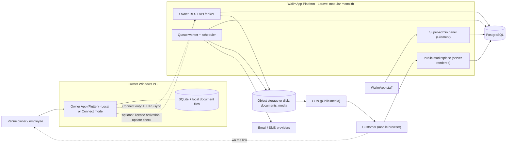

### 4.2 Components and responsibilities

| Component | Responsibility | Must NOT |
|---|---|---|
| **Owner App — Local mode** | All venue management: venues/halls, customers, reservations, calendar, finances, expenses, reports, documents/contracts, backup/restore, settings, licence verification. | Require the network. Publish anything. Accept online requests. |
| **Owner App — Connect mode** | Everything in Local, plus: account login and device linking, sync, booking-request inbox, listing/profile editing, notifications, multi-venue and employee features, Local→Connect migration wizard. | Treat local state as authoritative for confirmed reservations. Bypass server validation. |
| **Platform — Owner API** | Authentication, device management, sync push/pull/bootstrap, file transfer, migration sessions, licence activation, listing management endpoints. | Contain business logic in controllers (logic belongs in Actions). |
| **Platform — Public marketplace** | SSR pages for venues, providers, search, booking-request submission, sitemaps, SEO metadata. | Expose non-published data, pending requests, or customer PII. |
| **Platform — Super-admin** | Org/user/venue management, listing moderation, provider directory, ad campaigns, licences, subscriptions, support tools, platform reports, audit log viewer. | Give any staff member unrestricted access by default. Allow untracked access to tenant financial data. |
| **Platform — Workers** | Image processing, notifications, request expiry, subscription state transitions, sitemap generation, backups verification hooks, cleanup/retention jobs. | Hold state outside PostgreSQL / storage. |

### 4.3 What is shared and what is separate

| Item | Shared? | How |
|---|---|---|
| Domain vocabulary (entity names, states, permission names, error codes) | **Shared** | Defined once in `contracts/` (Markdown + JSON Schema + enums). Generated or hand-mirrored in PHP and Dart. Checked by contract tests. |
| Domain rules (overlap detection, balance calculation, state transitions, phone normalization) | **Specified once, implemented twice** (Dart for offline, PHP for authority) | Golden fixtures in `contracts/fixtures/*.json` run by both test suites (ADR-010). |
| Owner app code for Local and Connect | **Shared — one codebase, one binary** | Mode/capability flags. Connect features live in separate feature modules that Local never activates. |
| Owner app and future customer mobile app | **Partially shared** | A pure-Dart package (`walim_domain`: value objects, enums, validators, l10n keys). UI and data layers stay separate: the customer app is an online API client with no SQLite replica. |
| Backend API, marketplace, admin | **One Laravel deployable** | Separate route groups, guards, and middleware stacks. Shared domain modules and Actions. |
| Owner data schema (server vs client) | **Same logical model, different physical schema** | The SQLite schema is a subset with extra local-only tables (outbox, journal, sync state). PostgreSQL adds constraints and server-only tables. |
| Admin identities vs owner identities | **Separate** | Separate tables and guards (ADR-012). |
| Marketplace public data vs owner operational data | **Separate projections** | `listings` holds curated public data. Raw venue/hall/reservation data is never rendered directly to the public. Availability is computed from allocations only. |

### 4.4 Incremental delivery boundaries

Local must ship before anything server-side exists, so the boundaries are chosen so that each milestone only *adds* components:

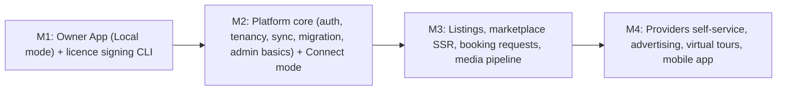

In M1 the only server-side element is a **licence issuance tool**. It can be a small CLI script run by staff or a minimal admin page. Online activation is optional in M1 (§14.3).

---

## 5. Recommended technology stack and rationale

### 5.1 Summary

| Concern | Recommendation | Status |
|---|---|---|
| Backend framework | Laravel (current supported major, 12.x or newer), PHP 8.4+ | Preference — **kept** |
| Central database | PostgreSQL 17/18 with `btree_gist`, `pg_trgm`, `unaccent` extensions | Preference — **kept** |
| Admin panel | Filament (v4 or newer) in the same Laravel app, separate panel and guard | Preference — **kept** |
| Owner app | Flutter (stable channel), Windows desktop first | Constraint/preference — **kept** |
| Local DB access | SQLite via **Drift** (type-safe queries, versioned migrations, migration tests) | Recommendation |
| Client state management | Riverpod | Recommendation (Bloc is an acceptable alternative) |
| Public marketplace | Laravel **Blade SSR + Livewire/Alpine** for interactivity, Tailwind CSS with RTL support | Recommendation (PRD leaves open) |
| Customer mobile app | **Deferred.** Mobile-responsive web first. Flutter later if justified. | Recommendation |
| Queue / cache / sessions / rate limiting | Laravel **database** drivers on PostgreSQL | Recommendation (honours "no Redis") |
| Search | PostgreSQL filters + full-text search + trigram | Recommendation |
| Files | Laravel Filesystem: S3-compatible object storage, or local disk if unavailable | Recommendation |
| API auth | Laravel Sanctum tokens + custom device refresh-token rotation | Recommendation |
| Admin auth | Separate session guard, mandatory TOTP 2FA | Recommendation |
| Licence crypto | Ed25519 signatures (libsodium in PHP, `cryptography` package in Dart) | Recommendation |
| PDF generation (client) | Dart `pdf` + `printing` packages with bundled Arabic fonts | Recommendation — **requires M0 spike** |
| Windows packaging | Signed installer (Inno Setup or MSIX). Code-signing certificate required. | Recommendation — **requires M0 spike** |

### 5.2 Laravel (backend and API)

- **Recommendation:** Keep Laravel. Use one application, structured as a modular monolith (§7).
- **Why it fits:** Mature, batteries-included (validation, queues, scheduler, policies, notifications, filesystem, rate limiting, migrations), and very well understood by AI coding agents. The large conventional surface means less custom infrastructure for one developer. It natively hosts Filament and Blade, so the API, admin panel, and marketplace can share one deployable and one set of domain Actions.
- **Alternatives:** Symfony (more explicit, more boilerplate); Node/NestJS (one language with a JS frontend, but Flutter is Dart anyway); Go (excellent operations, slower feature velocity); Supabase/Firebase-style BaaS (fast start, but row-level-security-only business logic is a poor fit for complex booking invariants, adds vendor lock-in, and raises hosting-jurisdiction issues).
- **Solo-dev implications:** One framework upgrade per year. Pin versions and follow the official upgrade guides. Use Larastan/PHPStan and Pint to keep AI-generated code consistent.
- **Risks:** The "Laravel magic" style (facades, implicit model binding, global scopes) can hide tenant-scoping mistakes. **Mitigation:** explicit `TenantContext`, policies on every Action, and architecture tests that forbid unscoped queries in tenant modules (§10.5, §19).

### 5.3 PostgreSQL (central database)

- **Recommendation:** Keep PostgreSQL. Enable `btree_gist` (exclusion constraints), `pg_trgm` (fuzzy name search), and `unaccent`.
- **Why it fits:** It has **exclusion constraints on range types**, which is the strongest available tool for "no two blocking bookings may overlap in the same hall". Also: transactional DDL (safe migrations), JSONB (sync payloads, audit diffs, translations), partial and expression indexes, mature PITR backup tooling, and built-in full-text search including an Arabic stemmer.
- **Alternatives:** MySQL/MariaDB has no exclusion constraints, so overlap would need locking patterns (`SELECT … FOR UPDATE` on a hall/date row). That is workable but easier to get wrong. SQLite on the server does not fit multi-user write concurrency.
- **Solo-dev implications:** Requires a backup and PITR discipline (§18.6). Managed PostgreSQL removes much of this work but may not be available in the chosen jurisdiction.
- **Risks:** Exclusion-constraint violations must be translated into domain conflicts (SQLSTATE `23P01`). This is easy, but it needs dedicated tests.

### 5.4 Filament (internal administration)

- **Recommendation:** Keep Filament, as a dedicated panel at `/admin` with its own guard (`admin`), and access restricted by IP allow-list or VPN if the host permits it.
- **Why it fits:** It gives CRUD, tables, filters, actions, and dashboards for dozens of admin resources at very low cost, built on Livewire, which the marketplace also uses.
- **Alternatives:** Laravel Nova (paid, similar); a custom admin SPA (expensive); Retool-like tools (external SaaS that receives PII, with jurisdiction issues).
- **Solo-dev implications:** Filament major upgrades can be substantial, so keep admin customizations conventional. **Rule:** Filament resources call module Actions for any mutation that has business rules (licence issuance, subscription change, listing approval, booking oversight). They never use raw `Model::update()` for those.
- **Risks:** Filament makes it easy to expose every column and every record. Mitigation: per-resource policies, field-level visibility for sensitive data, and audit hooks (§17.7).

### 5.5 Flutter for the owner app (Windows desktop)

- **Recommendation:** Keep Flutter, targeting Windows 10/11 x64 in M1. Keep platform-specific code isolated (file paths, credential storage, single-instance mutex, printing) so that macOS, Android tablet, or Linux builds remain possible later.
- **Why it fits:** One UI codebase with good RTL support through `Directionality` and `flutter_localizations`, good performance, and future reuse for mobile.
- **Alternatives:** .NET (WPF/WinUI/MAUI): native Windows and strong printing/reporting, but no path to mobile UI reuse. Electron/Tauri with a web UI: shares web skills with the marketplace, but has a larger footprint (Electron) and a different offline-database story. Both are valid. Flutter remains the better fit given the stated preference and future mobile reuse.
- **Solo-dev implications:** Windows desktop is a less-trodden Flutter target than mobile. Plugin coverage for printing, file pickers, secure storage, and notifications on Windows must be verified early. **M0 spike** (§22): Arabic contract PDF, printing, installer, code signing, secure storage, SQLite performance on a low-end PC.
- **Risks:** Some packages lack Windows support. Windows SmartScreen warns on unsigned installers. Mitigation: buy a code-signing certificate early (R-08), and prefer packages with Windows CI.

### 5.6 SQLite and Drift (local storage)

- **Recommendation:** SQLite through **Drift** with WAL mode, `foreign_keys=ON`, `busy_timeout`, `synchronous=NORMAL` (or `FULL` for financial safety; benchmark in M0), and a single application instance enforced by a named mutex.
- **Why it fits:** It fits PRD §3 exactly. Drift adds compile-time-checked SQL, stream queries for reactive UI (the calendar updates live), step-by-step versioned migrations, and **schema snapshot tooling for migration tests** (essential when user databases are never centrally upgraded).
- **Alternatives:** `sqflite_common_ffi` (raw, less safety); Isar/ObjectBox/Hive (not SQLite, so they violate the requirement, and some have uncertain maintenance); PowerSync/ElectricSQL-style sync products (they would speed up sync, but they impose their own backend services and conflict model and add vendor dependency; rejected for the core, see ADR-005).
- **Encryption at rest:** **[OPEN]** (Q-28). SQLCipher protects a stolen PC's data, but a lost key means lost data, and support becomes harder. Provisional default: no app-level DB encryption in M1. Recommend BitLocker in the user guide, password-protected app lock, and **encrypted backups** (passphrase-based) when exported. Keep the Drift setup compatible with SQLCipher so it can be enabled later.

### 5.7 Public marketplace web technology

- **Recommendation:** **Server-rendered Blade templates inside the same Laravel app**, with Livewire/Alpine for interactive filters and the booking form, Tailwind CSS (logical properties and `rtl:` variants), and Vite for assets.
- **Why it fits:** SEO needs fully rendered HTML, fast first paint, hreflang/canonical control, and sitemaps. Laravel SSR does all of this with **no extra runtime**. It reuses the domain models, availability queries, and localization files.
- **Alternatives:** *Next.js/Nuxt SSR* (rich frontend ecosystem, but a second deployable, a Node runtime, an API contract to maintain, and a second language for one developer); *Inertia + SSR* (needs a Node SSR process); *Flutter Web* (**rejected for the public site**: canvas rendering, weak SEO, heavy payloads on mobile networks); *static site generation* (stale availability, rebuild pipeline).
- **Solo-dev implications:** One deploy and one language. The marketplace is a set of controllers and views in the `Marketplace` module.
- **Risks:** Very rich interactive UX (map search, infinite scroll) is harder with Livewire than with a SPA. This is acceptable for M3, and a progressive-enhancement JS island can be added later.

### 5.8 Customer mobile application

- **Recommendation:** **Do not build in M1–M3.** A responsive, fast marketplace with WhatsApp deep links covers customer needs at launch. Reconsider in M4 based on traffic data. If built, use Flutter as an *online* client of a public API, reusing `walim_domain`.
- **Why:** An app store presence adds review cycles, push infrastructure, account systems, and another release train for one developer, with unclear demand.

### 5.9 Queue, cache, sessions, rate limiting

- **Recommendation:** Laravel `database` queue driver, `database` cache store, `database` sessions, rate limiter backed by the database cache. One queue worker managed by systemd/Supervisor (two queues: `default`, `media`) and the Laravel scheduler run from cron every minute.
- **Why it fits:** Expected load is tiny, and Redis adds a stateful service to secure, monitor, and back up (PRD §10).
- **Revisit when:** Sustained queue throughput above roughly 50 jobs/second, rate-limiter contention appears in slow query logs, or the marketplace needs a shared cache across several web nodes. Any change requires an ADR.

### 5.10 Search

- **Recommendation:** Structured filters (wilaya, capacity, price, amenities, date availability) as indexed SQL. Name/description keyword search with `pg_trgm` plus `unaccent`, and optionally `tsvector` using the `simple` config (Arabic plus French text in the same field). **No Elasticsearch/Meilisearch/Typesense** until venue count or query complexity requires it.
- **Risk:** Arabic morphological search quality is limited. This is acceptable because search is mostly filter-driven.

### 5.11 Files and media

- **Recommendation:** Laravel Filesystem with two logical disks, `private` (documents, unpublished uploads) and `public_media` (processed, published images). The backing store is S3-compatible object storage if the chosen host offers it, otherwise local disk on the VM with off-site replication (§16). Code never hard-codes the backend.

### 5.12 Authentication libraries

- **Recommendation:** Sanctum for API tokens. Sanctum tokens are hashed opaque tokens with abilities and expiry. Add a small custom `device_refresh_tokens` table for rotation and reuse detection. The marketplace uses no customer login in M3 (A-09). The admin panel uses a session guard with TOTP 2FA and recovery codes.
- **Alternatives:** Passport (a full OAuth2 server, overkill without third-party clients); JWT packages (stateless tokens complicate revocation, which matters for lost devices).

### 5.13 Notifications

- **Owner (desktop):** Booking requests and changes arrive through sync pull (polling interval about 60 s when the app is open and online) and are shown as in-app and Windows toast notifications. As a fallback, email and/or SMS go to the owner. **[OPEN]** Q-10: SMS provider availability and cost in Algeria.
- **Customer:** Request receipt and decision by SMS or email (provider TBD). The owner can also contact the customer through WhatsApp click-to-chat links (`https://wa.me/<E.164>`). WhatsApp Business API integration is deferred to M4+ because of cost, approval, and policy complexity.

### 5.14 Documents and PDF in the owner app

- **Recommendation:** Generate contracts and receipts **on the client** from templates (works offline) using the Dart `pdf` package with bundled OFL-licensed Arabic and Latin fonts (for example Noto Naskh/Sans Arabic plus Noto Sans). Print through the `printing` package (Windows print dialog).
- **Risk:** Arabic shaping, bidirectional mixed text (Arabic names with French clauses and numbers), and line-breaking quality in PDF generation. **M0 spike required.** The fallback is an HTML→PDF engine through a WebView, which would be heavier.

---

## 6. High-level architecture and data flows

### 6.1 Container view

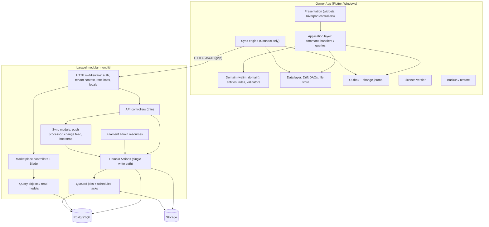

### 6.2 Flow A — Local write (both modes)

1. The user saves a reservation. The UI calls `CreateReservationCommand`.
2. The command handler opens a SQLite `BEGIN IMMEDIATE` transaction. It validates (shared domain rules), checks for overlap against blocking allocations, inserts the `reservations` row and `hall_allocations` rows, appends to `change_journal`, and **if the device is Connect-linked** appends an `outbox_ops` row. Then it commits.
3. Drift stream queries refresh the calendar.

There is no network involvement. The same code path runs in Local and Connect. The only difference is whether the outbox row is written and how the UI labels the status (`pending_sync` in Connect).

### 6.3 Flow B — Connect synchronization cycle

The cycle is triggered by app start, connectivity regained, a periodic timer (about 60 s while online), or a manual "Sync now".

1. **Push** pending outbox operations in local order, in batches of up to 100. The server processes each operation in its own transaction and returns a per-operation result.
2. The client applies results: accepted → mark synced and store the server version; conflict/rejected → create a *sync issue* and restore the server snapshot into the business row (the user's intent stays in the issue record).
3. **Pull** changes since the stored cursor and upsert server snapshots into local tables for rows that have no unresolved local operations.
4. Download pending files lazily (documents are fetched on open; listing photos are not needed locally).

Details are in §11.

### 6.4 Flow C — Online booking request (M3)

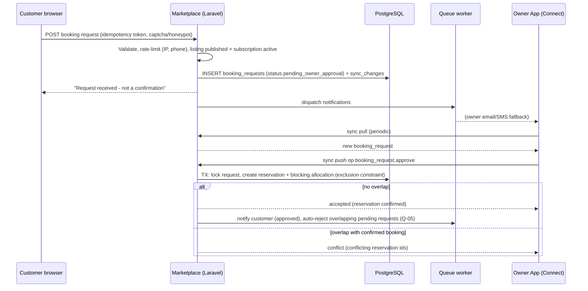

### 6.5 Flow D — Listing publication (M3)

Owner edits profile and photos in the app → files uploaded (Connect API) → images processed by the `media` queue → owner submits the listing → admin reviews it in Filament (approve/reject with reason, audited) → the listing becomes `published` → the public page is rendered and the sitemap is regenerated. Publication requires an active Connect subscription, checked server-side at submit time, at approval time, and on every public render through the listing's `is_publicly_visible` computed status (§14.7).

### 6.6 Flow E — Licence activation (M1 optional online / offline)

See §14.3.

---

## 7. Module and repository structure

### 7.1 Repository strategy

**[RECOMMENDATION]** A single Git **monorepo**. This works best for a solo developer working with AI agents: one place for contracts, cross-cutting changes in one commit, and one CI pipeline with path filters.

```
walimapp/
├── docs/
│   ├── architecture.md            ← this document
│   ├── adr/                       ← ADR-001 … one file per decision
│   └── runbooks/                  ← restore, key rotation, incident, release
├── contracts/
│   ├── openapi/owner-api.v1.yaml  ← REST contract (owner app ↔ API)
│   ├── sync/
│   │   ├── ops/*.schema.json      ← JSON Schema per operation type + version
│   │   └── entities/*.schema.json ← pulled entity snapshot schemas
│   ├── enums/*.json               ← states, permissions, error codes, slot kinds
│   └── fixtures/                  ← golden test vectors shared by PHP and Dart
│       ├── overlap_cases.json
│       ├── balance_cases.json
│       ├── reservation_transitions.json
│       └── phone_normalization.json
├── backend/                       ← Laravel application
├── owner_app/                     ← Flutter application (Windows first)
├── packages/
│   └── walim_domain/              ← pure Dart: value objects, enums, rules, validators
├── tools/
│   └── license-cli/               ← staff tool to issue/sign licences (M1); later folded into admin
└── .github/workflows/             ← CI pipelines (path-filtered)
```

Secrets, signing keys, and production `.env` files **never** enter the repository (§17.5).

### 7.2 Backend modules (Laravel)

**[RECOMMENDATION]** Modules live under `backend/app/Modules/<Module>` with a consistent internal layout:

```
app/Modules/Reservations/
├── Models/            Reservation, HallAllocation, BookingRequest, AvailabilityBlock
├── Actions/           ConfirmReservation, CancelReservation, ApproveBookingRequest, ...
├── Queries/           AvailabilityQuery, ReservationListQuery
├── Policies/
├── Data/              DTOs (input/output), validated payloads
├── Enums/             ReservationStatus, BookingRequestStatus
├── Events/            ReservationConfirmed, BookingRequestReceived
├── Sync/              operation handlers + entity serializers for the change feed
└── Http/              API controllers / requests specific to this module (thin)
```

| Module | Contents | Milestone |
|---|---|---|
| `Identity` | users, authentication, devices, refresh tokens, 2FA | M2 |
| `Tenancy` | organizations, members, roles, venue access, `TenantContext` | M2 |
| `Venues` | venues, halls, slots, amenities, venue services | M2 |
| `Customers` | customers, duplicate detection | M2 |
| `Reservations` | reservations, allocations, blocks, status history, booking requests, availability | M2 (requests M3) |
| `Finance` | financial transactions, expenses, categories, receipt series | M2 |
| `Documents` | files, documents, templates metadata | M2 |
| `Sync` | push processor, idempotency, change feed, bootstrap, conflict policies | M2 |
| `Migration` | import sessions, staging, validation, commit | M2 |
| `Licensing` | licences, activations, signing service, key ring | M1 (CLI) / M2 (API, admin) |
| `Billing` | plans, subscriptions, manual payments, entitlements | M2 |
| `Marketplace` | listings, public pages, search, sitemaps, SEO | M3 |
| `Media` | upload pipeline, image variants, moderation, tours | M3 (tours M4) |
| `Providers` | provider categories, directory entries | M3 (curated) / M4 (self-service) |
| `Advertising` | advertisers, placements, campaigns, counters | M3 basic / M4 |
| `Notifications` | channels, templates, preferences | M2/M3 |
| `Audit` | audit log writer, admin viewer | M2 |
| `Admin` | Filament panel providers, admin users, admin roles | M2 |
| `Shared` | money, IDs, time, localization helpers, problem-details errors | M2 |

**Module rules** (enforced with Pest architecture tests):

1. Controllers, Filament resources, and sync handlers **must not** write to models directly for entities that have business invariants. They call Actions.
2. A module may call another module's **Actions/Queries/public DTOs** only, not its internal models' mutation methods.
3. Every Action that touches tenant data receives an explicit `TenantContext` (organization, member, permitted venues) and calls a policy check first.
4. No module depends on `Marketplace`, `Advertising`, or `Media` except through events. This keeps M2 shippable without them.

### 7.3 Owner app structure (Flutter)

```
owner_app/lib/
├── main.dart
├── app/                 bootstrap, DI (Riverpod providers), routing (go_router), theme, l10n
├── core/
│   ├── db/              Drift database, tables, migrations, schema versions
│   ├── ids/             UUIDv7 generator
│   ├── time/            Clock abstraction, venue time zone handling
│   ├── money/           Money (int minor units), formatting
│   ├── files/           content-addressed local file store
│   ├── security/        credential storage (Windows DPAPI via secure storage), app lock
│   ├── journal/         change journal + outbox writers
│   ├── licensing/       licence parsing, signature verification, entitlement evaluation
│   ├── errors/, logging/
│   └── platform/        single-instance mutex, paths, printing adapters
├── features/
│   ├── venues/  customers/  reservations/  calendar/  finance/  expenses/
│   ├── documents/  reports/  backup/  settings/  licensing/
│   ├── connect_onboarding/  migration/          (Connect)
│   ├── sync/  sync_issues/                      (Connect)
│   ├── booking_requests/  listing/              (Connect, M3)
│   └── members/                                  (Connect)
│       each feature: domain/ application/ data/ presentation/
└── l10n/                app_ar.arb, app_fr.arb
```

**Capability gating:** a `Capabilities` provider derived from licence state and link state (§14.6) decides which routes and features are available. Connect feature modules are compiled into the same binary but are inert unless enabled. The server enforces the same restrictions independently.

### 7.4 Versioning

| Artifact | Scheme |
|---|---|
| Owner app | SemVer `MAJOR.MINOR.PATCH` plus an embedded **release date** (used for licence entitlement) and **local schema version** |
| Owner API | URL version `/api/v1`. Additive changes only within v1. |
| Sync operations | `op_type` + `op_version`. The server supports at least the current and previous op version. A `min_supported_client_version` is advertised by the server. |
| Backend | Continuous deployment from `main` with tagged releases |

---

## 8. Domain model and entity relationships

### 8.1 Bounded contexts

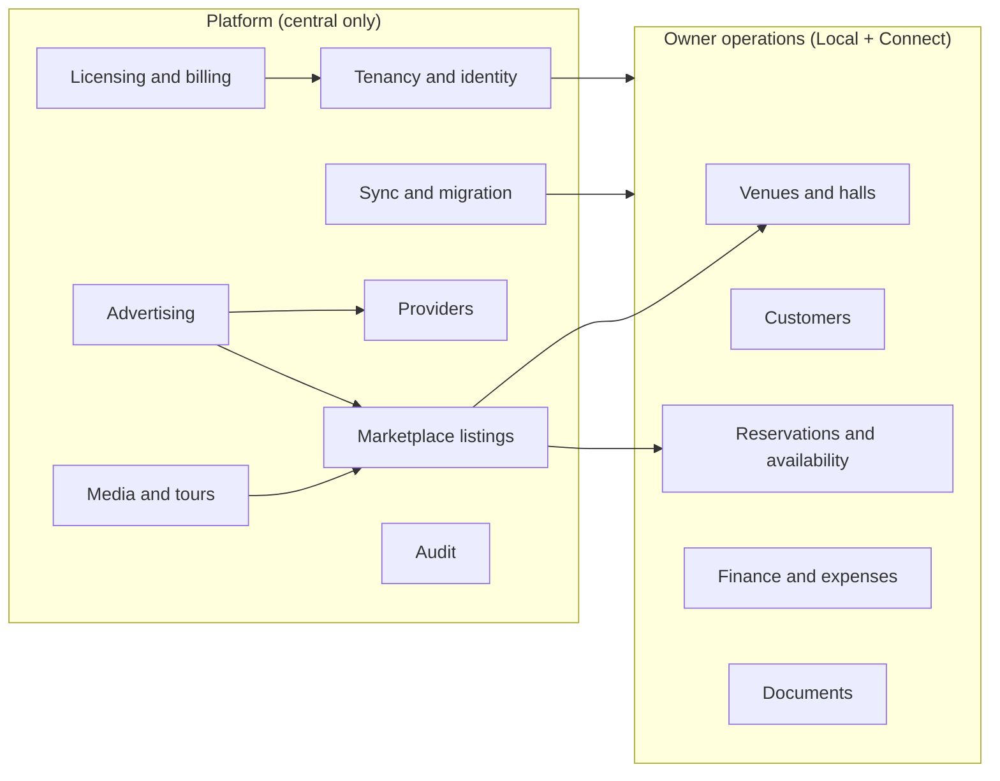

### 8.2 Tenancy, identity, and venues

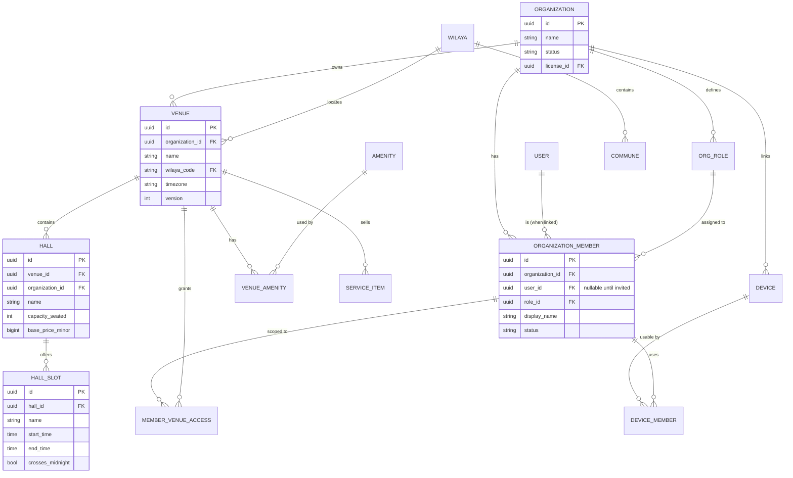

**Key design point — member vs user:** `organization_members` is the **actor** recorded on business data (`created_by_member_id`), and `users` is a **login identity**. In Local, the owner profile (and any future local profiles) is a member with `user_id = NULL`. On migration to Connect the member rows keep their UUIDs and are linked to real user accounts later. Historical attribution survives without any identity rewriting (§13.5).

### 8.3 Customers, reservations, and finance

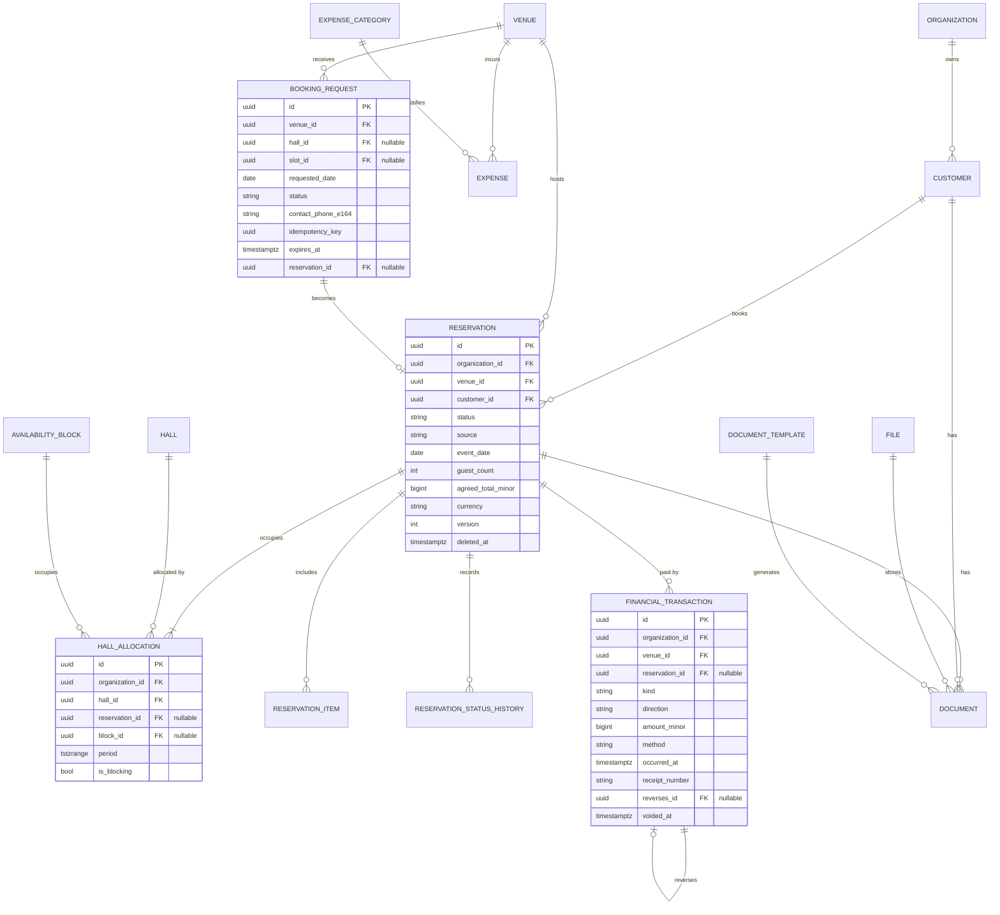

### 8.4 Marketplace, advertising, licensing, and billing

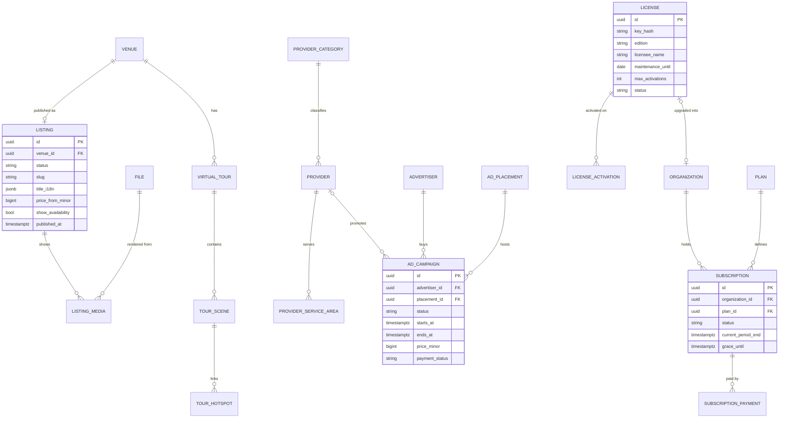

### 8.5 Entity catalogue

"Where" shows whether the entity lives on the device (L = Local SQLite, also used in Connect), on the server (S), or both (L+S, synchronized).

| Entity | Where | Notes |
|---|---|---|
| `organizations` | L+S | In Local, created at first run with a UUID (the "local organization"). |
| `organization_members` | L+S | Actor identity. `user_id` is only set server-side. |
| `org_roles`, `member_venue_access` | S (pulled read-only to L in Connect) | Permission set per role. Venue scope per member. |
| `users` | S | Login identity: phone/email, password hash, locale. Never stored on the device except a local verifier (§10.3). |
| `devices`, `device_members`, `device_refresh_tokens` | S | Linked devices, revocation. |
| `venues`, `halls`, `hall_slots` | L+S | Slots implement Q-02 (sessions vs full day). |
| `amenities` (catalogue), `venue_amenities` | S catalogue pulled, link L+S | Catalogue keyed by a stable `code`, not an ID, so Local can ship a built-in list. |
| `service_items` | L+S | Venue's priced extras (catering per head, decoration, etc.). |
| `customers` | L+S | Phone normalized to E.164. Duplicates allowed but detected. |
| `reservations` | L+S | Status machine (§12). |
| `hall_allocations` | L+S | The overlap-controlled record. One row per hall per reservation/block. |
| `availability_blocks` | L+S | Owner closures (maintenance, private use). |
| `reservation_items` | L+S | Line items. Totals are derived. |
| `reservation_status_history` | L+S (append-only) | Who, when, from → to, reason, op_id. |
| `booking_requests` | S (pulled to L in Connect) | Marketplace requests. Contains unverified PII. |
| `financial_transactions` | L+S (append-only + void) | Deposits, payments, refunds, adjustments. |
| `expenses`, `expense_categories` | L+S | Void, not delete. |
| `files` | L+S (metadata) + binary store | Content-addressed (`sha256`). |
| `documents`, `document_templates` | L+S | Generated documents are immutable. A new generation creates a new version. |
| `receipt_series` | L (+S) | Number allocation per device series (§9.6). |
| `listings`, `listing_media` | S (editable from Connect app) | Public projection. |
| `providers`, `provider_categories`, `provider_service_areas` | S | Curated in M3. |
| `advertisers`, `ad_placements`, `ad_campaigns`, `ad_daily_stats` | S | M3 basic, M4 full. |
| `virtual_tours`, `tour_scenes`, `tour_hotspots` | S | M4. |
| `licenses`, `license_activations` | S (+ signed licence file on device) | §14. |
| `plans`, `subscriptions`, `subscription_payments` | S | §14. |
| `admin_users`, admin roles/permissions | S | Separate identity (ADR-012). |
| `audit_logs` | S (append-only) | §17.7. The device keeps its own `change_journal`. |
| `sync_operations`, `sync_changes`, `org_sync_counters` | S | Sync metadata (§11). |
| `migration_sessions`, `migration_staging_records`, `migration_id_map` | S | §13. |
| `outbox_ops`, `sync_state`, `sync_issues`, `change_journal`, `local_settings`, `license_state`, `backup_log` | L only | Local metadata. |
| `wilayas`, `communes` | S (seeded copy in L) | Keyed by official code. **Do not hard-code the number of wilayas**: administrative divisions have changed before (48 → 58) and may change again. |

### 8.6 Three kinds of data — kept separate

| Kind | Examples | Rules |
|---|---|---|
| **Business records** | reservations, customers, transactions | Validated by domain rules. Synced. Exported. Subject to retention policy. |
| **Synchronization metadata** | `version`, `outbox_ops`, `sync_operations`, `sync_changes`, cursors, `sync_issues` | Never shown as business data. May be compacted or purged after a retention window. Never used for business decisions except conflict detection. |
| **Audit and history** | `reservation_status_history`, `audit_logs`, `change_journal` | Append-only. Not editable through any UI. Retained longer than sync metadata. Redacted for secrets. |

Version columns (`version`) live on business rows because they are needed for optimistic concurrency. All other sync bookkeeping lives in dedicated tables so that business tables stay clean and portable (for example in exports).

---

## 9. Database design principles and critical constraints

### 9.1 Identifiers

- **UUIDv7 primary keys for all synchronized entities, generated by whichever side creates the record** (the client offline, or the server for marketplace requests and admin-created records). UUIDv7 is time-ordered, which keeps B-tree indexes efficient, and it can be generated offline without coordination. PostgreSQL 18 provides `uuidv7()`. Laravel's `HasUuids` generates ordered UUIDs. Dart uses the `uuid` package (v7).
- The server **validates** client-supplied IDs: correct format, not already used by another organization (a collision is astronomically unlikely, but it is checked and rejected as `id_conflict`, never merged).
- Human-friendly numbers (reservation number, receipt number) are **separate columns**, never primary keys (§9.6).
- Reference data uses **stable codes** (`wilaya_code = '31'`, `amenity_code = 'parking'`) so that Local can ship built-in reference data that matches the server without ID mapping.

### 9.2 Money

- `bigint` minor units (`amount_minor`), with `currency CHAR(3) DEFAULT 'DZD'`. Never floating point. All arithmetic is integer. Formatting is locale-aware at the UI edge.
- Balances are **derived**: `agreed_total + Σ items − Σ payments_in + Σ refunds_out` (excluding voided entries). Derived values may be cached for list views but are never authoritative. The formula is pinned by `contracts/fixtures/balance_cases.json`.

### 9.3 Time

- Instants: `timestamptz` (PG) and ISO-8601 UTC text or integer epoch milliseconds (SQLite), consistently via Drift converters.
- Business dates: `event_date DATE` (the "wedding date" as the customer understands it), **plus** the computed allocation `period tstzrange` using the venue's time zone and the slot's times. This handles evenings that run past midnight.
- **Client clocks are never used for ordering or conflict resolution.** They are recorded (`client_created_at`) for display and diagnostics only. Ordering comes from server change sequences. Conflict detection comes from row versions (§11).
- User-entered business times (e.g. "payment received on 12 May") are business data, editable, and unrelated to sync timing.

### 9.4 Soft deletes and tombstones

Synchronized entities use `deleted_at` (tombstone) rather than physical deletes, so that deletions propagate through sync. Restrictions:

- A reservation that has any non-voided financial transaction or is `confirmed` **cannot be deleted**. It must be cancelled. This is enforced in the Action and, server-side, by a trigger or check in the Action's transaction.
- Financial transactions are never deleted. They are voided (`voided_at`, `void_reason`, `voided_by_member_id`) or reversed.
- Physical purge happens only through retention jobs (§9.8).

### 9.5 Critical PostgreSQL constraints

**(a) No overlapping blocking allocations per hall:**

```sql
CREATE EXTENSION IF NOT EXISTS btree_gist;

CREATE TABLE hall_allocations (
    id              uuid PRIMARY KEY,
    organization_id uuid NOT NULL REFERENCES organizations(id),
    hall_id         uuid NOT NULL REFERENCES halls(id),
    reservation_id  uuid REFERENCES reservations(id),
    block_id        uuid REFERENCES availability_blocks(id),
    period          tstzrange NOT NULL,
    is_blocking     boolean NOT NULL,
    created_at      timestamptz NOT NULL DEFAULT now(),
    CONSTRAINT one_owner CHECK ((reservation_id IS NULL) <> (block_id IS NULL)),
    CONSTRAINT period_valid CHECK (NOT isempty(period) AND lower_inc(period) AND NOT upper_inc(period)),
    CONSTRAINT no_double_booking
        EXCLUDE USING gist (hall_id WITH =, period WITH &&) WHERE (is_blocking)
);
```

`is_blocking` is set by the Action from the reservation status (§12.3) inside the same transaction as the status change. The half-open `[start, end)` convention lets back-to-back slots (afternoon `[14:00, 19:00)`, evening `[19:00, 02:00)`) coexist.

> [!IMPORTANT]
> The `is_blocking` flag is denormalized from reservation status. A consistency check runs in the test suite and as a nightly job: every `confirmed`/`tentative` reservation must have blocking allocations, and every other status must have only non-blocking allocations. A mismatch is an alert, not something to auto-fix silently.

**(b) Tenant consistency.** Every tenant table has `organization_id NOT NULL`. Composite foreign keys ensure that child rows reference parents in the **same** organization, for example:

```sql
ALTER TABLE halls ADD CONSTRAINT halls_venue_same_org
  FOREIGN KEY (venue_id, organization_id) REFERENCES venues (id, organization_id);
-- requires UNIQUE (id, organization_id) on venues
```

Apply this to `halls→venues`, `reservations→customers/venues`, `hall_allocations→halls/reservations`, `financial_transactions→reservations`, `documents→files`. This catches cross-tenant references even if application code has a bug.

**(c) Other key constraints and indexes**

| Table | Constraint / index | Purpose |
|---|---|---|
| `organization_members` | `UNIQUE (organization_id, user_id) WHERE user_id IS NOT NULL` | One membership per user per org |
| `users` | `UNIQUE (phone_e164)`, `UNIQUE (lower(email))`, both partial `WHERE NOT NULL` | Login uniqueness |
| `customers` | `INDEX (organization_id, phone_e164)`, trigram index on `full_name` | Duplicate detection, search (not unique: families share phones) |
| `reservations` | `INDEX (organization_id, venue_id, event_date)`, `INDEX (organization_id, status)`, `UNIQUE (organization_id, reference_number)` | Calendar, lists |
| `hall_allocations` | GiST exclusion (above), `INDEX (reservation_id)` | Overlap and joins |
| `financial_transactions` | `UNIQUE (organization_id, receipt_number) WHERE receipt_number IS NOT NULL`, `CHECK (amount_minor > 0)`, `INDEX (organization_id, reservation_id)`, `INDEX (organization_id, occurred_at)` | Receipts, balances, reports |
| `booking_requests` | `UNIQUE (idempotency_key)`, `INDEX (venue_id, requested_date, status)`, `INDEX (contact_phone_e164, created_at)` | Duplicate submits, owner inbox, spam limits |
| `listings` | `UNIQUE (venue_id)`, `UNIQUE (slug)` | One listing per venue |
| `sync_operations` | `UNIQUE (organization_id, op_id)` | Idempotency |
| `sync_changes` | `PRIMARY KEY (organization_id, change_seq)` | Ordered feed |
| `license_activations` | `UNIQUE (license_id, device_fingerprint_hash) WHERE deactivated_at IS NULL` | Activation limits |
| `subscriptions` | `UNIQUE (organization_id) WHERE status IN ('trialing','active','past_due','grace')` | One live subscription |
| `ad_campaigns` | `CHECK (ends_at > starts_at)`, `INDEX (placement_id, status, starts_at, ends_at)` | Scheduling |

### 9.6 Human-readable numbering

- **Reservation reference** (e.g. `RSV-2026-0153`) and **receipt numbers** must be unique per organization, but offline devices cannot coordinate.
- **[RECOMMENDATION]** Each device holds a **series prefix** assigned at first run (Local: `A`) or at linking (Connect: `A`, `B`, `C`…). Numbers are `{series}-{year}-{seq}`, allocated from a local `receipt_series` table inside the same transaction. This gives uniqueness without coordination, with a constraint backstop on the server.
- **[OPEN]** Q-12: whether Algerian invoicing or fiscal rules impose a single gap-free numbering sequence or a certified system for these documents. WalimApp receipts should be labelled as *non-fiscal receipts* until this is confirmed.

### 9.7 Transaction boundaries (server)

| Use case | Single transaction contains |
|---|---|
| Process one sync operation | idempotency insert → org sync counter lock → domain Action (rows + history + allocations) → `sync_changes` rows → operation result |
| Confirm/approve reservation | lock reservation (and request) `FOR UPDATE` → status transition check → allocation update (`is_blocking = true`) → status history → change feed. **The exclusion constraint is evaluated inside this transaction.** |
| Record payment | insert transaction (+ receipt number check) → change feed |
| Submit booking request | insert request → change feed (notifications dispatched **after commit** via `afterCommit` jobs) |
| Migration commit | all staged records for the session → change feed reset for the org → session status `committed` |
| Licence activation | activation row (with limit check under `SELECT … FOR UPDATE` on the licence) → audit log |

Side effects (email, SMS, image processing) are always dispatched **after commit** (`ShouldQueueAfterCommit` / `afterCommit()`), never inside the transaction.

### 9.8 Data retention (proposed — requires legal confirmation, Q-32)

| Data | Proposed retention | Notes |
|---|---|---|
| Financial transactions, receipts, contracts | ≥ 10 years from the end of the financial year | Commercial record-keeping obligations are believed to require multi-year retention. **The duration must be confirmed** against Algerian commercial and tax law. |
| Reservations and customers (active org) | Life of the account | Owner can anonymize customers with no financial records. |
| Booking requests rejected/expired/withdrawn | PII removed after 12 months, aggregate kept | Unverified PII minimization. |
| `sync_changes` | 90 days (older cursors force a re-bootstrap) | Sync metadata. |
| `sync_operations` (results) | 90 days | Idempotency window ≥ maximum offline period. **The client must re-bootstrap if it has been offline longer than this.** |
| `audit_logs` | 5 years (proposed) | Security investigations. |
| Server data after Connect expiry | 12 months after expiry, then deletion after notices (proposed, Q-22) | Export remains available until deletion. |
| Server backups | 35 days PITR + 12 monthly | Deleted data persists in backups until rotation. This must be disclosed in the privacy policy. |
| Local device data | Owner-controlled | WalimApp never remotely deletes local business data. |

### 9.9 SQLite specifics (owner app)

- The same UUIDs, column names, and money/time conventions as the server, so that migration and sync are straightforward mappings.
- **Overlap safety net in SQLite:** allocations store `period_start_ms`/`period_end_ms` integers. A `BEFORE INSERT/UPDATE` trigger raises `ABORT` if another blocking allocation for the same hall overlaps. The command handler additionally checks inside `BEGIN IMMEDIATE`, so SQLite's single-writer model makes check-then-insert safe.
- Foreign keys are enforced (`PRAGMA foreign_keys = ON` on every connection). `PRAGMA integrity_check` runs at startup on a schedule (weekly) and before backup/migration.
- Indexes mirror the main server ones (calendar by venue and date, customer phone, transactions by reservation).
- Local-only tables: `outbox_ops`, `sync_state`, `sync_issues`, `change_journal`, `local_settings`, `license_state`, `backup_log`, `receipt_series`, `file_cache`.

---

## 10. API, authentication, and authorization

### 10.1 API conventions

| Concern | Convention |
|---|---|
| Format | JSON, `snake_case`, UTF-8, gzip request and response bodies for sync |
| IDs | UUID strings |
| Money | `{ "amount_minor": 1500000, "currency": "DZD" }` |
| Time | ISO-8601 UTC instants, `YYYY-MM-DD` business dates |
| Errors | RFC 9457 `application/problem+json` with a stable machine `code` (e.g. `reservation.overlap`, `auth.device_revoked`), a localized `title` (based on `Accept-Language: ar`/`fr`), and `errors` for field validation |
| Tracing | `X-Request-Id` echoed back and logged |
| Pagination | Cursor-based (`next_cursor`), never offset for sync |
| Tenant in URL | `/api/v1/organizations/{org}/…`, so the tenant is explicit, resolved by middleware, and checked against the token's membership |
| Online-only vs offline-capable | **Offline-capable business data is written only through `sync/push` operations.** REST resources are used only for features that inherently need connectivity (members, listing, media upload, licences, migration). |

### 10.2 Endpoint patterns (illustrative, not complete)

**Owner API (`/api/v1`, Sanctum device tokens)**

| Method | Path | Purpose | Milestone |
|---|---|---|---|
| POST | `/auth/login` | Phone/email + password + device descriptor → access + refresh token | M2 |
| POST | `/auth/refresh` | Rotate refresh token (reuse detection) | M2 |
| POST | `/auth/logout` | Revoke current device tokens | M2 |
| POST | `/auth/password/otp`, `/auth/password/reset` | Password recovery | M2 |
| GET | `/me` | User, memberships, effective permissions | M2 |
| POST | `/organizations` | Create organization (Connect onboarding) | M2 |
| POST / DELETE | `/organizations/{org}/devices[/{device}]` | Link or revoke a device, set device scope | M2 |
| GET | `/organizations/{org}/sync/bootstrap` | Paged snapshot per entity type | M2 |
| POST | `/organizations/{org}/sync/push` | Batch of operations | M2 |
| GET | `/organizations/{org}/sync/pull?cursor=` | Change feed page | M2 |
| POST | `/organizations/{org}/sync/heartbeat` | Device health: pending ops, app version, last error | M2 |
| POST / PUT / POST | `/organizations/{org}/uploads`, `/uploads/{id}/parts/{n}`, `/uploads/{id}/complete` | Resumable, content-addressed file upload | M2 |
| GET | `/organizations/{org}/files/{file}/download` | Policy check → short-lived signed URL (302) | M2 |
| POST / PUT / POST / GET / POST | `/organizations/{org}/migrations`, `/migrations/{id}/chunks/{n}`, `/migrations/{id}/validate`, `/migrations/{id}`, `/migrations/{id}/commit` | Local→Connect migration | M2 |
| GET / POST / PATCH | `/organizations/{org}/members[/{member}]`, `/invitations` | Employees and roles | M2 |
| GET / PUT / POST | `/organizations/{org}/venues/{venue}/listing`, `/listing/submit`, `/listing/media` | Listing management | M3 |
| POST | `/licenses/activate`, `/licenses/deactivate`, `/licenses/offline-activation` | Licence activation (licence-key auth) | M1 (optional) / M2 |
| GET | `/app/releases?channel=stable` | Update manifest (public, signed) | M1 |

**Public web (server-rendered, `/{locale}` = `ar` | `fr`)**

| Method | Path pattern | Indexable |
|---|---|---|
| GET | `/{locale}` | Yes |
| GET | `/{locale}/salles/{wilaya}` | Yes (wilaya landing) |
| GET | `/{locale}/salles/{wilaya}/{venue-slug}` | Yes (venue profile) |
| GET | `/{locale}/recherche?…` | **No** (`noindex`, canonical to wilaya page) |
| POST | `/{locale}/salles/{wilaya}/{venue-slug}/demande` | — (booking request) |
| GET | `/{locale}/prestataires/{category}[/{wilaya}[/{provider-slug}]]` | Yes |
| GET | `/sitemap.xml`, `/robots.txt` | — |
| GET | `/go/{campaign}` | No (sponsored click redirect, `rel="sponsored nofollow"`) |

**Admin:** `/admin` (Filament, `admin` guard). It is not part of the public API.

### 10.3 Authentication

**Owner users (Connect):**

- Identity is a phone number (E.164) and/or email plus password, hashed with Argon2id.
- **Device linking:** the first login on a device registers a `devices` row (UUID generated at install, name, platform, app version, salted fingerprint hash). Tokens are bound to the device.
- **Tokens:** Sanctum access token with 1-hour expiry and ability `owner-api`. A rotating refresh token (30-day sliding window) is stored hashed in `device_refresh_tokens`. **Reuse of an already-rotated refresh token revokes all tokens for that device** and forces login (theft signal). Tokens are stored on Windows through the OS credential store (DPAPI) via secure storage, never in SQLite or plain files.
- **Offline unlock:** while online, each member who uses the device sets a **local device PIN/password**, stored as an Argon2id verifier in `local_settings`. This lets the app be unlocked and users switched offline **without** caching the server password. Repeated failures trigger an increasing delay. Cached permissions come from the last sync.
- **Actor attestation (trade-off, ADR-014):** sync pushes are authenticated by the **device** token. Each operation names the `actor_member_id` who performed it locally. The server checks that this member (a) is active, (b) is assigned to the device, and (c) currently holds the required permission for that operation and venue. A compromised device could misattribute actions among its assigned members, but it cannot exceed their combined permissions or reach other organizations. This is the only practical model for offline multi-user devices. It is documented as a residual risk (R-12).

**Local mode:** an optional app lock (password/PIN) protects against casual access. It is **not** encryption (§5.6).

**Admin staff:** a separate `admin_users` table and session guard. Password plus mandatory TOTP 2FA with recovery codes. 8-hour absolute and 30-minute idle session lifetime. Optional IP allow-list. Login attempts and 2FA resets are audited.

**Customers (M3):** no accounts (A-09). Booking requests are protected by rate limits, a honeypot field, an optional CAPTCHA, and optional SMS OTP verification (Q-09).

### 10.4 Authorization model

**Owner side — role + venue scope + entitlement:**

```
allowed(member, permission, venue?) =
      member.status == active
  AND device is not revoked (for API calls)
  AND permission ∈ member.role.permissions
  AND (member.role.all_venues OR venue ∈ member.venue_access)
  AND organization.entitlements permit the feature (e.g. listing.* needs active Connect)
```

**Permission catalogue (initial, code-defined):**

| Group | Permissions |
|---|---|
| Reservations | `reservations.view`, `reservations.create`, `reservations.confirm`, `reservations.reschedule`, `reservations.cancel` |
| Booking requests | `booking_requests.view`, `booking_requests.respond` |
| Customers | `customers.view`, `customers.manage`, `customers.view_sensitive` (ID document data) |
| Finance | `finance.view`, `finance.record`, `finance.void`, `expenses.manage`, `reports.view` |
| Documents | `documents.view`, `documents.manage`, `templates.manage` |
| Venue | `venue.settings`, `listing.manage` |
| Organization | `members.manage`, `devices.manage`, `billing.view` |

**Predefined roles (M2):** *Owner* (all permissions, cannot be removed, at least one per org), *Manager*, *Reception*, *Accountant*. Custom roles are deferred until requested (Q-15).

**Device data scope (confidentiality boundary for data at rest):** when linking a device, an owner or manager sets which venues and which data classes (`operations`, `finance`, `customer_sensitive`) the device may hold. **The pull feed is filtered by device scope.** The UI further hides data per logged-in member, but that is a convenience, **not a security boundary**: anyone with OS-level access to the PC can read the SQLite file. This is stated explicitly in the product documentation.

**Admin side:** granular admin permissions (for example `orgs.view`, `orgs.manage`, `listings.moderate`, `licenses.issue`, `licenses.revoke`, `subscriptions.manage`, `ads.manage`, `providers.manage`, `support.view_tenant_data`, `audit.view`, `admins.manage`). Admin roles (*Super-admin* for break-glass, *Support*, *Sales/Licensing*, *Moderator*, *Finance*) are assigned through a permission package (e.g. `spatie/laravel-permission` on the `admin` guard only). **Viewing tenant financial records or documents requires `support.view_tenant_data`, a stated reason, and creates an audit entry.** Impersonation of owners is not provided in M2. If added later, it is time-boxed, reason-logged, and read-only by default.

### 10.5 Server-side tenant enforcement — defence in depth

| Layer | Mechanism |
|---|---|
| 1. Routing | `auth:sanctum` → `EnsureDeviceActive` → `ResolveTenant` (org from URL; membership must exist; builds an immutable `TenantContext{org, member, role, venues, device_scope, entitlements}`) |
| 2. Actions | Every Action takes a `TenantContext` and calls its policy **first**. Actions never accept a raw `organization_id` from the request body. The organization always comes from the context. |
| 3. Queries | Tenant models expose `scopeForTenant(TenantContext)`. Query objects require a context. Lookups by ID include `organization_id`. Cross-tenant IDs return **404**, not 403, to avoid enumeration. |
| 4. Database | `organization_id NOT NULL` everywhere. Composite same-org foreign keys (§9.5b). |
| 5. Tests | An automated cross-tenant matrix: for every route and every sync op type, an actor from org B targets org A resources and must fail. **A test enumerates registered routes and op types and fails if any lacks a matrix entry** (§19). |
| 6. Optional later | PostgreSQL Row-Level Security as an extra safety net (ADR-008: deferred, re-evaluate after M3). |

### 10.6 Validation

- REST: FormRequest / DTO validation. Unknown fields are rejected for writes.
- Sync ops: (1) JSON Schema from `contracts/sync/ops` (structure, types, sizes), then (2) the Action's domain validation (state transitions, overlap, references, amounts > 0, dates within allowed range).
- Phone numbers normalized to E.164 with libphonenumber on both sides (golden fixture `phone_normalization.json`).
- Size limits: push batch ≤ 100 ops and ≤ 2 MB compressed. File-size limits per type (§16).
- **Server never trusts client-computed values** (balances, totals, `is_blocking`, status-derived fields). It recomputes them.

### 10.7 Rate limiting (database-backed limiter)

| Surface | Limit (initial, tunable) |
|---|---|
| Owner login | 5/min per identifier+IP. 30/hour per IP. Progressive lockout. |
| Password OTP | 3 per 15 min per phone. 10/day per phone. |
| Sync push/pull | 120 requests/min per device |
| Licence activation | 5/day per licence key. 20/hour per IP. |
| Booking request submit | 3/hour and 5/day per phone. 10/day per IP. At most 2 open requests per phone per venue. |
| Public pages | 300/min per IP (plus CDN/WAF rules if available) |
| Admin login | 5/min per account+IP. Alert after 10 failures. |

---

## 11. Offline storage and synchronization architecture

### 11.1 Operating modes

| Mode | Trigger | Writes | Network |
|---|---|---|---|
| **Local** | Valid Local licence, not linked | Full | None required (optional activation/update check) |
| **Connect — online** | Linked device, valid tokens, active subscription | Full, with outbox | Sync every ~60 s |
| **Connect — offline** | Linked, no connectivity | Full, with outbox. Reservations shown as `pending_sync`. | Queued |
| **Connect — restricted** | Subscription expired beyond grace (§14.7) | Depends on licence: full local editing if the org holds a Local licence, otherwise read-only | Pull of final state allowed. Push of business ops rejected with `subscription_inactive`. |
| **Read-only safe mode** | Licence missing/invalid, or DB schema newer than the app | View, search, print, export, backup only | — |

**No mode ever deletes or hides local business data.**

### 11.2 What is synchronized

| Entity | Direction | Push semantics | Conflict policy |
|---|---|---|---|
| Venue, hall, slot | ↔ | Field update ops | Three-way field merge. Field collision → sync issue. |
| Customer | ↔ | Field update ops | Three-way field merge. Duplicate detection is advisory (never auto-merge). |
| Reservation (core: status, date, hall/slot, customer) | ↔ | **Domain commands** (`create`, `confirm`, `reschedule`, `cancel`) | **Never auto-merged.** Server re-validates every invariant. Failure → sync issue. |
| Reservation (non-core: notes, guest count, items) | ↔ | Field update ops | Three-way field merge. Not allowed on cancelled reservations except notes. |
| Hall allocations | ↓ (server derives from commands) | Never pushed directly | — |
| Availability block | ↔ | Commands (`create`, `remove`) | Overlap-validated like reservations |
| Financial transaction | ↔ | **Insert-only** + `void` | Inserts never conflict. Void on voided = idempotent no-op. Missing parent → blocked. |
| Expense | ↔ | Insert, field update, void | Three-way field merge. Void wins over a concurrent edit (edit becomes a sync issue). |
| Document / file | ↔ | Insert (immutable) + metadata update | New versions, never overwrite. |
| Booking request | ↓ (+ decision commands ↑) | `approve`, `reject` | First decision wins. Later decision → `request_not_pending`. |
| Members, roles, venue access, device scope | ↓ | REST (online only) | Server authoritative |
| Org settings (non-critical preferences) | ↔ | Per-key set | **Last-write-wins by server arrival order — explicitly accepted** for cosmetic settings only |
| Listing, media, subscription, licence state | ↓ | REST (online only) | Server authoritative |

### 11.3 Local write path and outbox

Every mutating command runs in **one SQLite transaction**:

1. Validate with shared domain rules.
2. Apply to business tables. Increment `local_rev` on the row and set `sync_state = 'pending'` (Connect).
3. Append to `change_journal` (always, including Local): `{id, at, member_id, entity, entity_id, action, diff}`. This is the local audit trail and lets support reconstruct history.
4. In Connect: append one `outbox_ops` row.

```sql
-- SQLite (Drift) — local only
CREATE TABLE outbox_ops (
  op_id            TEXT PRIMARY KEY,      -- UUIDv7, idempotency key
  seq              INTEGER NOT NULL UNIQUE, -- local order
  op_type          TEXT NOT NULL,         -- e.g. 'reservation.create'
  op_version       INTEGER NOT NULL,
  entity_type      TEXT NOT NULL,
  entity_id        TEXT NOT NULL,
  base_version     INTEGER,               -- server version the edit was based on (NULL for creates)
  base_values      TEXT,                  -- JSON: prior values of changed fields (for field merge)
  payload          TEXT NOT NULL,         -- JSON: new values / command arguments
  depends_on       TEXT,                  -- JSON array of op_ids
  actor_member_id  TEXT NOT NULL,
  client_created_at TEXT NOT NULL,
  status           TEXT NOT NULL,         -- pending|in_flight|accepted|rejected|conflict|blocked|cancelled
  attempts         INTEGER NOT NULL DEFAULT 0,
  next_attempt_at  TEXT,
  last_error_code  TEXT,
  result           TEXT                   -- JSON server result
);
```

Synced business rows on the client carry: `server_version INTEGER NULL`, `sync_state TEXT` (`synced|pending|conflict|rejected`), `local_rev INTEGER`.

**Coalescing (optional optimization):** consecutive field-update ops for the same entity that are still `pending` (not in flight) may be merged into one op. The earliest `base_values` and the latest new values are kept. Commands are never coalesced.

### 11.4 Push protocol

```json
POST /api/v1/organizations/{org}/sync/push
{
  "device_id": "0193…",
  "client": { "app_version": "1.4.0", "schema_version": 12 },
  "ops": [
    {
      "op_id": "0193a…",
      "op_type": "reservation.create", "op_version": 1,
      "entity_type": "reservation", "entity_id": "0193b…",
      "actor_member_id": "0192…",
      "depends_on": ["0193c…"],
      "client_created_at": "2026-06-01T10:22:31Z",
      "payload": {
        "venue_id": "…", "customer_id": "0193c-customer…",
        "status": "confirmed", "event_date": "2026-07-12",
        "allocations": [{ "hall_id": "…", "slot_id": "…" }],
        "agreed_total": { "amount_minor": 45000000, "currency": "DZD" },
        "reference_number": "A-2026-0153"
      }
    },
    {
      "op_id": "0193d…",
      "op_type": "customer.update", "op_version": 1,
      "entity_type": "customer", "entity_id": "0191…",
      "base_version": 7,
      "base_values": { "phone_e164": "+213550000001" },
      "payload": { "phone_e164": "+213661000002" },
      "actor_member_id": "0192…",
      "client_created_at": "2026-06-01T10:25:02Z"
    }
  ]
}
```

```json
200 OK
{
  "results": [
    { "op_id": "0193a…", "status": "conflict",
      "code": "reservation.overlap",
      "detail": { "conflicting_reservation_ids": ["0190…"], "hall_id": "…",
                  "period": ["2026-07-12T18:00:00Z", "2026-07-13T01:00:00Z"] } },
    { "op_id": "0193d…", "status": "accepted", "entity_version": 8, "change_seq": 5512 }
  ],
  "server_time": "2026-06-01T10:31:00Z"
}
```

**Per-operation result statuses:**

| Status | Meaning | Client action |
|---|---|---|
| `accepted` | Applied (or an identical earlier submission was applied) | Mark synced. Store `entity_version`. |
| `conflict` | Concurrent change or invariant violation (overlap, field collision, invalid transition caused by another actor) | Restore server snapshot in the business row. Create a sync issue with both sides. |
| `rejected` | Validation or permission failure that retrying cannot fix | Sync issue. The row reverts to server state (or stays local-only if the record never reached the server). |
| `blocked` | A dependency op was not accepted | Keep pending. Resolves after the dependency is resolved. |
| `retry_later` | Transient server condition (lock timeout, maintenance) | Exponential backoff |

HTTP-level responses: `401` → refresh token; `403 auth.device_revoked` → stop sync and show the re-link flow; `426 client.upgrade_required` → continue offline and prompt for update; `429`/`503` → back off and honour `Retry-After`.

### 11.5 Server processing algorithm (per operation)

```
for op in batch (in order):
    BEGIN
      INSERT INTO sync_operations (organization_id, op_id, device_id, payload_hash, status='processing')
        ON CONFLICT (organization_id, op_id) DO NOTHING
      if not inserted:
          existing = SELECT … (waits if a concurrent identical op is still committing)
          if existing.payload_hash != hash(op): result = rejected('sync.idempotency_key_reused')
          else: result = existing.result            -- duplicate retry → same answer
          COMMIT; continue
      if any(dep in op.depends_on not accepted): result = blocked; record; COMMIT; continue
      validate schema(op_type, op_version)
      ctx = TenantContext(org, actor_member_id, device)       -- checks member ∈ device_members
      handler = registry[op_type][op_version]
      SELECT … FROM org_sync_counters WHERE organization_id = :org FOR UPDATE   -- serialize feed order
      result = handler.apply(ctx, op)       -- calls domain Action; may raise Conflict/Validation
      for each changed entity: INSERT sync_changes(org, ++counter, entity_type, entity_id, venue_id, op)
      UPDATE sync_operations SET status, result
    COMMIT
    on DomainConflict/ValidationError: ROLLBACK the business changes, then record the result
                                         in a fresh small transaction (idempotency row + result)
    on serialization/lock timeout: ROLLBACK → retry_later (idempotency row not persisted)
```

- **Each operation is its own transaction.** A batch can partly succeed, and a failure never rolls back unrelated work.
- The idempotency record and the business change commit **atomically**, so a crash between them is impossible. A client retry after a lost response receives the stored result.
- Idempotency records are kept ≥ 90 days (§9.8). A device offline for longer must re-bootstrap. Its pending ops are re-submitted after bootstrap with fresh base versions, and conflicts are surfaced (§11.15).

### 11.6 Conflict detection

1. **Commands (reservations, blocks, booking decisions):** the handler loads the current row `FOR UPDATE`, checks that the transition is valid **from the current server state** (not from the client's belief), and re-checks invariants (the overlap exclusion constraint). `base_version` is informational for commands, except for `reschedule`, which requires `base_version == current` (otherwise conflict, because the owner moved a booking that someone else also changed).
2. **Field updates (customers, venues, expenses, reservation notes):** three-way merge per changed field:

```
for field in op.payload:
    if current[field] == op.base_values[field]:   apply (nobody else changed it)
    elif current[field] == op.payload[field]:     no-op (same change already present)
    else:                                         collision(field)
if any collision → status=conflict, return {server_values, client_values, base_values} for colliding fields
else apply non-colliding fields atomically (all or none — partial apply is not allowed)
```

This needs no server-side field history and no trust in client clocks.

3. **Deletes vs updates:** an update to a tombstoned row → `conflict (entity.deleted)`. A delete of a row modified since `base_version` → `conflict`.
4. **Inserts:** a duplicate `entity_id` with an identical payload is idempotent (accepted). With a different payload → `rejected (id_conflict)`.

### 11.7 Pull protocol and change feed

```
GET /api/v1/organizations/{org}/sync/pull?cursor=5400&limit=500
→ { "changes": [ { "seq": 5401, "entity_type": "reservation", "entity_id": "…",
                   "op": "upsert", "version": 9, "data": { …snapshot… } },
                 { "seq": 5402, "entity_type": "customer", "entity_id": "…", "op": "delete" } ],
    "next_cursor": 5402, "has_more": false, "scope_hash": "c41f…", "server_time": "…" }
```

**Why a per-organization counter instead of a global sequence:** with a plain `bigserial`, transaction T1 can take value 100, T2 can take 101 and commit first, and a reader can then advance its cursor past 100 before T1 commits. That change would never be delivered. Locking the organization's `org_sync_counters` row for the duration of the write transaction ensures that `change_seq` values become visible **in commit order, without gaps**, per organization. The cost is that writes within one organization are serialized, which is negligible at venue scale (A-05) and does not affect other tenants.

- `sync_changes` stores *which* entity changed. The pull handler deduplicates by entity within the page and serializes the **current** row snapshot, filtered by device scope (venue, data class). Redacted fields are omitted, not nulled.
- `scope_hash` identifies the device's current scope (venues, data classes, permission version). If it differs from the client's stored value, the client performs a **scope re-sync** (§11.14).
- Change-feed rows older than 90 days are compacted. A cursor older than the oldest retained row → `410 sync.cursor_expired` → re-bootstrap.

### 11.8 Bootstrap (initial or recovery)

1. `GET /sync/bootstrap?start=1` returns `snapshot_seq = current counter` and a list of entity types.
2. The client pages each entity type (`?entity=customers&page_token=…`) in dependency order: venues → halls → slots → customers → reservations → allocations → transactions → expenses → documents metadata → booking requests.
3. When it is done, the client sets `cursor = snapshot_seq` and pulls normally. Changes made during bootstrap are delivered by the pull, and duplicates are harmless because rows are upserted by ID and version.
4. Bootstrap writes go into the local DB in batched transactions, but the device is marked `ready` only after completion. An interrupted bootstrap resumes from its page tokens.

### 11.9 Applying pulled changes on the client

```
for change in page (single SQLite transaction per page):
    local = find(entity_id)
    if local has outbox ops in (pending, in_flight, conflict):
        store change.data in server_snapshots (shadow) — do not overwrite user's pending edit
    else if local is null or change.version > local.server_version:
        upsert row from snapshot; server_version = change.version; sync_state = synced
    else: ignore (stale or duplicate)
save cursor = page.next_cursor  (same transaction)
```

**The sync cycle always pushes before it pulls.** As a result, by the time a pull is applied, most pending ops have already been resolved, and shadows are rare. When a pending op later resolves, the shadow (or a fresh pull) is applied to the row.

### 11.10 Sync issues: conflict reporting and resolution

All `conflict`, `rejected`, and long-`blocked` ops produce a `sync_issues` entry. The issue appears in a **Sync issues** inbox with a badge in the main navigation and, for reservations, a red marker on the calendar date.

| Issue type | Shown to user | Resolution options |
|---|---|---|
| Reservation overlap (offline-created or rescheduled) | Local reservation details, the competing confirmed booking (if the member may view it), customer contact | **Choose another hall/slot/date** (creates a new op) · **Keep as tentative waitlist** (if Q-04 allows) · **Cancel local reservation** (payments recorded offline stay attached and are flagged for refund handling) |
| Field collision | Base / mine / server values per field | Keep server · Re-apply mine (new op with current base) · Edit manually |
| Invalid transition (e.g. cancelled elsewhere) | Who changed it, when | Accept server state · Re-create if still valid |
| Booking request already decided | Decision made by whom, when | Acknowledge |
| Permission denied | Missing permission | Ask owner/manager. The op can be discarded after export. |
| Blocked dependency | Which parent op failed | Resolves when parent is resolved |

**Rules:** an issue is never auto-dismissed. Discarding a local intent requires an explicit action and is journalled. Financial transactions recorded offline are **never discarded automatically**, even if their reservation is rejected. They are re-attached or refunded explicitly.

### 11.11 Retries, ordering, and idempotency

- Ops are pushed in local `seq` order. Independent ops after a failed op still proceed (the server marks dependents `blocked`).
- Backoff: exponential with jitter, from 5 s up to a 10-minute cap for transient failures. An immediate retry is triggered when connectivity returns. Permanent failures are not retried.
- An op stuck `in_flight` (app crashed mid-request) returns to `pending` on startup. Re-sending is safe because of idempotency.
- Every network call has a timeout. Large batches are split by count and size.

### 11.12 Local schema migrations and protocol evolution

- Drift `schemaVersion` with **step-by-step, forward-only** migrations. Each released schema is snapshotted (`drift_dev schema dump`) and **every historical-version → current migration is tested** with real data fixtures.
- **Before any migration:** (1) check licence/update entitlement, so an un-entitled newer build never upgrades the DB (§14.5); (2) take an automatic backup; (3) run `integrity_check`; (4) migrate inside a transaction; (5) on failure, restore the backup and start in read-only safe mode with a support export.
- **Downgrades are not supported.** An older app that finds a newer `schema_version` starts in read-only safe mode with a prompt to update.
- Protocol: the server supports the current and previous `op_version` of each op type, advertises `min_supported_client_version`, and returns `426` below it. **A client below the minimum keeps working offline (P1)** and holds its outbox until updated.
- **New entity types:** an older client ignores unknown entity types in pulls. A newer client that introduces a type performs a **targeted bootstrap** for that type after upgrade, so that changes skipped while it was old are recovered.

### 11.13 File synchronization

- Files are content-addressed (`sha256`). The `document.create` op references `file_sha256`. The file binary is uploaded separately (resumable parts). The server marks the document `file_status = pending` until the bytes arrive and the hash matches.
- Uploads skip files the server already holds for the same organization (hash check). Deduplication is **per organization**, never cross-tenant, to avoid leaking file existence.
- Downloads are **lazy**: metadata syncs, and bytes are fetched on first open and cached. Optional "download all documents" for offline completeness.
- Size limits and type allow-list (§16.3). Partial uploads expire after 24 h.

### 11.14 Scope changes, revocation, and device loss

- **Scope reduced** (employee removed from a venue, device scope narrowed): the next pull returns a new `scope_hash`. The client re-bootstraps scope and **purges rows outside the new scope**, after pushing any pending ops that the actor is still allowed to push. Ops that are no longer permitted become sync issues.
- **Device revoked:** the API returns `403 auth.device_revoked`. The app stops syncing and offers to export pending ops. It does not delete local data automatically. *Limitation:* data already on a lost or stolen PC **cannot be remotely erased**. The mitigations are scope minimization, OS-level disk encryption, the app lock, and prompt revocation. This must be communicated honestly to owners (R-12).

### 11.15 Recovery procedures

| Situation | Procedure |
|---|---|
| Lost response / crash during push | Idempotent re-push (automatic) |
| Cursor expired or offline > 90 days | Re-bootstrap. Pending ops are re-validated (new base versions captured from fresh state). Field collisions surface as issues. |
| Local DB corruption | Restore the latest local backup, then re-bootstrap from the server. Ops that exist in the backup but not on the server are re-pushed (idempotent). Ops after the backup are lost **unless** they had been synced. |
| Suspected divergence (bug) | "Verify sync" tool: the client sends per-entity counts and a checksum of `(id, version)` pairs; the server compares and returns mismatching IDs; the client re-fetches them. Run automatically weekly. |
| Restoring a Local backup on a Connect device | **Not an overwrite.** Treated as a *recovery import*: the backup is opened read-only, the user sees differences against server data, and selected records can be re-submitted as new ops. Prevents resurrecting stale state over server data. |
| Server restored from backup (DR) | Devices may hold changes newer than the server. On first contact after DR, the server advertises a new `epoch`. Devices re-push their journal of accepted ops since the restored point (op_ids preserve idempotency), then re-bootstrap. This is documented in the DR runbook (§18.8). |

### 11.16 Sync cycle with an offline-booking conflict

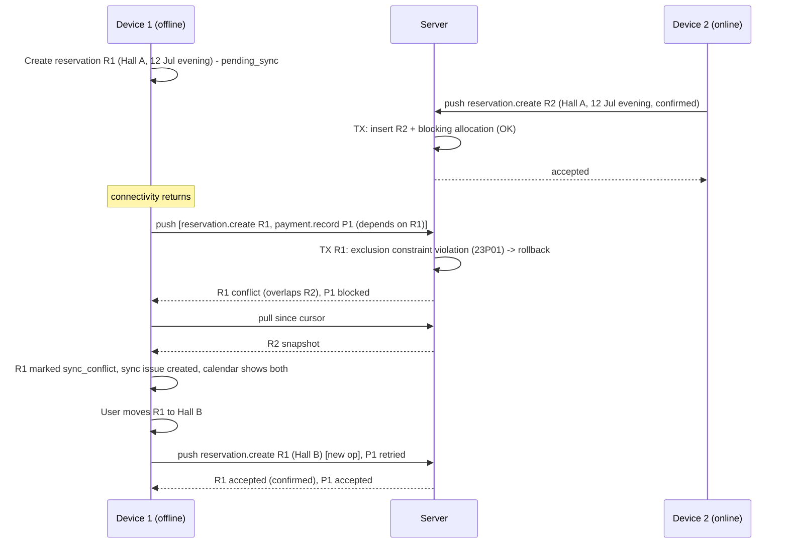

> [!NOTE]
> In the conflicting attempt the local reservation was never created on the server, so the corrected attempt is a **new `create` op** for the same `entity_id` with new allocations. The original op stays recorded as `conflict` for traceability.

### 11.17 Deliberately not included

- **CRDTs / automatic merge of everything.** The core invariants (no overlaps, valid transitions, immutable money) need authoritative validation, not convergence.
- **Real-time push (WebSockets).** Polling every ~60 s is enough for booking requests that wait for a human decision. WebSockets (e.g. Laravel Reverb) would add a long-running service. Revisit if owners need instant alerts and the polling cost becomes significant.
- **Peer-to-peer / LAN sync** (PRD §3 says it is not required).
- **Third-party sync engines** (ADR-005).

---

## 12. Reservation lifecycle and concurrency control

### 12.1 Mapping PRD states to the model

| PRD state | Model | Where it lives |
|---|---|---|
| `pending_owner_approval` | `booking_requests.status = pending_owner_approval` | Server (pulled to Connect devices) |
| `pending_sync` | **Client-side overlay**: a reservation whose latest command op is not yet accepted by the server | Owner app only. Never stored as a server status. |
| `confirmed` | `reservations.status = confirmed`, committed by the server (Connect) or locally (Local) | Both |
| Rejected | `booking_requests.status = rejected` (owner or auto) | Server |
| Cancelled | `reservations.status = cancelled`. Requests have `withdrawn` (by customer) and `expired`. | Both |
| *(proposed)* `tentative` | Owner-created option/hold, blocking (Q-04) | Both |
| *(client overlay)* `sync_conflict` | Server returned a conflict for the latest command | Owner app only |

**Why requests and reservations are separate entities [RECOMMENDATION, ADR-011]:** requests contain unverified customer data from the public internet, follow a different lifecycle, and must not pollute the owner's customer list, calendar, or financial reports. Approval creates a reservation (and a customer, after duplicate detection) **in the same transaction**. The request keeps `reservation_id` for traceability.

### 12.2 Reservation state machine (server-authoritative in Connect)

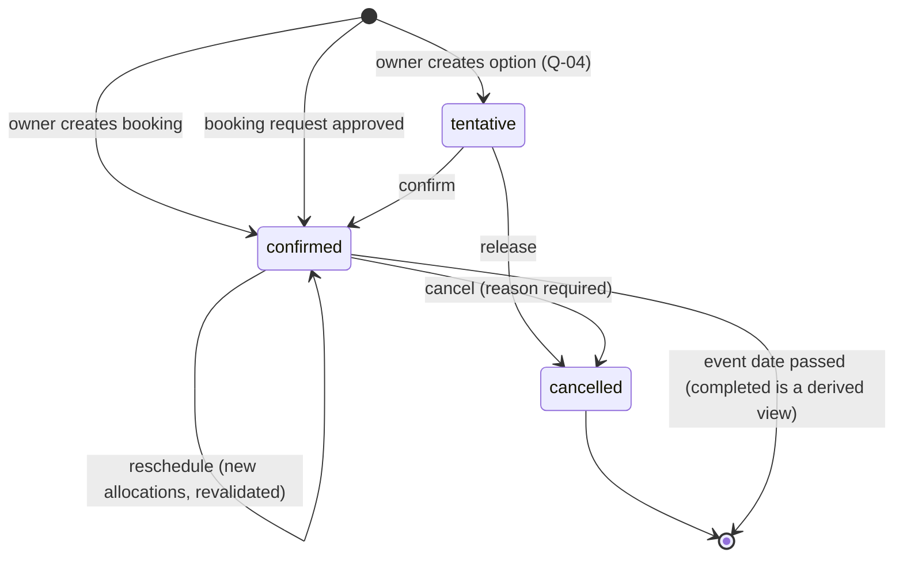

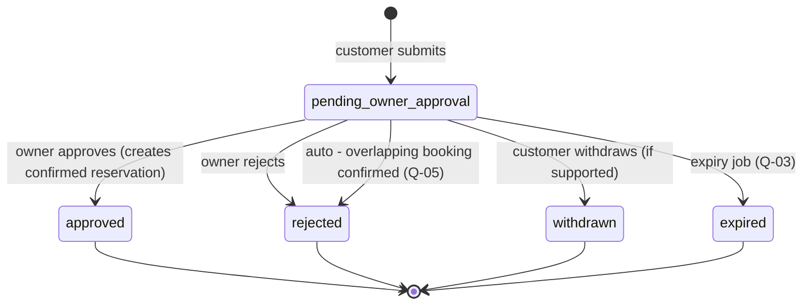

`completed` is derived (`status = confirmed AND period end < now`) rather than stored, which avoids a scheduled mass update and an extra sync source. Whether reopening a cancelled reservation should be allowed is Q-07. The provisional default is no: create a new reservation instead.

### 12.3 Blocking matrix

| Status | Blocks the hall period? | Shown on public availability? |
|---|---|---|
| `confirmed` | **Yes** | As "unavailable" |
| `tentative` (if adopted) | **Yes** (provisional, Q-04) | As "unavailable" |
| Availability block | **Yes** | As "unavailable" |
| `pending_owner_approval` request | **No** (provisional, Q-01) | Not shown (never reveal pending demand) |
| `cancelled`, `rejected`, `expired`, `withdrawn` | No | — |
| Client `pending_sync` | Locally yes (local trigger); on the server only once accepted | — |

### 12.4 Transitions, actors, and permissions

| Command | From | To | Actor / permission | Server checks |
|---|---|---|---|---|
| `reservation.create` | — | `confirmed` or `tentative` | member with `reservations.create` (+ `reservations.confirm` for confirmed) | venue/hall in scope, slot valid, customer exists in org, **exclusion constraint** |
| `reservation.confirm` | `tentative` | `confirmed` | `reservations.confirm` | still tentative, allocation blocking remains valid |
| `reservation.reschedule` | `confirmed`/`tentative` | same | `reservations.reschedule` | `base_version == current`, new allocations pass the exclusion constraint (old ones released atomically in the same transaction) |
| `reservation.cancel` | `confirmed`/`tentative` | `cancelled` | `reservations.cancel` | reason required. Allocations → non-blocking. Cancelling an already cancelled reservation = accepted no-op. |
| `booking_request.approve` | `pending_owner_approval` | `approved` (+ reservation `confirmed`) | `booking_requests.respond` + `reservations.confirm` | request still pending and not expired; subscription active; exclusion constraint |
| `booking_request.reject` | `pending_owner_approval` | `rejected` | `booking_requests.respond` | still pending. Reason code from a list + optional message. |
| expire (system) | `pending_owner_approval` | `expired` | scheduler | `expires_at < now` |

Every transition writes `reservation_status_history` (or `booking_request_events`) with actor, reason, `op_id`, and timestamp, in the same transaction.

### 12.5 Preventing double bookings — server implementation

**Primary mechanism:** the PostgreSQL exclusion constraint (§9.5a) on `hall_allocations` for blocking rows. Application pre-checks exist only to produce friendly messages. **Correctness never depends on them.**

```php
// Illustrative — ConfirmBookingRequest Action (inside the sync op transaction)
DB::transaction(function () use ($ctx, $requestId, $decision) {
    $request = BookingRequest::forTenant($ctx)->lockForUpdate()->findOrFail($requestId);
    $this->policy->authorize($ctx, 'booking_requests.respond', $request->venue_id);
    $request->assertPending();                       // else DomainConflict('request_not_pending')
    $customer = $this->customers->findOrCreateFromRequest($ctx, $request); // advisory dedupe
    $reservation = Reservation::create([... 'status' => 'confirmed', 'source' => 'marketplace']);
    try {
        HallAllocation::create([... 'period' => $period, 'is_blocking' => true]);
    } catch (QueryException $e) {
        if ($e->getCode() === '23P01') {             // exclusion_violation
            throw new DomainConflict('reservation.overlap', $this->conflictsFor($period));
        }
        throw $e;
    }
    $request->markApproved($reservation, $ctx->member);
    $this->history->record(...);
    $this->feed->record($ctx->org, [$request, $reservation, $customer]);
    // after commit: notify customer, auto-reject overlapping pending requests (Q-05)
});
```

Because an exclusion-constraint violation aborts the transaction, the conflict result is recorded in a follow-up transaction (§11.5).

### 12.6 Concurrency scenarios

| # | Scenario | Outcome |
|---|---|---|
| 1 | Two customers request the same hall/date | Both `pending_owner_approval`. The owner inbox groups them ("2 requests for 12 Jul, Hall A"). |
| 2 | Owner approves on device 1 while an employee confirms a walk-in on device 2 (both online) | Exclusion constraint: the first commit wins. The second receives `conflict` immediately. |
| 3 | Offline device creates a confirmed booking; meanwhile the slot is confirmed online | On sync, `conflict`. A sync issue appears with resolution options (§11.10). **The online confirmed booking is never overwritten.** |
| 4 | Network retry of an approval | Same `op_id` → stored result returned. No duplicate reservation. |
| 5 | Customer double-submits the form | Same form `idempotency_key` → one request. The second submit shows the same confirmation page. |
| 6 | Owner approves a request that has just expired or been withdrawn | `conflict (request_not_pending)`. The owner can create a reservation directly if the customer still wants it. |
| 7 | Two devices cancel the same reservation | First → cancelled. Second → accepted no-op (idempotent transition). |
| 8 | Device reschedules offline; another device edited the same reservation's date meanwhile | `base_version` mismatch → conflict. Neither change is lost (the server keeps one; the other becomes an issue). |
| 9 | Tentative hold being confirmed while an owner on another device cancels it | Row lock serializes the two. The second gets `invalid_transition` conflict. |
| 10 | Subscription lapses with ops in the outbox | Business ops for an org with a Local licence: accepted until the restriction date, then `subscription_inactive` (§14.7). Ops are never discarded silently. |
| 11 | Local mode (single device) | SQLite `BEGIN IMMEDIATE` + trigger. Overlap is impossible without bypassing the app. |

### 12.7 Offline reservations in Connect

- Offline-created or offline-modified reservations are shown as **"Confirmed — awaiting sync"** (amber), distinct from server-confirmed (green). Contracts and receipts printed while `pending_sync` show a configurable notice (Q-06).
- **Practical risk depends on topology (A-06):** with one device and online requests only approvable from the app, offline conflicts can only come from that same device's own sequencing. Conflicts appear only when several devices or employees write concurrently. The UI can show "Last synced: 3 h ago" to inform the owner's confidence.
- Approving an online request while offline is allowed as a queued intent (`pending_sync`). **The customer is notified only after the server commits.**

### 12.8 Public availability rules

- A date shows as **available** only if the listing has `show_availability = true`, the organization's last successful sync is within a freshness window (proposed 48 h), and no blocking allocation exists for at least one hall that matches the search's capacity. Otherwise it shows **"Availability on request"**. This addresses PRD §6, "where reliable data is available".
- Availability is shown per date (and per slot if configured), never with booking details.

### 12.9 Unresolved booking rules (must be decided — §23)

Q-01 holds for pending requests · Q-02 booking granularity (day vs sessions) · Q-03 request expiry · Q-04 tentative/option holds · Q-05 auto-reject on approval · Q-06 offline confirmation wording · Q-07 reopening cancelled reservations · Q-13 cancellation/refund policy recording · Q-14 whole-venue bookings · Q-16 minimum notice and maximum horizon for requests.

---

## 13. Local-to-Connect migration

### 13.1 Goals and design choices

- **Preserve:** venues, halls, slots, customers, reservations with full status history, allocations, items, financial transactions (including voided entries and reversals), expenses, documents and their files, templates, receipt series, local members (as unlinked members), and the change journal (as an archived attachment for support).
- **Keep the original UUIDs.** Because M1 generates UUIDv7 IDs and uses the server's column conventions, almost all records are copied 1:1. Identity mapping is needed only in the exceptional cases listed in §13.5.
- **Snapshot, not journal replay:** the migration uploads current state plus history tables. Replaying a multi-year journal through sync handlers would be slower, more fragile, and would reject legitimate historical states (for example, past reservations that would fail "date in future" validation).
- **Stage → validate → commit:** nothing reaches live tables until the full dataset has been uploaded and validated. **The local database is not modified until the server confirms the commit.**

### 13.2 Flow

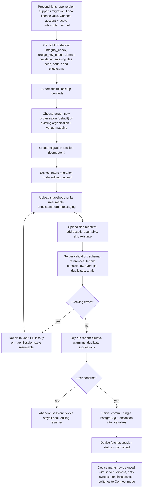

### 13.3 Steps in detail

1. **Pre-flight (device):** `PRAGMA integrity_check` and `foreign_key_check`. Domain checks: overlapping blocking allocations (should not exist; reported if they do), negative or zero amounts, orphaned documents, missing document files. Produces a manifest `{entity_type: {count, checksum_of_sorted(id,local_rev)}}`.
2. **Backup:** a full backup (DB + files) is created and verified (re-opened, integrity-checked) before continuing.
3. **Session:** `POST /migrations` with `{license_id, device_id, manifest, target}` → `session_id`. The call is idempotent per `(license_id, device_id)` while a session is open. One active migration per licence.
4. **Editing pause:** to avoid snapshot drift, the app enters **migration mode** (read-only with a progress screen). The expected duration is minutes for typical volumes (A-05). The user can cancel, which returns the app to Local with no side effects.
5. **Chunk upload:** records are serialized per entity type in dependency order, in chunks of about 500 records. `PUT /migrations/{id}/chunks/{n}` with `sha256`. Re-sending the same chunk number with the same hash is a no-op. A different hash for an already-received chunk is rejected. Staging: `migration_staging_records(session_id, entity_type, entity_id, payload jsonb, chunk_no)`.
6. **File upload:** the same resumable upload API as sync (§11.13), tagged with the session. Missing local files are allowed but listed as warnings ("document metadata kept, file missing").
7. **Validation (server, idempotent, re-runnable):**
   - JSON Schema per entity.
   - Referential integrity inside the staged set, plus against existing org data when merging.
   - Every `organization_id` in staging is rewritten to the target org. **The client-supplied org ID is never trusted.**
   - ID collisions with any existing row (any org) → blocking error (practically impossible with UUIDv7, but checked).
   - Overlap simulation for blocking allocations (against existing org allocations when merging).
   - Financial reconciliation: the server recomputes per-reservation balances and totals and compares them with the device-provided summary in the manifest. A mismatch is a blocking error, because it indicates a serialization bug.
   - Counts and checksums are compared with the manifest.
8. **Dry-run report:** shown in the app, with counts per entity, warnings, and duplicate suggestions.
9. **Commit:** one PostgreSQL transaction inserts all staged records into live tables in dependency order (preserving IDs, `created_at`, history, and `source = 'migration'`). It sets `version = 1` for each row, writes one `sync_changes` entry per record (or sets a bootstrap marker), records the device as linked with series prefix `A` preserved, sets the session to `committed`, and writes an audit log entry. At A-05 volumes a single transaction is fine. If volumes grow, commit in per-entity batches under a session-level advisory lock with idempotent `INSERT … ON CONFLICT (id) DO NOTHING`.
10. **Finalize (device):** `GET /migrations/{id}` → `committed` with a `{entity_id: version}` map (or "all = 1") and the initial `cursor`. In one SQLite transaction, the device sets `server_version`, `sync_state = synced`, the cursor, the link state, and the device ID. Editing resumes in Connect mode.

### 13.4 Failure and recovery matrix

| Failure point | State | Recovery |
|---|---|---|
| Before session creation | Nothing on server | Retry. App stays Local. |
| During chunk/file upload (crash, network) | Partial staging | Resume: the server reports received chunks and files. The device sends the rest. |
| Validation errors | Staging intact, not committed | Fix locally (the app guides the user), then re-upload affected chunks. Or abandon. |
| User abandons, or session idle > 7 days | Staging purged by job | Device remains Local. A new session can be started later. |
| Commit transaction fails | Rolled back atomically | Session stays `validated`. Retry commit. |
| Commit succeeded but response lost | Server `committed`, device unaware | Device polls session status → finalizes. Commit is idempotent (`committed` session returns the same result). |
| Device crashes during finalize | Server committed; local finalize transaction rolled back | On restart, the device sees an open session in local state → queries the server → re-runs finalize. |
| Device lost before finalize | Server committed | Install on a new device → log in → bootstrap from the server (data is already central). |
| Bug discovered after commit | Data live | Admin "rollback migration" tool (M2): deletes all rows with `source='migration'` for that session **only if** no subsequent changes reference them; otherwise a manual correction runbook. The local backup from step 2 is always available. |

### 13.5 Identity mapping and duplicates

| Case | Handling |
|---|---|
| New organization (default) | No mapping. UUIDs preserved. |
| Merge into an existing Connect org (the owner already created an org/venue online, or is consolidating two Local installs) | The wizard asks the user to map each local venue to an existing server venue or "create new", and each local hall to a server hall or "create new". `migration_id_map(session_id, entity_type, local_id, server_id)` drives FK rewriting **in staging**. Unmapped entities keep their UUIDs. |
| Local members (owner profile, any local profiles) | Imported as `organization_members` with `user_id = NULL` and the same UUIDs. The migrating user's member row is linked to their account. Others can be linked to invited users later. History attribution is preserved. |
| Customers duplicated within local data, or against an existing org | **Never auto-merged.** Duplicates (same normalized phone, similar name by trigram) are reported as suggestions. Merging is a later explicit owner action (`customer.merge` command re-points reservations and keeps a merge record). |
| Reference data | Codes (wilaya, amenity) map directly. Unknown codes → warning and kept as free text. |
| Two Local licences/devices into one org | Supported sequentially through merge mode. Series prefixes stay distinct (A, B), so receipt numbers do not collide. Overlapping allocations between the two datasets → blocking validation errors that the owner must resolve. |

### 13.6 Post-migration

- The local DB keeps all data and the pre-migration backup is retained. The Local licence remains valid (the device can fall back to Local if Connect lapses, §14.7).
- The licence record is linked to the organization (`organizations.license_id`) for support and entitlement purposes.

---

## 14. Licensing and subscriptions

### 14.1 Products and entitlements

| Product | Commercial model | Entitles |
|---|---|---|
| **Local licence** (perpetual) | One-time purchase **[REQ]** | Perpetual use of any app build released on or before `maintenance_until`. Local features. N activations (default 1 device, Q-18). |
| **Local maintenance** (optional) | Paid periods **[REQ]** | Extends `maintenance_until` (updates + support) |
| **Connect subscription** | Monthly/annual **[REQ]** (pricing open) | Sync, multi-device, employees, listing, booking requests, notifications. Always includes updates (needed for protocol compatibility). |

### 14.2 Licence artifacts (offline-verifiable)

| Artifact | Contents | Where |
|---|---|---|
| **Licence key** | Human-enterable `WLM-XXXXX-XXXXX-XXXXX-XXXXX` (≥ 100 bits of randomness + checksum) | Given to the buyer. Stored **hashed** on the server. |
| **Licence certificate** | `{license_id, edition, licensee_name, issued_at, maintenance_until, max_activations, features, key_id}` + Ed25519 signature | `.walimlic` file / downloadable. Embedded in the activation. |
| **Activation certificate** | `{activation_id, license_id, device_fingerprint_hash, activated_at, license_certificate_digest, key_id}` + signature | Stored in the app data directory **and** in the DB `license_state` |

- **Signature scheme:** Ed25519 over canonical JSON (sorted keys, no whitespace), encoded base64url. The app embeds a **key ring** of public keys by `key_id`, which allows key rotation without invalidating old licences.
- **Maintenance renewal** issues a **new licence certificate** with a later `maintenance_until`, delivered online or as a file. The existing activation remains valid because it references the licence ID. Certificate digest checks accept newer certificates for the same licence.
- **Private signing key:** held only on the backend host (M2) or the staff workstation running the licence CLI (M1). It is encrypted at rest, file permissions are restricted, it is backed up offline in two places, and a rotation runbook exists. **Loss of the key prevents issuing new licences but does not break existing ones** (P5).

### 14.3 Activation flows

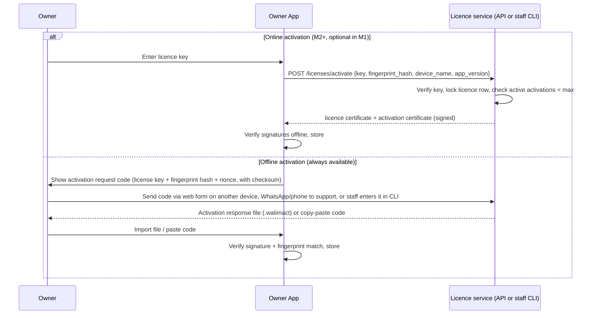

**Fingerprint:** a salted SHA-256 of the Windows `MachineGuid` (and optionally the system-volume serial). It is stable across normal hardware changes, but it changes on an OS reinstall. It is never sent unhashed.

### 14.4 Entitlement evaluation (client, offline)

```
license_ok   = signature_valid(license_cert) AND signature_valid(activation_cert)
               AND activation.license_id == license.id AND license.status_known != revoked
device_ok    = activation.fingerprint_hash == current_fingerprint_hash
build_ok     = app.release_date <= license.maintenance_until        -- not the wall clock
               OR app.release_date <= previous_installed_entitled_release_date  (rollback allowed)

mode:
  license_ok AND device_ok AND build_ok          → FULL (Local features)
  license_ok AND device_ok AND NOT build_ok      → this build not covered: refuse DB migration,
                                                   offer to reinstall last entitled version
                                                   (installer kept in %LOCALAPPDATA%\WalimApp\installers)
                                                   or renew maintenance. Data untouched.
  license_ok AND NOT device_ok                   → REACTIVATION_GRACE (14 days full use), then
                                                   RESTRICTED_EDITING (view/print/export/backup)
  no licence (fresh install)                     → TRIAL (Q-19) then RESTRICTED_EDITING
  invalid signature (tampering)                  → RESTRICTED_EDITING
```

**Key properties:**

- **No dependency on the system clock** for perpetual use: maintenance expiry only affects *which builds* are entitled, so setting the clock back gains nothing and a wrong clock breaks nothing.
- **Worst case is restricted editing, never data loss or a data lock-out:** viewing, searching, printing, exporting (CSV/PDF), and backing up always work.
- **Revocation** (refund, fraud) only takes effect when the app is online, or when a new build checks a revocation list that is embedded at release time. Perpetual offline installs cannot be revoked remotely. This is accepted.

### 14.5 Updates and maintenance

- Release channel: a signed update manifest (`/app/releases`) lists versions, release dates, minimum schema versions, installer URLs, and SHA-256 hashes. The app checks it **only if online and enabled by the user**. Offline users receive installers by file.
- **Before installing or running a new build**, the app evaluates `build_ok`. If the build is not entitled, it **does not migrate the DB** and explains the options. This prevents the "upgraded schema, can't go back" trap (§11.12).
- Old installers for entitled versions remain downloadable from the customer's licence page.
- **Local → Connect upgrade:** handled by migration (§13). The Local licence is retained.
- **Future upgrades** (e.g. a "Local Pro" edition or a multi-device Local): represented as `features` in the licence certificate, so no new mechanism is needed.

### 14.6 Capabilities by state

| Capability | Local FULL | Local restricted | Connect active | Connect grace | Connect restricted (with Local licence) | Connect restricted (no Local licence) |
|---|---|---|---|---|---|---|
| View / search / print / export / backup | ✓ | ✓ | ✓ | ✓ | ✓ | ✓ |
| Create/edit local business data | ✓ | ✗ | ✓ | ✓ | ✓ (queued in outbox) | ✗ |
| Sync push | — | — | ✓ | ✓ | ✗ (`subscription_inactive`) | ✗ |
| Sync pull | — | — | ✓ | ✓ | ✓ (90 days, final state) | ✓ (90 days) |
| Public listing visible | — | — | ✓ | ✓ | ✗ (hidden, "temporarily unavailable" or 404 — Q-23) | ✗ |
| Accept new booking requests | — | — | ✓ | ✓ | ✗ | ✗ |
| Respond to existing pending requests | — | — | ✓ | ✓ | ✗ (requests auto-expire, customers notified) | ✗ |
| Server-side data export request | — | — | ✓ | ✓ | ✓ until deletion | ✓ until deletion |

### 14.7 Connect subscription lifecycle

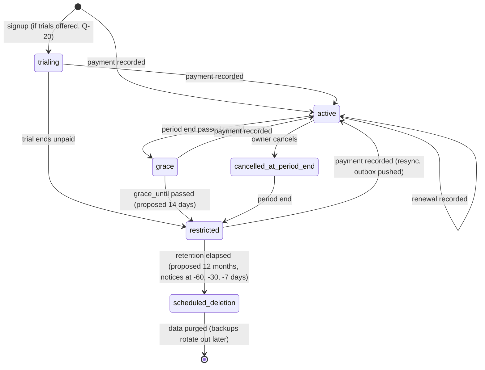

- State transitions are run by a scheduled job (hourly) and by payment recording in the admin panel. Every transition is audited and triggers a notification to the owner (in-app via sync, plus email/SMS).
- **Entitlement checks are server-side:** listing visibility is computed at render (`listing.published AND org.entitlement('marketplace')`), booking-request submission checks entitlement, and sync push checks entitlement. The client's cached entitlement (with `valid_until`) is only for the UI.
- **Reactivation:** outbox ops accumulated during restriction are pushed on resumption. Conflicts follow the normal process.

### 14.8 Payments

- **M2:** manual recording by staff (`subscription_payments`: amount, method, reference, received_at, recorded_by), audited. Optional proforma/receipt PDF generated server-side.
- **Later:** an online payment gateway supporting Algerian cards (CIB/Edahabia) or mobile payment, behind a `PaymentProvider` interface with webhook idempotency. Provider selection is an open question (Q-24). It is not on the critical path.

### 14.9 Device replacement and licence recovery

| Situation | Flow |
|---|---|
| Planned replacement (old PC available) | Old app: "Deactivate this device" (online or offline deactivation code). Then activate the new PC. Data moves via backup/restore (§18.7). |
| Old PC dead/stolen | Self-service: N transfers per year through the licence portal or online activation (it auto-deactivates the oldest activation if the self-service quota allows, Q-18). Beyond the quota: support verifies identity (purchase record, phone) and an admin revokes the old activation (audited). |
| OS reinstall on same PC | The fingerprint changed → 14-day grace → reactivation (counts as a transfer only if the quota is configured that way). |
| Lost licence key | Licence portal lookup by verified phone/email of the purchaser, or support reissue (key shown once, audited). |
| Lost data and licence | The licence is recoverable as above. **Data is recoverable only from the owner's backups** in Local mode. The product must push owners strongly to keep external backups (§18.7). |

### 14.10 Tamper resistance — explicit stance

Client-side licensing on a PC the user controls **can be bypassed** by a determined attacker (binary patching). The goal is to keep honest customers honest with minimal friction, **not** DRM. No obfuscation arms race, no kernel-level checks, no online heartbeat requirement for Local. Connect is naturally protected because its value is server-side.

### 14.11 Admin operations (audited)

Issue licence · Extend maintenance · Revoke licence or activation · Reset activation quota · Reissue key · Record subscription payment · Change plan · Extend grace · Force-restrict or restore · Export org data · Schedule or cancel deletion. Each requires a specific admin permission (§10.4) and writes an audit entry with a reason.

---

## 15. Public marketplace and SEO

### 15.1 Architecture

- `Marketplace` module inside the Laravel monolith: controllers, Blade views, Livewire components (search filters, booking form, provider filters), query objects that read **only** `listings`, `listing_media`, published venue facts (halls' capacities, amenities, wilaya/commune), and availability derived from `hall_allocations`.
- **No customer accounts in M3** (A-09). All pages are cacheable for anonymous visitors, except the booking form submission.
- Caching: HTTP caching headers for public pages (short TTL, e.g. 5 minutes) and a CDN in front if available. Application-level caching of expensive query fragments uses the database cache store. Availability widgets are rendered via a small uncached endpoint or Livewire component, so that cached pages never show stale availability.

### 15.2 Pages

| Page | Content | Notes |
|---|---|---|
| Home | Search box (wilaya, date, guests), featured/sponsored venues, provider categories | Sponsored blocks collapse if empty (§15.7) |
| Wilaya landing (`/salles/{wilaya}`) | Venue list for the wilaya, intro text, filters | Main SEO entry pages |
| Search results (`/recherche`) | Filters: wilaya, commune, date, guests (capacity), price range, amenities/services | `noindex`. Canonical to the wilaya page. |
| Venue profile | Name, description, photos (gallery), halls and capacities, amenities, price from, location (map link), contact buttons (call, WhatsApp), availability calendar (if reliable), booking request form, tour (M4) | JSON-LD, OG tags |
| Provider directory | Categories → wilaya → provider profile | Curated in M3 |
| Static | About, terms, privacy policy (AR/FR), contact, "for venue owners" (sales funnel for Local/Connect) | — |

### 15.3 Search implementation

```sql
-- Illustrative: venues in wilaya W with a hall that fits N guests and is free on date D
SELECT v.id
FROM listings l
JOIN venues v ON v.id = l.venue_id
WHERE l.status = 'published' AND v.wilaya_code = :w
  AND EXISTS (
      SELECT 1 FROM halls h
      WHERE h.venue_id = v.id AND h.is_active AND h.capacity_seated >= :n
        AND NOT EXISTS (
            SELECT 1 FROM hall_allocations a
            WHERE a.hall_id = h.id AND a.is_blocking
              AND a.period && tstzrange(:day_start, :day_end, '[)')))
  AND (:price_max IS NULL OR l.price_from_minor <= :price_max)
ORDER BY <ranking>
LIMIT 20 OFFSET …;    -- offset is acceptable here (bounded public lists), not for sync
```

The entitlement filter (`org has active Connect`) and the availability freshness rule (§12.8) are applied in the same query, using a maintained `organizations.marketplace_visible` flag updated on subscription transitions plus `last_sync_at`.

**Ranking (initial):** sponsored slots (labelled, maximum 2 per page, must match the active filters), then organic ordering by profile completeness, photo count, and freshness. **The ranking must be documented publicly**, and sponsored placement must never be disguised as organic (PRD §6).

### 15.4 Booking request form

Fields: date (and slot if configured), guest count, name, phone (required), email (optional), message, consent checkbox for data processing (privacy notice link). Hidden: idempotency key (UUID generated per form render), honeypot. Server checks: listing visible, entitlement, date within allowed horizon (Q-16), rate limits (§10.7), phone normalized and valid Algerian/international number. The response page says clearly: **"This is a request, not a confirmation. The venue will contact you."** It does not reveal whether the date is "really" free beyond the public availability display.

Optional, per Q-09: SMS OTP verification before the request is delivered to the owner.

### 15.5 Localization and RTL on the web

- Locale prefix `/ar`, `/fr`. `<html lang="ar" dir="rtl">` and `<html lang="fr" dir="ltr">`.
- Tailwind logical utilities (`ms-*`, `me-*`, `ps-*`, `text-start`) and `rtl:` variants. Icons that imply direction are mirrored.
- Content translations: JSONB `*_i18n` columns (`{"ar": "...", "fr": "..."}`) for owner/admin-authored content, with a fallback to the other language if one is missing (shown with `lang` attributes so screen readers and search engines handle it correctly).
- UI strings in Laravel `lang/ar`, `lang/fr`. A language switcher keeps the same page.
- Fonts: a performant Arabic web font (self-hosted, subset) plus the Latin font. `font-display: swap`.

### 15.6 Technical SEO checklist

- Server-rendered HTML for all indexable content. No client-side-only rendering of key text.
- `hreflang` (`ar-DZ`, `fr-DZ`, `x-default`) and self-referencing canonicals.
- Clean slugs: Latin transliteration for both locales (Q-27 for Arabic-script slugs).
- XML sitemaps (index + per-type: wilaya pages, venues, providers), regenerated by a scheduled job and on publication changes.
- JSON-LD: `LocalBusiness`/`EventVenue` for venues (name, address, geo, image, priceRange, maximumAttendeeCapacity), `BreadcrumbList`, `Organization` for the site. **No fake review markup.**
- Open Graph / Twitter cards with processed images (important for WhatsApp/Facebook sharing in Algeria).
- Performance budget: LCP < 2.5 s on mid-range Android over 4G. Responsive `srcset` WebP/AVIF images, lazy-loaded gallery, minimal JS.
- `noindex` for search results with arbitrary filter combinations, the booking form result, and unpublished or suspended listings (410/404 for removed listings with a redirect to the wilaya page where appropriate).
- Sponsored links use `rel="sponsored"`.

### 15.7 Provider directory and advertising

- **Providers (M3, curated):** `provider_categories` (i18n names, slug, icon), `providers` (name, category, wilaya, service areas, description i18n, photos, phone, WhatsApp, social links, status `draft|published|hidden`). Admin CRUD in Filament. **Self-registration/editing (M4)** adds provider user accounts (a separate `provider` member type or org type) and a moderation workflow. The data model already allows `providers.organization_id` to be nullable for later claiming.
- **Advertising:**
  - `ad_placements` are code-defined slots (`home_featured`, `wilaya_top`, `search_inline`, `venue_sidebar_banner`, `provider_category_top`) with type (`featured_listing` | `banner`), dimensions, maximum concurrent campaigns, and a **fallback policy** (`collapse` | `house_content` | `organic_featured`).
  - `ad_campaigns`: advertiser, placement, target (provider, venue, or external URL), creative file (banner), targeting (wilaya list, category), `starts_at`/`ends_at`, `price_minor`, `payment_status`, `status` (`draft → scheduled → active → paused → ended | cancelled`), approved_by (admin), audit.
  - Rendering: a `PlacementResolver` returns active campaigns for the slot and context. **If none, the slot either collapses or renders the fallback, so no empty ad block is ever shown** (PRD §6). Each sponsored item carries a visible "Sponsorisé / إعلان" label.
  - Measurement (M3 basic): daily aggregated impressions and clicks per campaign (`ad_daily_stats`, upsert counters; clicks via `/go/{campaign}` redirect). No per-user tracking and no third-party ad scripts. Google Ads is not required (PRD §6).

---

## 16. Media storage and virtual tours

### 16.1 Storage classes

| Class | Examples | Storage | Access | Delivery |
|---|---|---|---|---|
| **Private tenant documents** | Contracts, receipts, ID copies, expense attachments | `private` disk, key `org/{org_id}/files/{sha256}` | Policy check → short-lived signed URL (≤ 5 min) or streamed through the app | Never via CDN. `Content-Disposition: attachment`. |
| **Unpublished uploads** | New listing photos, panoramas pending review | `private` disk, `org/{org_id}/incoming/…` | Owner and moderators only | Signed URLs for previews |
| **Published public media** | Processed listing photos, provider photos, banner creatives, tour tiles | `public_media` disk, content-hashed immutable paths `m/{hash}/{variant}.webp` | Public | CDN with long cache (`immutable`, 1 year) |
| **Local documents (device)** | All documents in Local/Connect | `%LOCALAPPDATA%\WalimApp\files\{sha256[0:2]}\{sha256}` | App only | — |

### 16.2 Upload and processing pipeline

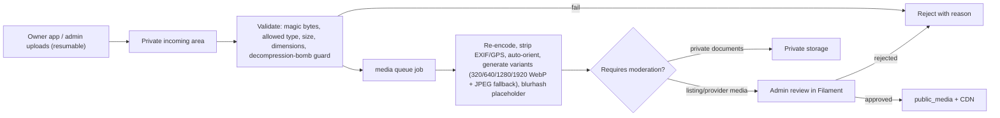

### 16.3 Validation rules (initial)

| Type | Allowed formats | Max size | Other |
|---|---|---|---|
| Listing/provider photos | JPEG, PNG, WebP (HEIC only if a decoder is available server-side) | 15 MB | Min 1200 px long edge (recommended), max 50 MP |
| Banner creatives | JPEG, PNG, WebP | 5 MB | Exact placement dimensions or aspect ratio |
| Documents | PDF, JPEG, PNG | 20 MB | PDFs are stored as-is but never rendered inline. Served as attachments. |
| Panoramas (M4) | JPEG equirectangular, 2:1 aspect | 40 MB | Recommended ≤ 8192×4096 |

**Never accepted:** SVG, HTML, executables, archives. Images are **re-encoded**, which neutralizes polyglot files and strips metadata (including GPS location from phone photos). Antivirus scanning of documents (e.g. ClamAV) is optional, decided by ops capacity (Q-34).

**Processing library:** Intervention Image with Imagick or GD for photos (M3). For large panoramas (M4) add **libvips** (CLI or PHP-FFI), which uses much less memory than Imagick on 8K images. The `media` queue runs with a memory limit and one concurrent job to protect the single VM.

### 16.4 Virtual tours (M4 — not a dependency of the first marketplace release)

- **Data model:** `virtual_tours (venue_id, status draft|submitted|published|rejected, version)`, `tour_scenes (tour_id, name_i18n, panorama_file_id, initial_yaw, initial_pitch, sort)`, `tour_hotspots (scene_id, target_scene_id, yaw, pitch, label_i18n)`. Publishing a tour snapshots its version, so later edits do not alter the published tour until they are re-approved.
- **Owner flow (Connect app or web owner area):** upload panoramas → name scenes → place hotspots in a preview viewer → submit → admin review → publish.
- **Processing:** validate the 2:1 ratio and size → generate a preview (2048×1024) and a viewer image (4096×2048), and later multi-resolution cube tiles if performance needs it → thumbnails per scene.
- **Viewer:** an open-source WebGL panorama viewer library (candidates: Pannellum, Marzipano, Photo Sphere Viewer — licence review per A-14), lazy-loaded only on the tour tab so it does not affect page performance.
- **Flutter in-app preview:** embedding a WebView on Windows (WebView2) to reuse the same web viewer avoids building a native viewer. M0/M4 spike.

### 16.5 Backup of media

The object storage or disk is replicated or backed up off-site (§18.6). Public variants can be regenerated from originals, so **originals are the only must-backup media**.
