# WalimApp — Architecture

| | |
|---|---|
| **Document status** | Draft v0.1 — for product-owner review. **Not approved.** No implementation should start until this is reviewed. |
| **Date** | 2026-10-27 |
| **Primary source** | `product-requirements.md` (initial draft for architecture design) |
| **Scope** | Whole-product architecture, with Milestone 1 (Local MVP) specified in the most detail |
| **Nothing in this document has been validated by implementation, load testing, security review, or legal review.** |

**How to read this document.** Every statement that matters is tagged so you can tell where it came from:

| Tag | Meaning |
|---|---|
| **[PRD]** | A requirement stated in `product-requirements.md` or the architecture brief. |
| **[ASSUMPTION]** | Something this document assumes to be true. Needs confirmation. IDs `A-nn`. |
| **[REC]** | A recommendation by the architect. A proposal, not an approved decision. |
| **[OPEN]** | A business or technical decision that cannot be made correctly without more input. IDs `OD-nn` (full list in §23). |

---

## 1. Executive summary

WalimApp is four products on one domain: an offline-first owner application (**Local**, then **Connect**), a public marketplace, and an internal super-admin. The hard problems are not the web pages; they are (1) never losing or corrupting an owner's data, (2) never double-booking a hall, and (3) making a standalone single-PC product upgradeable to a synchronized, multi-device, online product without a data migration cliff.

**Verdict on the proposed stack.** The preferred stack (Laravel, PostgreSQL, Filament, Flutter, SQLite) fits the requirements and a solo developer. **[REC] Keep it.** I recommend no replacement. The recommendations below refine how it is used.

**Key recommendations**

1. **One Flutter codebase, one SQLite schema, two editions.** Local and Connect are the same app; Connect is Local plus an entitlement-gated sync layer. Upgrading is "turn sync on", not "import into a different product".
2. **Sync-ready data model from Milestone 1.** Client-generated **UUIDv7** primary keys, server-style row versions, soft-delete tombstones, integer money, calendar-date semantics, and an append-only financial ledger — all in Local MVP. This is the single most important early foundation: it makes Local→Connect migration an *identity-preserving upload* rather than a re-keying exercise (§13).
3. **Central PostgreSQL is the authority for online bookings**, enforced by a **database exclusion constraint** on confirmed reservations (`btree_gist`), not by application checks alone (§12).
4. **Separate `booking_requests` from `reservations`.** A customer request is not a reservation. Approval is the transaction that creates a confirmed reservation. This removes most hold/overlap ambiguity from the core table (§8, §12).
5. **`pending_sync` is a client-side overlay, not a server state.** The PRD lists it among booking states; I recommend deriving it from the local operation queue rather than storing it on the server. This is a deliberate interpretation of the PRD and is flagged in §3.4.
6. **Custom operation-based sync protocol** (idempotent ops, per-entity conflict policy, per-organization change log) rather than an off-the-shelf sync engine or blanket last-write-wins (§11). Reservations and payments are never last-write-wins.
7. **Modular monolith** in Laravel. No Redis, no Kubernetes, no microservices. Database-backed queue and cache until measured need (§5, §18).
8. **Public marketplace is server-rendered Laravel (Blade) in the same monolith**, not Flutter web and not a separate JavaScript framework (§15).
9. **Licensing is signed offline-verifiable files** (Ed25519) that grant "all builds released on or before the maintenance end date", so lapsed maintenance never disables Local (§14).
10. **Hosting is undecided and gated on a legal question** (Algerian personal-data rules on cross-border transfer). The architecture is hosting-agnostic; §18 gives selection criteria rather than a pick.

**Decisions that most need product-owner input** (details in §23): booking granularity (full day vs. time slots); whether pending requests hold dates; what happens to confirmed online bookings when Connect expires; whether Local data is encrypted at rest; how customers and owners pay (payment rails in Algeria); hosting jurisdiction.

**What is deliberately deferred:** customer accounts and a customer mobile app, provider self-service, advertising analytics, real-time push, virtual tours, local-network sync, online payment gateway, owner web portal.

---

## 2. Product requirements and architectural principles

### 2.1 Requirements digest

Condensed from the PRD. IDs are used throughout this document.

| ID | Requirement | PRD § |
|---|---|---|
| R-01 | Four components: Local, Connect, public marketplace, super-admin. | 1 |
| R-02 | Multiple organizations with strict data separation; owners, employees with restricted permissions, customers, providers, staff. | 2 |
| R-03 | Local: venues/halls, customers, reservations, calendar, deposits/balances/transactions, expenses and reports, contracts/documents, backup/restore, settings. | 3 |
| R-04 | Local works fully offline; data in SQLite; Windows desktop via Flutter first; single device, no LAN sync; no cloud dependency; no online publishing or online requests in Local-only mode. | 3 |
| R-05 | Local is a perpetual license; lapsed maintenance must not disable it or destroy data; offline activation and recovery; future upgrade to Connect without losing records. | 3, 9 |
| R-06 | Connect: Local capabilities plus online venue profile/listing, services and availability, online booking requests, notifications, sync, multi-venue, employee permissions scoped by organization/venue. | 4 |
| R-07 | Central backend is authoritative for shared online state; offline ops queued; sync tolerates retries, duplicates, intermittent connectivity; stable IDs; explicit conflict handling; never blindly overwrite a confirmed reservation; conflicts reported with resolution. | 4 |
| R-08 | Local→Connect migration preserves customers, reservations, financial history, available documents. | 4 |
| R-09 | Booking: customers request venue+date; selecting a date never confirms; pending until owner decides; backend validates and prevents conflicting confirmed bookings; states `pending_owner_approval`, `pending_sync`, `confirmed`, plus rejected/cancelled with history. | 5 |
| R-10 | Hold/expiry/overlap-presentation rules for pending requests must be explicitly identified, not silently assumed. | 5 |
| R-11 | Marketplace: search/filter by Wilaya, date, price, capacity, location, services; venue profiles; availability where reliable; booking requests; WhatsApp contact; provider discovery; mobile-responsive; Arabic/French; SEO. | 6 |
| R-12 | Provider directory curated by staff initially; self-service later. | 6 |
| R-13 | Sponsored listings: featured listings, reserved banners, campaign records, labelled sponsored content, admin-controlled, no ugly empty ad blocks. No Google Ads requirement. | 6 |
| R-14 | Virtual tours (360° panoramas, scenes, hotspots, preview/submit/publish) eventually; must not block first marketplace release. | 7 |
| R-15 | Super-admin: organizations, listings/approval, providers, bookings oversight/support, roles/permissions, campaigns, licenses/subscriptions, reports, config. Sensitive actions permission-controlled and auditable; broad access ≠ unrestricted access. | 8 |
| R-16 | Local: one-time purchase + optional maintenance. Connect: recurring subscription (monthly/annual considered); graceful expiry; data preservation and export; Local data stays available. Pricing not final. | 9 |
| R-17 | Prefer modular monolith; no Kubernetes/Redis/etc. without demonstrated need. | 10 |
| R-18 | Server-side authorization for every protected operation; protect credentials, financial and personal data, uploaded documents; audit sensitive admin actions. | 11 |
| R-19 | Arabic and French; evaluate Algerian personal-data legislation and cross-border transfer before choosing hosting/external providers; define backup, restore, retention, expiry policies. | 11 |
| R-20 | Delivery order: Local MVP → Connect foundation → marketplace → expansion. Local must not depend on the rest. | 12 |

### 2.2 Architectural principles

**[REC]** These are the tie-breakers when requirements pull in different directions.

1. **Data safety beats features.** Any design choice that risks silent data loss or silent overwrite loses to one that doesn't, even if slower to build.
2. **The server is the authority for shared state; the device is the authority for its own unsynced intent.** Local-only mode has no server, so the device is authoritative there.
3. **Sync-ready from day one, sync-active later.** Pay the small cost of stable IDs, versions, tombstones, and immutable ledgers in Milestone 1; do not build the sync engine until Milestone 2.
4. **Explicit over implicit conflict handling.** Conflicts are first-class records the user sees and resolves. No silent merge on bookings or money.
5. **Constraints in the database, not only in code.** Anything that must never happen (double-confirmed booking, cross-tenant reference, negative-side effects on ledger) has a database-level backstop.
6. **Tenant ID on everything, derived from the credential, never from the request body.**
7. **Local never phones home to function.** Network features are additive and degrade to "off".
8. **One developer, many AI agents.** Prefer conventional, well-documented patterns; prefer fewer moving parts; encode rules as executable tests and contracts so agents cannot drift. Boring technology.
9. **Money and dates are domain types, not primitives.** Integer minor units; calendar dates are dates, not timestamps.
10. **Every irreversible operation is preceded by a verified backup** (schema migration, restore, Local→Connect migration, deletion).
11. **Don't claim what isn't verified.** Security and correctness properties in this document are *design intents* until the matching tests in §19 pass.
12. **Defer speculative generality.** No plugin systems, no generic workflow engines, no event sourcing, no multi-region.

---

## 3. Assumptions, constraints, and unresolved decisions

### 3.1 Mandatory constraints (from the PRD)

| ID | Constraint | Source |
|---|---|---|
| C-01 | Local runs fully offline, on one device, with SQLite storage. | R-04 |
| C-02 | Initial owner-app target is Windows desktop, built with Flutter. | R-04 |
| C-03 | Local perpetual license; lapsed maintenance never disables it or deletes data. | R-05 |
| C-04 | Central backend is authoritative for online bookings; confirmed bookings are never silently overwritten by sync. | R-07, R-09 |
| C-05 | Server-side tenant isolation and authorization. | R-02, R-18 |
| C-06 | Arabic and French support (marketplace, and owner app). | R-11, R-19 |
| C-07 | No Kubernetes/Redis/etc. without demonstrated need. | R-17 |
| C-08 | Virtual tours must not block the first marketplace release. | R-14 |
| C-09 | Pricing is not final; hosting not selected. | R-16, brief |

### 3.2 Assumptions

| ID | Assumption | Impact if wrong |
|---|---|---|
| A-01 | The owner app's primary UI language is Arabic or French per user preference, with full RTL for Arabic. | Larger i18n effort if more languages (e.g., Tamazight) are required. |
| A-02 | A "reservation" is for one hall on one calendar date, optionally a time slot (see OD-01). Multi-day events are rare. | Exclusion-constraint design and calendar UI change. |
| A-03 | Typical organization scale is small: 1–10 venues, hundreds to low thousands of reservations per year, ≤ ~10 employee devices. | Sync design would need revisiting only at ~100× this. |
| A-04 | Owners' PCs are often shared, slow to update, occasionally reinstalled, sometimes pirated Windows, and not always online. | Drives backup UX, update strategy, clock-skew tolerance. |
| A-05 | Internet in Algeria is intermittent for some owners; payloads should be small and resumable. | Drives chunked/resumable uploads and small sync batches. |
| A-06 | Customers do not need accounts to submit a booking request in the first marketplace release. | Customer auth and mobile app move earlier. |
| A-07 | Cash, bank transfer, and CCP are the dominant payment methods between customers and venues; Connect subscription payment may initially be manual. | An online payment gateway becomes a Milestone 2/3 dependency (OD-12). |
| A-08 | Dates of events are in `Africa/Algiers` (UTC+1, no DST as of writing). | Calendar-date storage rule is still correct; only display rules change. |
| A-09 | A single production region/host is acceptable initially (no HA cluster). | RTO/RPO targets in §18 would need revising. |
| A-10 | Local and Connect are sold as one Windows application download; there is no separate "Connect-only" binary. | Build flavor split (ADR-003). |
| A-11 | Windows 10/11 64-bit is the minimum for Local. | Installer/runtime decisions. |
| A-12 | Currency is DZD; multi-currency is out of scope. | Money model would need a currency table. |

### 3.3 Unresolved decisions (summary)

The full list, with provisional recommendations and the milestone each is needed by, is in **§23**. The ones that block the most design are: OD-01 (booking granularity), OD-02 (do pending requests hold dates), OD-04 (Connect expiry vs. confirmed future bookings), OD-07 (hosting + legal), OD-09 (Local encryption at rest), OD-12 (payment rails).

### 3.4 Interpretations of the PRD that need your confirmation

These are places where I did not follow the PRD's wording literally. Please confirm or reject.

| # | PRD wording | Interpretation in this document | Why |
|---|---|---|---|
| I-1 | Lists `pending_sync` as a booking lifecycle state. | **Not stored on the server.** It is a client-side overlay derived from the local operation queue. The server's reservation states are `confirmed` and `cancelled` (plus request states). | A server cannot know that something is waiting to reach it. Storing it as a business status mixes transport state with business state, and the same reservation can be "confirmed" on the server *and* have a pending local edit. |
| I-2 | Lists `pending_owner_approval` as a booking state. | It is the initial state of a **`booking_request`** (a separate entity). A `reservation` only exists once confirmed (or created by the owner). | Keeps the exclusion constraint simple and lets many overlapping requests coexist without holding the calendar (OD-02). |
| I-3 | "Rejected and cancelled states". | `rejected` and `expired` apply to requests; `cancelled` applies to reservations. A rejected/expired request never becomes a reservation. | Clean state machines; full history preserved. |
| I-4 | "Availability information where reliable data is available." | Availability is shown publicly only for venues whose data is *fresh* (recent successful sync) and who opted into showing it. | Prevents publishing stale availability from an owner who has been offline for weeks. |
| I-5 | Local "must not publish or accept online requests." | Enforced structurally: Local has no code path to the marketplace; publishing endpoints require a Connect entitlement server-side. | Not just a UI toggle. |

---

## 4. System context and component boundaries

### 4.1 System context

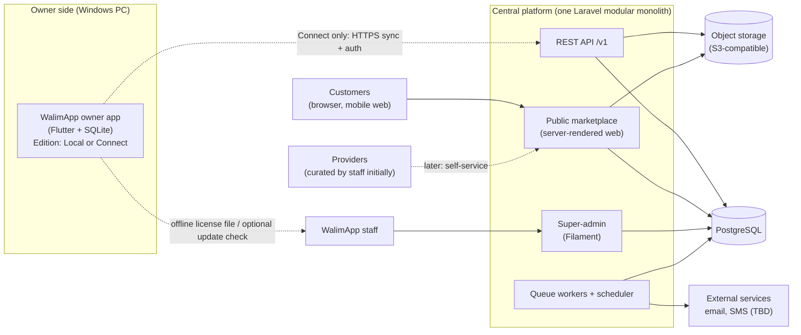

The dotted edge from the owner app is the **only** network dependency, and it exists only in Connect (plus an optional, user-consented update check and optional online license activation in Local). Without it, Local is complete.

### 4.2 Component responsibilities

| Component | Responsible for | Explicitly *not* responsible for |
|---|---|---|
| **Owner app — Local edition** | All owner workflows on one device; local SQLite; local backup/restore; license verification (offline); local reports; document storage on disk. | Publishing, online requests, any server communication required for operation. |
| **Owner app — Connect edition** | Everything in Local, plus: auth, sync client, offline queue, conflict UI, online listing management UI, request inbox, entitlement handling. | Being the authority for online bookings; enforcing other users' permissions. |
| **Central API** | Authentication, authorization, tenancy, sync endpoints, booking authority, entitlement, file upload/download authorization. | Rendering public pages. |
| **Public marketplace** | Discovery, SEO pages, public availability display, booking-request intake, provider directory, sponsored placement rendering. | Owner-private business data (it only ever reads *published* projections). |
| **Super-admin** | Staff-operated management of organizations, listings review, license issuance, subscriptions, campaigns, support, audit review. | Day-to-day owner operations. |
| **Background workers** | Notifications, request expiry, subscription state transitions, image processing, retention jobs, backup verification. | Interactive request handling. |

### 4.3 What is shared and what stays separate

Dart (owner app) and PHP (backend) cannot share source code. **[REC]** Share *contracts and executable test vectors* instead.

| Layer | Shared between Local and Connect | Shared between app and backend | Separate |
|---|---|---|---|
| UI, navigation, localization, reports, calendar | ✅ one app | ❌ | Marketplace UI and admin UI are separate (Blade, Filament). |
| Domain rules (overlap, balance, status transitions, money rounding, validation) | ✅ one Dart package | ⚠️ **Specified once** in `contracts/` as prose + JSON test vectors; **implemented twice** (Dart, PHP); both suites run the same vectors | Server-only rules: entitlements, moderation, ad scheduling. |
| Local schema (Drift) | ✅ identical; Connect adds sync tables | ⚠️ A **schema manifest** (`contracts/syncable-schema.yaml`) lists syncable tables/columns/types; a parity test checks both SQLite and PostgreSQL against it | Server-only tables: marketplace, billing, audit, change log. Local-only tables: outbox, license state, backup log. |
| Sync wire format | ❌ (Local has none) | ✅ OpenAPI + JSON Schema for sync payloads | — |
| API client | — | ✅ generated from OpenAPI (or hand-written thin client verified by contract tests) | — |
| Money, ID, date formats | ✅ | ✅ (spec in `contracts/conventions.md`) | — |
| Licensing | ✅ verifier in app (public key) | ✅ same signature format | Signing key and issuance only on the server side (never in the app). |

### 4.4 Local independence rules

**[PRD]** Local must be independently usable and must not depend on the marketplace or central backend. **[REC]** Made testable:

1. No network call at startup or during normal operation in Local edition.
2. No third-party SDK that requires connectivity or telemetry. Crash reporting, if any, is opt-in and queued/discarded offline.
3. The update check and online license activation are **user-initiated or opt-in**, fail silently, and never block the UI.
4. Local build must pass an automated test that runs the app's core workflows with all outbound network blocked (§19.7).
5. Fonts, locales, reports, contract templates, and PDF generation are bundled — no CDN fetches.
6. Connect-only code paths are present in the binary but unreachable without a valid Connect entitlement. Absence of the entitlement is the normal state in Local.

---

## 5. Recommended technology stack and rationale

### 5.1 Classification of technology statements

| Class | Items |
|---|---|
| **Mandatory (PRD constraint)** | SQLite as local persistence; Windows desktop first; Flutter for the owner application (and potentially a customer mobile application); no Kubernetes/Redis without need; Arabic + French; SEO-friendly public site. |
| **Preference (proposed, may be challenged)** | Laravel; PostgreSQL; Filament; Flutter for a future customer app. |
| **Unresolved** | Public-web implementation approach; hosting provider/jurisdiction; object storage/CDN provider; email/SMS/WhatsApp providers; payment rails; Windows installer/signing approach. |

### 5.2 Decisions

Each item: **Recommendation → Why it fits → Alternatives → Solo-dev implications → Risks.**

#### 5.2.1 Laravel (central backend + REST API)
- **Recommendation [REC]:** Keep. Use the current supported Laravel release on a supported PHP version; pin versions; upgrade deliberately.
- **Fit:** Mature ecosystem for auth (Sanctum), validation, policies, queues, scheduling, migrations, rate limiting, testing (Pest/PHPUnit). Filament is Laravel-native. You already build government and business apps with it, which is the largest risk reducer for a solo developer.
- **Alternatives:** Symfony (more ceremony, no Filament), Django/Rails (no advantage that outweighs familiarity), Node/NestJS (weaker batteries-included story).
- **Solo-dev implications:** One deploy unit, one language server-side, abundant AI-agent training coverage. Keep the code in a **modular monolith** (§7).
- **Risks:** Laravel's Eloquent makes cross-module coupling easy → enforce module boundaries with architecture tests (ADR-002). Octane/long-running servers are *not* needed; plain PHP-FPM is simpler and safer.

#### 5.2.2 PostgreSQL (central database)
- **Recommendation [REC]:** Keep. It is the *enabling* choice for booking integrity: `EXCLUDE USING gist` constraints with range types give a declarative, concurrency-safe "no overlapping confirmed bookings" guarantee (§12).
- **Fit:** Exclusion constraints, partial/expression indexes, `jsonb`, `uuid`, full-text search, `pg_trgm`, `unaccent`, optional Row-Level Security, transactional DDL.
- **Alternatives:** MySQL/MariaDB (no native exclusion constraints → would need lock tables or app-level checks — weaker); SQLite central (no).
- **Solo-dev implications:** Needs real backup discipline (WAL archiving) — see §18. Managed PostgreSQL removes much of that if budget and jurisdiction allow.
- **Risks:** Requires the `btree_gist` extension (standard contrib; usually allowed on managed services — **verify on the chosen host before committing**, OD-07). Arabic full-text search configuration availability varies by PG version — verify; fall back to normalized text + `pg_trgm` (§15.4).

#### 5.2.3 Filament (super-admin)
- **Recommendation [REC]:** Keep, for **staff only**. Run it as a separate panel with its own guard, mandatory 2FA, and its own role/permission set.
- **Fit:** Rapid CRUD for organizations, listings review, providers, campaigns, licenses, subscriptions, audit viewer.
- **Alternatives:** Nova (paid), custom Blade/Inertia (slower), Retool-style tools (extra service).
- **Solo-dev implications:** Biggest productivity multiplier in the whole stack for internal tooling.
- **Risks:** (a) **Filament must not bypass domain invariants.** All admin writes go through the same application services as the API so validation, audit, and sync change-log entries happen (ADR-009). (b) Plugin sprawl and major-version upgrades — keep third-party plugins minimal. (c) Not a good fit for the owner-facing product; do not stretch it to an owner web portal in early milestones.

#### 5.2.4 Flutter (owner application, Windows desktop first)
- **Recommendation [REC]:** Keep, as **one codebase for Local and Connect**, with a future customer mobile app sharing a small API-client/localization package.
- **Fit:** Single codebase for Windows now and Android/iOS later; strong UI toolkit (calendars, tables, forms); good RTL support in the framework; offline-capable by nature; Dart is strongly typed.
- **Alternatives:** WinUI/WPF/.NET MAUI (best Windows-native feel, mature printing, but no code reuse for a future mobile app and a second language); Electron/Tauri (web UI, larger footprint, less natural SQLite/offline story in Dart-less stacks).
- **Solo-dev implications:** Desktop plugin ecosystem is thinner than mobile; budget time for platform glue (installer, file pickers, printing, auto-update, secure storage).
- **Risks:** (a) **Arabic PDF generation** (text shaping, bidi, fonts) for contracts and reports is a known weak area in Dart PDF libraries → **mandatory spike before M1 scope freeze** (§22, spike S-1). (b) **Windows code signing and SmartScreen reputation** affect first-run trust (OD-10). (c) Printing fidelity on varied Windows printers. (d) Accessibility and IME behavior on Windows are acceptable but should be tested with Arabic and French keyboards.

#### 5.2.5 SQLite + Drift (local storage)
- **Recommendation [REC]:** SQLite via **Drift** (type-safe SQL, migrations, DAOs, streams, in-memory testing). Settings: `journal_mode=WAL`, `foreign_keys=ON`, `synchronous=FULL` (write volume is tiny; durability matters more than speed), `busy_timeout` set, `PRAGMA integrity_check` on a schedule and before backup/migration.
- **Fit:** Meets C-01; relational integrity mirrors PostgreSQL; the same schema serves Local and Connect.
- **Alternatives:** raw `sqflite_common_ffi` (less safety), ObjectBox/Isar (not SQL; harder to mirror constraints and to migrate), a sync-engine-owned database (below).
- **Solo-dev implications:** Drift code generation + migrations tested from every historical version (§11.9, §19).
- **Risks:** Encryption at rest is **not** free (OD-09): SQLCipher adds key-management and lost-key risk. Native SQLite binaries must be bundled (do not rely on a system SQLite).

#### 5.2.6 Synchronization engine
- **Recommendation [REC]:** **Custom, operation-based protocol** over the Laravel REST API (§11). Not a third-party sync engine in M2.
- **Fit:** The hard part of WalimApp sync is *entity-specific semantics* (reservations must be server-validated; payments are append-only; customers merge by field). Generic engines are strongest at state-based replication with a single conflict policy, and weakest at exactly the rules this product needs.
- **Alternatives considered:** PowerSync / ElectricSQL / similar (add a service to operate, constrain schema and auth model, default to row-level last-write-wins semantics); CRDTs (powerful for text/collaboration, wrong tool for exclusive resources like a hall on a date); Firebase/Supabase-style hosted sync (hosting-jurisdiction and lock-in concerns, replaces Laravel as authority).
- **Solo-dev implications:** More code to write and test than adopting an engine, but a smaller and fully understood surface: one push endpoint, one pull endpoint, one change log. Mitigated by a deterministic sync simulator (§19.5).
- **Risks:** Sync bugs are the largest correctness risk in the project (RK-01 in §21). Mitigation is test investment before M2 is "done", not clever design.

#### 5.2.7 Public marketplace web implementation
- **Recommendation [REC]:** **Server-rendered Blade templates in the Laravel monolith**, Tailwind CSS, Alpine.js for small interactions; optionally Livewire for the filter/search UI. Progressive enhancement: pages work without JavaScript.
- **Fit:** SEO needs crawlable HTML, fast first paint on mid-range phones and slow networks, per-language URLs, structured data. SSR in the same app means no second deployment, no API duplication, direct Eloquent reads of published projections, and trivial caching.
- **Alternatives:** Next.js/Nuxt/Astro as a separate site (excellent SEO, but a second runtime, second deploy, API surface, and auth boundary — poor trade for one developer); Inertia (SSR needs a Node process); **Flutter Web — rejected** for the public site (poor SEO and weak first-load performance).
- **Solo-dev implications:** Marketplace is a module of the monolith with its own route group, layout, and (later) its own domain/subdomain.
- **Risks:** If a rich client-side experience (map-based search) becomes essential, add islands (Alpine/Vue) rather than rewriting. A future customer mobile app needs a **public JSON API**; do **not** build it until that app is scheduled (ADR-012).

#### 5.2.8 Authentication
- **Recommendation [REC]:** Laravel Sanctum opaque tokens, **device-bound**, short-lived access token + rotating refresh token (custom, with reuse detection) for the owner app; session-based auth with mandatory 2FA for Filament staff.
- **Alternatives:** Passport/OAuth2 (heavier than needed for first-party apps), JWT (revocation and rotation harder), external IdP like Keycloak (extra infrastructure; reconsider if third-party integrations or SSO appear).
- **Risks:** Rolling your own refresh rotation is security-sensitive → isolate in one module with focused tests (§10.2, §19.3).

#### 5.2.9 Queue, cache, sessions, scheduler
- **Recommendation [REC]:** Database-backed queue and cache; Laravel scheduler via cron; workers supervised by systemd/supervisor. **No Redis.** Laravel Horizon is therefore not used; Laravel Pulse (database-backed) is acceptable.
- **Why:** Volume is low (A-03). Fewer services to secure, patch, back up, and monitor.
- **Trigger to revisit:** queue latency or DB load measured above agreed thresholds, or need for real-time WebSockets at scale (ADR-007 records the triggers).

#### 5.2.10 Search
- **Recommendation [REC]:** PostgreSQL (filters + full-text + `pg_trgm` + `unaccent`) over a denormalized `listing_search` projection. No Elasticsearch/Meilisearch/Typesense initially.
- **Trigger to revisit:** relevance quality or latency inadequate with real catalog sizes (likely thousands, not millions, of listings).

#### 5.2.11 Object storage and media delivery
- **Recommendation [REC]:** Laravel filesystem abstraction over **S3-compatible object storage** (provider TBD, OD-07); local disk acceptable for development and the earliest staging. Public images via immutable hashed URLs with long cache headers; private documents only via short-lived authorized URLs. Details in §16.

#### 5.2.12 Notifications
- **Recommendation [REC]:** In-app (sync/poll) + email first. SMS provider and WhatsApp Business API are **unresolved** (cost, cross-border, delivery in Algeria). Use `wa.me` **click-to-chat links** for customer↔owner contact, which need no API. Windows desktop has no FCM; use foreground polling (30–60 s) plus email for requests. WebSockets are deferred.

#### 5.2.13 Observability
- **Recommendation [REC]:** Structured JSON logs with request/correlation IDs; error tracking via a service with **PII scrubbing** (or a self-hosted equivalent if jurisdiction requires); external uptime checks (not co-hosted); Laravel Pulse for app metrics; database and queue health endpoints.

#### 5.2.14 Windows packaging and updates
- **Recommendation [REC]:** Spike three options before M1 release: **MSIX**, **Inno Setup/MSI + a signed update manifest**, and a Flutter auto-update package. Whichever is chosen must (a) work for **offline manual installation from a downloaded installer or USB**, (b) check build date against license maintenance (§14), (c) never touch user data on upgrade/uninstall (data lives in the user's app-data folder, not the install folder).
- **Risk:** Code-signing certificate cost and SmartScreen warnings (OD-10).

#### 5.2.15 Hosting (unselected)
- **Recommendation [REC]:** Do not choose yet. Select using the criteria in §18.2 *after* the legal question (OD-07) is answered. Design is host-agnostic: Ubuntu LTS + PHP-FPM + Nginx/Caddy + PostgreSQL + S3-compatible storage.

#### 5.2.16 Libraries (candidates, to be confirmed in spikes)
Flutter: `drift`, `sqlite3` (bundled), Riverpod (state), `dio` or `http`, OS-protected secure storage for tokens, `pdf` + `printing`, `intl`/`flutter_localizations`. Laravel: Sanctum, Filament, Pest, a PostgreSQL-aware OpenAPI generator, `spatie/laravel-permission` for **staff** roles only (ADR-008), image processing via libvips/GD/Imagick. Treat names as candidates, not commitments.

---

## 6. High-level architecture and data flows

### 6.1 Owner application layering

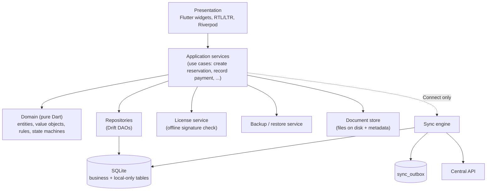

Rules: widgets never touch the database; use cases are the only place a business operation is composed; **every state-changing use case runs in one SQLite transaction** that writes the business change *and*, in Connect, the outbox row (transactional outbox).

### 6.2 Central platform modules (logical)

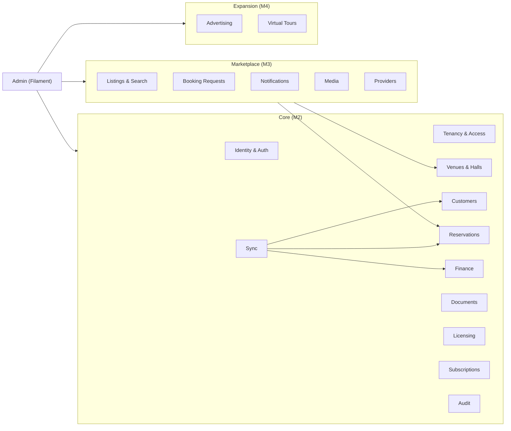

### 6.3 Principal data flows

| ID | Flow | Path | Authoritative store | Notes |
|---|---|---|---|---|
| DF-1 | Local daily operation | UI → use case → SQLite | Device SQLite | No network. Backup is the only protection against device loss (§18.7). |
| DF-2 | Connect owner edit (online or offline) | UI → use case → SQLite **+ outbox** → (when online) push → server validates → change log → other devices pull | PostgreSQL | Device shows `pending_sync` overlay until acknowledged. |
| DF-3 | Customer booking request | Browser → marketplace → `booking_requests` (PostgreSQL) → notify owner → owner device pulls request → owner approves/rejects (an *operation* pushed to server) → server creates reservation | PostgreSQL | Owner approval is validated by the server at commit time; the owner's device is never the authority for confirming an online booking. |
| DF-4 | Listing publish | Owner edits draft listing → submits → staff review (Filament) → publish → public projection updated | PostgreSQL | Public site reads a published projection only. |
| DF-5 | License issuance (Local) | Customer purchase → staff issues signed license file in admin → delivered by any channel → imported into app | License ledger in PostgreSQL; signed file on device | Works fully offline on the device side. |
| DF-6 | Media upload (Connect) | App/web → upload session → object storage → processing job → listing media | Object storage + `media_assets` | Resumable, size/format validated server-side. |
| DF-7 | Document sync | Metadata via sync; file bytes via separate resumable upload keyed by SHA-256 | Object storage + metadata in PostgreSQL | Metadata may arrive before bytes; UI shows "file not yet uploaded". |

---

## 7. Module and repository structure

### 7.1 Repository strategy

**[REC]** A **single monorepo.** One developer, one set of AI agents, and cross-cutting contracts (sync payloads, domain test vectors, schema manifest) make atomic cross-stack changes valuable. Splitting repositories now buys nothing and costs coordination.

```
walimapp/
├── AGENTS.md                      # rules for AI coding agents (see 7.5)
├── docs/
│   ├── architecture.md            # this document (once approved)
│   ├── adr/                       # one file per ADR
│   └── runbooks/                  # backup/restore, deploy, incident, license issuance
├── contracts/                     # SOURCE OF TRUTH shared by Dart and PHP
│   ├── conventions.md             # ids, money, dates, error codes, naming
│   ├── openapi/                   # REST contract (versioned)
│   ├── sync/                      # push/pull JSON Schemas, conflict codes
│   ├── syncable-schema.yaml       # syncable tables/columns/types
│   ├── domain-vectors/            # JSON test vectors: overlap, balance, transitions, money, license
│   └── license/                   # license format spec + test keys/fixtures (never real keys)
├── backend/                       # Laravel application (modular monolith)
│   ├── app/Modules/<Module>/...
│   ├── database/migrations/
│   └── tests/
├── apps/
│   └── owner/                     # Flutter app (Local + Connect)
│       ├── lib/features/<feature>/
│       ├── lib/data/              # Drift schema, DAOs, migrations
│       ├── lib/sync/              # Connect-only sync engine
│       ├── lib/services/          # license, backup, documents, updates
│       └── test/ integration_test/
├── packages/
│   └── walim_domain/              # pure Dart: entities, rules, state machines, money/date types
└── tools/                         # schema-parity check, license signing CLI (offline), fixtures
```

**[REC]** Extract further Dart packages (API client, localization) only when the customer mobile app actually starts — not before.

### 7.2 Laravel module structure

Plain namespaced folders under `app/Modules/` (not a module-generator package), each with the same internal layout:

```
app/Modules/Reservations/
├── Domain/          # value objects, state machine, pure rules (no framework imports)
├── Application/     # actions/use cases (the only entry point for writes)
├── Infrastructure/  # Eloquent models, repositories, external adapters
├── Http/            # controllers, requests, resources (API); thin
├── Policies/
├── Events/ Listeners/
└── Tests/
```

| Module | Milestone | Owns |
|---|---|---|
| Identity | M2 | users, credentials, devices, device sessions, refresh tokens, 2FA (staff) |
| Tenancy | M2 | organizations, memberships, roles/permissions (tenant), venue scopes |
| Venues | M2 | venues, halls, booking slots, venue services |
| Customers | M2 | customers (tenant-private CRM records) |
| Reservations | M2 | reservations, status history, conflict logic |
| Finance | M2 | financial transactions (ledger), expenses |
| Documents | M2 | documents, versions, storage keys |
| Sync | M2 | change log, operations ledger, conflict queue, device registry, snapshot |
| Licensing | M2 | licenses, activations, signing |
| Subscriptions | M2 | plans, subscriptions, entitlements |
| Audit | M2 | audit log, security events |
| Admin | M2→ | Filament resources and panels (calls Application layer only) |
| Listings | M3 | venue listings, revisions, moderation, search projection |
| BookingRequests | M3 | customer requests, expiry, owner decisions |
| Notifications | M3 | channels, templates, delivery log |
| Media | M3 | media assets, processing |
| Providers | M3 (curated) / M4 (self-service) | providers, categories |
| Advertising | M4 | advertisers, placements, campaigns |
| VirtualTours | M4 | tours, scenes, hotspots |

**Module rules (enforced by architecture tests — ADR-002):**
1. A module's `Domain` imports nothing from Laravel or other modules.
2. Other modules call a module only through its `Application` public actions or published interfaces/events, never its Eloquent models.
3. Cross-module references are by ID.
4. **All writes (API, Filament, jobs, console) go through `Application` actions.** Filament resources must not call `$model->update()` directly.
5. Every action that mutates tenant data takes an explicit `TenantContext`.

### 7.3 Flutter structure

Feature-first folders (`features/reservations`, `features/calendar`, `features/finance`, `features/customers`, `features/documents`, `features/reports`, `features/settings`, `features/license`, `features/backup`, and later `features/connect`). Each feature has `presentation/`, `application/`, and optionally `domain/` extensions; shared rules live in `packages/walim_domain`. State management: Riverpod (alternative: Bloc — acceptable; avoid mixing).

### 7.4 CI/CD outline

GitHub Actions (or equivalent): backend tests against a **real PostgreSQL service** (not SQLite); `flutter analyze` + unit/widget/integration tests; schema-parity check; OpenAPI diff check (breaking changes fail); architecture tests; Windows build job producing an unsigned installer artifact on every merge to main; signed release builds only from tags.

### 7.5 Working with AI coding agents (guardrails)

**[REC]** Because the developer is solo and delegates implementation to agents:
- `AGENTS.md` states: module boundaries, "never write status/booking/money rules outside `Domain`", "never trust `organization_id` from request input", "every migration needs an expand/contract note", "do not add infrastructure dependencies".
- **Domain rules are written test-first from `contracts/domain-vectors`**, so an agent that "improves" a rule fails a shared vector.
- Each feature has a short spec (inputs, states, errors, permissions, tests) approved before generation. Reviews focus on: authorization, transactions, migrations, and anything touching money or dates.
- Agents must not generate or handle real signing keys, production secrets, or real customer data.

---

## 8. Domain model and entity relationships

### 8.1 Categories of data

| Category | Examples | Rules |
|---|---|---|
| **Business records** | venues, halls, customers, reservations, transactions, expenses, documents, listings, campaigns | Synced (where syncable) and subject to retention/export. |
| **Synchronization metadata** | `sync_change_log`, `sync_operations`, `sync_conflicts`, `devices`, local `sync_outbox`, `sync_state` | Never part of exports/backups' business content; rebuildable or discardable per rules in §11. |
| **Audit & history** | `audit_logs`, `reservation_status_history` | Append-only. History that the PRD requires users to *see* (status history) is a business record; security/admin audit is separate. |
| **Local-only** | license state, backup log, app settings, UI preferences | Never synced. |
| **Server-only** | marketplace projections, billing, campaigns, staff users | Never present on devices. |

### 8.2 Entity relationship overview

**Tenancy and operations (synced domain):**

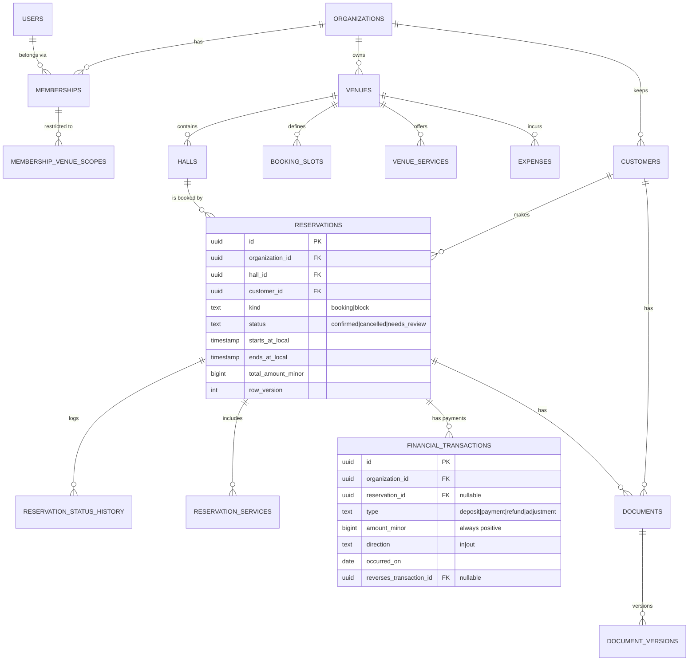

**Marketplace (server-only):**

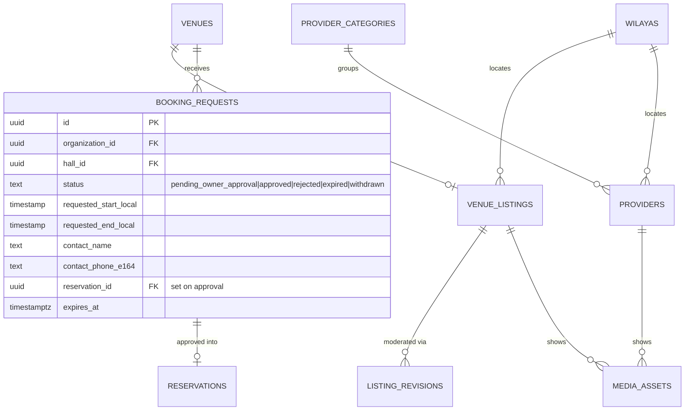

**Commercial (server-only; licenses also verified offline on device):**

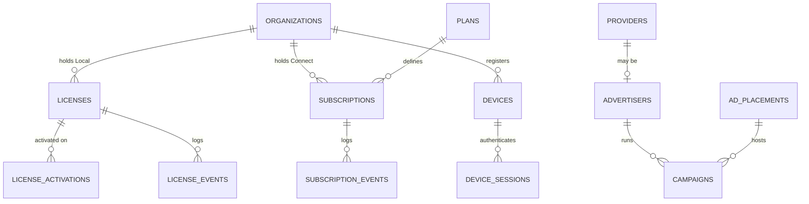

### 8.3 Notes on principal entities

**Organizations, users, memberships.** `organizations` is the tenant. A `user` is a person with credentials and may belong to several organizations through `memberships` (role + status). `membership_venue_scopes` restricts a membership to specific venues; **no rows means all venues** in the organization. Platform staff are a **separate** table (`staff_users`) with their own guard — staff are never members of tenant organizations by accident.

**Employees and permissions.** Permissions are a closed catalog defined in code (e.g., `reservations.view`, `reservations.create`, `reservations.confirm`, `reservations.cancel`, `payments.record`, `payments.reverse`, `expenses.manage`, `reports.view`, `documents.view`, `documents.manage`, `customers.manage`, `venues.manage`, `listing.manage`, `staff.manage`, `settings.manage`, `sync.use`). A membership has a role (named permission set) and optional per-member overrides. Venue scope and permission are checked together.

**Venues, halls, slots, services.** A venue has one or more halls. `booking_slots` are venue-defined named time ranges (e.g., "full day", "afternoon", "evening") — see OD-01; a venue with no explicit slots gets a default full-day slot. `venue_services` are optional offerings with a price used as snapshots on reservations (`reservation_services` copies name/price at booking time so later price changes never rewrite history).

**Customers.** Tenant-private CRM records (name, phone normalized to E.164, alternate phone, notes). **Not** marketplace users. Duplicates are *detected and suggested*, never auto-merged (§13.5). Marketplace requesters become `customers` of an organization only when the owner approves their request (copy, not link).

**Reservations.** `kind` is `booking` or `block` (an owner-created unavailable period with no customer — one table, one overlap constraint). `status` is `confirmed`, `cancelled`, or `needs_review` (imported/conflicted records that do **not** hold the calendar until resolved — used only by migration/conflict handling). Also holds: agreed total, `source` (`owner`, `online_request`, `migration`), `origin_request_id`, `reservation_number` (human-readable, unique per organization; see §9.3 for the offline-numbering problem), cancellation reason/time/actor. Status transitions are written to `reservation_status_history` (append-only, includes actor, device, reason, previous/new status).

**Booking requests (server-only).** Created by customers via the marketplace; states `pending_owner_approval`, `approved`, `rejected`, `expired`, `withdrawn`. Many overlapping requests for the same hall/time can coexist. `approved` links to the created reservation. Retains contact details with a defined retention period (§9.5).

**Financial transactions (ledger).** Append-only. `type` ∈ deposit, payment, refund, adjustment; `amount_minor` is always positive; `direction` says in/out. Corrections are *reversing entries* (`reverses_transaction_id`), never edits or deletes. Reservation balance = Σ(in) − Σ(out) against the agreed total, **computed, not stored** (a cached value may exist but is rebuildable). Payments belong to a reservation or stand alone (e.g., a general deposit); `payments.reverse` is a distinct permission.

**Expenses.** Category, amount, date, venue, optional vendor/notes, optional receipt document. Editable with version checks (low-risk entity), voidable with audit.

**Documents and versions.** `documents` holds metadata (type: contract, identity copy, receipt, other; links to reservation/customer; `current_version_id`). `document_versions` are immutable: `storage_key`, `sha256`, `size`, `mime`, uploader. Replacing a contract creates a new version; old versions are retained. Local stores bytes in a content-addressed folder on disk; Connect stores bytes in private object storage keyed by SHA-256.

**Listings, media, providers, campaigns.** `venue_listings` is the public face of a venue, with `listing_revisions` for moderated edits (the public site shows the last *approved* revision). `media_assets` is a generic table (`kind`: image, panorama, document-preview) so tours can plug in later without a schema rewrite. `providers` are staff-curated directory entries. `campaigns` link an advertiser to a placement for a date range with status and price; no impression/click tables until M4 and until a need is demonstrated.

**Licenses and subscriptions.** `licenses` (perpetual Local, `maintenance_until`, status), `license_activations` (device fingerprint hash, activation time, replaced_by), `license_events` (issued/reissued/transferred/revoked-as-record). `subscriptions` (plan, period, state, grace/expiry dates) with `subscription_events`. Manual payment records are kept in a minimal `billing_payments` table until a gateway exists (OD-12).

**Devices.** `devices` registers each Connect installation (device UUID, org, user, platform, app version, first/last seen, **sync epoch**, last pulled sequence). Needed for sync, revocation, and clone detection (§11.8).

### 8.4 Cross-cutting conventions

| Convention | Rule |
|---|---|
| IDs | **UUIDv7**, generated client-side for all syncable entities. PostgreSQL `uuid`; SQLite `TEXT` (canonical lowercase). Human-facing numbers (reservation number) are separate columns. |
| Money | **Integer minor units** (`bigint` / SQLite `INTEGER`), DZD, never floats. Rounding rules and display formatting in `contracts/conventions.md` with shared vectors. |
| Event dates/times | Stored as **wall-clock local** (`timestamp without time zone` / ISO text) in the venue's time zone, because "the wedding is on 14 June evening" is not an instant. Booking overlap is computed on these. |
| Instants (created/updated/synced) | UTC (`timestamptz` / ISO-8601 with `Z`). Server time is authoritative; client time is informational only. |
| Soft delete | `deleted_at` on syncable tables; tombstones propagate via sync. Ledger and history tables are **never** soft-deleted or edited. |
| Versioning | `row_version integer` incremented by the **server** on each accepted change; Local increments locally in Local-only mode and is reconciled at migration (§13). |
| Provenance | `created_by`, `updated_by` (user id), and for syncable rows the originating `device_id` in the change log (not in business tables). |
| Language | Text fields that are public (listing name/description) are stored per locale (`ar`, `fr`) in translation tables/JSON; private data is stored as entered. |

### 8.5 Deliberately not modeled (yet)

Multi-currency, tax/invoice generation beyond simple receipts/contracts, loyalty programs, inventory, staff payroll, customer accounts, reviews/ratings, messaging threads, per-impression ad analytics, multi-day recurring events, hall sub-division/combination (e.g., two halls sold together — flagged as OD-15), dynamic pricing. Each can be added later without breaking the above.

---

## 9. Database design principles and critical constraints

### 9.1 Principles

1. **Every tenant-owned table has `organization_id NOT NULL`.** Child tables reference parents with **composite foreign keys including `organization_id`**, so a row can never point to another tenant's parent even if application code is buggy.
2. **Money columns have `CHECK (amount_minor >= 0)`** where sign is carried by `direction`/`type`.
3. **State columns have `CHECK` constraints** listing legal values; transitions are enforced in `Domain` and recorded in history.
4. **Append-only tables** (ledger, history, audit) have triggers that reject `UPDATE`/`DELETE`, and the application database role has no `UPDATE`/`DELETE` privilege on audit tables.
5. **Migrations follow expand/contract** (add nullable/compatible → backfill → switch → remove). No destructive migration without a verified backup (§18).
6. **Use PostgreSQL for tests** that depend on constraints, locking, or ranges. Never test concurrency on SQLite.

### 9.2 Critical constraints (PostgreSQL)

**No overlapping confirmed reservations per hall:**

```sql
CREATE EXTENSION IF NOT EXISTS btree_gist;

ALTER TABLE reservations
  ADD CONSTRAINT reservations_time_order
  CHECK (ends_at_local > starts_at_local);

ALTER TABLE reservations
  ADD CONSTRAINT reservations_no_overlap
  EXCLUDE USING gist (
    hall_id WITH =,
    tsrange(starts_at_local, ends_at_local, '[)') WITH &&
  )
  WHERE (status = 'confirmed' AND deleted_at IS NULL);
```

The violation surfaces as SQLSTATE `23P01`; the application maps it to the domain error `reservation.date_conflict` (HTTP 409). `[)` ranges mean back-to-back slots (afternoon ends 18:00, evening starts 18:00) do not conflict. A full-day booking is `[00:00, 24:00)` of the date and correctly overlaps any slot that day.

**Tenant-consistent foreign keys (pattern):**

```sql
ALTER TABLE halls ADD CONSTRAINT halls_org_id_uq UNIQUE (organization_id, id);

ALTER TABLE reservations
  ADD CONSTRAINT reservations_hall_fk
  FOREIGN KEY (organization_id, hall_id) REFERENCES halls (organization_id, id);
```

**Other constraints and uniqueness:**

| Constraint | Purpose |
|---|---|
| `UNIQUE (organization_id, reservation_number)` | Human-readable numbers unique per tenant (see offline numbering below). |
| `UNIQUE (organization_id, device_id, op_id)` on `sync_operations` | Idempotent sync (§11). |
| `UNIQUE (organization_id, seq)` on `sync_change_log` | Total order of changes per tenant. |
| `UNIQUE (booking_request_id)` on reservations where `source='online_request'` (partial) | A request can be approved into at most one reservation. |
| `UNIQUE (venue_id, slug, locale)` on `venue_listings` translations | Stable SEO URLs. |
| `UNIQUE (license_id, device_fingerprint_hash) WHERE replaced_by IS NULL` on activations | One active activation per device. |
| `CHECK` that `reverses_transaction_id` references a transaction of the same reservation and opposite direction | Ledger integrity (enforced by trigger or application + test). |
| Phone: `CHECK` E.164 format; **no** uniqueness on customer phone | Duplicates are suggested, not blocked (families share phones). |
| `UNIQUE (document_id, sha256)` | Avoids duplicate version uploads. |
| Tenant-isolated unique slugs | Organization-scoped uniqueness is always `(organization_id, …)`. |

**Offline reservation numbers.** A sequential human number cannot be assigned offline without collisions. **[REC]** Use a **per-device-prefixed local number** (e.g., `L-2026-0041` locally) and let the **server assign the official sequential number** on acceptance; the app shows the local number until synced and stores both. In Local-only mode there is no server, so the local number is final; at migration it is preserved as the official number (OD-16: confirm the desired numbering format with owners).

**SQLite backstop for the same rule (Local and Connect):** SQLite has no exclusion constraints; use `BEGIN IMMEDIATE` transactions plus `BEFORE INSERT/UPDATE` triggers that `RAISE(ABORT, 'reservation.date_conflict')` when an overlapping `confirmed` row exists for the same hall. This is a *local* integrity rule; the server remains the authority for Connect.

### 9.3 Indexing guidance (initial only)

- `reservations (hall_id, starts_at_local)` plus the GiST index created by the exclusion constraint.
- `reservations (organization_id, status, starts_at_local)` for calendar and dashboards.
- `financial_transactions (reservation_id, occurred_on)` and `(organization_id, occurred_on)` for reports.
- `sync_change_log (organization_id, seq)`; `(organization_id, entity_type, entity_id)` for rebuilding.
- `booking_requests (organization_id, status, created_at)` and `(hall_id, requested_start_local)`.
- `listing_search` GIN (FTS) + trigram + btree on Wilaya, capacity, price.
- Add further indexes only from observed slow queries.

### 9.4 Transaction boundaries (principal operations)

| Operation | Boundary | Contents |
|---|---|---|
| Local: create/edit reservation | One SQLite txn (`BEGIN IMMEDIATE`) | validate overlap → write reservation → write status history → (Connect) write outbox row |
| Local: record payment | One SQLite txn | write ledger row → (Connect) outbox row |
| Server: approve booking request | One PostgreSQL txn | lock request `FOR UPDATE` → verify `pending_owner_approval` → insert reservation (**exclusion constraint here**) → update request → insert history → bump org sync sequence + change-log rows → insert audit. Notifications dispatched **after commit**. |
| Server: apply one sync operation | One txn **per operation** | insert idempotency row → apply with version check → change log → store result. Ops are independent unless they declare a dependency (§11.5). |
| Server: Local→Connect promotion | One txn per organization (volumes are small) | promote staged rows → manifest → verification marker (§13) |
| Server: expire requests (job) | Small batches, one txn per request | `pending_owner_approval` → `expired` + history + notification event |

### 9.5 Retention and data lifecycle (provisional — confirm with counsel, OD-14)

| Data | Provisional retention | Notes |
|---|---|---|
| Financial transactions, reservations, expenses | Long-term while the organization exists; after closure, retain per Algerian accounting/commercial record-keeping rules (**period to be confirmed**; commonly cited as multi-year) | Never hard-deleted by sync. |
| Customer personal data (owner's CRM) | Until owner deletes or anonymizes; export on request | Controller/processor roles must be clarified (OD-14). |
| Marketplace booking requests (customer contact data) | Provisional: anonymize contact fields N months after final state | WalimApp is likely a controller for this data — **legal confirmation required**. |
| Sync tombstones | ≥ 90 days (and ≥ longest allowed device offline period) | Older cursors force a resnapshot. |
| `sync_operations` idempotency ledger | 90 days | Replays beyond this are rejected as stale. |
| Audit logs | Provisional ≥ 24 months; append-only | Longer for license/billing admin actions. |
| Expired Connect organizations | Read-only/export window (provisional 90–180 days), then archive/delete per policy | Local copy on the owner's device is unaffected (§14.4). |
| Backups | See §18.6 | Backups contain personal data → covered by retention and access rules. |

### 9.6 Referential and deletion rules

Hard deletes are limited to: unreferenced drafts, expired upload sessions, and policy-driven purges executed by named jobs. Venues/halls with reservations are **archived**, not deleted. Customers with reservations are **anonymized** rather than deleted when erasure is requested, preserving financial integrity (legal basis to be confirmed).

---

## 10. API, authentication, and authorization

### 10.1 API conventions

| Topic | Convention **[REC]** |
|---|---|
| Style | REST over HTTPS, JSON, base path `/api/v1`. The OpenAPI document in `contracts/openapi/` is the contract; breaking changes fail CI. |
| Tenant addressing | **Path-scoped:** `/api/v1/orgs/{org}/…`. The `{org}` segment is a *claim to be verified* against the caller's membership on every request, never trusted. |
| Errors | RFC 9457 `application/problem+json` with a stable machine `code` (e.g., `reservation.date_conflict`, `auth.token_expired`, `sync.cursor_too_old`), human `title`, and optional `errors[]` for field validation. Messages are localized client-side by `code`. |
| Pagination | Cursor-based (`?cursor=…&limit=…`), max limit enforced. |
| Idempotency | `Idempotency-Key` header required on all non-sync `POST`s that create state (booking requests, uploads, activations). Sync uses `op_id` instead (§11). |
| Concurrency | Non-sync updates use `If-Match` with the entity `row_version` (ETag). Sync uses `base_version`. |
| Versioning | URL major version; additive changes only within a version; `X-Client-Version` and `X-Schema-Version` request headers; server may answer `426 Upgrade Required` with `min_client_version` and a support URL. Server supports payload versions N and N-1 during a migration window. |
| Formats | IDs: UUIDv7 strings. Money: integer minor units + `currency`. Event times: local wall-clock `YYYY-MM-DDTHH:MM:SS` plus venue time zone id. Instants: RFC 3339 UTC. |
| Output | Always via API Resource classes — never serialize Eloquent models directly. |
| Compression/size | gzip; request body caps per route; file bytes never go through JSON endpoints. |

### 10.2 Endpoint patterns (illustrative, not exhaustive)

| Area | Examples | Notes |
|---|---|---|
| Auth | `POST /auth/login`, `POST /auth/refresh`, `POST /auth/logout`, `POST /auth/password/forgot`, `POST /auth/password/reset` | Device registration happens at login: body includes `device_id`, `platform`, `app_version`. |
| Me | `GET /me`, `GET /me/memberships` | Returns orgs, roles, permissions, venue scopes, entitlement summary. |
| Entitlement | `GET /orgs/{org}/entitlement` | Signed **entitlement lease** (§14.3) so offline devices can keep operating. |
| Sync | `POST /orgs/{org}/sync/push`, `GET /orgs/{org}/sync/pull?cursor=…`, `GET /orgs/{org}/sync/snapshot/{entity}?cursor=…`, `POST /orgs/{org}/sync/verify` | The only bulk data path for the owner app. |
| Resources (non-sync reads/admin actions) | `GET /orgs/{org}/venues/{venue}/calendar?from=&to=`, `GET /orgs/{org}/reservations/{id}` | Reads outside sync (e.g., web dashboards later). Writes from the owner app go through sync ops. |
| Booking requests | `GET /orgs/{org}/booking-requests?status=pending_owner_approval`, `POST …/{id}/approve`, `POST …/{id}/reject` | Approve/reject are also available as sync ops so they work offline-queued; the endpoint form exists for non-device clients. |
| Documents | `POST /orgs/{org}/documents/uploads` (create session), `PUT …/uploads/{id}/parts/{n}`, `POST …/uploads/{id}/complete`, `GET /orgs/{org}/documents/{id}/versions/{v}/download-url` | Resumable; download URL is short-lived and authorization-checked. |
| Listing | `GET/PUT /orgs/{org}/venues/{venue}/listing/draft`, `POST …/listing/submit` | Draft vs. published separation (§15). |
| Media | `POST /orgs/{org}/media/uploads` … | See §16. |
| License | `POST /license/activate` (optional online activation), `GET /license/{key}/status` | Local never needs these (§14). |
| Public site | Web routes (`/ar/…`, `/fr/…`), `POST /{locale}/booking-requests` | Server-rendered; **no public JSON API until the customer mobile app is scheduled** (ADR-012). |

### 10.3 Authentication (owner app)

**Credentials:** email or phone + password (Argon2id via Laravel hashing). Optional second factor is a later enhancement for owners; **mandatory** for staff (Filament).

**Tokens (Connect):**

| Token | Lifetime (provisional) | Stored | Notes |
|---|---|---|---|
| Access token (Sanctum, opaque, device-bound) | 30–60 minutes | In OS-protected secure storage | Abilities encode org/device; revocable server-side. |
| Refresh token (custom, rotating) | 90 days sliding | OS-protected secure storage; **hashed** at rest on server | **Reuse detection**: if an old refresh token is presented again, revoke the whole device session family and force re-login. |
| Entitlement lease (signed) | 30 days (provisional) | Local DB | Lets an offline device keep Connect features within the subscription period + grace without contacting the server. |

**Offline behavior:** the app **always** opens and works offline regardless of token state. Authentication is needed only to sync. If the refresh token has expired (long offline period), the user signs in again; the outbox and local data are untouched.

**Other controls:** login throttling per account+IP, uniform error messages, password reset by single-use expiring token, session list with remote revocation, optional "revoke all devices". Employee accounts are created by owners (invitation flow); an owner can suspend an employee, which revokes sessions and triggers a **scope purge** on that device at next contact (§11.6).

### 10.4 Authorization model

Authorization is evaluated **server-side on every request and every sync operation**, in this order:

1. **Authenticate** → principal (user + device) or staff.
2. **Resolve `TenantContext`** from the credential + path `{org}`; verify an *active* membership; reject otherwise with `404` (not `403`) for other tenants' resources to avoid existence leaks.
3. **Entitlement check** → is the organization allowed to use this capability (Connect active, listing allowed, etc.)?
4. **Permission check** → does the membership's role/overrides include the required permission?
5. **Venue scope check** → if the membership is venue-scoped, is the target (via its hall/venue) in scope?
6. **Object-level policy** → e.g., an employee may edit only reservations they created, if such a rule is configured (optional).
7. **Database backstops** → composite FKs prevent cross-tenant references; optional Row-Level Security later (ADR-006).

```php
// Sketch — controller stays thin; the Application action takes the context explicitly
public function approve(ApproveRequestRequest $r, string $org, string $id): JsonResponse
{
    $ctx = TenantContext::fromRequest($r, $org);          // verifies membership; never reads org from body
    $this->authorize('approve', [BookingRequest::class, $ctx, $id]); // permission + venue scope
    $result = $this->approveBookingRequest->handle($ctx, $id, $r->validated());
    return ApprovalResource::make($result)->response();
}
```

**Staff (super-admin) authorization.** Separate guard, **mandatory 2FA**, role-based with granular permissions. No staff role is "everything". Proposed starting roles: *Support* (read limited tenant data via audited support view), *Moderator* (listings/providers), *Licensing* (issue/reissue licenses, subscriptions), *Campaign manager*, *Finance* (billing records), *Platform admin* (users/roles/config; **cannot** read tenant business data by default). Rules:
- **Read access to tenant private data** (customers, finance, documents) requires an explicit permission, a **reason**, is time-boxed, and is audited; the owner can be notified (policy decision OD-17).
- **No impersonation** of owner accounts. Support uses a read-only support view.
- **Step-up re-authentication** (password/2FA) for license revocation or reissue, role changes, data export, subscription overrides, and deletions.
- **Two-person rule** is *not* proposed initially (solo developer); instead, the audit log is reviewed on a schedule and alerts fire for high-risk actions.

### 10.5 Validation

- Laravel Form Requests validate shape and constraints; **domain invariants** (state transitions, overlap, ledger rules) are validated in `Domain`/`Application`, because they must also apply to sync, admin, and jobs.
- Sync payloads are validated against JSON Schemas in `contracts/sync/`. Unknown fields from newer clients are ignored and logged; unknown commands are rejected with `sync.unsupported_command`.
- Mass assignment is closed (explicit DTOs); tenant and audit columns are never client-settable.
- File uploads: server-side magic-byte detection, size/dimension caps, extension allow-list, never trust client MIME (§16).

### 10.6 Rate limiting

Laravel named limiters, backed by the database cache store initially (single node; revisit with scale).

| Surface | Limit key | Starting point (tune from data) |
|---|---|---|
| Login | account + IP | 5/min, progressive lockout |
| Refresh | device | 10/min |
| Sync push/pull | device | generous per minute, with `Retry-After` honored by client backoff |
| Public booking request | IP + phone + venue | e.g., 3/hour per phone per venue; global per-IP cap; honeypot + lightweight bot challenge (**OD-18**: choice of challenge provider vs. cross-border concerns) |
| Public search | IP | cache-friendly; moderate |
| Uploads | org + device | per-hour byte quota |
| Password reset / OTP | account + IP | strict |

### 10.7 Example stable error codes

`auth.invalid_credentials`, `auth.token_expired`, `auth.refresh_reuse_detected`, `tenant.not_found`, `permission.denied`, `entitlement.inactive`, `reservation.date_conflict`, `reservation.invalid_transition`, `request.not_pending`, `request.expired`, `sync.op_duplicate`, `sync.version_conflict`, `sync.cursor_too_old`, `sync.device_state_invalid`, `sync.unsupported_payload_version`, `license.invalid_signature`, `upload.unsupported_type`, `upload.too_large`, `client.upgrade_required`.

---

## 11. Offline storage and synchronization architecture

### 11.1 Scope and stance

- **Local edition:** no sync. The SQLite database is the sole store; the design only needs to be *sync-ready* (IDs, versions, tombstones, ledger).
- **Connect edition:** SQLite remains the device's working store; PostgreSQL is authoritative for shared online state (R-07). Devices read and write locally first; a background engine reconciles.
- **Model:** *operation-based push* (the device sends intents, the server validates and decides) + *change-feed pull* (the device applies server-confirmed changes in order). This gives the server a veto on every write, which is what booking integrity requires.

### 11.2 Local database layout

| Table group | Tables | Synced? |
|---|---|---|
| Business | venues, halls, booking_slots, venue_services, customers, reservations, reservation_services, reservation_status_history, financial_transactions, expenses, expense_categories, documents, document_versions | Yes (Connect) |
| Sync metadata (Connect only) | `sync_outbox`, `sync_state` (device_id, epoch, last pulled seq, last push time), `sync_shadow` (server copy of entities with pending local edits), `sync_conflicts`, `file_upload_queue` | No |
| Local-only | `app_settings`, `license_state`, `backup_log`, `schema_meta` (schema version, install_id, created_at_app_version) | No |

`install_id` (UUID) is generated once at first run and recorded in backups; it supports duplicate-dataset detection in migration (§13.5).

### 11.3 Behavior by connectivity state

| State | What works | What is queued | What is blocked |
|---|---|---|---|
| Local edition (always offline) | Everything in R-03 | — | Online features (hidden, and refused server-side) |
| Connect, online, healthy | Everything; edits appear instantly locally and sync within seconds | — | — |
| Connect, offline | All local workflows | All edits as outbox ops; file uploads | Receiving new requests/changes; seeing other devices' edits; publishing |
| Connect, online but unauthenticated (token/refresh expired) | All local workflows | Outbox retained | Sync until re-login |
| Connect, subscription expired | All local workflows (as "Local mode") | Edits kept locally; **not** pushed | Sync, listing, online requests (§14.4) |
| Server unreachable / 5xx | As offline | Outbox with backoff | — |

**Connectivity detection:** do not trust the OS "online" flag. The engine uses a lightweight authenticated `GET /sync/ping` with timeouts; failure ⇒ offline backoff.

### 11.4 Outbox and operation envelope

Every state-changing use case, in the **same SQLite transaction** as the business write, inserts an outbox row:

| Column | Purpose |
|---|---|
| `op_id` (UUIDv7) | **Idempotency key**; also the primary key. |
| `device_seq` | Monotonic per device epoch; defines push order. |
| `entity_type`, `entity_id` | Target. |
| `command` | e.g., `reservation.create`, `reservation.reschedule`, `reservation.cancel`, `payment.record`, `payment.reverse`, `customer.update`, `request.approve`, `request.reject`, `document.add_version`. |
| `base_version` | Server version the edit was based on (`null` for creates). |
| `payload_version` | Schema version of the payload. |
| `payload` (JSON) | Command arguments (not whole rows for critical entities). |
| `depends_on` | Optional op ids that must succeed first (e.g., payment depends on its reservation create). |
| `status` | `pending`, `in_flight`, `acked`, `conflicted`, `rejected`, `blocked`, `dead` |
| `attempts`, `next_retry_at`, `last_error_code`, `created_at_local` | Retry bookkeeping; `created_at_local` is informational only. |

```json
{
  "op_id": "01934f3a-7c21-7b5e-9e0a-3f2d9c1a5b10",
  "device_id": "01934e00-1111-7000-8000-aaaaaaaaaaaa",
  "device_epoch": 2,
  "device_seq": 1042,
  "entity_type": "reservation",
  "entity_id": "01934f3a-7c20-7000-8000-bbbbbbbbbbbb",
  "command": "reservation.create",
  "base_version": null,
  "payload_version": 1,
  "payload": {
    "hall_id": "…", "customer_id": "…",
    "starts_at_local": "2027-06-14T18:00:00", "ends_at_local": "2027-06-15T00:00:00",
    "total_amount_minor": 45000000, "local_number": "L-2026-0041"
  },
  "depends_on": [],
  "client_created_at": "2026-10-27T10:15:00Z"
}
```

### 11.5 Push protocol

```mermaid
sequenceDiagram
    autonumber
    participant UI as Owner app (UI)
    participant DB as Local SQLite
    participant ENG as Sync engine
    participant API as Laravel API
    participant PG as PostgreSQL

    UI->>DB: use case txn: business row + outbox row (pending)
    UI-->>UI: show row with pending sync overlay
    ENG->>API: POST /sync/push (device, epoch, up to 50 ops)
    loop each op in device_seq order
        API->>PG: BEGIN
        API->>PG: INSERT sync_operations(org, device, op_id) — unique
        alt duplicate op_id
            API->>PG: read stored result
            API-->>ENG: status=duplicate (original result)
        else new op
            API->>API: authorize (permission + venue scope + entitlement)
            API->>PG: apply command with version check / exclusion constraint
            alt applied
                API->>PG: bump org seq, write change_log, store result
                API-->>ENG: status=applied, entity_version, server_seq
            else conflict or rejected
                API->>PG: store result (no business change)
                API-->>ENG: status=conflict/rejected + code + safe server state
            end
        end
        API->>PG: COMMIT
    end
    ENG->>DB: mark acked / conflicted / rejected; clear overlay or open conflict
    ENG->>API: GET /sync/pull?cursor=…
    API-->>ENG: changes (ordered by seq) + next_cursor
    ENG->>DB: apply changes in one txn (respecting sync_shadow rules)
```

**Rules**
- **Ordered, but independent per entity.** Ops are pushed in `device_seq` order. A failure on one op does not stop unrelated ops. Ops whose `depends_on` failed are marked `blocked` and not sent.
- **Per-entity stop:** while an entity has a `conflicted` op, later ops on the same entity wait (`blocked`) so the user resolves in order.
- **Batching:** ≤ 50 ops or ≤ ~256 KB per request (tunable) to suit weak connections (A-05).
- **Idempotency:** same `(org, device, op_id)` always returns the *original* result — including `conflict`/`rejected` — so a retry after a lost response is harmless.
- **Atomicity:** each op is one server transaction; there is no cross-op transaction.

### 11.6 Pull protocol and the change log

**Per-organization total order.** The server keeps `org_sync_state(organization_id, last_seq)`. Every committed change writes rows to `sync_change_log(organization_id, seq, entity_type, entity_id, venue_id, op, row_version, changed_at, origin_device_id)`. To make sequence order equal **commit order** (a classic pitfall with plain sequences, where a lower number can commit *after* a higher one and a puller skips it):

```sql
-- inside the writing transaction, late, after entity rows are locked/written
UPDATE org_sync_state
   SET last_seq = last_seq + :n
 WHERE organization_id = :org
RETURNING last_seq;   -- row lock held until COMMIT ⇒ seq order == commit order
```

Lock-ordering rule to avoid deadlocks: **entity rows first, `org_sync_state` last**. This serializes *commits per organization* for the duration of the final statements — acceptable at A-03 scale and it incidentally simplifies reasoning.

**Pull:** `GET /sync/pull?cursor=<seq>&limit=500` returns changes with `seq > cursor`, materialized from current rows (latest version only; multiple changes to one entity collapse), plus tombstones. If the cursor is older than the tombstone retention horizon → `sync.cursor_too_old` ⇒ device must **resnapshot** (§11.12).

**Permission-aware filtering.** The server filters pull/snapshot by the caller's **venue scope and permissions** (e.g., an employee without `payments.*` never receives ledger rows; a venue-scoped receptionist never receives other venues). When a scope shrinks, the server sends a `scope_revoked` directive and the device **purges** the affected rows (after confirming no unsynced ops would be lost — if there are, they are pushed first, then purged). Offline devices keep stale data until their next contact; **encryption at rest (OD-09) reduces that exposure** and is therefore recommended for employee devices in Connect.

**Applying pulled changes on the device.** In one SQLite transaction, in `seq` order:
- If the entity has **no pending ops**: upsert/delete directly; set `row_version`.
- If the entity **has pending ops**: write the server row to `sync_shadow` *instead*, leave the local (edited) row untouched. The server will decide at push time using each op's `base_version`. After a push ack, the shadow is dropped and the local row's version updated; on conflict, the shadow supplies the "their version" side of the conflict screen.

**Snapshot/bootstrap:** paginated per entity type with a pinned `snapshot_seq`; after the snapshot, pull continues from `snapshot_seq`. Snapshot is the same code path as "rebuild from server".

### 11.7 Conflict policy by entity (no blanket last-write-wins)

| Entity | Write pattern | Detection | Resolution | Never |
|---|---|---|---|---|
| **Reservation** (dates, hall, status, price) | Command ops | Version check **and** exclusion constraint | Server applies if valid; otherwise `conflict`/`rejected`. User resolves explicitly (reschedule, change hall, cancel local intent, or explicit separate "cancel existing" with permission + reason). | Silent overwrite of a `confirmed` reservation; LWW on date/hall/status. |
| Reservation (non-critical fields: notes, guest count, contact notes) | Field-level patch | `base_version` mismatch | Field-level merge when different fields changed; if the same field changed on both sides → surface conflict (notes may offer "keep both"). | — |
| **Financial transaction** | **Append-only** `payment.record` / `payment.reverse` | Duplicate `op_id`/`id` only | Always accepted if the parent reservation exists (even if cancelled meanwhile — money is real). Corrections via reversing entries. | Edit, delete, or LWW of an amount. |
| Customer | Field-level patch | `base_version` | Field-level merge; same-field collision → conflict prompt; **duplicate detection** by normalized phone/name → *suggest* merge, never auto-merge. | Auto-merge of records. |
| Expense | Patch/void | `base_version` | Field-level merge; same-field collision → last server-accepted wins **with audit entry and a notice** (low risk, provisional, OD-19). | Hard delete. |
| Venue/hall/slot/service settings | Patch | `base_version` | Field-level; pricing/capacity collisions → conflict prompt. Published-listing fields are server-moderated (§15). | — |
| Document metadata | Patch | `base_version` | Merge; **versions are immutable** and both kept. | Overwriting file bytes. |
| Booking request | Server-owned; device sends `approve`/`reject` | Request state at commit | Valid only from `pending_owner_approval`; if already expired/withdrawn/decided → `rejected` with the current state. | Approving a request into a conflicting date. |
| Employees, roles, permissions, entitlement, license | **Server-authoritative, pull-only** | — | Device cannot write. | Client-side changes. |

### 11.8 Retries, ordering, clocks, device identity

- **Retry/backoff:** exponential with jitter (≈5 s → 15 min cap). Classify: network/5xx/429 ⇒ retry (honor `Retry-After`); `401` ⇒ re-authenticate, *keep* the op; `409`/conflict ⇒ stop and surface; `422`/validation ⇒ `rejected`, surface and allow edit-and-resubmit; `426` ⇒ prompt to update the app.
- **Clocks:** device wall-clock is never used to order or resolve conflicts. Ordering = server `seq` and `row_version`. The engine compares the server `Date` header to the device clock and warns when skew exceeds a threshold (affects license/lease sanity, not data).
- **Device identity:** `device_id` (UUID) + `device_epoch`; the server tracks `last_device_seq` per `(device, epoch)`.
  - **Cloned data folder** (copying the app-data directory to another PC) or **restoring an old backup** makes `device_seq` go backwards or collide ⇒ server returns `sync.device_state_invalid` ⇒ the app **re-registers with a new `device_id`/epoch**, exports unsent ops to a recovery file for review, and rebuilds from a server snapshot. This prevents a stale restore from silently resurrecting old state.

### 11.9 Schema migrations

**Client (SQLite via Drift):**
- Migrations are **forward-only, numbered, transactional**, tested from **every shipped schema version** (fixtures of real old databases).
- Before applying any migration the app takes an **automatic verified backup copy** (`VACUUM INTO` or the SQLite backup API). If the migration fails, the app restores that copy and shows a blocking recovery screen — it never opens a half-migrated DB.
- **Downgrade is unsupported.** If `db_schema_version > app_max_schema_version` (user reinstalled an older build), the app refuses to open the data and explains why (protects against corruption). Interaction with licensing: a lapsed-maintenance user is entitled to older builds; the product therefore must keep older builds able to *read-only open and export* newer data where feasible, or clearly instruct to install a compatible build (risk RK-12).
- Outbox payloads carry `payload_version`; a migration that changes command payloads must also **upgrade pending outbox rows**.

**Server:** expand/contract migrations; server accepts payload versions N and N-1; `426 Upgrade Required` only when a client is older than the supported window, and the response includes how to update offline.

### 11.10 Validation

Client validates for UX and offline correctness using the shared domain rules; **server re-validates everything** (schema, enums, permissions, invariants). The client is never trusted for: tenant, permissions, status transitions, totals, or ledger integrity. Differences between client and server rule outcomes are bugs caught by the shared vectors.

### 11.11 Conflict experience (what the owner sees)

- Rows with unacknowledged ops show a **"pending sync"** badge (the PRD's `pending_sync`, derived from the outbox).
- A **Sync Center** screen lists: pending, failed (with reason), conflicts, last successful sync, device clock warning, storage/backlog size.
- A **conflict** shows *your change* vs *current server state* side by side (customer name and dates only for reservations conflicting with others — full details only if the user has permission to see them) and offers allowed resolutions: *reschedule/move*, *change hall*, *discard my change*, *keep both* (where meaningful), or — for explicit cases — *cancel the other reservation* (requires `reservations.cancel`, a reason, and is a new command, audited).
- Notifications on conflicts and dead ops; never auto-discard.

### 11.12 Recovery

| Situation | Procedure |
|---|---|
| Op stuck/`dead` | Dead-letter view: retry, edit & resubmit, or discard (confirmation + automatic export of the op to a file). |
| Local DB corrupted | Restore latest verified backup → device re-registers (new epoch) → resnapshot; unsent ops from the backup are *listed for review*, not auto-pushed. |
| Cursor too old / lost state | Resnapshot. If pending ops exist they are exported first; after the snapshot they are re-validated and re-queued by the user. |
| Server restored from backup (PITR) | Server increments a **restore epoch**; every device must reconcile: unsynced/newer local data is surfaced via a reconcile import flow (staging + validation similar to §13). Documented as a last-resort runbook; rehearsed before M2 completes. |
| Divergence suspected | `POST /sync/verify` compares per-entity counts + canonical checksums; mismatch ⇒ guided repair (resnapshot). |

### 11.13 Explicit limits

No peer-to-peer/LAN sync; no real-time collaborative editing; no merging of two *independent* Local datasets (§13.10); devices offline longer than tombstone retention must resnapshot.

---

## 12. Reservation lifecycle and concurrency control

### 12.1 Source of truth

| Context | Authority |
|---|---|
| Local edition | The device's SQLite (there is no server) |
| Connect: confirmed online bookings and all shared state | **PostgreSQL**, enforced by the exclusion constraint (§9.2) |
| Connect: unsynced local intent | The device, until the server accepts or rejects it |
| Public availability display | Derived from PostgreSQL only |

### 12.2 State machines

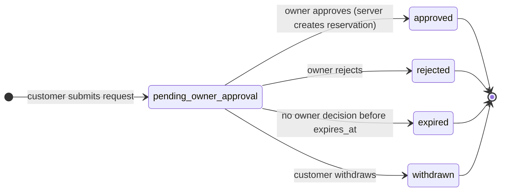

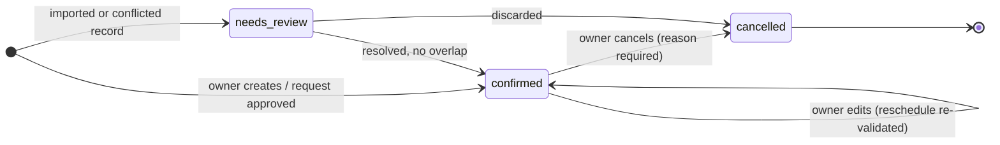

The **client-side overlay** (not stored on the server) is orthogonal to both:

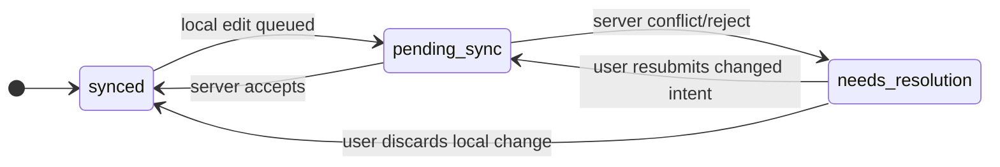

### 12.3 Transitions (summary)

| Transition | Actor | Preconditions | Effects |
|---|---|---|---|
| Request created | Customer (public) | Venue accepts requests and has Connect entitlement; rate-limit/anti-abuse passed; date not already **confirmed/blocked** at intake (customer sees "unavailable") | `booking_requests` row; owner notified |
| Approve | Owner/employee with `reservations.confirm` + venue scope | Request `pending_owner_approval`; **no overlapping confirmed reservation** (DB constraint) | Reservation `confirmed` created; request `approved`; history; change-log; notification to customer |
| Reject | Same permission | Request pending | Request `rejected` with reason (optional message) |
| Expire | System job | `now > expires_at` and still pending | Request `expired`; notification |
| Create reservation | Owner/employee (`reservations.create`) | Valid data; server: constraint passes | `confirmed`; if offline → overlay until acked |
| Reschedule/change hall | `reservations.update` | Re-validated against the constraint | History entry with old/new values |
| Cancel | `reservations.cancel` | Status `confirmed`; reason | `cancelled`; frees the slot; **no automatic refund** (ledger entries are manual); history |

### 12.4 Concurrency control strategy

**[REC]** Layered, with the database as the final arbiter:

1. **Guarantee:** `EXCLUDE USING gist` on confirmed reservations. Any code path — API, sync, Filament, a bug — that tries to confirm an overlapping booking fails with `23P01` mapped to `reservation.date_conflict`.
2. **Single-writer reasoning for state changes:** operations on a request lock it `FOR UPDATE` so approve/reject/expire cannot interleave.
3. **Lock order:** request/reservation rows → `org_sync_state` (§11.6). Documented to prevent deadlocks.
4. **Idempotency:** `Idempotency-Key` / `op_id` make retries safe.
5. **No read-then-write races:** never "check availability, then insert" in application code *as the guarantee*; the check may exist for friendly errors, but the constraint decides.
6. **Isolation level:** default `READ COMMITTED` is sufficient *because* of the constraint-based guarantee; do not rely on `SERIALIZABLE`.

Approval sketch:

```php
DB::transaction(function () use ($ctx, $requestId) {
    $req = BookingRequest::forOrg($ctx->orgId)->lockForUpdate()->findOrFail($requestId);
    $req->assertPending();                                   // request.not_pending / request.expired

    try {
        $res = Reservation::create([... 'status' => 'confirmed', 'source' => 'online_request', 'origin_request_id' => $req->id]);
    } catch (QueryException $e) {
        if ($e->getCode() === '23P01') { throw new ReservationDateConflict(); }  // exclusion violation
        throw $e;
    }

    $req->markApproved($res->id);
    ReservationHistory::record($res, 'created', $ctx);
    SyncChangeLog::record($ctx->orgId, [$res, $req]);        // takes org_sync_state lock last
    Audit::record($ctx, 'booking_request.approved', $req);
    DB::afterCommit(fn () => NotifyCustomerRequestApproved::dispatch($req->id));
});
```

### 12.5 Scenario table (each must have an automated test — §19)

| # | Scenario | Expected outcome |
|---|---|---|
| S1 | Two customers request the same hall/date at the same moment | Both requests stored as pending (no hold); owner sees an **overlap indicator** on both. |
| S2 | Owner approves request A; another device approves overlapping request B a moment later | A confirmed; B's approval fails with `reservation.date_conflict`; B remains pending (or is marked `superseded` in UI) and the owner is told why. |
| S3 | Two devices approve the same request concurrently | One wins; the other gets `request.not_pending` (idempotent if same `op_id`). |
| S4 | Owner offline creates reservation for date D; meanwhile online request for D approved elsewhere | On sync the offline create returns `conflict`; local item becomes `needs_resolution`; **the confirmed online booking is untouched**. |
| S5 | Client retries a push whose response was lost | `duplicate`; original result returned; no double effect. |
| S6 | Cancel vs. approve race on related request/reservation | Row locks serialize; second operation sees the new state and gets a precise error. |
| S7 | Customer requests a date already confirmed (stale page) | Intake rejects with "unavailable" when it can; if racing, request stored and its approval will fail on conflict. |
| S8 | Owner reschedules into an overlapping date | Constraint violation → `reservation.date_conflict`; no partial changes. |
| S9 | A delayed offline `update` arrives after the reservation was cancelled | Version/state check ⇒ `conflict`; never resurrects the cancelled reservation. |
| S10 | Two devices (same org) create bookings for the same slot offline | First pushed wins; second gets `conflict`. |
| S11 | Block (owner unavailable) vs. booking overlap | Same table/constraint ⇒ same behavior. |
| S12 | Request expires while owner is approving | Request lock: whichever commits first wins; the loser gets `request.expired`/`request.not_pending`. |

### 12.6 Pending requests, holds, and expiry — unresolved (OD-02, OD-03)

The PRD requires this to be **identified, not assumed**. Options:

| Option | Behavior | Pros | Cons |
|---|---|---|---|
| **A — No hold (provisional default)** | Pending requests never block dates; many may overlap; first *approval* wins. | No calendar-blocking abuse by anonymous users; simplest constraint; no expiry to enforce on the calendar. | Customers can request dates another customer is waiting on; owners juggle overlaps; a customer may be rejected after waiting. |
| B — Soft hold with expiry | Pending request reserves the slot for N hours (constraint includes `held` status; a job expires it). | Fair to the first requester; clearer expectations. | Anonymous users can block calendars (abuse), requires verification + expiry job + support burden; constraint depends on time-driven state changes. |
| C — Owner-initiated tentative hold | Requests don't hold; the owner may place a *tentative* hold with expiry on one request (status `tentative` included in constraint). | Owner controls; limited abuse. | One more state and UI. |

**[REC] provisional:** **A**, with (i) clear overlap presentation (a "competing requests" panel per hall/date, ordered by submission time), (ii) a **request expiry** default (provisional **72 hours**, configurable per venue, reminders at 24/48 h), and (iii) architecture that allows adding **C** later without schema upheaval (the `status` check list and constraint predicate change in one migration). **B** is only advisable if customer phone verification (OTP) exists.

### 12.7 Public availability

Computed from PostgreSQL: `confirmed` reservations + `block` entries per hall/date. Displayed as "available / unavailable" only (never customer details). A venue shows availability only if (a) the owner enabled it and (b) the organization's **last successful sync** is within a freshness window (provisional 7 days); otherwise the page shows "Contact the venue / send a request" (interpretation I-4). Cached briefly (tens of seconds) with invalidation on change-log events; never cached across a booking approval path.

### 12.8 Cancellation and money

Cancelling a reservation never edits the ledger. Deposits stay; the owner records refunds (or retention) as explicit ledger entries. Cancelling a **marketplace-originated** booking requires the owner action; customer-initiated cancellation is a *request to the owner* in M3 (no customer accounts). Cancellation reasons and actors are stored in status history.

---

## 13. Local-to-Connect migration

### 13.1 Design principles

1. **Identity-preserving.** Because Local uses client-generated UUIDv7 keys from M1, migration **uploads rows with their existing IDs**. There is no re-keying and no ID mapping table for normal data. This is the main reason the sync-ready model is built into Local MVP.
2. **Non-destructive.** The local database is never deleted or altered destructively by migration; it becomes the Connect working DB after verification.
3. **Staged, validated, then promoted.** Nothing reaches the live tables until validation passes.
4. **Idempotent and resumable** at every step via a `migration_id`.
5. **Verified backup first** (mandatory, automatic).

### 13.2 Preconditions

- App at a version that supports migration; local schema migrated to current.
- `PRAGMA integrity_check` passes; **no overlapping confirmed reservations** and ledger totals consistent (pre-flight report; Local enforces the same overlap rule from M1, so failures indicate corruption or old data).
- Valid Connect subscription/entitlement for the target organization (or trial).
- User signed in with a role allowed to migrate (`owner`).
- Sufficient disk space (backup copy + document staging).

### 13.3 State machine

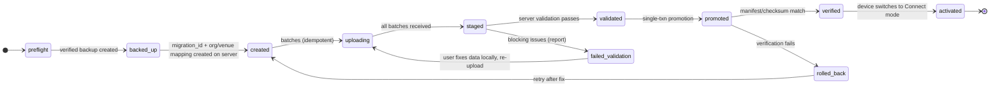

### 13.4 Steps

1. **Pre-flight** (local): integrity check, business checks, estimate of rows/documents, report.
2. **Backup:** create a verified backup archive (DB snapshot + documents) in a user-visible location; record in `backup_log`.
3. **Create:** server creates `migration_sessions(id, org, device, state, manifest_expected)` and, if new, the organization/venues from local records (same IDs).
4. **Upload:** client sends batches in dependency order (venues → halls/slots/services → customers → reservations → transactions/expenses → document metadata), each batch with `migration_id` + batch number (idempotent, retryable; small payloads for weak links). Data lands in **staging tables** (`migration_staged_records`, JSONB per entity type), not live tables.
5. **Document bytes:** uploaded in a separate resumable queue to *quarantine* storage keyed by SHA-256; missing/unreadable files are reported as **warnings**, not blockers (PRD: "available documents").
6. **Validate (server):** FK integrity within the staged set; enum/format checks; **overlap check** on confirmed reservations; ledger consistency (each reversal points to a valid entry); duplicate checks (§13.5); totals; compare against the client-computed **manifest** (per entity type: row count + SHA-256 of canonical serialization).
7. **Promote:** a single transaction per organization moves staged rows into live tables, writes the change-log entries, and records which rows were promoted (`migration_manifest`). Data volumes are small (A-03), so one transaction is feasible.
8. **Verify:** server recomputes counts/checksums from live tables and compares to the manifest; result stored.
9. **Activate:** on `verified`, the client sets its `sync_state` (`device_id`, new epoch, `last_seq` = promotion sequence), marks all rows synced at server versions, and enables Connect mode. The outbox starts empty.
10. **Aftercare:** keep the pre-migration backup; show a migration report (counts, warnings, resolved duplicates).

### 13.5 Identity mapping and duplicate detection

| Concern | Approach |
|---|---|
| Row identity | **Same UUID**; staged upsert by `(organization_id, id)` makes re-runs idempotent. |
| Same Local dataset uploaded twice (retry or second attempt) | Same `install_id` + `migration_id` ⇒ resume/replace staging; never duplicate. |
| **Same organization already has data** (another PC uploaded earlier, or a previous migration succeeded) | Detect by `install_id` mismatch and non-empty org ⇒ **refuse automatic merge**; offer "this PC is not the primary dataset" paths (§13.10). |
| Duplicate customers within the data (same normalized phone/name variants) | **Report and suggest** merges after migration; never auto-merge during migration. |
| Reservation number collisions | Local numbers preserved as official numbers if unique; collisions flagged for renumber with a visible mapping. |
| Overlapping confirmed reservations in legacy data | Imported as `needs_review` (do not hold calendar), listed in the report for owner resolution. |
| Users | Owner account created/linked at activation; employees are not migrated (Local has none) and are invited afterwards. |

### 13.6 Failure and recovery

| Failure point | Effect | Recovery |
|---|---|---|
| Crash/network loss during upload | Staging incomplete | Resume with same `migration_id`; batches idempotent. |
| Validation fails | Nothing promoted | Report; fix locally; re-upload (staging replaced). |
| Server error mid-promotion | Transaction rolled back | Retry promotion. |
| Verification mismatch after promotion | Org flagged `migration_failed` | **Rollback by manifest** (soft-delete promoted rows, restore org to pre-migration state); keep staging for diagnosis; support case; Local continues unchanged. |
| Client crashes after `verified`, before `activated` | Server done, client not switched | On restart the client queries `migration_id` status and activates idempotently. |
| User abandons | Local remains fully usable | Server staging purged after a retention window; organization can be deleted. |
| Disk problem on device | Local DB damaged | Restore the pre-migration backup; migration restarts. |

### 13.7 Post-migration data ownership

The device now holds a full copy; the server holds the authoritative copy. If Connect later expires (§14.4) the device continues in "Local mode" with its full dataset — satisfying the PRD requirement that Local data remain available.

### 13.8 Testing the migration

Fixture databases (small, large, with overlaps, with missing documents, with duplicate customers, with corrupted rows); fault injection at each state transition; idempotency (run twice, kill mid-upload); checksum parity tests. See §19.

### 13.9 Alternatives considered

- *Re-keying with an ID mapping table* — unnecessary because IDs are UUIDv7 from the start; also error-prone.
- *Directly replaying Local history as outbox ops* — requires a Local change journal (speculative cost in M1) and would route legacy data through live validation, creating confusing partial states. Rejected.
- *Importing via CSV/Excel* — useful as an escape hatch for third-party data, not for the primary path.

### 13.10 Not supported initially (and why)

- **Merging two independent Local datasets** (the owner used Local on two PCs). The architecture treats one as primary; the other can be kept archived, imported as a separate organization, or reconciled manually via export. Merging would reintroduce the conflicts Connect exists to avoid (OD-20).
- **Downgrading** Connect back into a fresh Local-only dataset with server changes — instead, export (§14.4).

---

## 14. Licensing and subscriptions

### 14.1 Principles

1. **Two independent mechanisms.** *Local license* (perpetual, verified offline) and *Connect subscription* (server-side entitlement). They share a license/subscription admin but not a runtime path.
2. **Never destroy or lock away user data.** Every restricted state still allows **view, export, and backup**.
3. **Licensing is friction for honest users, not DRM.** Offline software can be copied; the design aims at fair, recoverable licensing, not piracy-proofing (documented limitation).
4. **The license decides which *builds* are covered, not whether the owner's data may be opened.**

### 14.2 Local perpetual license

**Format.** A signed license file (Ed25519 over canonical JSON; file = `base64url(payload).base64url(signature)`), verified fully offline with public key(s) embedded in the app (supports multiple key IDs for rotation).

```json
{
  "v": 1, "kid": "k1",
  "license_id": "01934f…",
  "product": "walimapp-local",
  "licensee": { "name": "Salle Example", "reference": "ORG-0042" },
  "issued_at": "2026-11-02",
  "maintenance_until": "2027-11-02",
  "binding": { "fingerprint_hash": "b3a1…", "activation_id": "01934f…" },
  "features": ["local"],
  "limits": { "venues": null }
}
```

**The perpetual rule (maintenance model).** Each app build embeds its **release date**. A license covers every build with `build_release_date <= maintenance_until`. There is no expiry on the license itself.

| Condition | App behavior |
|---|---|
| Valid license, build covered | Full operation. |
| Valid license, **build released after `maintenance_until`** | The app **does not run schema migrations** and does not open the data for editing in this build. It shows: "This version was released after your maintenance period. Renew maintenance, or install the version you purchased/last covered." Data is untouched; **read-only view + export + backup remain available** without migration where the DB schema is readable; otherwise the older build is simply reinstalled. |
| Valid license, older covered build | Runs normally, forever. |
| No license (trial) | Time/volume-limited trial (provisional, OD-21). After trial: **read-only + export + backup**, never data loss. |
| Fingerprint mismatch | Prompt to "transfer license" (request re-issue). Provisional grace of 14 days of normal operation, then read-only + export + backup (OD-21). |

**Critical ordering rule:** the license check happens **before** any schema migration, so an uncovered newer build can never migrate (and thereby strand) a user's database. Downgrade is then just "reinstall the older covered build".

**Updates policy question (OD-23):** whether *security patches* are free for everyone (recommended where feasible) is a business decision; the architecture supports a `security_patch_floor` date in the update manifest.

**Offline activation flow**

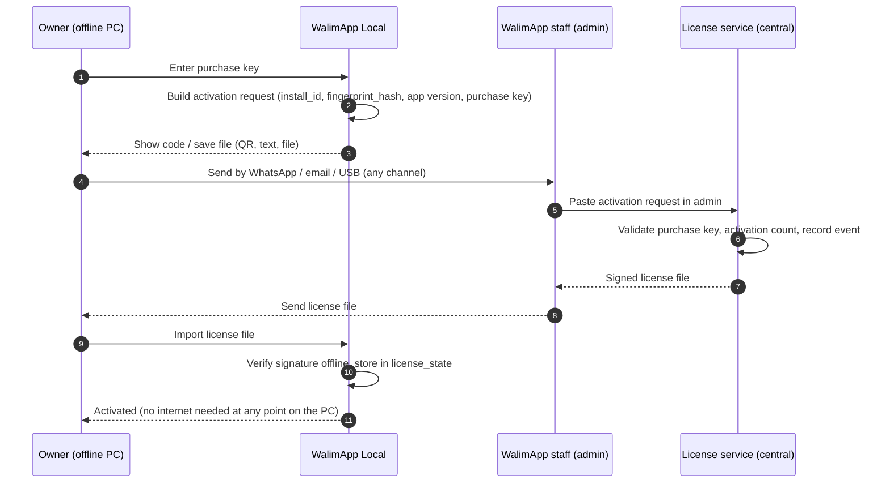

**Online activation** (optional, when internet exists) calls the same service automatically (`POST /license/activate`). Same output, same ledger.

**Device replacement / transfer.** The owner asks staff for a transfer; staff approves (limit provisional: 2 per 12 months, OD-21); the license service issues a new file for the new fingerprint and marks the old activation `replaced_by`. **Limitation:** an offline old PC cannot be remotely deactivated. Mitigation is administrative (ledger, support), not technical.

**Fingerprint.** A hash derived from stable machine attributes plus `install_id`. Because hardware/OS reinstalls change fingerprints in the real world, the fingerprint is a *soft* binding: mismatch triggers the transfer flow with the grace/read-only fallback above, never data loss.

**License recovery.** The PostgreSQL license ledger is the source of truth. A customer who lost the file proves ownership (purchase key + contact/invoice reference, policy OD-21); staff re-issue the same license. A copy of the license file is also included in every backup archive.

**Key management.** Private signing key held server-side only in the Licensing module's narrow signing service (secret store; consider a managed KMS when hosting is chosen), never in the repo, CI logs, or AI-agent context. App embeds public keys with `kid`; rotation = ship an app version trusting the new `kid`, reissue as needed. Compromise response is documented in a runbook (rotate `kid`, publish revoked-kid list in the update manifest, reissue).

### 14.3 Connect subscription

**State machine**

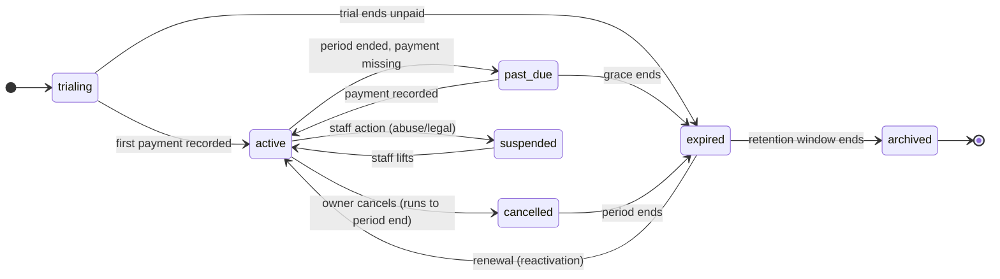

**Entitlement.** The server computes an organization's entitlement from its subscription state and returns a **signed entitlement lease** (`org_id`, `features`, `valid_until`, `grace_until`, `kid`). Devices cache it so Connect features continue offline until `valid_until + grace_until` (provisional lease 30 days, grace 14 days, OD-22). Server-side checks remain authoritative for every request.

**Plans.** `plans(code, interval monthly|annual, features, limits)`. Limits (venues, employees, storage) are product decisions (OD-12); the schema stores them as data, not code.

**Payment handling.** Provisional **[REC]:** staff record manual payments (bank transfer, CCP, cash) in `billing_payments`, which moves a subscription to `active` with a period. Online card collection in Algeria depends on local payment networks and integrators; a gateway is a separate decision (OD-12) and must be gated by the hosting/legal analysis. Invoicing/receipt legal requirements must be confirmed (OD-14).

### 14.4 Access restrictions by subscription state

| Capability | trialing / active | past_due (grace) | expired | suspended |
|---|---|---|---|---|
| Local-equivalent operation on device (all R-03 workflows) | ✅ | ✅ | ✅ | ✅ |
| Sync push/pull | ✅ | ✅ (warning banners) | ❌ (edits kept locally, not pushed) | ❌ |
| Public listing visible | ✅ | ✅ | ❌ unpublished (provisional: immediately at `expired`) | ❌ |
| New online booking requests | ✅ | ✅ | ❌ | ❌ |
| Pending requests | Normal | Normal | Auto-closed/expired with customer notice | Same |
| **Previously confirmed online bookings** | Normal | Normal | **Remain valid commitments**: retained read-only on server, present on device; customers keep their records (OD-04: customer-facing policy to be defined) | Same |
| Employee logins to server | ✅ | ✅ | ❌ (devices keep working locally with cached data) | ❌ |
| Owner export of server data | ✅ | ✅ | ✅ within read-only window (provisional 90–180 days) | ✅ (staff-mediated) |
| Reactivation | — | Pay | Pay → restore listing; devices reconcile via normal sync | Staff |

**Data export and recovery.** (1) On every device: the backup archive and a full "Export all data" (CSV/JSON + documents) at any time, in any state. (2) From the server, for owners (including after expiry within the read-only window): an export job producing a ZIP (CSV/JSON + document files) and, as a stretch goal, a Local-compatible database snapshot. (3) After `archived`, server data is purged per retention policy (OD-14); device copies are unaffected.

**Reactivation after long expiry.** Devices that continued locally may hold unsynced changes. The normal sync rules apply (conflicts are explicit). Orgs with several diverged devices may hit many conflicts — an accepted risk (RK-09); the Sync Center must make bulk resolution tolerable.

### 14.5 Upgrade paths

- **Local → Connect:** purchase/activate Connect; run §13; the Local license remains valid for the Local-mode fallback.
- **New major versions of Local:** optionally require a paid upgrade by adding `max_major` to the license (OD-23). Not in the first license format unless chosen now — adding a field later is backward compatible (the `v` field and unknown-field policy cover it).
- **Pricing changes:** no architectural impact; plans are data.

### 14.6 Server-side license/subscription administration

Filament resources for licenses, activations, plans, subscriptions, billing payments, and a license/subscription event timeline. Sensitive actions (issue, reissue, transfer, revoke-as-record, subscription override, refund note) require specific permissions, step-up re-auth, a reason, and write to `audit_logs`. "Revoke" is a **record-keeping and online-enforcement** action only; offline Local licenses cannot be revoked remotely (stated plainly to the product owner).

---

## 15. Public marketplace and SEO

### 15.1 Architecture

A module group inside the Laravel monolith: **server-rendered Blade** pages, Tailwind, small Alpine/Livewire islands for filters and the booking-request form. Separate route group and layout; locale in the path. It reads only **published projections** (`venue_listings` published revision + `listing_search`), never raw owner tables. Deployed together with the API; can move to its own subdomain without code changes.

### 15.2 URLs and localization

- Locale-prefixed paths: `/ar/…` and `/fr/…` (default decided by business, OD-24). Localized slugs, e.g.:
  - `/fr/salles-des-fetes/alger` (Wilaya landing page)
  - `/ar/قاعات-الأفراح/الجزائر`
  - `/fr/salles-des-fetes/alger/salle-example-bab-ezzouar` (venue)
  - `/fr/prestataires/decorateurs/oran` (provider category × Wilaya)
- `hreflang` links between language versions; self-canonical per URL; `x-default` set.
- Wilaya list is reference data seeded from the **official list** (verify the current official codes/names before seeding).

### 15.3 Page types

Home; Wilaya + category landing pages (indexable, content-rich); search results; venue profile; provider directory (category, Wilaya, profile); booking-request form + confirmation/status page; contact via `wa.me` link; static pages (about, terms, privacy, advertise).

### 15.4 Search and filters

Filters: Wilaya, price band, capacity, services, (date, where availability is reliable — I-4), free-text. Implementation: SQL filters + PostgreSQL FTS + `pg_trgm` + `unaccent` over `listing_search`. Arabic normalization (alef variants, tashkeel, ta marbuta) happens at index time into a normalized column; **verify** which text-search configurations the chosen PostgreSQL version provides for Arabic and French, and test relevance with real queries (spike S-5). Indexing policy: index Wilaya/category pages; `noindex,follow` for arbitrary filter combinations; canonical to the clean landing page; `rel=next/prev`-style pagination handled by crawlable links.

### 15.5 SEO technical checklist

Server-rendered HTML; sitemaps split by type with `lastmod` from publish events; `robots.txt`; schema.org JSON-LD (`EventVenue`/`LocalBusiness`, `BreadcrumbList`; **no invented ratings/reviews**); Open Graph/Twitter cards with the hero derivative; descriptive alt text from listing data; Core Web Vitals budget (LCP image served as responsive WebP/AVIF, lazy loading below the fold, no layout shift from ad slots); no duplicate content across locales without hreflang; clean 404/410 handling for unpublished listings; HTTPS + HSTS.

### 15.6 Booking request intake

1. Customer opens a venue profile, chooses date (and slot if the venue defines slots), enters name, phone (E.164 validation), optional email/message, guest count; sees consent text (Arabic/French) for processing their data (wording subject to legal confirmation).
2. Anti-abuse: rate limits, honeypot, lightweight challenge (OD-18), optional OTP **later** (needed if holds are adopted, §12.6).
3. Server validates the venue, entitlement, and (when possible) that the date is not already confirmed/blocked.
4. `booking_requests` row created (`pending_owner_approval`, `expires_at`), owner notified (in-app via sync + email).
5. Customer receives a **tokenized status link** (unguessable token, no account). Statuses: pending / approved / declined / expired. Contact details are not exposed on the status page.

### 15.7 Listing lifecycle and moderation

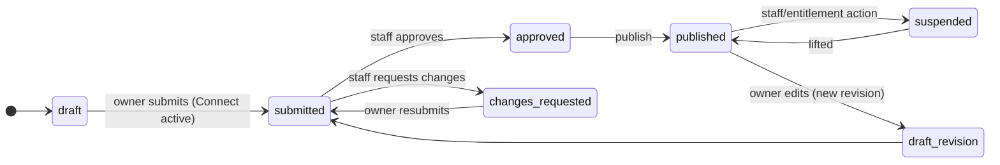

The public site always renders the **last approved published revision**; owner edits create a new revision and do not alter the public page until approved. Entitlement loss unpublishes automatically.

### 15.8 Provider directory

Curated by staff in Filament: `provider_categories`, `providers` (name, category, Wilaya(s)/service area, description per locale, photos, contact, social links, status). Public pages by category × Wilaya. Self-registration is M4; the design reserves `owner_user_id` (nullable) on providers but builds nothing for it earlier.

### 15.9 Sponsored placements

| Concern | Design |
|---|---|
| Entities | `ad_placements` (key, page type, size, max concurrent), `campaigns` (advertiser, placement, targeting: Wilaya/category optional, `starts_on`, `ends_on`, price, status: draft → approved → active → paused/ended), creative reference (media asset + link/provider). |
| Selection | Deterministic: active campaigns for the placement, within dates and targeting, ordered by a simple rotation (least recently shown / round-robin) — no auction, no ad-tech. |
| **Labeling** | Every sponsored item is visibly marked ("Sponsored" / "إعلان") and has `rel="sponsored nofollow"` on outbound links; sponsored items do **not** change organic ranking outside labeled slots. |
| **No empty ad blocks** | Placement rendering rule: **if no active campaign, the slot renders house content** (editorial promo, "list your venue/service", or featured organic content) **or collapses entirely** (no reserved empty space — a layout test verifies no layout shift). |
| Control | Staff-only creation/publication; audit logged; clear campaign records for billing. |
| Measurement | Not in the first release. If required, store **daily aggregated** counters, not per-event rows (avoid premature analytics infrastructure). |
| Legal | Local advertising/consumer rules to be confirmed (OD-14). |

### 15.10 Performance and caching

Response/fragment caching for public pages (cache store: database/file initially; tags not required), keyed per locale, invalidated by publish/approval events; availability widgets cached for tens of seconds; static assets fingerprinted with long cache headers. CDN is optional later and subject to the jurisdiction decision (OD-07).

### 15.11 Arabic/RTL and accessibility

`dir="rtl"` for Arabic with **CSS logical properties** (`margin-inline-start` etc.) so one stylesheet serves both directions; self-hosted, subsetted Arabic and Latin fonts (no third-party font CDN); digit style decision (OD-25); phone/number/date formatting per locale; bidi-safe rendering for mixed Arabic/Latin content (names, addresses); keyboard and screen-reader basics; RTL visual regression tests (§19).

### 15.12 Analytics and cookies

Prefer privacy-respecting first-party analytics (self-hosted or server-side counts) to avoid third-party data transfers until the legal review (OD-14) allows otherwise; cookie use minimal (session/CSRF/locale). Consent banner requirements to be confirmed locally.

### 15.13 Deferred

Customer accounts, reviews, messaging, saved searches, map-based search, public JSON API, payment of deposits online, provider self-service, SMS OTP.

---

## 16. Media storage and virtual tours

### 16.1 Principles

Originals are **private**; the public sees only **derivatives** via immutable URLs; private documents are served only after an authorization check via short-lived URLs; no user-supplied filenames or paths in storage keys; the server (not the client) decides type and size.

### 16.2 Storage layout

S3-compatible object storage (provider TBD) behind Laravel's filesystem abstraction, with two logical areas:

```
private/{org_id}/documents/{document_id}/{sha256}          # contracts, ID copies (never public)
private/{org_id}/media-originals/{asset_id}                 # uploaded originals
public/media/{asset_id}/{hash}/{variant}.{webp|avif|jpg}    # derivatives, immutable
quarantine/migration/{migration_id}/{sha256}                # Local→Connect staging (purged)
```

Buckets/prefixes have **no public listing**; only `public/` is world-readable (or fronted by a CDN); `private/` is never public. Server-side encryption at the provider; consider application-level encryption for identity documents (decision tied to OD-09/OD-14).

### 16.3 Upload pipeline

1. Client requests an **upload session** (declared type, size, hash) → server checks entitlement, quota, allowed types.
2. Upload: Laravel-mediated **chunked/resumable** endpoints for images and documents (typically ≤ 10–20 MB) — simplest operationally. For large panoramas (M4) use **presigned multipart** uploads straight to storage so PHP is not in the data path; requires bucket CORS and per-part retries.
3. Completion triggers a queued job: magic-byte detection, size/dimension caps, **decode test with libvips** (decompression-bomb guard via pixel limit), **strip EXIF/GPS**, re-encode, generate variants, compute hashes, write `media_assets` status `ready` / `failed`.
4. Optional malware scanning (ClamAV) for documents — decision OD-26 (resource cost on a small host).
5. Orphaned/abandoned sessions and failed uploads purged by a scheduled job.

Accepted types (initial): JPEG, PNG, WebP (images); PDF (documents); panoramas JPEG/WebP equirectangular (M4). Reject everything else server-side regardless of extension or client MIME.

### 16.4 Image optimization and delivery

Variants (provisional widths): 320, 640, 960, 1600, 2400 px in AVIF/WebP plus JPEG fallback; `srcset`/`sizes`; lazy loading; low-quality placeholder or dominant color; focal point for crops; per-listing image count and per-org storage quotas. URLs include a content hash ⇒ `Cache-Control: public, max-age=31536000, immutable`. Delivery from object storage directly at first; a CDN later if latency/egress justify it (and if jurisdiction allows).

### 16.5 Private documents

`GET …/documents/{id}/versions/{v}/download-url` → authorization (§10.4) → **short-lived signed URL** (≤ 5 min) with `Content-Disposition: attachment` for sensitive types. Downloads of identity-related documents are audit-logged. Never exposed through listing APIs or the public site. Local mode: files in a content-addressed folder under the app-data directory, with metadata in SQLite and hash verification on read and during backup.

### 16.6 Virtual tours (Milestone 4)

**Not a dependency of M3** (C-08): listings render fully without a tour (`tour_id` nullable).

| Aspect | Recommendation |
|---|---|
| Model | `tours(venue_id, status, start_scene_id)`, `tour_scenes(tour_id, panorama_asset_id, title per locale, initial_yaw/pitch)`, `tour_hotspots(scene_id, target_scene_id, yaw, pitch, label)`. A tour is data (JSON-renderable), not a file. |
| Panorama format | Equirectangular 2:1, JPEG/WebP; bounds to be set after a spike (indicatively 4096×2048 minimum and 8192×4096 maximum). |
| Processing | MVP: single downscaled equirect + thumbnails; later: **multi-resolution tiles/cube faces** via libvips for large panoramas and mobile bandwidth. |
| Viewer | Open-source panorama viewer (Pannellum or Photo Sphere Viewer class); evaluate size, RTL label support, license, mobile gyro behavior in a spike (S-6). Loaded only on pages with a tour. |
| Workflow | Owner uploads panoramas → arranges scenes → places hotspots → **preview** → submits → staff moderation → published. Same revision/moderation pattern as listings. |
| Storage planning | A tour of ~10 scenes can reach hundreds of MB including derivatives (estimate; measure in the spike). Quotas per organization are needed; storage cost is a pricing input (OD-12). |
| Fallbacks | Photo gallery remains the primary content; tour is progressive enhancement; low-bandwidth users are not forced to load it. |
| Capture | Owners supply their own panoramas; no capture app (PRD). |

### 16.7 Lifecycle

Deleting a listing/venue schedules media purge after a window (provisional 30 days); content-hash dedupe where safe; orphan reports in admin.

---

## 17. Security and privacy

> **Statement of limits.** This section documents *intended controls and open questions*. Documenting a control does not make the system secure. Security claims are only as good as the tests in §19 and an independent review (recommended before Connect sync general availability and before the marketplace launch).

### 17.1 Assets, actors, principal threats

| Asset | Threat | Primary controls |
|---|---|---|
| Tenant business data (customers, reservations, finance) | Cross-tenant access (IDOR, missing scope) | Path-scoped tenant + membership check, composite FKs, policy tests across every route/op, optional RLS (ADR-006) |
| Credentials / sessions | Brute force, token theft, refresh replay | Argon2id, throttling, device-bound short tokens, refresh rotation + reuse detection, OS-protected storage, session revocation |
| Booking integrity | Double-booking, replay, forged ops | DB exclusion constraint, idempotency, server-side validation of every sync op |
| Local data on PCs | Theft/shared PC, malware, stale employee copies | Optional DB encryption (OD-09), app lock PIN, encrypted backups, scope purge, minimal data on employee devices |
| License signing key | Compromise ⇒ forged licenses | Server-side narrow signer, key IDs, rotation runbook, no key in repo/agents |
| Uploaded files | Malware, bombs, privacy leaks (EXIF GPS), public exposure | Type/size validation, re-encode, strip EXIF, private-by-default, signed URLs |
| Staff accounts | Insider misuse, account takeover | Mandatory 2FA, granular permissions, step-up auth, audit, no impersonation |
| Public site | Spam requests, scraping, XSS | Rate limits, honeypot/challenge, output escaping, CSP |
| Backups | Leakage/loss | Encryption, off-host/off-provider copy, restore drills, access controls |
| Supply chain (incl. AI-generated code) | Malicious/vulnerable dependency, secret leakage | Lockfiles, pinned versions, review of dependency additions, secret scanning, no secrets in prompts |

### 17.2 Controls by area

**Authentication & sessions** — §10.3. Staff: 2FA, short sessions, IP/alert on unusual login.

**Authorization & tenancy** — §10.4, §9.1. Every sync op is individually authorized. Frontend/client visibility is never a boundary.

**Data in transit** — TLS everywhere, HSTS, modern ciphers; certificate pinning in the app is *not* proposed initially (operational risk on rotation) — revisit if threat model warrants.

**Data at rest** — Server: provider disk encryption + encrypted backups + object-storage SSE; application-level encryption for a few high-risk fields (e.g., identity-document files) is an open option. Device: OS account isolation by default; **optional SQLCipher** database encryption with a key protected by the OS and a **recovery key** shown once (OD-09); backups encrypted with a user passphrase (Argon2id + AES-GCM) and clearly warned that a lost passphrase is unrecoverable.

**Sensitive data minimization** — Do owners truly need to store national ID copies? If yes, treat as the highest-sensitivity class (separate permission, audit on access, optional encryption). Marketplace requesters provide only name/phone (+ optional email).

**Files** — §16. Private by default; short-lived URLs; authorization on every access.

**Admin permissions** — §10.4. Tenant-private data access is permissioned, reasoned, time-boxed, audited.

**Audit logs** — Append-only `audit_logs` (actor type/id, org, action, subject, request_id, IP, user agent, timestamp, redacted before/after summary). DB role without `UPDATE/DELETE`, trigger guard, off-host log shipping later. Logged: logins/failures, role/permission changes, license/subscription actions, exports, support access to private data, listing moderation, booking approval/cancellation, deletions, config changes. Reviewed on a schedule with alerts for high-risk actions. Tamper-evidence (hash chaining) is optional hardening, not initial.

**Credentials and licenses handling** — Secrets only in the secret store/encrypted env; DB roles separated (migrator / app / read-only reporting); license private key per §14.2; no credentials in logs or error reports; scrub PII in error tracking.

**Web hardening** — CSP, secure cookies, CSRF on web forms, output escaping, `X-Content-Type-Options`, frame protections, dependency audit in CI, upload restrictions, SSRF-safe (no server-side URL fetching of user input).

**Logging & privacy** — No personal data in application logs beyond IDs; request IDs for correlation; log retention bounded.

**Incident response (minimum)** — Written runbook: detection sources, triage, containment (revoke tokens/keys), notification obligations (**to be confirmed legally**), restore procedures, post-incident review.

**Vulnerability handling** — Security contact page; dependency updates cadence (monthly + critical out-of-band); patch policy for the Windows app (security patch distribution is a product decision, OD-23).

### 17.3 Algerian data-protection and hosting questions — **to confirm; no legal conclusions here**

Findings to anchor the review (from a law-firm guide and secondary summaries retrieved while preparing this document; **verify against the official texts and with qualified counsel**): personal-data processing in Algeria is governed by **Law No. 18-07 of 10 June 2018**, supervised by the **ANPDP** (National Authority for the Protection of Personal Data); it has been **amended and supplemented by Law No. 25-11 of 24 July 2025**; the regime includes consent requirements, a declaration/authorization system for processing, and **authorization of cross-border transfers**, with criminal penalties for some violations. Some secondary sources also mention DPO, breach-notification, and record-keeping obligations introduced or tightened by the amendment — **unverified here**.

| # | Question for counsel / ANPDP | Why it affects the architecture |
|---|---|---|
| L-1 | Must WalimApp **declare or obtain authorization** for each processing purpose (marketplace requests, owner CRM hosting, audit logs, sync)? Who files — WalimApp, owners, or both? | Possible pre-launch dependency for M3 (and M2 if hosting customer data). |
| L-2 | **Controller vs. processor roles:** is WalimApp a processor for owners' customer data (Connect) and a controller for marketplace requesters and owners' account data? | Defines contracts, consent wording, deletion/export duties, and who answers data-subject requests. |
| L-3 | **Cross-border transfer:** is hosting data (including backups) outside Algeria permitted, and under what authorization/conditions? Are there data-localization expectations for particular categories or sectors? | Decides hosting jurisdiction (OD-07) — the biggest operational fork. |
| L-4 | Are **external services** (email delivery, SMS/WhatsApp, error tracking, CDN, captcha, analytics, object storage) each a cross-border transfer needing coverage? | Limits tooling choices; may require Algerian or approved providers. |
| L-5 | Valid **consent** form and wording in Arabic/French for marketplace requests and cookies/analytics; consent records to store. | Request intake UI and data model (`consent_records`). |
| L-6 | **Sensitive data** classification (ID copies, financial data) and required safeguards. | Encryption, access controls, retention. |
| L-7 | **Retention periods** (accounting/commercial records; request contact data; audit logs) and **erasure/anonymization** rules. | §9.5 values are provisional placeholders. |
| L-8 | **Breach notification** duties and timelines. | Incident runbook, monitoring. |
| L-9 | **DPO** appointment or registration requirements for the company. | Organizational, not code, but affects launch checklist. |
| L-10 | Invoicing/receipt, advertising, and e-commerce/consumer-protection rules applicable to subscriptions, sponsored listings, and online booking intermediation. | Billing documents, labeling, terms. |
| L-11 | Whether publishing venue/provider business contact data requires specific consents or declarations. | Listing onboarding flow. |

---

## 18. Deployment and operational architecture

### 18.1 Environments

| Environment | Purpose | Data | Notes |
|---|---|---|---|
| **Local dev** | Daily development | Seeded fake data | Laravel with PostgreSQL (container or native), Flutter desktop; one-command setup script. |
| **CI** | Every push/PR | Ephemeral | Real PostgreSQL service container; Flutter tests; Windows build job. |
| **Staging** | Release candidate, restore drills, migration rehearsals, load spikes | **Anonymized/synthetic only** | Same OS/PHP/PostgreSQL versions and topology as production (smaller size). Used for the monthly backup-restore verification and Local→Connect rehearsals. |
| **Production** | Live | Real | Access limited; changes only via pipeline; secrets in the secret store. |

Feature flags: simple database/config flags (e.g., `marketplace.enabled`, `requests.enabled`) so incomplete modules can ship dark.

### 18.2 Hosting selection criteria (no provider chosen; nothing assumed purchased)

Decide **after** legal answers L-1…L-4 (OD-07). Evaluate:

| Criterion | Questions |
|---|---|
| Jurisdiction/legal | Allowed location? Data-processing agreement available? |
| Technical fit | Ubuntu LTS VM or container support; ability to install `btree_gist`/extensions; PHP 8.x, libvips/Imagick; S3-compatible storage; private networking. |
| PostgreSQL option | Managed PostgreSQL (backups/PITR handled; extension support) vs. self-managed on the VM (cheaper, more operational work). |
| Reliability | Snapshot/backup facilities, off-provider backup possible, support responsiveness. |
| Latency to Algeria | Typically acceptable from European regions; **measure** from Algerian networks before committing. |
| Cost | Predictable monthly cost, egress pricing (images!), payment method available to the business. |
| Exit | Portability: standard PostgreSQL, S3 API, no proprietary runtime. |

Candidate categories: European VPS/cloud providers, Algerian hosting/data centers, managed PaaS. **No recommendation until the legal inputs exist.** The architecture assumes only: Linux VM(s) + managed or self-run PostgreSQL + S3-compatible storage.

### 18.3 Reference topology (initial)

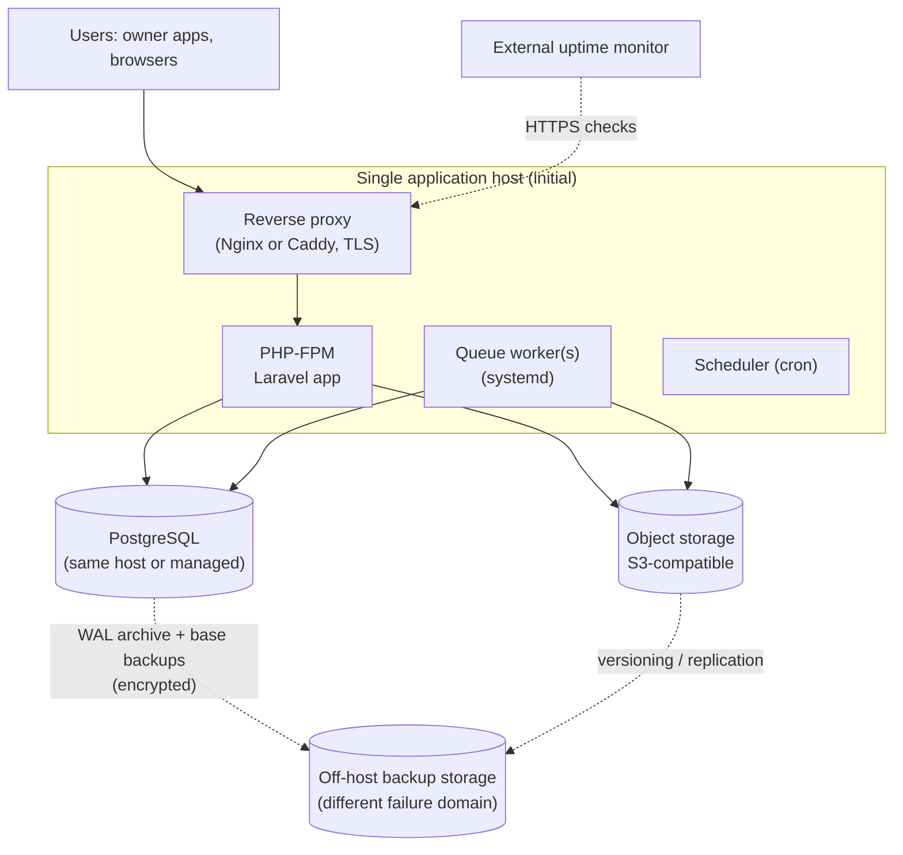

**Scale path (only when measured triggers are hit — ADR-007):** move PostgreSQL to a dedicated/managed instance → separate worker host → CDN for media → read replica for public search → Redis/queue service only if database-backed queue/cache becomes a bottleneck or real-time features require it. No Kubernetes in any foreseeable step for this product.

### 18.4 Configuration and secrets

- Configuration via environment variables; **no secrets in the repository**. Environment files are stored encrypted (SOPS or Laravel's encrypted env) and decrypted at deploy time, or provided by the host's secret facility.
- Separate secrets per environment; separate **database roles** (owner/migrator, application, read-only/reporting); the application role cannot `DROP`/`ALTER` and cannot modify audit tables.
- Secret inventory with owner and rotation interval (APP_KEY, DB passwords, mail/SMS keys, storage keys, license signing key, error-tracking DSN). Rotation procedures in runbooks; rotation tested on staging.
- CI secrets are scoped and never printed; the license private key never exists in CI.
- AI agents receive no production secrets or production data.

### 18.5 Deployment process

1. Merge to `main` → CI green → tag.
2. Build artifact (Composer install `--no-dev`, assets built once).
3. Deploy via atomic release switch (symlinked releases) using a simple tool (Deployer/GitHub Actions + SSH, or a hosted deploy service to reduce ops — choice at hosting time).
4. Run migrations with `--force` **only if** the release's migration review confirms expand/contract compatibility with the *previous* code (so rollback of code is safe).
5. Warm caches, restart workers gracefully, run smoke tests/health checks.
6. Rollback = switch back to the previous release; database changes are **forward-fixed**, not reverted, except via backup restore for disasters.
7. Destructive migrations require a fresh verified backup and a manual approval step.

### 18.6 Server backups and restoration

| Item | Approach **[REC]** | Provisional targets (confirm, OD-27) |
|---|---|---|
| PostgreSQL | Base backups + **continuous WAL archiving** (pgBackRest or WAL-G) to off-host storage; plus a daily logical dump as a secondary, independent recovery path. If using managed PostgreSQL, enable provider PITR **and** keep an independent logical dump elsewhere. | **RPO ≤ 15 min**, **RTO ≤ 4 h** |
| Object storage | Versioning + lifecycle rules; replication or periodic copy to a second provider/location (subject to L-3). | RPO ≤ 24 h |
| Secrets/config | Stored encrypted in a separate system from the host. | — |
| Encryption | Backups encrypted client-side; keys stored separately from backups. | — |
| Retention | Provisional: 14 daily, 8 weekly, 12 monthly (confirm vs. legal retention/erasure obligations — backups contain personal data). | — |
| Monitoring | Alert if the last successful backup/WAL archive is older than threshold. | — |
| **Restore drills** | Automated monthly restore to staging with integrity checks (row counts, constraint validation, application smoke test); full manual DR drill at least twice a year; every drill timed and recorded. A backup that has never been restored is not considered a backup. | — |

**Server restore consequences for sync:** restoring to a point in time rolls the change log back; clients may be *ahead* of the server. The restore runbook includes incrementing the **restore epoch** and the device reconcile flow (§11.12). This must be rehearsed before M2 is declared complete.

### 18.7 Owner-device backup architecture (Local and Connect)

- **Archive:** a single file containing a consistent database snapshot (`VACUUM INTO` / SQLite online backup, never a raw file copy of a live DB), the documents folder (content-addressed), the license file, and a **manifest** (app version, schema version, `install_id`, created time, per-file SHA-256).
- **Scheduling:** automatic daily backup (and on exit if the last backup is older than a threshold) to a user-chosen folder, with rotation (keep N). The app **warns prominently** when the last backup is older than X days or the destination is unavailable, and recommends an external drive/another PC/synced folder. Local is single-device: **the backup is the only protection against disk loss**, so backup UX is treated as a core feature, not a setting.
- **Optional encryption** with a passphrase (Argon2id + AES-GCM); explicit warning about unrecoverable loss.
- **Verification on create:** reopen the snapshot read-only, run `integrity_check`, verify hashes.
- **Restore:** validate the manifest and hashes → **take a safety backup of current data first** → restore into a temp location → verify → atomic swap → run migrations if the backup is from an older schema. Refuse backups from a **newer schema** than the app understands.
- **Connect devices:** restoring an old backup creates a divergent history; after restore the device **re-registers (new epoch)** and resnapshots from the server; unsent ops from the backup are shown for review, not auto-pushed (§11.8).
- **Cloud drive folders:** users can point backups at a OneDrive/Google Drive folder; no integration code is needed (and no data leaves the PC from the app itself).

### 18.8 Logging and monitoring

- **Logs:** structured JSON, `request_id` + `org_id` + `device_id` correlation, no personal data beyond IDs, rotated and retained 30–90 days.
- **Error tracking:** with PII scrubbing; self-hosted or jurisdiction-appropriate service (OD-07, L-4).
- **Uptime:** external checks on the public site, API health, and a synthetic "login + sync ping" check.
- **App metrics:** Laravel Pulse (database-backed) for slow queries/jobs/exceptions.
- **Alerts (initial set):** 5xx rate, p95 latency, queue backlog age, failed jobs, disk usage, DB connections, backup/WAL freshness, certificate expiry, sync error/conflict rate spike, login-failure spike, storage quota.
- **Solo-operator realism:** alerts route to phone/email with severity tiers; avoid noisy alerts; document "what to do" for each in runbooks.

### 18.9 Background jobs (database-backed queue + scheduler)

| Job | Cadence | Notes |
|---|---|---|
| Expire pending booking requests + notify | Every few minutes | Idempotent; per-request transaction |
| Subscription state transitions + reminder notices | Hourly | Computes `past_due`/`expired`/`archived` |
| Notification delivery (email, later SMS) | Continuous | Retries with backoff; delivery log |
| Media processing | On upload | Failure status surfaced |
| Search projection refresh | On publish events | Rebuildable |
| Tombstone/idempotency-ledger retention purge | Daily | Respects horizons (§9.5) |
| Orphan upload/media cleanup | Daily | |
| Backup verification/health | Daily/monthly | Feeds alerts |
| Audit/support-access expiry | Hourly | Time-boxed support access ends automatically |

### 18.10 Windows application releases

- Build on a Windows CI runner; **sign** installers and binaries with a code-signing certificate (cost, SmartScreen reputation: OD-10); publish checksums.
- Installer installs binaries only; user data lives in the per-user app-data directory and is **never** touched by upgrade/uninstall (uninstall asks explicitly whether to leave data; default: keep).
- **Update manifest** (static signed JSON, optionally served by the central site): lists builds with release date, min supported schema, security-patch floor; the app (opt-in) checks and offers only builds **covered by the license's maintenance date** (§14.2). Offline owners can install from a downloaded installer or USB.
- Channels: stable (default) and beta (opt-in). Staged rollout by percentage is possible for Connect through server-side flags; **a bad Local build cannot be recalled from offline machines**, so release gating relies on tests (§19) and a beta channel.
- Crash/diagnostic reporting: opt-in, with an exportable diagnostic bundle the user can send manually.

### 18.11 Disaster scenarios

| Scenario | Response |
|---|---|
| App host lost | Provision new host from runbook/IaC-lite scripts; restore config/secrets; point to existing managed DB/object storage; RTO target applies. |
| Database corruption/accidental deletion | PITR to just before the event on staging first; verify; promote/restore; increment restore epoch; device reconcile flow. |
| Credentials compromised | Rotate keys/passwords/tokens; revoke sessions; audit review; notification duties (L-8). |
| Ransomware on server | Immutable/off-provider backups; rebuild from clean images; restore. |
| Provider outage | Owner apps keep working offline (by design); public site degraded; failover to new provider via restore (hours, not minutes, in the initial design — accepted, A-09). |
| Jurisdiction/legal change | Portability criteria (§18.2) keep migration feasible. |
| Owner PC failure | Local: restore from the owner's backup. Connect: reinstall and resnapshot from server. |

---

## 19. Testing and quality gates

### 19.1 Principles and tooling

- Tests that depend on **constraints, locking, ranges, or transactions run against real PostgreSQL**, never SQLite.
- Shared **domain vectors** (`contracts/domain-vectors/*.json`) run in both Dart and PHP suites.
- Backend: Pest/PHPUnit (unit, feature, architecture tests). Flutter: `flutter_test` (unit/widget/golden), Drift in-memory DBs, `integration_test` on a Windows runner. Public site: HTTP feature tests + a browser tool (e.g., Playwright) for critical flows and visual/RTL checks.
- AI-generated code gets **no exemption**: a feature is not done until its listed tests exist and pass.

### 19.2 Test layers

| Layer | What it covers | Notes |
|---|---|---|
| **Unit** | Domain rules: overlap, slot arithmetic, balance, money rounding, status transitions, reservation numbering, license verification, canonical serialization/hashing | Vectors shared across Dart/PHP. |
| **Integration (backend)** | Application actions with a real DB: approve request, apply sync op, migrate promotion, subscription transitions, entitlement | Transaction boundaries asserted (partial failure leaves no partial state). |
| **API authorization** | Every route and sync command × role × tenant × venue scope (§19.3) | Auto-generated matrix; failing the matrix fails CI. |
| **Booking concurrency** | S1–S12 (§12.5) with parallel real connections | §19.4. |
| **Synchronization** | Idempotent replay, ordering, dependencies, conflicts, tombstones, cursor expiry, permission-filtered pull, scope purge, device clone/restore detection, restore-epoch reconcile | Deterministic simulator (§19.5). |
| **Migration** | SQLite schema migrations from every shipped version; server migrations; Local→Connect with fault injection | §19.6. |
| **Offline behavior** | Core Local workflows with all network blocked; Connect offline queue/resume; token expiry offline | §19.7. |
| **Database constraints** | Exclusion constraint, composite FKs, CHECKs, ledger immutability triggers, audit-table privileges, uniqueness | Constraint tests attempt illegal writes *directly via SQL* to prove the DB refuses them. |
| **Backup/restore** | Device archive round-trip; server PITR drill; restore-epoch flow | §19.8. |
| **Contract** | OpenAPI conformance both ways; syncable-schema parity (SQLite ↔ PostgreSQL ↔ manifest) | Breaking changes fail CI. |
| **Security** | Dependency audit, secret scanning, upload abuse suite, token rotation/reuse detection, rate limits, CSP/headers | Plus an independent review (recommended) before M2 GA and M3 launch. |
| **Localization/RTL** | Golden/screenshot tests Arabic RTL vs French LTR for key screens, PDFs, marketplace pages | Includes mixed Arabic/Latin strings and number formatting. |
| **Performance (smoke)** | Calendar/list queries on realistic volumes; public search; sync of N ops | Budgets set in spikes; not premature optimization. |
| **End-to-end** | §19.9 | Few, stable, high-value. |

### 19.3 Authorization testing

- **Route/command inventory test:** enumerates all registered routes, sync commands, Filament resources, and jobs that touch tenant data; fails if any lacks an authorization declaration (policy/permission/scope).
- **Matrix:** roles (owner, manager, receptionist, accountant, venue-scoped employee, suspended, other-tenant user, unauthenticated, staff roles) × resources × verbs → expected allow/deny. Cross-tenant requests must return `404`.
- **Tenant-forgery tests:** `organization_id`/`hall_id` of another tenant in bodies, query strings, and sync payloads must never be honored.
- **Composite FK tests:** direct SQL inserting cross-tenant references must fail.

### 19.4 Concurrency testing technique

Use multiple real PostgreSQL connections in parallel (separate processes or threads with a barrier): N workers attempt overlapping approvals/creations/reschedules for the same hall; assert **exactly one** confirmed row, all others receive `reservation.date_conflict`, no partial writes, and `sync_change_log` is gapless in commit order. Repeat thousands of iterations in CI nightly (not per commit). Include lock-order deadlock detection (no deadlocks under randomized interleavings).

### 19.5 Sync simulator

A deterministic, seeded harness (in the repo) that runs K simulated devices against an in-process server (real PostgreSQL), generating random operations, disconnections, duplicate deliveries, reordering of responses, device restarts, restores from stale backups, and permission changes. **Invariants checked after every run:** (1) no two confirmed overlapping reservations; (2) no confirmed reservation silently changed by a sync op; (3) ledger sums on device == server after convergence; (4) every acked op has exactly one effect; (5) all devices converge to the server state when conflicts are resolved; (6) no data of a revoked scope remains after purge; (7) pull never skips committed changes. Failing seeds are saved as regression tests.

### 19.6 Migration testing

- SQLite: fixture databases from each released schema version, including large and edge-case data; migrate → verify content hash invariants and app smoke tests; simulated crash mid-migration → automatic restore path.
- Local→Connect: fixtures (clean, large, overlapping, duplicates, missing documents, corrupted rows); **fault injection at every state transition** (§13.3); run-twice idempotency; kill-during-upload; verification mismatch → rollback by manifest; checksum parity.

### 19.7 Offline testing

CI job runs the Local build with outbound network denied (firewall rule or network namespace) executing the Local E2E suite; asserts zero outbound connection attempts at startup and during workflows. Connect: scripted airplane-mode scenarios (create/edit offline, restart app, reconnect, observe sync).

### 19.8 Backup/restore testing

Device: create backup → restore on a clean profile → compare content hashes and document hashes; restore with older schema (migrates); refuse newer schema; corrupted archive detection; encrypted backup wrong-passphrase handling. Server: automated monthly restore to staging with integrity + smoke tests; semiannual full DR drill with measured RTO/RPO.

### 19.9 Critical end-to-end workflows

| # | Workflow |
|---|---|
| E1 | Local: create venue/hall → customer → reservation → deposit → balance → generate Arabic and French contract → backup → restore on clean machine → data identical |
| E2 | Local license: offline activation → run → maintenance lapses → older covered build runs; uncovered newer build does not migrate; read-only/export available |
| E3 | Connect: login → create reservation offline → reconnect → sync accepted → second device sees it |
| E4 | Connect conflict: offline reservation vs. already-confirmed booking → conflict screen → resolution → confirmed booking untouched |
| E5 | Marketplace: customer submits request → owner notified → owner approves on app → server confirms → customer status page updates → availability reflects |
| E6 | Local→Connect migration with documents → verification report → sync works → local backup retained |
| E7 | Subscription lifecycle: active → past_due → expired (listing unpublished, sync blocked, local works) → export → renewal → reconcile |
| E8 | Staff: issue license, subscription override with step-up auth → audit entries present; restricted staff role cannot read tenant data |

### 19.10 Quality gates per milestone

A milestone is **not complete** until every item in its gate exists *and passes*.

**Milestone 1 — Local MVP**
1. Shared domain vectors implemented in Dart (overlap, balance, money, transitions, numbering, license).
2. SQLite constraints/triggers: overlap trigger tests, ledger immutability, FK enforcement.
3. Schema migration tests from every released version (at least from the first public build) + crash-mid-migration recovery.
4. Backup/restore device suite (§19.8) including documents and encrypted backups.
5. Network-blocked E2E (E1, E2) green; zero outbound traffic assertion.
6. License vectors: valid, tampered, wrong `kid`, uncovered build, expired maintenance continues, fingerprint mismatch, clock rollback.
7. Arabic/French golden tests for key screens and generated PDFs (post-spike S-1).
8. Realistic-volume smoke test (e.g., 10 years of activity) for calendar and reports within agreed budgets.
9. Installer tests: clean install, upgrade keeps data, uninstall keeps data by default; signed artifacts.
10. Pilot with real owners (business acceptance) and a documented data-safety review (crash-kill tests during writes).
11. UUIDv7/version/tombstone/ledger conventions verified against `contracts/conventions.md` (sync-readiness checklist).

**Milestone 2 — Connect foundation**
1. Authorization matrix and route inventory green; tenant-forgery and composite-FK tests.
2. Exclusion-constraint concurrency suite (§19.4) green repeatedly.
3. Sync simulator (§19.5) invariants hold across a large seeded run set; idempotency and commit-order tests.
4. Token lifecycle tests: rotation, reuse detection, revoke, offline expiry behavior.
5. Device clone/stale-restore detection and restore-epoch reconcile rehearsed.
6. Scope-purge and permission-filtered pull tests.
7. Local→Connect migration suite with fault injection (§19.6) green; E6.
8. Entitlement lease and subscription state tests; E7 (server part).
9. Contract tests: OpenAPI ↔ client; schema parity manifest check green.
10. Server backup/PITR drill executed and timed; runbooks written.
11. Dependency/secret scanning clean; **independent security review** completed or consciously waived by the owner with risks recorded.
12. Load smoke at ≥ 10× A-03 volumes.

**Milestone 3 — Public marketplace and online booking**
1. E5 green; S1–S12 green.
2. Intake abuse tests (rate limits, honeypot, replay of `Idempotency-Key`).
3. SEO verification: rendered HTML contains content without JS; hreflang/canonical/sitemap/robots checked; structured data validates; mobile performance budgets met.
4. RTL/LTR visual regression for all page types.
5. Listing moderation and revision tests; unpublish-on-expiry test.
6. Availability freshness rule tests (I-4).
7. Request expiry job and notification delivery (including provider failure/retry) tests.
8. Media pipeline abuse suite: polyglot files, decompression bombs, EXIF/GPS stripping, wrong MIME; private-document access tests.
9. Sponsored placement tests: labeling, `rel` attributes, empty-slot fallback, no layout shift.
10. Privacy: consent recorded; retention/anonymization job tested; legal checklist L-1…L-5 answered and filed.
11. External security review of the public surface completed or consciously waived.

**Milestone 4 — Expansion**
1. Panorama pipeline tests (format/size validation, processing, failure recovery) and viewer checks on representative low-end Android and desktop browsers.
2. Storage quota enforcement; tour moderation/revision tests.
3. Campaign scheduling tests (overlaps, reserved placements, date boundaries); billing record reconciliation.
4. Provider self-service authorization tests and moderation.
5. Re-run of M2/M3 regression suites.

---

## 20. Architectural decision records

All ADRs are **Proposed** until you approve them. Format: *Context → Decision → Alternatives → Consequences / revisit trigger.* They become `docs/adr/NNN-*.md` after approval.

**ADR-001 — Modular monolith in a monorepo.** *Context:* solo developer, AI agents, shared contracts. *Decision:* one Laravel app with internal modules; one repository containing backend, app, shared contracts. *Alternatives:* microservices; multi-repo. *Consequences:* simplest ops and atomic changes; requires discipline on boundaries (ADR-002). *Revisit:* a team grows or a module needs independent scaling.

**ADR-002 — Enforce module boundaries with architecture tests.** *Decision:* Pest architecture tests (or Deptrac) forbid cross-module model access and framework imports in `Domain`. *Alternatives:* convention only. *Consequences:* a small CI cost, large protection against coupling drift from AI-generated code.

**ADR-003 — One Flutter app, two editions (single binary).** *Context:* Local→Connect in-place upgrade. *Decision:* one codebase/schema; edition = entitlement; Connect code present but dormant in Local. *Alternatives:* two separate apps (upgrade requires migrating between codebases; duplicated UI). *Consequences:* simplest upgrade; Local binary includes unused code (acceptable); requires the isolation tests of §4.4.

**ADR-004 — Client-generated UUIDv7 identifiers for all syncable entities.** *Decision:* UUIDv7 (time-ordered) as primary keys, generated on the device; human numbers are separate fields. *Alternatives:* server-assigned integer IDs (impossible offline), UUIDv4 (poor index locality), ULID (non-standard in PostgreSQL). *Consequences:* offline creation, identity-preserving migration, no ID mapping; slightly larger keys.

**ADR-005 — Custom operation-based sync with per-entity conflict policy.** *Decision:* §11. *Alternatives:* PowerSync/ElectricSQL-class engines, CRDTs, hosted backends, blanket last-write-wins. *Consequences:* maximum control over booking/money semantics; more code and tests (RK-01). *Revisit:* if sync requirements broaden (e.g., collaborative text) or maintenance burden proves excessive after M2.

**ADR-006 — Tenant isolation: application-level enforcement + composite foreign keys; PostgreSQL RLS deferred.** *Decision:* §9.1, §10.4. *Alternatives:* RLS from day one; database-per-tenant; schema-per-tenant. *Consequences:* simpler operations; relies on tests (§19.3). *Revisit:* RLS adoption for the highest-value tables (reservations, ledger, documents) after M2 if it can be done without migration/pooling pain; database-per-tenant only for a regulatory or isolation requirement.

**ADR-007 — No Redis; database-backed queue/cache/rate-limits.** *Decision:* §5.2.9. *Consequences:* fewer services; modest DB load. *Revisit triggers (any):* queue wait p95 above agreed threshold, DB CPU attributable to queue/cache sustained, need for WebSockets/real-time at scale.

**ADR-008 — Authorization: custom tenant RBAC with venue scopes; Spatie permissions for platform staff only.** *Context:* tenant permissions need venue scoping and offline-aware sync filtering; staff permissions are a classic Filament use case. *Alternatives:* one mechanism for both. *Consequences:* two small mechanisms with different concerns; clear separation of tenant vs platform privilege.

**ADR-009 — All writes go through Application actions (including Filament, jobs, console).** *Consequences:* invariants, audit, and sync change-log entries cannot be bypassed by the admin panel; slightly slower admin development.

**ADR-010 — PostgreSQL exclusion constraint is the booking authority.** *Decision:* §9.2, §12.4. *Alternatives:* application-level checks with locks; advisory locks; unique (hall, date, slot) index; `SERIALIZABLE` transactions. *Consequences:* declarative, concurrency-safe, supports mixed slots and multi-day ranges; requires `btree_gist` (verify on host, RK-17). *Fallback if extension unavailable:* advisory lock per hall + transactional overlap query, plus nightly consistency check.

**ADR-011 — Separate `booking_requests` from `reservations`; `pending_sync` is a client-side overlay.** *Decision:* §3.4, §12. *Alternatives:* single table with all PRD statuses. *Consequences:* clean constraint and state machines; requires explaining the mapping to the PRD (I-1, I-2).

**ADR-012 — Public marketplace is server-rendered Laravel; no public JSON API until the customer mobile app is scheduled.** *Alternatives:* Next/Nuxt/Astro, Flutter Web. *Consequences:* one deployable, strong SEO; if the customer app arrives, add a versioned public API then.

**ADR-013 — Money as integer minor units; event times as local wall-clock; instants in UTC.** *Alternatives:* decimals/floats; timestamps with zones for events. *Consequences:* no rounding drift; correct "evening of 14 June" semantics; conversion rules in `contracts/conventions.md`.

**ADR-014 — Append-only financial ledger with reversing entries.** *Alternatives:* editable payments. *Consequences:* trustworthy history and conflict-free sync; UI needs "reverse/correct" flows.

**ADR-015 — Local license = signed offline file; coverage rule = build release date ≤ maintenance end; license check precedes schema migration.** *Alternatives:* online-only activation, per-version keys, hardware dongles. *Consequences:* satisfies the perpetual requirement; honest-user friction only; policy details in OD-21/OD-23.

**ADR-016 — Connect entitlement via signed lease with grace.** *Alternatives:* online check on every launch (breaks offline-first). *Consequences:* offline-safe; bounded staleness.

**ADR-017 — Local→Connect migration is a staged, identity-preserving, verified upload with manifest rollback.** *Alternatives:* ID re-mapping, journal replay, CSV import. *Consequences:* §13.9.

**ADR-018 — Local database: SQLite via Drift, WAL, `synchronous=FULL`, foreign keys on; encryption at rest decision deferred (OD-09).** *Consequences:* durable and consistent; encryption is a seam, not a commitment, until decided.

**ADR-019 — S3-compatible object storage; private originals, public derivatives, short-lived signed URLs for private files.** *Alternatives:* local disk only; database blobs. *Consequences:* portable across providers; some operational surface (CORS for presigned uploads).

**ADR-020 — Hosting provider deferred; selection by criteria after legal review.** *Consequences:* avoids committing before L-1…L-4 are answered; the design stays host-agnostic.

**ADR-021 — Backups: base + WAL archiving with automated restore drills; restore epoch for sync.** *Alternatives:* nightly dumps only. *Consequences:* low RPO; requires operational discipline; restore consequences for clients are designed in (§11.12).

**ADR-022 — Authentication: device-bound Sanctum tokens + custom rotating refresh tokens.** *Alternatives:* Passport, JWT, external IdP. *Consequences:* minimal moving parts; custom refresh logic must be thoroughly tested.

**ADR-023 — Sync-change-log ordering via per-organization sequence under row lock.** *Alternatives:* global sequences with snapshot horizons; logical decoding. *Consequences:* commit-ordered, simple pull semantics; per-org write serialization acceptable at A-03 scale. *Revisit:* if per-org write contention is measured.

---

## 21. Risks and mitigations

| ID | Risk | Likelihood / Impact | Mitigation | Milestone |
|---|---|---|---|---|
| RK-01 | Sync bugs cause lost/duplicated/overwritten data | Med / **Critical** | Operation-based design, idempotency, commit-ordered change log, simulator invariants (§19.5), staged rollout to pilot owners, conflict UX, recovery paths | M2 |
| RK-02 | A non-API path (admin, job, import) creates a double booking | Low / Critical | Database exclusion constraint; ADR-009; tests that bypass the app and write SQL | M1–M2 |
| RK-03 | Cross-tenant data exposure | Low–Med / Critical | Path-scoped tenant, membership checks, composite FKs, inventory + matrix tests, independent review, RLS option | M2 |
| RK-04 | Solo-developer bandwidth, scope creep, bus factor | **High** / High | Strict milestones, deferred list, runbooks, ADRs, simple infra, automated tests/backups, consider a trusted contractor for security review and ops | All |
| RK-05 | AI-generated code drifts from rules or introduces vulnerabilities | High / High | `AGENTS.md`, module/arch tests, shared vectors, review checklist on auth/money/dates/migrations, dependency review, no secrets in prompts | All |
| RK-06 | Arabic text shaping/RTL issues in PDF contracts/reports on desktop | Med / High | **Spike S-1 before M1 scope freeze**; fallback approaches (HTML→PDF alternatives, bundled shaping fonts), golden tests | M1 |
| RK-07 | Windows trust friction: SmartScreen warnings, antivirus false positives, unsigned builds | Med / Med–High | Code signing, reputation building, clear install guide, vendor AV false-positive submissions, stable publisher identity | M1 |
| RK-08 | Local data loss from disk failure/no backups | Med / **Critical** (for the owner) | Backup UX as a core feature, verified automatic backups, nagging warnings, external-drive guidance, encrypted option | M1 |
| RK-09 | Diverged devices after long Connect expiry create many conflicts | Med / Med | Sync Center bulk-resolution tools; clear reconcile UI; policy limiting divergence window (OD-22) | M2–M3 |
| RK-10 | Unresolved legal/hosting constraints block launch or force re-platforming | Med / High | Start legal review now (L-1…L-11); host-agnostic design; portability criteria | M2–M3 |
| RK-11 | License circumvention/support load of offline activation | Med / Low–Med | Soft binding, ledger, transfer policy, accept limits; low-friction recovery | M1 |
| RK-12 | Older (covered) builds cannot read newer DB schemas after the owner used a newer build | Med / Med | License check before migration; refuse downgrade; read-only/export fallback; clear messaging | M1 |
| RK-13 | Lost encryption key/passphrase makes data unrecoverable | Med (if adopted) / High | Recovery key flow; strong warnings; encryption optional/defaulted by decision OD-09 | M1 |
| RK-14 | Stale public availability harms owner/customer trust | Med / Med | Freshness window, "request" semantics, owner approval always required | M3 |
| RK-15 | Marketplace cold start (few venues, little traffic) | High / High (business) | Not architectural; consider staff-seeded listings (OD-28), SEO foundations early, Local licenses fund runway | M3 |
| RK-16 | Spam/abuse of booking requests overwhelms owners | Med / Med | Rate limits, challenge, optional OTP, owner block list later | M3 |
| RK-17 | Chosen host lacks `btree_gist` or PostgreSQL features | Low–Med / High | Verify in provider selection (S-7); documented fallback ADR-010 | M2 |
| RK-18 | Flutter Windows plugin ecosystem gaps (printing, secure storage, updaters) | Med / Med | Spikes S-1…S-3; thin adapter layers; prefer maintained plugins; budget platform-glue time | M1 |
| RK-19 | Subscription payment collection friction in Algeria | High / Med–High | Manual payment flow first; gateway as a separate decision; annual plans to reduce touchpoints | M2–M3 |
| RK-20 | Server restore rolls back data that devices already have | Low / High | Restore epoch + reconcile flow; rehearsal; PITR minimizes loss | M2 |
| RK-21 | Over-engineering the M1 foundations delays the first sellable product | Med / High | Only the listed sync-ready conventions are mandatory in M1; no sync engine, no change journal, no RLS, no public API | M1 |
| RK-22 | Employee devices retain data after access is revoked while offline | Med / Med | Scope purge on next contact, optional encryption, device policy (OD-06) | M2 |

---

## 22. Phased implementation roadmap

No calendar dates are given: solo-developer estimates without validated velocity would be misleading. Phases are ordered by dependency; each ends with the quality gate in §19.10.

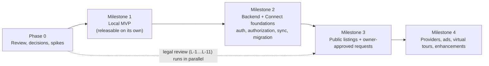

### Phase 0 — Review, decisions, spikes (before any feature work)

| Spike | Question answered | Output |
|---|---|---|
| S-1 | Can Arabic + French contracts/reports render correctly to PDF and print from Flutter on Windows? | Decision on PDF approach; golden samples |
| S-2 | Drift + SQLite on Windows: WAL, `synchronous=FULL`, backup API/`VACUUM INTO`, triggers, FK enforcement, crash-kill durability | Confirmed settings; crash test |
| S-3 | Installer/packaging, code signing, update manifest, offline install | Chosen approach; cost estimate for certificate |
| S-4 | PostgreSQL prototype: exclusion constraint + org-sequence lock + parallel approvals + commit-order pull | Validated §9.2/§11.6 under concurrency |
| S-5 | Arabic/French search configuration on target PostgreSQL version | Relevance findings; normalization approach |
| S-6 | Panorama viewer evaluation (RTL labels, mobile) — can wait until M4 planning | Library choice |
| S-7 | Host candidates: extension support, latency from Algerian networks, backup features, cost | Input to OD-07 |
| S-8 | License signing/verification prototype incl. canonical JSON and key rotation | Format frozen for M1 |

Also in Phase 0: you answer the **M1-blocking** product questions (OD-01, OD-05, OD-09, OD-11, OD-15, OD-16, OD-29, OD-31, OD-32) and approve/modify the ADRs.

### Milestone 1 — WalimApp Local MVP

**Scope [PRD]:** venues/halls; customers; reservations; calendar; deposits/balances/transactions; expenses and financial reports; contracts and documents; backup/restore; settings; offline license activation.

**Architectural foundations that must exist now (cheap now, expensive later):**

| Foundation | Why now |
|---|---|
| UUIDv7 IDs, `row_version`, `updated_at`, `deleted_at` tombstones | Identity-preserving migration; sync-readiness |
| Integer money; local wall-clock event times; calendar-date semantics | Cannot be retrofitted safely |
| Append-only ledger + reservation status history | Sync conflict-freedom; audit |
| Overlap trigger enforcing the same rule as the future server | Data integrity; clean migration |
| Domain package + shared vectors; `contracts/conventions.md` | Prevents drift between Dart and PHP |
| `install_id`, `schema_meta`, migration framework with pre-migration backup | Safe upgrades |
| Backup/restore with manifest and verification | Local's sole safety net |
| License verifier before-migration ordering; build release date embedding | Perpetual rule can't be retrofitted into shipped builds |
| i18n/RTL from the first screen | Retrofitting RTL is costly |
| Network-isolation tests | Guarantees Local independence |

**Safely deferred past M1:** sync engine, outbox, conflict UI, authentication, employees/permissions, listings, any server code (other than the license-issuance tooling needed to sell Local — a minimal internal tool or script is enough), encryption at rest (unless OD-09 says otherwise), auto-update beyond a manual check.

**Suggested vertical slices (each shippable internally):** (1) app skeleton + DB + migrations + backup; (2) venues/halls/slots/customers; (3) reservations + calendar + overlap rules; (4) transactions/ledger + balances; (5) documents + contracts; (6) expenses + reports; (7) license + installer + update check; (8) hardening, pilot, gate.

### Milestone 2 — Central backend and Connect foundations

Order: (1) Laravel skeleton, modules, CI, PostgreSQL, audit, staff panel shell; (2) identity, tenancy, memberships, permissions, devices/tokens; (3) core domain tables mirroring the Local schema + constraints; (4) sync endpoints, change log, idempotency ledger, snapshot; (5) client sync engine, outbox, Sync Center, conflict UI; (6) entitlements/subscriptions + licensing admin; (7) Local→Connect migration; (8) restore/DR rehearsal; (9) hardening + gate. **Spike S-4's prototype is promoted here, not rewritten.**

**Deferred past M2:** marketplace, booking requests, notifications beyond email stubs, listing moderation, media pipeline (except documents), advertising.

### Milestone 3 — Public listings and owner-approved requests

Order: (1) listing drafts/revisions/moderation + publish projection; (2) media pipeline for images; (3) public site shell (locale routing, layout, SEO plumbing); (4) venue pages + search/filters + Wilaya landing pages; (5) availability display with freshness rules; (6) booking-request intake, notifications, owner approval via sync, status page, expiry job; (7) curated provider directory (basic); (8) sponsored placement scaffolding only if commercially needed at launch; (9) legal checklist closed; hardening + gate.

*Possible refinement (needs your decision, OD-28):* ship **(1)–(5) and the provider directory first** as "M3a" (discovery only, with a prominent "send request" via WhatsApp) and add **owner-approved booking requests as "M3b"**, reducing launch risk.

### Milestone 4 — Expansion

Provider self-service; campaign management improvements and (if needed) aggregate ad reporting; virtual tours (panorama pipeline, scene editor, moderation); customer accounts / customer mobile app (when scheduled, adds public API); real-time channel if justified (ADR-007); further enhancements.

---

## 23. Questions requiring product-owner decisions

"Needed by" is the latest point at which the answer must exist. **Recommendation** column is provisional, not approved.

| ID | Question | Why it matters | Provisional recommendation | Needed by |
|---|---|---|---|---|
| OD-01 | **Booking granularity:** full day only, named time slots (afternoon/evening/night), or arbitrary ranges? Can one event span multiple days? | Defines the constraint, calendar UI, pricing, and public availability. | Venue-defined slots, default single full-day slot; constraint supports ranges so changing later is cheap. | **M1 schema freeze** |
| OD-02 | Do pending requests **hold** dates? | Fairness vs. abuse; constraint design. | **No hold** (Option A) + overlap indicator; owner-initiated tentative hold later (Option C). | M3 design (decide before M2 schema freeze) |
| OD-03 | Request **expiry period**, reminders, and how competing requests are presented. | Customer expectations; job design. | 72 h default, configurable; reminders at 24/48 h; "competing requests" panel. | M3 |
| OD-04 | What happens to **confirmed online bookings and pending requests** when a Connect subscription expires? What do customers see? | Legal/commercial promise to customers. | Confirmed bookings remain valid and retained read-only; pending requests auto-closed with notice. | M2 |
| OD-05 | May an **offline-created reservation** be presented to the owner as "confirmed" before the server accepts it? | Owner could promise a date that is later rejected. | Show as saved but **"not yet confirmed online"** with the pending-sync badge. | M2 |
| OD-06 | Employee device policy: number of devices per org, personal devices, remote wipe expectations. | Scope purge, encryption, tokens. | Limit devices per plan; encryption recommended on employee devices. | M2 |
| OD-07 | **Hosting jurisdiction/provider** (blocked on L-1…L-4). | Largest operational fork; backups, CDN, email, SMS choices. | Do not decide until legal answers exist; run S-7 meanwhile. | Before M2 production use |
| OD-08 | Do owners need **mobile/web access** to their data (phone app or web portal) in Connect? | Scope of M2/M4; additional client. | Defer; Windows app first, evaluate demand. | M2 planning |
| OD-09 | **Encrypt Local database at rest** by default, optionally, or not at all in M1? | Key-loss risk vs theft risk; backups; employee devices. | M1: encrypted **backups** (passphrase) + design seam; decide DB encryption before M1 freeze, recommend it for Connect employee devices. | **M1 scope freeze** |
| OD-10 | Code-signing certificate, installer format, distribution channel (website, USB, resellers). | First-run trust; updates. | Decide from spike S-3. | M1 |
| OD-11 | **Trial policy** for Local (time/volume limits, or none). | Licensing states and UX. | Time-limited trial then read-only + export + backup. | M1 |
| OD-12 | **Pricing, plan limits, payment rails** (manual transfer/CCP/cash, card via an integrator), invoices/receipts. | Subscription flows and admin tooling. | Manual first; gateway after legal/hosting decision. | M2 |
| OD-13 | Connect plan limits (venues, employees, devices, storage). | Entitlement model. | Store limits as plan data. | M2 |
| OD-14 | **Legal/regulatory items:** retention periods, controller/processor roles, consent wording, invoicing, advertising rules (L-1…L-11). | Many provisional values in this document. | Engage counsel now. | M2 (hosting), M3 (marketplace) |
| OD-15 | **Hall combinations/sub-division** (e.g., two halls sold together, divisible hall). | Overlap model changes. | Out of scope for now; model each hall independently. | M1 |
| OD-16 | **Reservation numbering format** (and per-year reset). | Offline numbering rule (§9.2). | `L-YYYY-NNNN` local; server renumbers on Connect acceptance. | M1 |
| OD-17 | **Staff access to tenant private data** policy and whether owners are notified. | Support model, privacy promises. | Permissioned, reasoned, time-boxed, audited; notify owners. | M2 |
| OD-18 | Anti-spam approach for public requests (challenge provider vs. self-built; OTP). | Cross-border concerns; abuse. | Rate limits + honeypot first; OTP if holds adopted. | M3 |
| OD-19 | Is **last-accepted-wins** (with notice and audit) acceptable for expense edits? | Conflict policy. | Yes, provisional. | M2 |
| OD-20 | Merging **two independent Local datasets** — required? | Complex; may not be needed. | Unsupported initially. | M2 |
| OD-21 | **License policies:** activations per license, transfers per year, recovery proof, mismatch grace period. | Support load, fairness. | 1 activation; 2 transfers/12 months; purchase key + contact verification; 14-day grace then read-only. | M1 |
| OD-22 | **Subscription timings:** grace length, lease length, when the listing is unpublished, read-only/export window. | Customer experience; retention law. | Grace 14 d; lease 30 d; unpublish at `expired`; export window 90–180 d. | M2 |
| OD-23 | **Update policy:** are security patches free for lapsed maintenance? Do major versions require paid upgrades (`max_major`)? | Update manifest and license format. | Free security patches where feasible; paid majors only if desired. | M1 (format) |
| OD-24 | **Default language** and any additional languages (e.g., Tamazight); URL structure. | i18n scope; SEO. | `ar` and `fr` only; choose default by audience research. | M3 (app: M1) |
| OD-25 | **Digit style** (Western vs Arabic-Indic) in Arabic UI and documents. | Documents/reports consistency. | Western digits default, configurable later. | M1 |
| OD-26 | Malware scanning for uploaded documents? | Host resources. | Optional later; validate/re-encode images first. | M3 |
| OD-27 | **RPO/RTO targets** and backup budget. | Backup architecture/cost. | RPO ≤ 15 min, RTO ≤ 4 h (provisional). | M2 |
| OD-28 | **Marketplace seeding:** may staff create listings for venues not yet on Connect? Ship discovery before booking requests (M3a/M3b)? | Cold start; consent/legal implications. | Consider M3a/M3b split; staff-seeded listings only with consent. | M3 planning |
| OD-29 | Do owners **store identity-document copies**? | Sensitivity class, encryption, retention. | Avoid by default; if needed, separate permission + audit + optional encryption. | M1 |
| OD-30 | Local multi-user: does Local need **app-lock PIN** or multiple local users? | Security expectations on shared PCs. | Single owner profile + optional PIN; no local RBAC. | M1 |
| OD-31 | **Contract templates:** who authors the Arabic/French legal templates, and can owners edit them? | Documents feature scope; legal review. | Provide a few vetted templates + owner-editable fields; legal review by counsel. | M1 |
| OD-32 | **Financial reports required** in M1 (daily cash, monthly P&L, per-reservation statement, outstanding balances, exports). | Scope and queries. | Short list agreed with pilot owners. | M1 |

---

## Appendix A — Traceability and contradiction check against the PRD

### A.1 Requirement coverage

| Requirement | Where addressed |
|---|---|
| R-01, R-02 | §4, §8, §10 |
| R-03, R-04 | §4.4, §5.2.4–5.2.5, §6.1, §9, §11.1–11.3, §18.7 |
| R-05, R-16 | §14 |
| R-06 | §4, §10, §11, §15 |
| R-07, R-09, R-10 | §11, §12 |
| R-08 | §13 |
| R-11–R-13 | §15 |
| R-14 | §16.6 |
| R-15 | §10.4, §14.6, §17 |
| R-17 | §5, §18.3 |
| R-18 | §10, §17 |
| R-19 | §15.11, §17.3, §9.5, §18 |
| R-20 | §22 |

### A.2 Tensions and contradictions found (and how they were handled)

| # | Tension | Handling |
|---|---|---|
| 1 | PRD lists `pending_sync` as a booking state, but a server cannot store "waiting to reach the server". | Client-side overlay (I-1). **Needs your confirmation.** |
| 2 | PRD: "Selecting an available date does not automatically confirm" vs. "display availability where reliable" — availability can be stale if the owner is offline. | Freshness rule + owner approval always required (I-4, §12.7). |
| 3 | PRD: Local is "one device" vs. Connect "employees" — implies multi-device only in Connect. | Consistent: Local single-device, Connect multi-device with sync; no LAN sync (non-goal). |
| 4 | PRD: "maintenance expiry must not disable the purchased version" vs. shipping new versions that require new schemas. | Build-date coverage rule + license check **before** migration; read-only/export fallback (§14.2). |
| 5 | PRD: "Existing Local data must remain available if Connect access expires" vs. server-side retention/deletion obligations. | Device holds a full copy; server read-only/export window then archive; legal confirmation (§14.4, OD-14). |
| 6 | PRD: confirmed bookings can't be silently overwritten vs. offline-created reservations that owners may already have promised. | Explicit conflict flow; local intent can lose; confirmed booking is never touched (§11.7, §12.5 S4, OD-05). |
| 7 | PRD: "no Redis…" vs. real-time notifications expectation. | Polling + email; WebSockets deferred with explicit revisit trigger (ADR-007). |
| 8 | PRD names SQLite remaining in Connect while backend is authoritative. | Device DB is a working replica + queue, never the authority for online bookings (§12.1). |
| 9 | PRD: provider directory "curated" and later self-service vs. sponsored placements. | Staff-curated now; placement rules independent of ownership (§15.8–15.9). |
| 10 | PRD wants hosting evaluated against Algerian law before choosing; brief says no VPS assumed. | Hosting left open, criteria provided (§18.2, §17.3). |

### A.3 Complexity deliberately avoided

No Kubernetes/microservices; no Redis or separate search engine; no WebSockets in M2–M3; no CRDTs; no event sourcing; no Local change journal (migration uploads a snapshot); no RLS in the first release (kept as an option); no public JSON API or customer accounts before they are needed; no per-impression ad analytics; no multi-currency; no hash-chained audit logs; no two-person approval rule; no certificate pinning; no owner web portal. Each has an explicit revisit trigger or is recorded as an open decision.

### A.4 What this document does *not* establish

It does not establish that the design is secure, performant at scale, legally compliant, or commercially viable. It does not fix prices, dates, or hosting. All "provisional" values are placeholders for your decisions and for the spikes and reviews listed in §22.
